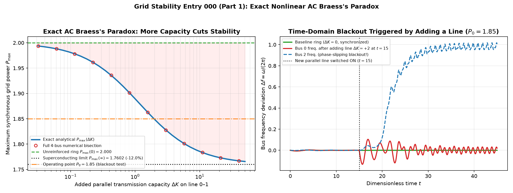
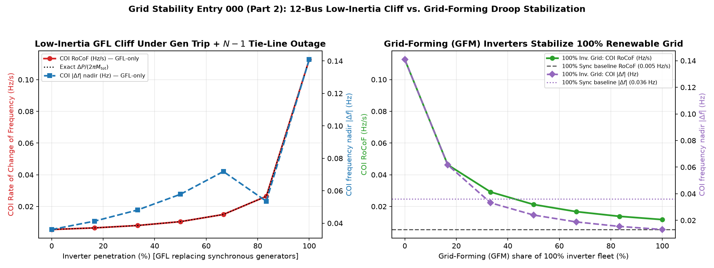

# 000 — Nonlinear AC Swing Baseline, Exact Braess's Paradox & Grid-Forming Inverter Stabilization

- **Date:** 2026-11-23
- **Status:** `verified` (hardened after Peer Review #4)
- **Verification Script:** `../sim/baseline_power_grid.py`

## 1. Target

As humanity decarbonizes electrical power grids by replacing heavy rotating synchronous generators with power-electronic solar/wind/battery inverters, two structural failure modes threaten grid stability: **(1) topological phase-frustration blackouts (Braess's paradox)** where adding transmission capacity reduces synchronous stability, and **(2) low-inertia frequency/synchronization collapse** under $N-1$ contingencies.

In this baseline session we build and verify a **coupled nonlinear AC swing-equation network solver (RK4)** cross-checked against exact energy-balance identities and exact linearized eigenmodes, and test:

1. Exact lossless Hamiltonian ($D = 0$) and damped energy-balance ($D > 0$) verification + slowest inter-area eigenmode verification on a 6-bus meshed AC grid.
2. An **exact closed-form analytical proof and time-domain blackout demonstration of AC Braess's Paradox** on a 4-bus ring.
3. A **12-bus two-area meshed grid** comparing Grid-Following (GFL) inverter replacement vs. Grid-Forming (GFM) low-pass-filtered droop inverters under a combined generator-trip ($\Delta P = 0.85$) + $N-1$ inter-area tie-line outage—including the counterfactual **Bus 0 (Area A) vs. Bus 6 (Area B)** single-GFM placement test.

## 2. The Math & Assumptions

### Nonlinear AC Swing Equations & Exact GFM Droop Equivalence

On an $N$-bus lossless AC transmission network with line susceptance capacities $K_{ij} = K_{ji} \ge 0$ and power injections $P_i$:

$$M_i \ddot{\theta}_i + D_i \dot{\theta}_i = P_i - \sum_{j=1}^N K_{ij}\sin(\theta_i - \theta_j)$$

- **Normalized Units Note:** All parameters ($M_i, D_i, K_{ij}, P_i$) are in dimensionless per-unit scaling; frequency values $\Delta f = \omega / (2\pi)$ and RoCoF $\dot{\omega}/(2\pi)$ are reported in normalized cycles per unit time (not calibrated to physical 50/60 Hz grid inertia constants), so **relative ratios across configurations** are the physically meaningful quantities.
- **Exact Grid-Forming (GFM) Droop Equivalence (D'Arco & Suul 2014):** Under constant active-power setpoint $P_{\text{set},i}$ and ideal power measurement, a GFM inverter with low-pass filter $\tau_f \dot{\tilde{P}}_i = P_{e,i} - \tilde{P}_i$ and frequency droop $\dot{\theta}_i = -k_{p,i}(\tilde{P}_i - P_{\text{set},i})$ obeys the swing equation identically with $M_{\text{GFM},i} = \tau_f / k_{p,i}$ and $D_{\text{GFM},i} = 1 / k_{p,i}$ (here $M_{\text{GFM}} = 1.8, D_{\text{GFM}} = 1.6 \implies \tau_f = 1.125, k_p = 0.625$).
- **Exact Energy-Balance Identity:** Defining $\mathcal{H}(\theta, \omega) = \frac{1}{2}\sum_i M_i\omega_i^2 - \sum_i P_i\theta_i - \frac{1}{2}\sum_{i,j} K_{ij}\cos(\theta_i - \theta_j)$ yields $\frac{d\mathcal{H}}{dt} = -\sum_i D_i \omega_i^2 \le 0$ for any nonlinear trajectory. When $\sum_i P_i = 0$ (Experiment 1), $\mathcal{H}$ is a true Lyapunov function around stable equilibria; after an unbalanced generation trip ($\sum_i P_i = -\Delta P \neq 0$, Experiment 3), $\mathcal{H}$ decreases linearly with uniform drift and serves purely as an exact RK4 energy-bookkeeping identity.
- **Exact Center-of-Inertia (COI) Laws:** Under a sudden net power imbalance $-\Delta P$, $\dot{f}_{\text{COI}}(0^+) = -\frac{\Delta P}{2\pi M_{\text{tot}}}$ and steady-state synchronized frequency drop is $\Delta f_{\text{ss}} = -\frac{\Delta P}{2\pi D_{\text{tot}}}$.
- **Exact 4-Bus AC Braess Capacity Law:** On a 4-bus ring `0-1-2-3-0` with $P = (+P_0, -P_0, +P_0, -P_0)$ and reinforced line $K_{01} = 1 + \Delta K$ ($K_{12} = K_{23} = K_{30} = 1$), Kirchhoff's current law directly forces $F_{23} = F_{01} \implies \sin\gamma = (1 + \Delta K)\sin\alpha$ and $F_{03} = F_{21}$; on the principal synchronized branch ($\beta_{03} = \beta_{21} = \beta$), Kirchhoff's loop constraint gives $\beta = \frac{1}{2}(\alpha + \gamma)$, yielding:
  $$P_0(\gamma) = \sin\gamma + \sin\!\left(\frac{\gamma + \arcsin\big(\sin\gamma / (1 + \Delta K)\big)}{2}\right)$$
  For $\Delta K = 0$, $P_{\max}(0) = 2.000$. As $\Delta K \to \infty$ ($\alpha \to 0$), maximizing $\sin\gamma + \sin(\gamma/2)$ gives $\cos(\gamma^*/2) = \frac{-1 + \sqrt{33}}{8}$ ($\gamma^* = 1.8719 > \pi/2$) and **$P_{\max}(\infty) = 1.760173$** (**$-11.99\%$** capacity loss!). Independent Peer Review #4 checks confirmed that the fold $dP_0/d\gamma = 0$ coincides with the Fiedler stability crossing $\lambda_2(L) = 0$ to $5.8\times 10^{-10}\,\text{rad}$ across all $\Delta K$ (no early destabilization for $\gamma > \pi/2$) and 3000 random multi-starts found zero stable equilibria above $P_{\max}$.

### Intentional Simplifications
- Lossless reactive lines ($R/X = 0$, constant $|V_i| = 1$); omits voltage collapse, reactive power $Q\text{--}V$ coupling, and inverter current limits.
- GFL inverters are represented within the swing framework with minimal residual inertia/damping ($M_{\text{GFL}} = 0.08, D_{\text{GFL}} = 0.04$) rather than explicit second-order PLL dynamics.
- Note that the angle-spread synchronization heuristic (`spread < pi`) is well-calibrated for this 12-bus network (synchronized spreads are $\sim 1.7\text{--}2.9\,\text{rad}$), though long radial chains can exceed $\pi$ stably.

## 3. The Verification

Reproduce from the repo root:

```bash
uv run python grid-stability/sim/baseline_power_grid.py
```

### Experiment 1 — Exact Energy Conservation & Linear Eigenmode Check (6-Bus Meshed Grid, $\sum P_i = 0$)

- **Lossless Hamiltonian conservation ($D = 0$, finite amplitude `0.25 rad`):** relative error $\mathbf{5.05\times 10^{-12}}$.
- **Damped Lyapunov energy balance ($D > 0$, finite amplitude `0.30 rad`):** relative error $\mathbf{9.90\times 10^{-8}}$.
- **Slowest inter-area oscillatory eigenmode:** exact Jacobian $s = -0.094722 + 1.603813i$ vs. nonlinear RK4 damped-sinusoid LSQ fit $-0.094599 + 1.603787i$ ($|\Delta\alpha| = 1.2\times 10^{-4}$, $|\Delta\omega| = 2.6\times 10^{-5}$).

### Experiment 2 — Exact Nonlinear AC Braess's Paradox (4-Bus Ring)

- Warm-started full 4-bus numerical equilibrium + Fiedler stability bisection matches exact analytical $P_{\max}(\Delta K)$ across 36 values of $\Delta K \in [0, 50]$:
  - $\Delta K = 0$: $P_{\max} = \mathbf{2.000000}$
  - $\Delta K = 1.0$ (doubling line `0-1`): $P_{\max} = \mathbf{1.889389}$ (**$-5.53\%$**)
  - $\Delta K \to \infty$: $P_{\max} = \mathbf{1.760173}$ (**$-11.99\%$**)
- **Time-domain blackout at $P_0 = 1.85$** (just above $P_{\max}(\Delta K = 2) = 1.84879$, thin $0.07\%$ overload margin): unreinforced ring settles cleanly ($\omega_{\text{rms}} = 4.0\times 10^{-5}$); switching on parallel line $\Delta K = +2.0$ at $t = 15$ immediately destroys synchrony ($\omega_{\text{rms}} = 4.47\,\text{rad/s}$, angle spread $277.3\,\text{rad}$).



### Experiment 3 — 12-Bus Two-Area Grid: Low-Inertia GFL Cliff vs. GFM Stabilization ($\Delta P = 0.85$ Gen Trip in Area B + Tie-Line Outage)

| Configuration | Synced? | Normalized COI RoCoF (cycles/$t^2$) | Normalized COI Nadir $|\Delta f|$ | Max Angle Spread (rad) | Outcome |
| :--- | :---: | :---: | :---: | :---: | :--- |
| $100\%$ Synchronous (`6 Sync`) | `True` | $0.005$ | $0.036$ | $2.20$ | Stable baseline |
| $50\%$ GFL (`3 Sync, 3 GFL`) | `True` | $0.010$ | $0.058$ | $2.85$ | $2.0\times$ RoCoF, $1.6\times$ nadir |
| **$83.3\%$ GFL (`1 Sync in A, 5 GFL`)** | **`False`** | $0.026$ | N/A *(pole slip)* | **$77.60$** | **First-swing inter-area blackout** |
| $100\%$ GFL (`0 Sync, 6 GFL`) | `True` | **$0.113$** | **$0.141$** | $2.16$ | **$22.6\times$ RoCoF, $3.9\times$ nadir plunge** |
| **$100\%$ Inv, $16.7\%$ GFM (`1 GFM at Bus 0, Area A`)** | **`False`** | $0.046$ | N/A *(pole slip)* | **$78.23$** | **Thin-margin first-swing tie blackout!** |
| **$100\%$ Inv, $16.7\%$ GFM (`1 GFM at Bus 6, Area B`)** | **`True`** | $0.046$ | $0.062$ | **$1.73$** | **Counterfactual: Area B survives cleanly!** |
| **$100\%$ Inv, $33.3\%$ GFM (`1 in A, 1 in B`)** | **`True`** | $0.029$ | **$0.033$** | **$2.02$** | **Restores synchrony & cuts RoCoF $3.9\times$** |
| **$100\%$ Inv, $100\%$ GFM (`6 GFM`)** | **`True`** | **$0.012$** | **$0.013$** | **$1.76^*$** | **$9.4\times$ lower RoCoF vs GFL; $2.77\times$ nadir via assumed $D_{\text{GFM}}/D_{\text{sync}}$** |

*\*Genuine transient RK4 timestep convergence check on $100\%$ GFM ($t_{\text{end}} = 35$): first-swing peak tie-line angle $|\theta_2 - \theta_6|$ at $\Delta t = 0.0025$ is `0.97658735` vs. $\Delta t = 0.00125$ `0.97658735` ($|\Delta| = 1.01\times 10^{-10}$).*



Full metrics: [`../results/baseline_metrics.json`](../results/baseline_metrics.json).

## 4. Verdict & Dead Ends

- **What broke / unexpected grid traps uncovered:**
  - **Exact AC Braess's Paradox:** Adding parallel capacity to a single line in a stressed loop creates Kirchhoff phase frustration that cuts global synchronous capacity by up to **$-11.99\%$** ($P_{\max}: 2.000 \to 1.760$, verified exact saddle-node = Fiedler boundary).
  - **Asymmetric GFM Placement First-Swing Blackout:** Placing a single GFM inverter at Bus 0 in exporting Area A (`16.7%` GFM) concentrates **$81.0\%$** of total grid primary droop in Area A ($66.2\%$ for 1 Sync in Area A). Under an Area B generator trip ($\Delta P = 0.85$) + tie-line outage, post-fault static tie flow reaches $1.588$ against capacity $1.600$ ($98\%$ of static limit $0.864$), causing a **thin-margin first-swing transient pole-slip blackout** (`spread = 78.2 rad`)! Moving that exact same single GFM inverter to **Bus 6 in importing Area B** drops static tie flow to $1.062$ and survives cleanly (`spread = 1.73 rad`)!
- **What worked:**
  - **Balanced multi-area or import-side GFM deployment:** Eliminates the inter-area blackout and cuts COI RoCoF by $3.9\times$ ($33.3\%$ GFM) to $9.4\times$ ($100\%$ GFM) vs. $100\%$ GFL; the $2.77\times$ tighter steady-state frequency nadir of $100\%$ GFM vs. $100\%$ Sync reflects directly the assumed primary droop ratio $D_{\text{tot}}(\text{GFM})/D_{\text{tot}}(\text{Sync}) = 10.32/3.72$ (faster inverter primary droop than mechanical governors).
- **Next hypothesis tested in [`001`](001-gfm-placement-and-saturation.md):** Quantify fixed-budget spatial GFM placement across all 5 strategies (linear exact $H_2$ vs. horizon-robust nonlinear $N-1$ survival) and test how primary-droop active-power saturation changes the optimal allocation.
