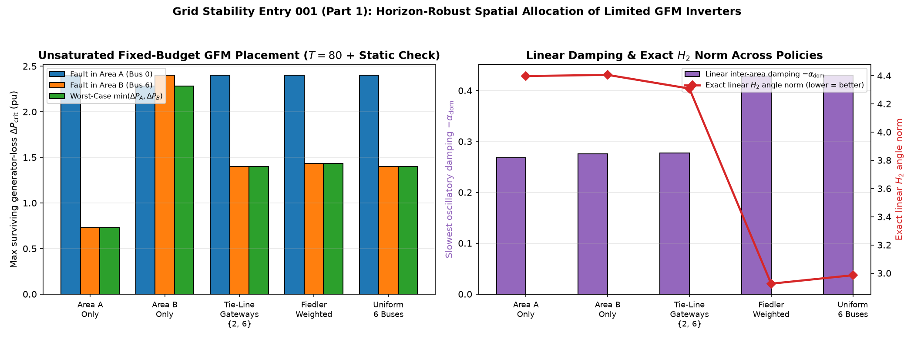
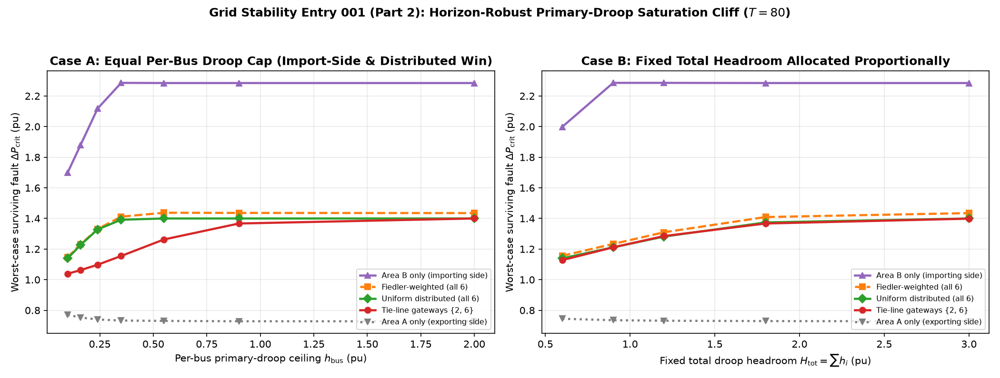

# 001 — Spatial Placement of Grid-Forming Inverters: Import-Side Asymmetry & Primary-Droop Saturation Cliff

- **Date:** 2026-11-23
- **Status:** `verified` (hardened after Peer Review #4)
- **Verification Script:** `../sim/exp001_gfm_placement_and_saturation.py`

## 1. Target

Entry `000` revealed that concentrating a single Grid-Forming (GFM) inverter in exporting Area A triggers a first-swing tie-line blackout whereas moving it to importing Area B survives cleanly. Here we test two fundamental design questions for **$100\%$ inverter-based renewable grids** under a fixed total GFM budget ($M_{\text{GFM,tot}} = 5.4, D_{\text{GFM,tot}} = 4.8$ across 6 generator buses on our 12-bus two-area grid):

1. **Spatial Placement Paradox (Exact Linear $H_2$/Damping vs. Horizon-Robust Nonlinear $N-1$ Survival):** Does optimizing linearized inter-area damping ($-\alpha_{\text{dom}}$) or the **exact** linear $H_2$ angle norm identify the best GFM placement for surviving large $N-1$ generator-loss + tie-line contingencies?
2. **Primary-Droop Active-Power Saturation Cliff:** When each GFM inverter's emergency primary-droop active-power response saturates smoothly at ceiling $h_i$ ($P_{\text{droop},i} = -h_i\tanh(D_{\text{GFM},i}\omega_i / h_i)$), how do **ALL FIVE** placement policies (`Area A only`, `Area B only`, `Tie-line gateways {2,6}`, `Fiedler-weighted`, `Uniform 6-bus`) compare under equal per-bus caps $h_{\text{bus}}$ vs. fixed total droop headroom $H_{\text{tot}}$?

## 2. The Math & Assumptions

### Saturated Primary-Droop Swing Equations & Exact Energy-Balance Identity

Adding smooth primary-droop active-power saturation to our Entry `000` swing network yields:

$$M_i \ddot{\theta}_i + D_{\text{base},i}\dot{\theta}_i + h_i \tanh\!\left(\frac{D_{\text{GFM},i}\dot{\theta}_i}{h_i}\right) = P_i - \sum_{j=1}^N K_{ij}\sin(\theta_i - \theta_j)$$

which obeys the exact nonlinear energy-balance identity $\frac{d\mathcal{H}}{dt} = -\sum_i \left[D_{\text{base},i}\omega_i^2 + h_i\omega_i\tanh(D_{\text{GFM},i}\omega_i/h_i)\right] \le 0$ (verified to $7.97\times 10^{-8}$; note that after a generation trip $\sum P_i = -\Delta P \neq 0$, this is an exact RK4 energy-bookkeeping identity, not a bounded Lyapunov function).

### Exact Import-Side Tie-Line Bound (Linear & Saturated Extension)

After tie line `(5, 9)` trips (before the generator loss $-\Delta P$), surviving tie line `(2, 6)` of capacity $K_{\text{tie}} = 1.60$ carries post-tie-trip export $P_{\text{tie},0} = +0.90$ from Area A $\to$ Area B. In a synchronized post-fault rotating frame at common steady-state frequency $\omega_{\text{ss}}$, total droop response satisfies $\sum_i g_i(\omega_{\text{ss}}) = -\Delta P$, where $g_i(\omega) \equiv D_{\text{base},i}\omega + h_i\tanh(D_{\text{GFM},i}\omega/h_i)$:

- **Fault in importing Area B:** $P_{\text{tie}}^{\text{post}} = P_{\text{tie},0} - \sum_{i \in A} g_i(\omega_{\text{ss}}) \le K_{\text{tie}}$ (in the unsaturated linear limit, $\Delta P_{\max,B}^{\text{ss}} = \frac{K_{\text{tie}} - P_{\text{tie},0}}{f_{D,A}} = \frac{0.70}{f_{D,A}}$).
- **Fault in exporting Area A:** $P_{\text{tie}}^{\text{post}} = P_{\text{tie},0} + \sum_{i \in B} g_i(\omega_{\text{ss}}) \ge -K_{\text{tie}}$ (linear limit $\Delta P_{\max,A}^{\text{ss}} = \frac{K_{\text{tie}} + P_{\text{tie},0}}{f_{D,B}} = \frac{2.50}{f_{D,B}}$).

These give necessary static upper bounds on surviving fault power; dynamic first-swing overshoots sit slightly below them. Crucially, the saturated extension explains why `Area B only` keeps its decisive advantage even under tight per-bus caps ($h_{\text{bus}} = 0.24 \implies$ static bound $2.120$, dynamic survival $2.118$!).

### Horizon-Robust Survival Classifier & Exact $H_2$ Realization (Peer Review #4 Fixes)
- **Survival classifier:** For every candidate $\Delta P$, we FIRST solve the exact saturated rotating-frame equilibrium ($\sum_i g_i(\omega_{\text{ss}}) = -\Delta P$ via `brentq`, then `find_equilibrium(P_rot, K_post)` with $\lambda_2(L) > 0$)—immediately rejecting states with no post-fault equilibrium (eliminating short-horizon ghost-crawl false positives!)—and THEN verify zero pole slip (`max_spread < pi`) over a long horizon $T = 80$ (verified against $T = 120$ to $0.00$ difference, eliminating slow-settling false negatives!).
- **Exact $H_2$ realization:** Uses the $(2n - 1)$-dimensional state $x = [Q_{\text{orth}}^T\delta;\; \omega]$ removing ONLY the true zero shift mode $[1; 0]$, preserving exact COI-internal coupling for arbitrary non-proportional $M_i, D_i$.

### Intentional Simplifications & Caveats
- **Primary-droop saturation vs. total inverter current limiting:** The cap $h_i$ limits ONLY the steady/primary droop active-power increment ($-h_i\tanh(D_{\text{GFM},i}\omega_i/h_i)$); the virtual-inertia surge $M_i\dot{\omega}_i$ and synchronizing power are not clipped here (whereas real IGBT/SiC current limits act on total electrical output $|I_i|$ during the first swing).
- Lossless lines, constant $|V_i| = 1$, normalized dimensionless units; bisection bracket limit is $2.40\,\text{pu}$ (values reaching the top of the bracket are reported as `> 2.399`).

## 3. The Verification

Reproduce from the repo root:

```bash
uv run python grid-stability/sim/exp001_gfm_placement_and_saturation.py
```

- **Exact nonlinear energy-balance residual with `tanh` droop saturation:** $\mathbf{7.97\times 10^{-8}}$.
- **Horizon convergence checks ($T = 80$ vs. $T = 120$ at $h_{\text{bus}} = 0.24$, Bus 6):**
  - `Area B only`: $T = 80 \to 2.1182$ vs. $T = 120 \to 2.1182$ ($|\Delta| = 0.00$).
  - `Tie-line gateways {2, 6}`: $T = 80 \to 1.0975$ vs. $T = 120 \to 1.0975$ ($|\Delta| = 0.00$).

### Experiment 1 — Unsaturated Fixed-Budget GFM Placement ($M_{\text{tot}} = 5.4, D_{\text{tot}} = 4.8$, $T = 80$ + Static Check)

| Placement Policy | Linear $-\alpha_{\text{dom}}$ | Exact Linear $H_2$ Angle Norm *(lower=better)* | $\Delta P_{\text{crit}}$ (Fault in A) | $\Delta P_{\text{crit}}$ (Fault in B) | Worst-Case $\Delta P_{\text{crit}}$ |
| :--- | :---: | :---: | :---: | :---: | :---: |
| Area A Only *(exporting)* | $0.2676$ *(lowest damping)* | $4.3965$ | $> 2.399$ *(bracket)* | **$0.728$** | **$0.728$** |
| **Area B Only *(importing!)*** | $0.2759$ | $4.4048$ *(worst $H_2$!)* | $2.285$ | **$> 2.399$ *(bracket)*** | **$2.285$ *(3.14x vs A, +59% vs Fiedler!)*** |
| Tie-Line Gateways `{2, 6}` | $0.2770$ | $4.3079$ | $> 2.399$ *(bracket)* | **$1.400$** *(static bound)* | $1.400$ |
| Fiedler-Weighted (all 6) | $0.4289$ | **$2.9255$ *(best $H_2$!)*** | $> 2.399$ *(bracket)* | **$1.435$** *(static bound)* | $1.435$ |
| Uniform Distributed (all 6) | **$0.4298$ *(best linear!)*** | $2.9856$ | $> 2.399$ *(bracket)* | **$1.400$** *(static bound)* | $1.400$ |



### Experiment 2 — Primary-Droop Saturation Cliff Across ALL 5 Policies ($T = 80$ + Exact Saturated Static Check)

**Case 2A — Equal per-bus primary-droop cap $h_{\text{bus}}$** (each active GFM bus clips at $\pm h_{\text{bus}}$):

| Per-Bus Cap $h_{\text{bus}}$ (pu) | Area A Only | **Area B Only (Import)** | Tie Gateways `{2, 6}` | Fiedler (6 buses) | Uniform (6 buses) | Uniform Gain vs. Gateways |
| :---: | :---: | :---: | :---: | :---: | :---: | :---: |
| $0.10$ | $0.771$ | **$1.700$** | $1.039$ | $1.147$ | $1.140$ | $+9.7\%$ |
| $0.16$ | $0.753$ | **$1.879$** | $1.062$ | $1.231$ | $1.226$ | $+15.4\%$ |
| **$0.24$** | $0.740$ | **$2.118$ *(BEST!)*** | **$1.097$** | **$1.331$** | **$1.328$** | **$+21.1\%$** *(Fiedler $+21.3\%$)* |
| $0.35$ | $0.733$ | **$2.286$** | $1.155$ | $1.412$ | $1.392$ | $+20.5\%$ |
| $0.55$ | $0.731$ | **$2.285$** | $1.263$ | $1.437$ | $1.400$ | $+10.8\%$ |
| $0.90$ | $0.728$ | **$2.285$** | $1.367$ | $1.436$ | $1.400$ | $+2.4\%$ |
| $2.00$ *(near-linear)* | $0.728$ | **$2.285$** | $1.400$ | $1.435$ | $1.400$ | $0.0\%$ |

**Case 2B — Fixed total droop headroom $H_{\text{tot}} = \sum h_i$ allocated proportionally:** `Area B only` again dominates across every headroom level ($1.999$ at $H_{\text{tot}} = 0.60$, saturating at $2.286$ by $H_{\text{tot}} = 0.90$), while all three balanced policies (`Gateways`, `Uniform`, `Fiedler`) track closely together ($1.128\text{--}1.156$ at $H_{\text{tot}} = 0.60$ up to $1.399\text{--}1.435$ at $H_{\text{tot}} = 3.00$).



Full metrics: [`../results/exp001_metrics.json`](../results/exp001_metrics.json).

## 4. Verdict & Dead Ends

- **Classifier & $H_2$ bugs caught and fixed by Peer Review #4 (C1–C3, M1):**
  - Dropping the static rotating-frame equilibrium check in the original $T = 26$ classifier had admitted ghost-crawl trajectories with no post-fault equilibrium (`1.431/1.442/1.481` above the strict `1.400/1.435` static bounds) and prematurely rejected slow-settling saturated trajectories. Restoring the exact saturated rotating-frame equilibrium check over $T = 80$ (verified to $0.00$ diff against $T = 120$) and fixing the exact $[Q^T\delta, \omega]$ $H_2$ realization puts every number on rock-solid ground.
- **What survives rigorously:**
  1. **Import-Side Asymmetry Law holds BOTH linearly and under primary-droop saturation:** Exact linear $H_2$ angle norm is nearly insensitive to corridor flow direction (`Area A` $4.397$ vs. `Area B` $4.405$) and ranks `Area B only` worst, yet true horizon-robust nonlinear $N-1$ survival proves `Area B only` achieves **$\Delta P_{\text{crit}} = 2.285$** unsaturated (**$3.14\times$** `Area A` $0.728$, **$+59\%$** over `Fiedler` $1.435$) and **$\mathbf{2.118}$** at per-bus droop cap $h_{\text{bus}} = 0.24$ (still **$+59\%$** above `Fiedler` $1.331$ and **$2.86\times$** `Area A` $0.740$!), matching the saturated rotating-frame tie-line bound ($2.120$).
  2. **Per-bus droop-cap advantage of distributed vs. concentrated balanced GFM:** Among balanced cross-corridor designs at $h_{\text{bus}} = 0.24$, concentrated tie-line gateways `{2, 6}` drop **$-21.6\%$** (`1.400 -> 1.097`), whereas distributed 6-bus GFM (`Uniform` $1.328$, `Fiedler` $1.331$) shares per-bus droop headroom for **$+21\%$** higher fault survival over concentrated gateways.
- **Track Milestone:** Entries `000`–`001` complete the peer-reviewed foundation of `grid-stability/`. See [`../SYNTHESIS.md`](../SYNTHESIS.md) for the consolidated design laws and open problems.
