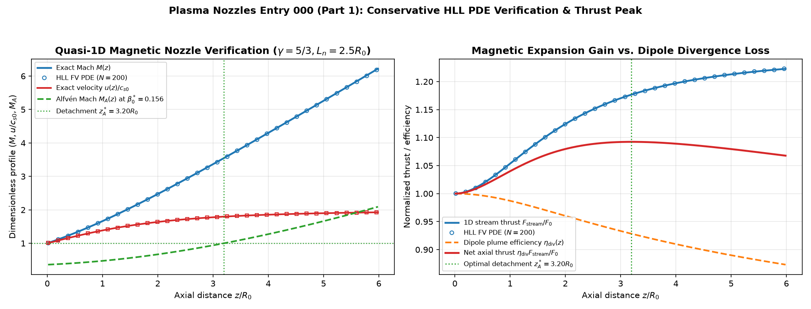
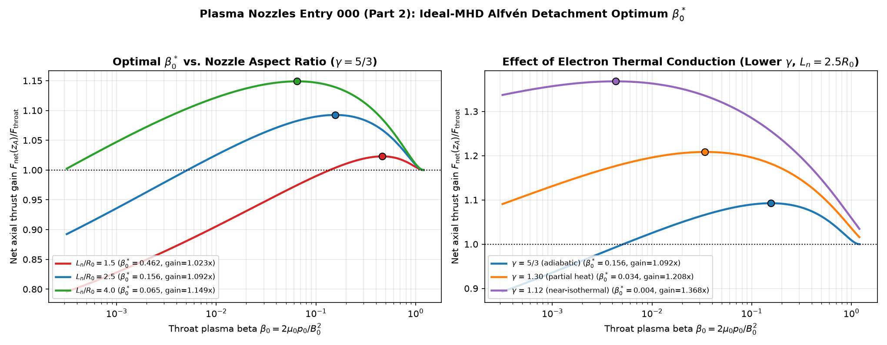

# 000 — Quasi-1D Paraxial Magnetic Nozzle Baseline & Ideal-MHD Alfvén Detachment Optimum

- **Date:** 2026-11-23
- **Status:** `verified`
- **Verification Script:** `../sim/baseline_magnetic_nozzle.py`

## 1. Target

Establish a verified fluid/paraxial magnetic nozzle baseline before adding resistive cross-field detachment or 2D MHD instabilities (such as Kelvin–Helmholtz shear layers and magnetic-field self-stretching):

1. Cross-verify an unsteady conservative 2nd-order HLL finite-volume Euler solver against the exact analytical supersonic Mach-area solution and exact axial thrust balance.
2. Quantify the **Ideal-MHD Alfvén Detachment vs. Dipole Plume Divergence trade-off**: find the optimal throat plasma beta $\beta_0^* = 2\mu_0 p_0 / B_0^2$ that maximizes net axial magnetic thrust across nozzle aspect ratios ($L_n/R_0$) and electron polytropic indices ($\gamma$).

## 2. The Math & Assumptions

### Governing Quasi-1D Conservative Equations & Exact Invariants
Consider an axisymmetric solenoid/dipole-like magnetic flux tube conserving magnetic flux $B(z) A(z) = B_0 A_0$:
$$A(z) = \left(1 + \frac{z^2}{L_n^2}\right)^{3/2}, \qquad R(z) = \left(1 + \frac{z^2}{L_n^2}\right)^{3/4}$$
In dimensionless throat units ($\rho_0 = 1, c_{s0} = 1, R_0 = 1, p_0 = 1/\gamma$, sonic throat $M_0 = 1$):
$$\frac{\partial (A\rho)}{\partial t} + \frac{\partial (A\rho u)}{\partial z} = 0, \qquad \frac{\partial (A\rho u)}{\partial t} + \frac{\partial [A(\rho u^2 + p)]}{\partial z} = p\frac{dA}{dz}, \qquad \frac{\partial (A E)}{\partial t} + \frac{\partial [A u(E + p)]}{\partial z} = 0$$
Steady supersonic flow obeys the exact Mach-area law, exact axial thrust balance $F_{\text{stream}}(z) = \dot{m}u + pA = F_0 + \int_0^z p\,dA$, and ideal-MHD **Alfvén Mach number** scaling (Arefiev & Breizman 2005):
$$M_A^2(z) = \frac{\mu_0 \rho u^2}{B^2} = M_{A0}^2\,u(z)\,A(z), \qquad M_{A0}^2 = \frac{\gamma}{2}\beta_0$$
Plasma detaches cleanly when inertia overcomes magnetic tension at the **Alfvén surface $z_A$** where $M_A(z_A) = 1$.

### Paraxial Divergence Efficiency Trade-Off
Along a flared dipole flux tube with wall slope $\tan\theta_w(z) = dR/dz$, conical plume divergence efficiency is $\eta_{\text{div}}(z) = \frac{1}{2}(1 + \cos\theta_w(z))$, giving net axial thrust at detachment:
$$F_{\text{net}}(\beta_0) = \eta_{\text{div}}(z_A)\,F_{\text{stream}}(z_A)$$
- **Too high $\beta_0$ (weak field):** $z_A \to 0$ (premature detachment $\implies$ zero magnetic thrust gain).
- **Too low $\beta_0$ (over-strong field):** $z_A \gg L_n$ (plasma stays glued to sharply flaring dipole field lines $\implies$ severe divergence loss can drop $F_{\text{net}}$ *below* throat thrust $F_0$!).

### Intentional Simplifications
- Quasi-1D paraxial fluid model (assumes frozen-in ideal MHD up to $z_A$ and abrupt ballistic detachment at $M_A = 1$, without self-consistent 2D induced magnetic field deformation $\mathbf{B}_{\text{ind}}$ or resistive slip $\eta \neq 0$, which we will model in Entry `001`).

## 3. The Verification

Reproduce from the repo root:

```bash
uv run python plasma-nozzles/sim/baseline_magnetic_nozzle.py
```

### Experiment 1 — Unsteady HLL FV Solver vs. Exact Analytical Solution ($\gamma = 5/3, L_n = 2.5 R_0, z \in [0, 6]$)

| Grid $N$ | Rel. Err $M(z)$ | Rel. Err $u(z)$ | Rel. Err $F_{\text{stream}}$ | Mass Flux Err | Thrust-Balance Err |
| :---: | :---: | :---: | :---: | :---: | :---: |
| $100$ | $3.96\times 10^{-3}$ | $2.24\times 10^{-3}$ | $1.22\times 10^{-2}$ | $1.26\times 10^{-2}$ | $1.24\times 10^{-2}$ |
| $200$ | $2.12\times 10^{-3}$ | $1.15\times 10^{-3}$ | $5.95\times 10^{-3}$ | $6.27\times 10^{-3}$ | $6.20\times 10^{-3}$ |
| $400$ | $1.08\times 10^{-3}$ | $6.02\times 10^{-4}$ | $2.83\times 10^{-3}$ | $3.11\times 10^{-3}$ | $3.08\times 10^{-3}$ |

*(Clean halving of error per $2\times$ refinement; first-order rate is set by the sonic throat singularity $dM/dz \to \infty$ at $M = 1$ where the minmod slope limiter activates.)*



### Experiment 2 — Optimal Throat Plasma Beta $\beta_0^*$ Across Geometry & Polytropic Index

| $\gamma$ | Nozzle $L_n/R_0$ | Optimal $\beta_0^*$ | Optimal $M_{A0}^*$ | Detachment $z_A^*/R_0$ | $M(z_A^*)$ | $\eta_{\text{div}}(z_A^*)$ | Net Axial Thrust Gain |
| :---: | :---: | :---: | :---: | :---: | :---: | :---: | :---: |
| $5/3$ (adiabatic) | $1.5$ | $0.4621$ | $0.621$ | $0.96$ | $2.13$ | $0.931$ | **$1.023\times$ (+2.3%)** |
| $5/3$ (adiabatic) | $2.5$ | $0.1561$ | $0.361$ | $3.20$ | $3.55$ | $0.928$ | **$1.092\times$ (+9.2%)** |
| $5/3$ (adiabatic) | $4.0$ | $0.0648$ | $0.232$ | $7.57$ | $5.00$ | $0.950$ | **$1.149\times$ (+14.9%)** |
| $1.30$ (partial heat) | $2.5$ | $0.0340$ | $0.149$ | $6.21$ | $4.17$ | $0.870$ | **$1.208\times$ (+20.8%)** |
| **$1.12$ (near-isothermal)** | $2.5$ | **$0.0043$** | $0.049$ | $12.55$ | $4.44$ | $0.800$ | **$1.368\times$ (+36.8%)** |



Full metrics: [`../results/baseline_metrics.json`](../results/baseline_metrics.json).

## 4. Verdict & Dead Ends

- **Over-magnetizing a dipole nozzle destroys net thrust:** For $\beta_0 \ll \beta_0^*$, the plasma remains magnetized past the rapid dipole flare ($R \propto z^{3/2}$), driving $\eta_{\text{div}}$ down so hard that net axial thrust drops *below* the bare throat thrust ($F_{\text{net}}/F_0 < 1$)!
- **Electron thermodynamics is a $4\times$ lever:** Keeping electrons near-isothermal ($\gamma = 1.12$, via parallel thermal conduction from the core) quadruples magnetic thrust augmentation from **+9.2%** to **+36.8%** at $L_n = 2.5 R_0$, but shifts the required optimal throat beta downward by $36\times$ ($\beta_0^*: 0.156 \to 0.0043$).
- **Next hypothesis (`001`):** Move to **2D Resistive MHD / Induced Magnetic Field Detachment**—solving the coupled plasma-flow + Grad–Shafranov / magnetic-diffusion equations to test how finite magnetic Reynolds number $R_m$ and self-induced diamagnetic currents deform the dipole field and change the true detachment efficiency!
