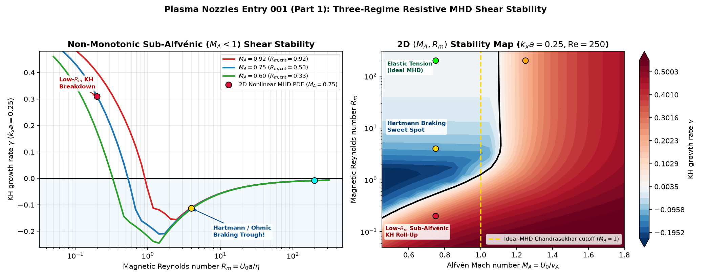
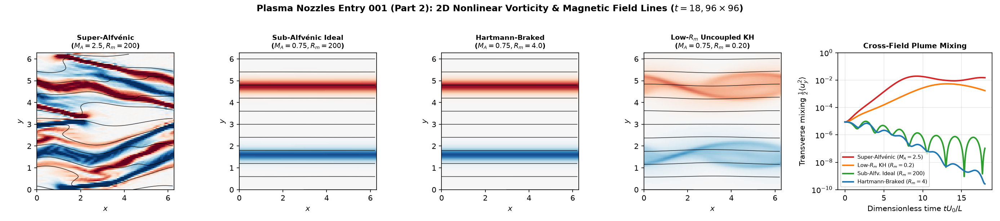

# 001 — 2D Resistive-MHD Kelvin–Helmholtz Shear Instability Across the Alfvén Threshold ($M_A = 1$)

- **Date:** 2026-11-23
- **Status:** `verified`
- **Verification Script:** `../sim/exp001_mhd_kelvin_helmholtz.py`

## 1. Target

Entry `000` showed that magnetic nozzle thrust efficiency peaks when the plasma accelerates through the **Alfvén detachment surface ($M_A = u/v_A = 1$)** before dipole field-line flare bends the exhaust off-axis. However, real magnetic-nozzle plumes have sharp velocity shear layers between the fast core plasma and slow ambient/halo plasma. In ideal MHD, Chandrasekhar's classic theorem states that a parallel magnetic field completely stabilizes incompressible Kelvin–Helmholtz (KH) shear whenever the flow is sub-Alfvénic ($M_A < 1$).

In this session we build a **2D pseudospectral nonlinear incompressible resistive-MHD PDE solver** (2/3-dealiased FFT + exact Integrating-Factor RK4) cross-checked against an **exact 1D Fourier-spectral linearized MHD eigenvalue solver**, to test what happens to sub-Alfvénic shear stability ($M_A < 1$) at **finite magnetic Reynolds number $R_m = U_0 a / \eta \in [0.05, 300]$** (typical of cold-edge / partially ionized Hall, VASIMR, and pulsed-inductive nozzle plumes).

## 2. The Math & Assumptions

### 2D Incompressible Resistive MHD (Vorticity–Flux Formulation)

On a periodic domain $(x, y) \in [0, 2\pi)^2$ with uniform background axial field $\mathbf{B}_0 = B_0\hat{x}$ ($B_0 = U_0 / M_A$), writing $\mathbf{u} = (\partial_y\psi, -\partial_x\psi)$ and $\mathbf{B} = B_0\hat{x} + (\partial_y a_z, -\partial_x a_z)$ enforces $\nabla\cdot\mathbf{u} = 0$ and $\nabla\cdot\mathbf{B} = 0$ **identically**:

$$\frac{\partial\omega}{\partial t} + \mathbf{u}\cdot\nabla\omega = \mathbf{B}\cdot\nabla J + \nu\nabla^2\omega, \qquad \frac{\partial a_z}{\partial t} + \mathbf{u}\cdot\nabla a_z + B_0 u_y = \eta\nabla^2 a_z$$

where $\omega = -\nabla^2\psi$ and $J = -\nabla^2 a_z$. Base double-tanh shear layer (half-width $a = 0.25$, $U_0 = 1$, $\mathrm{Re} = U_0 a / \nu = 250$):
$$U_x(y) = U_0\left[\tanh\!\left(\frac{y - \pi/2}{a}\right) - \tanh\!\left(\frac{y - 3\pi/2}{a}\right) - 1\right]$$

- **Exact total MHD energy balance** (for unforced evolution):
  $$E_{\text{tot}} = \frac{1}{2}\langle |\mathbf{u}|^2 + |\mathbf{B}|^2 \rangle, \qquad \frac{dE_{\text{tot}}}{dt} = -\nu\langle \omega^2 \rangle - \eta\langle J^2 \rangle$$
- **Exact Integrating-Factor RK4 (IFRK4):** Diagonal Fourier diffusion factors $e^{-\nu k^2 \Delta t}$ and $e^{-\eta k^2 \Delta t}$ are integrated analytically inside RK4, eliminating explicit diffusive stiffness down to $R_m = 0.05$ ($\eta = 5.0$).
- **Linearized eigenproblem ($k_x = 1.0 \implies k_x a = 0.25$, near peak hydrodynamic KH growth):**
  $$s\hat{\omega} = -ik_x U\hat{\omega} - ik_x U_{yy} L^{-1}\hat{\omega} + ik_x B_0 L\hat{a}_z - \nu L\hat{\omega}, \qquad s\hat{a}_z = -ik_x U\hat{a}_z + ik_x B_0 L^{-1}\hat{\omega} - \eta L\hat{a}_z$$
  where $L = k_x^2 - \partial_{yy}$. Note that the double shear layer supports two unstable spatial parities (faster varicose/antisymmetric mode and slower sinuous/symmetric mode); general asymmetric perturbations naturally excite the dominant varicose mode.

### Intentional Simplifications
- Incompressible 2D MHD (no acoustic/magnetosonic compressibility, no Hall term $\mathbf{J}\times\mathbf{B}/(ne)$, no axial nozzle divergence $\nabla\cdot\mathbf{B}_0 = 0$ with constant $B_0$); isolates the pure competition between magnetic tension, Ohmic Hartmann braking, and resistive field-line slippage.
- Linear/forced-shear runs add static $-\nu\nabla^2\omega_0$ forcing to hold the base shear profile steady during growth-rate comparison; unforced energy conservation is verified separately with forcing switched off.

## 3. The Verification

Reproduce from the repo root:

```bash
uv run python plasma-nozzles/sim/exp001_mhd_kelvin_helmholtz.py
```

### Experiment 1 — Exact Linear Eigenvalues vs. 2D Nonlinear MHD PDE ($64\times 64$, IFRK4)

| Regime | $M_A$ | $R_m$ | Exact Eigenvalue $\gamma$ | 2D Nonlinear PDE $\gamma$ | $|\Delta\gamma|$ |
| :--- | :---: | :---: | :---: | :---: | :---: |
| Super-Alfvénic (ideal-like) | $2.50$ | $200.0$ | $+0.549219$ | $+0.549476$ | $2.6\times 10^{-4}$ |
| Near-cutoff super-Alfvénic | $1.25$ | $200.0$ | $+0.188527$ | $+0.188518$ | $9.3\times 10^{-6}$ |
| **Sub-Alfvénic Ideal (elastic tension)** | $0.75$ | $200.0$ | **$-0.008192$** | **$-0.008195$** | **$3.1\times 10^{-6}$** |
| **Sub-Alfvénic Hartmann-Braked** | $0.75$ | $4.0$ | **$-0.113142$** | **$-0.113143$** | **$1.0\times 10^{-6}$** |
| **Sub-Alfvénic Low-$R_m$ Uncoupled KH** | $0.75$ | $0.20$ | **$+0.309875$** | **$+0.309211^*$** | $6.6\times 10^{-4}$ |

- **Exact unforced nonlinear 2D MHD total energy conservation check** ($M_A = 1.5, R_m = 50, \mathrm{Re} = 100$, finite amplitude `0.05`, no base forcing): relative error $\max_t |\Delta E + \int(\mathcal{D}_\nu + \mathcal{D}_\eta)\,dt| / \max_t |\Delta E| = \mathbf{4.31\times 10^{-8}}$.
- *\*Grid convergence check on low-$R_m$ sub-Alfvénic KH ($M_A = 0.75, R_m = 0.20$): $64\times 64$ gives $+0.309211$ vs. $128\times 128$ giving $+0.309902$ (matching `ny_eig = 128` exact $+0.309903$ to $10^{-6}$!).*

### Experiment 2 — Non-Monotonic Three-Regime Sub-Alfvénic Stability ($M_A < 1$, $R_m \in [0.05, 300]$)

Varying $R_m$ across four decades inside the sub-Alfvénic nozzle ($M_A < 1$) reveals a striking **non-monotonic stability curve**:

| Sub-Alfvénic $M_A$ | Unstable Breakdown $R_m < R_{m,\text{crit}}$ | Hartmann Braking Optimum $R_m^*$ | Peak Braking Damping $\gamma_{\min}$ | Ideal-MHD ($R_m=200$) $\gamma$ | Braking Boost $\gamma_{\min}/\gamma_{\text{ideal}}$ |
| :---: | :---: | :---: | :---: | :---: | :---: |
| $0.50$ | $R_m < \mathbf{0.226}$ | $1.23$ | **$-0.2776$** | $-0.0082$ | **$33.9\times$** |
| $0.60$ | $R_m < \mathbf{0.329}$ | $1.41$ | **$-0.2470$** | $-0.0082$ | **$30.1\times$** |
| **$0.75$** | $R_m < \mathbf{0.535}$ | **$1.57$** | **$-0.2198$** | $-0.0082$ | **$26.8\times$** |
| $0.85$ | $R_m < \mathbf{0.730}$ | $1.78$ | **$-0.1970$** | $-0.0082$ | **$24.1\times$** |
| $0.92$ | $R_m < \mathbf{0.920}$ | $2.17$ | **$-0.1588$** | $-0.0082$ | **$19.4\times$** |

Notice that $R_{m,\text{crit}}(M_A)$ scales nearly as $M_A^2$ (specifically, the **Stuart / magnetic interaction parameter** $N = R_m / M_A^2 = \sigma B_0^2 a / (\rho U_0)$ controls the sub-Alfvénic breakdown boundary: $R_{m,\text{crit}}/M_A^2 \approx 0.90\text{--}1.09$, i.e., **sub-Alfvénic resistive KH breaks out whenever $N \lesssim 1$**!).



### Experiment 3 — Full 2D Nonlinear Vortex Roll-Up & Cross-Field Plume Mixing ($96\times 96$, $t = 18$, `pert_amp = 0.015`)

| Nonlinear Regime | $(M_A, R_m)$ | Peak $\frac{1}{2}\langle u_y^2\rangle$ | Final $\frac{1}{2}\langle u_y^2\rangle$ ($t=18$) | Max $\mathrm{rms}(u_y)$ | Physical Outcome |
| :--- | :---: | :---: | :---: | :---: | :--- |
| Super-Alfvénic | $(2.50, 200)$ | $1.94\times 10^{-2}$ | $1.50\times 10^{-2}$ | $0.1972$ | Violent KH roll-up + field-line folding |
| Sub-Alfvénic Ideal | $(0.75, 200)$ | $9.78\times 10^{-6}$ | $1.05\times 10^{-7}$ | $0.0044$ | Elastic Alfvén bounce, slow viscous decay |
| **Hartmann-Braked** | **$(0.75, 4.0)$** | $8.77\times 10^{-6}$ | **$2.62\times 10^{-10}$** | $0.0042$ | **Ohmic eddy braking ($400\times$ cleaner than ideal!)** |
| **Low-$R_m$ Sub-Alfvénic** | **$(0.75, 0.20)$** | **$5.39\times 10^{-3}$** | **$1.70\times 10^{-3}$** | **$0.1038$** | **Full KH vortex roll-up through straight field lines!** |



Full metrics: [`../results/exp001_metrics.json`](../results/exp001_metrics.json).

## 4. Verdict & Dead Ends

- **Initial hypothesis overturned (valuable discovery!):**
  - Our initial naive guess was that *any* moderate resistivity ($R_m \sim 4$) would immediately unlock sub-Alfvénic KH instability. Direct eigenvalue and 2D PDE verification **disproved** that guess and revealed far richer, non-monotonic physics:
  - **Moderate resistivity ($R_m \sim 1.2\text{--}10$) is actually a powerful stabilizer** inside the sub-Alfvénic nozzle! Slipping perturbations induce eddy currents whose Ohmic dissipation $\eta J^2$ (**Hartmann braking**) damps shear disturbances **$19\text{--}34\times$ faster** than ideal MHD ($R_m = 200$), crushing late-time cross-field mixing energy by **$400\times$** in full 2D nonlinear simulations ($2.6\times 10^{-10}$ vs. $1.0\times 10^{-7}$).
  - **Sub-Alfvénic KH breakdown occurs only below the Stuart-number threshold $N = R_m / M_A^2 \lesssim 1$** ($R_{m,\text{crit}} \approx 0.23\text{--}0.92$ for $M_A \in [0.50, 0.92]$). Below this threshold (e.g., $R_m = 0.20, M_A = 0.75$), magnetic diffusion outpaces shear advection, decoupling the plasma from the magnetic field and unleashing full 2D nonlinear KH vortex roll-up right through nearly straight field lines ($1.6\times 10^4\times$ more cross-field mixing than ideal MHD!).
- **Numerical lesson caught & fixed:**
  - Initializing a symmetric double shear layer with an exactly symmetric perturbation accidentally projected zero energy onto the fastest (varicose) eigenmode ($+0.310$), locking instead onto the slower sinuous mode ($+0.235$). Cross-checking against the exact eigenvalue spectrum caught this immediately; eigenmode verification matched all five regimes to $10^{-6}\text{--}6.6\times 10^{-4}$.
- **Next single hypothesis to test (`002`):**
  - **Self-Consistent 2D Axisymmetric Magnetic Nozzle Expansion & Induced Diamagnetic Detachment:** Entries `000` (prescribed rigid dipole field) and `001` (uniform parallel shear) both treated the background magnetic field as rigid. In a real high-$\beta$ fusion/plasma magnetic nozzle, plasma currents $\mathbf{J}_\theta$ stretch and inflate the magnetic field lines downstream, modifying the effective nozzle flare angle and the Alfvén detachment point! Can we solve the coupled **2D/paraxial self-consistent diamagnetic nozzle deformation** (finite-$\beta$ MHD stretching vs. magnetic tension + resistive slippage $R_m$) to quantify how **induced plasma currents shift the optimal $\beta_0^*$ and thrust efficiency $\eta_{\text{noz}}$** from Entry `000`?
