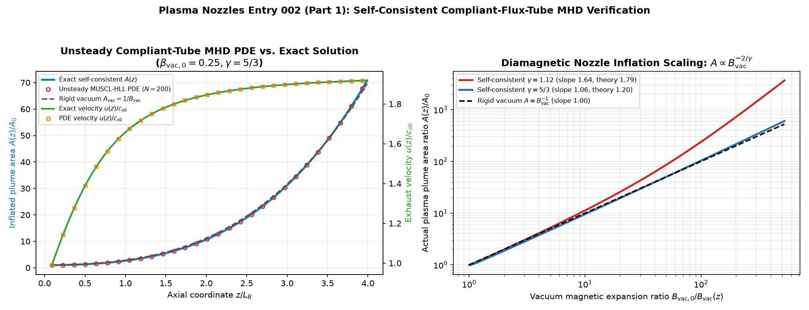

# 002 — Fixed-External-Field Compliant Flux-Tube MHD Nozzle: Diamagnetic Inflation & Tube-Speed Choking

- **Date:** 2026-11-23
- **Status:** `verified` (hardened after Peer Review #3)
- **Verification Script:** `../sim/exp002_self_consistent_nozzle.py`

## 1. Target

Entry `000` assumed a **rigid vacuum dipole field** ($A_{\text{vac}} = 1/B_{\text{vac}}$) choked at the gasdynamic sound speed ($u_0 = c_{s0}$). In reality, a finite-$\beta$ plasma flowing inside an external magnetic field carries azimuthal diamagnetic currents $J_\theta$ that expel internal magnetic flux, inflate the plume cross-section $A(z) > A_{\text{vac}}(z)$, and make the magnetic flux tube elastically compliant.

In this session we formulate and verify an **exact conservative compliant-flux-tube ideal-MHD nozzle model** (with fixed external vacuum field $B_{\text{vac}}(z)$ — exact steady solution + unsteady 2nd-order MUSCL-minmod HLL conservative FV PDE solver) to answer:

1. How does radial magnetostatic pressure balance ($p + B^2/2 = B_{\text{vac}}^2/2$) change nozzle choking, magnetoacoustic wave speeds, and downstream plume expansion $A(z)$?
2. Under an apples-to-apples **same-stagnation-enthalpy ($H_0$) specific-impulse comparison**, how much does flux-tube compliance shift optimal $\beta_{\text{vac},0}^*$ and net axial thrust gain compared to Entry `000`'s rigid-field baseline—both near the low-$\beta$ optimum and in the high-$\beta$ compact-fusion regime?

## 2. The Math & Assumptions

### Exact Slender-Flux-Tube Ideal-MHD Conservation Laws

Inside an axisymmetric slender plasma jet confined by a **prescribed external vacuum field** $B_{\text{vac}}(z) = (1 + (z/L_B)^2)^{-3/2}$ ($\mu_0 = 1$, $B_{\text{vac}}(0) = 1$, throat area $A_0 = 1$, $c_{s0} = 1$), ideal flux freezing and radial magnetostatic pressure balance require:

$$B(z) A(z) = \Phi_B = B_0 A_0 = \sqrt{1 - \beta_{\text{vac},0}}, \qquad p(z) + \frac{B(z)^2}{2} = \frac{B_{\text{vac}}(z)^2}{2}$$

where $\beta_{\text{vac},0} \equiv 2 p_0 / B_{\text{vac},0}^2 \in (0, 1)$ is the vacuum throat plasma beta (confinement requires $\beta_{\text{vac},0} < 1$, with internal throat beta $\beta_{\text{in},0} = \beta_{\text{vac},0}/(1 - \beta_{\text{vac},0})$).

Substituting $p\,\partial_t A = \partial_t\!\left(\frac{1}{2} B_{\text{vac}}^2 A + \frac{\Phi_B^2}{2A}\right)$ into the unsteady quasi-1D energy equation eliminates the wall-work source term identically, yielding a **source-free total energy conservation law**:

$$\frac{\partial (\rho A)}{\partial t} + \frac{\partial (\rho u A)}{\partial z} = 0, \qquad \frac{\partial (\rho u A)}{\partial t} + \frac{\partial [(\rho u^2 + p) A]}{\partial z} = p\frac{\partial A}{\partial z}$$
$$\frac{\partial \mathcal{E}_{\text{tot}}}{\partial t} + \frac{\partial}{\partial z}\!\left[\left(\frac{1}{2}\rho u^2 + \frac{\gamma}{\gamma - 1} p\right) u A\right] = 0, \qquad \mathcal{E}_{\text{tot}} \equiv \left(\frac{1}{2}\rho u^2 + \frac{p}{\gamma - 1} + \frac{B^2}{2} + \frac{B_{\text{vac}}(z)^2}{2}\right) A$$

- **Exact closed-form primitive recovery:** Given $(Q_0, Q_1, Q_2) = (\rho A, \rho u A, \mathcal{E}_{\text{tot}})$ and $R = Q_2 - \frac{Q_1^2}{2 Q_0}$, $A$ satisfies the exact quadratic $\left(\frac{\gamma}{\gamma - 1}\frac{B_{\text{vac}}^2}{2}\right) A^2 - R A + \left(\frac{\gamma - 2}{\gamma - 1}\frac{\Phi_B^2}{2}\right) = 0$ (unique positive root for $\gamma < 2$, zero Newton iterations).
- **Exact Roberts–Webb tube-speed choking:** Under fixed external pressure $p_{\text{ext}}(z) = B_{\text{vac}}(z)^2/2$, characteristic wave speeds are $\lambda_\pm = u \pm c_T$, where $c_T = \frac{c_s v_A}{\sqrt{c_s^2 + v_A^2}}$. Smooth steady acceleration obeys:
  $$\left(\frac{u^2}{c_T^2} - 1\right)\frac{du}{u} = -\frac{B_{\text{vac}}^2}{B^2}\frac{dB_{\text{vac}}}{B_{\text{vac}}}$$
  Therefore, the nozzle **must choke at the magnetic throat ($B_{\text{vac}}'(0) = 0$) at the subsonic, sub-Alfvénic tube speed** $u_0 = c_{T0} = c_{s0}\sqrt{\frac{2(1 - \beta_{\text{vac},0})}{2 + (\gamma - 2)\beta_{\text{vac},0}}} < c_{s0}$. Along the super-tube branch ($u > c_T$), $dp_{\text{tot}}/d\rho = (c_s^2 + v_A^2)(1 - c_T^2/u^2) > 0$, guaranteeing a unique steady solution at every $z > 0$.
- **Three exact structural properties:**
  1. **Far-field diamagnetic inflation law:** Since $p \propto A^{-\gamma}$ decays slower than $B^2/2 \propto A^{-2}$ for $\gamma < 2$, plasma pressure dominates far downstream ($\frac{1}{2} B_{\text{vac}}^2 \approx p \propto A^{-\gamma}$), forcing $A(z) \propto B_{\text{vac}}(z)^{-2/\gamma}$ (vs. rigid $A_{\text{vac}} \propto B_{\text{vac}}^{-1}$).
  2. **Detachment beta identity:** Directly from the definition of Alfvén detachment ($M_A = u / v_A = 1 \implies \rho u^2 = B^2$), internal plasma beta at $z_{\text{det}}$ obeys the exact algebraic identity $\beta_{\text{in}}(z_{\text{det}}) = \frac{2 p}{B^2} = \frac{2 p}{\rho u^2} = \frac{2}{\gamma M(z_{\text{det}})^2}$.
  3. **Apples-to-apples same-stagnation-enthalpy ($H_0$) thrust metric:** Because rigid and compliant nozzles choke at different throat speeds ($c_{s0}$ vs. $c_{T0} < c_{s0}$), holding throat static state $(p_0, \rho_0)$ fixed gives the compliant nozzle *lower* stagnation enthalpy $H_0 = \frac{1}{2}u_0^2 + \frac{\gamma}{\gamma-1}\frac{p_0}{\rho_0}$. To compare nozzles on an equal-reservoir footing, we normalize each nozzle's net axial specific impulse at detachment $I_{\text{sp,eff}} = \eta_{\text{div}}(z_{\text{det}}) F(z_{\text{det}}) / \dot{m}$ against an unexpanded sonic nozzle fed from **its own** stagnation enthalpy $H_0$:
     $$c_* = \sqrt{\frac{2(\gamma - 1)}{\gamma + 1}\,H_0}, \qquad I_{\text{sp,sonic}}(H_0) = \left(1 + \frac{1}{\gamma}\right) c_*$$
     By the classic gasdynamic property that $F/\dot{m}$ achieves its minimum at $M = 1$ for fixed $H_0$, a compliant nozzle without divergence loss cannot deliver *less* impulse per unit mass than a same-$H_0$ sonic nozzle.

### Intentional Simplifications & Validity Caveats
- **Fixed external vacuum field (no external back-reaction):** $B_{\text{vac}}(z)$ is prescribed and does not compress as the plume inflates; true 2D Grad–Shafranov back-reaction would partially resist large inflations (such as the $3.89\times$ far-field expansion at $\gamma = 1.12$). Likewise, Roberts–Webb $c_T$ assumes a fixed local external pressure rather than a non-local vacuum-field response.
- **Slender-tube / paraxial validity bound:** At the near-isothermal $\gamma = 1.12$ optimum ($R_0/L_B = 0.20$), $A_{\text{det}} = 618 \implies r_{\text{det}} \approx 5.0\,L_B$ at $z_{\text{det}} = 8.37\,L_B$ with edge flare $\theta_{\text{edge}} = 42.0^\circ$, exceeding strict paraxial/slender-tube validity.
- **Abrupt ballistic detachment at $M_A = 1$:** Same criterion as Entry `000` for controlled comparison; note that $F_{\text{net}} = \eta_{\text{div}}(z_{\text{det}}) F(z_{\text{det}})$ discards residual thermal enthalpy downstream of $M_A = 1$ (biasing against high-$\beta$ early detachment), and edge-line $\eta_{\text{div}}$ upper-bounds flux-weighted divergence loss.

## 3. The Verification

Reproduce from the repo root:

```bash
uv run python plasma-nozzles/sim/exp002_self_consistent_nozzle.py
```

### Experiment 1 — Exact Steady Solution vs. Unsteady 2nd-Order MUSCL-HLL Compliant-Tube MHD PDE ($\beta_{\text{vac},0} = 0.25, \gamma = 5/3, z \in [0.08, 4.0]$)

Note: the unsteady PDE test starts slightly super-tube at $z_{\text{in}} = 0.08\,L_B$ ($M_T > 1$) so all three characteristics enter cleanly; it verifies the conservative compliant-flux-tube PDE, closed-form primitive recovery, and steady super-tube expansion downstream of the throat (not transonic throat passage).

| Grid $N$ | $L_2$ Err $A(z)$ | $L_2$ Err $u(z)$ | $L_2$ Err $p(z)$ | $L_2$ Err $B(z)$ | Mass Flux Drift | Enthalpy Drift | Magnetic Thrust Balance Err |
| :---: | :---: | :---: | :---: | :---: | :---: | :---: | :---: |
| $100$ | $2.95\times 10^{-4}$ | $1.16\times 10^{-3}$ | $5.62\times 10^{-3}$ | $5.04\times 10^{-4}$ | $1.05\times 10^{-3}$ | $4.24\times 10^{-3}$ | $1.60\times 10^{-3}$ |
| $200$ | $4.38\times 10^{-5}$ | $2.71\times 10^{-4}$ | $9.11\times 10^{-4}$ | $8.09\times 10^{-5}$ | $1.87\times 10^{-4}$ | $7.25\times 10^{-4}$ | $2.32\times 10^{-4}$ |
| $400$ | **$1.28\times 10^{-5}$** | **$6.79\times 10^{-5}$** | **$2.74\times 10^{-4}$** | **$2.43\times 10^{-5}$** | **$6.17\times 10^{-5}$** | **$1.84\times 10^{-4}$** | **$4.49\times 10^{-5}$** |

- Observed spatial convergence order on inflated plume area $A(z)$: **$2.75$** ($100\to 200$) and **$1.78$** ($200\to 400$). Independent Peer Review #3 checks also confirmed symbolic exactness of $\mathcal{E}_{\text{tot}}$, $10^{-14}$ closed-tube conservation, $O(\Delta z)$ entropy convergence, and $2\times 10^{-7}$ agreement against direct ODE integration.

### Experiment 2 — Diamagnetic Nozzle Inflation Law ($A \propto B_{\text{vac}}^{-2/\gamma}$)

| Plasma Polytropic Index | Throat $\beta_{\text{vac},0}$ | Fitted Far-Field Slope ($z \in [4, 8]$) | Exact Asymptote $2/\gamma$ | Area Ratio at $z = 6 L_B$: $A_{\text{comp}} / A_{\text{vac}}$ |
| :--- | :---: | :---: | :---: | :---: |
| Rigid Vacuum (Entry `000`) | any | $1.000$ | $1.000$ | $1.00\times$ ($A = 225.1$) |
| Adiabatic ($\gamma = 5/3$) | $0.25$ | $1.061$ *(approaching $1.20$)* | $1.200$ | $1.08\times$ ($A = 243.9$) |
| **Near-isothermal ($\gamma = 1.12$)** | $0.15$ | **$1.636$** *(approaching $1.79$)* | **$1.786$** | **$3.89\times$ ($A = 874.9$)** |



### Experiment 3 — Same-$H_0$ Compliant vs. Rigid Thrust Optimization (Continuous Optimizer + Exact `brentq` $z_{\text{det}}$)

Algebraic detachment identity $\beta_{\text{in}}(z_{\text{det}}) = 2/(\gamma M_{\text{det}}^2)$ holds to machine precision ($2.3\times 10^{-14}$ and $1.4\times 10^{-17}$ via exact `brentq` root-finding).

| $\gamma$ | Slenderness $R_0/L_B$ | Rigid $\beta_{\text{vac},0}^*$ | Rigid Same-$H_0$ Gain | Compliant $\beta_{\text{vac},0}^*$ | Compliant Same-$H_0$ Gain | Compliance Delta ($\Delta$ pts) |
| :---: | :---: | :---: | :---: | :---: | :---: | :---: |
| $5/3$ | $0.10$ | $0.01134$ | $+21.43\%$ | $0.01126$ | **$+21.42\%$** | $-0.01$ pts |
| $5/3$ | $0.20$ | $0.04265$ | $+17.01\%$ | $0.04200$ | **$+16.98\%$** | $-0.03$ pts |
| $5/3$ | $0.35$ | $0.12125$ | $+10.99\%$ | $0.11602$ | **$+10.95\%$** | $-0.04$ pts |
| $1.12$ | $0.10$ | $0.00010$ | $+76.70\%$ | $0.00010$ | **$+76.12\%$** | $-0.58$ pts |
| $1.12$ | $0.20$ | $0.00089$ | $+58.66\%$ | $0.00087$ | **$+57.59\%$** | **$-1.08$ pts** *(flare $\theta: 40.9^\circ \to 42.0^\circ$)* |
| $1.12$ | $0.35$ | $0.00341$ | $+41.17\%$ | $0.00299$ | **$+39.67\%$** | **$-1.49$ pts** |

- **High-$\beta$ Same-$H_0$ Gain Erosion ($R_0 / L_B = 0.20$, never negative!):**
  - **Adiabatic ($\gamma = 5/3$):** At $\beta_{\text{vac},0} = 0.54$, compliant gain drops to **$+4.52\%$** vs. rigid $+7.59\%$ ($z_{\text{det}}: 0.549 \to 0.486$); at $\beta_{\text{vac},0} = 0.78$, compliant gain collapses to **$+0.02\%$** (near-zero magnetic thrust augmentation, where $M_{\text{det}} \approx 1$) vs. rigid $+3.70\%$.
  - **Near-isothermal ($\gamma = 1.12$):** At $\beta_{\text{vac},0} = 0.50$, compliant gain is **$+11.12\%$** vs. rigid $+17.77\%$; at $\beta_{\text{vac},0} = 0.77$, compliant gain collapses to **$+0.49\%$** vs. rigid $+11.03\%$; at $\beta_{\text{vac},0} = 0.83$, compliant gain reaches **$+0.09\%$** vs. rigid $+9.82\%$.


Full metrics: [`../results/exp002_metrics.json`](../results/exp002_metrics.json).

## 4. Verdict & Dead Ends

- **Metric artifact caught & corrected by Peer Review #3 (C1):**
  - Comparing rigid ($u_0 = c_{s0}$) and compliant ($u_0 = c_{T0} < c_{s0}$) nozzles at equal throat static $(p_0, \rho_0)$ against a single rigid sonic reference gave the compliant nozzle up to $19\%$ less stagnation enthalpy $H_0$, producing a spurious `< 0%` negative gain at high $\beta$. Under the proper **same-$H_0$ reservoir comparison**, compliant thrust gain **never goes negative** (minimum $+0.02\text{--}+0.09\%$).
- **What survives rigorously:**
  1. **Exact Compliant-Flux-Tube MHD Conservation Law:** Derived and verified $\mathcal{E}_{\text{tot}} = (\frac{1}{2}\rho u^2 + \frac{p}{\gamma-1} + \frac{B^2}{2} + \frac{B_{\text{vac}}^2}{2})A$, closed-form quadratic primitive recovery, Roberts–Webb tube-speed choking $u_0 = c_{T0}$, and far-field diamagnetic scaling $A \propto B_{\text{vac}}^{-2/\gamma}$ (verified in 2nd-order MUSCL-HLL PDE to $1.3\times 10^{-5}$).
  2. **Why Entry `000`'s low-$\beta$ optima hold:** Because optimal low-$\beta$ nozzles expand to $M_{\text{det}} \sim 5\text{--}6$ before detaching, $\beta_{\text{in}}(z_{\text{det}}) = 2/(\gamma M_{\text{det}}^2) \approx 0.03\text{--}0.06 \ll 1$. For adiabatic plasmas ($\gamma = 5/3$), flux-tube compliance alters optimal same-$H_0$ thrust gain by only **$-0.01$ to $-0.04$ percentage points**; for near-isothermal plasmas ($\gamma = 1.12$), real diamagnetic plume flare costs **$-0.58$ to $-1.49$ percentage points** ($\theta_{\text{edge}}: 40.9^\circ \to 42.0^\circ$).
  3. **High-$\beta$ Erosion to Near-Zero Gain:** Above $\beta_{\text{vac},0} \approx 0.50$, upstream detachment plus subsonic tube choking erode magnetic nozzle gain nearly to zero ($+0.02\%$ vs. rigid $+3.70\%$ at $\beta = 0.78$ for $\gamma = 5/3$; $+0.49\%$ vs. rigid $+11.03\%$ at $\beta = 0.77$ for $\gamma = 1.12$).
- **Track Milestone:** Entries `000`–`002` complete the peer-reviewed arc of `plasma-nozzles/`. See [`../SYNTHESIS.md`](../SYNTHESIS.md) for the consolidated design laws and open problems.
