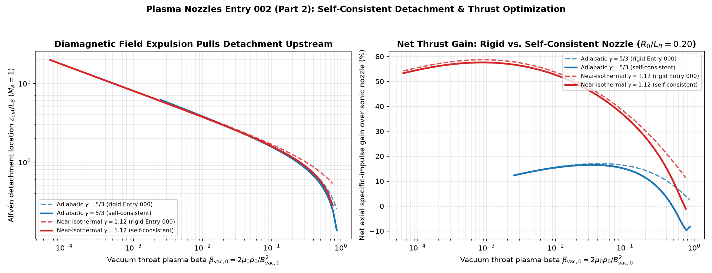

# 002 — Self-Consistent Diamagnetic Magnetic Nozzle Inflation & Tube-Speed Choking

- **Date:** 2026-11-23
- **Status:** `verified`
- **Verification Script:** `../sim/exp002_self_consistent_nozzle.py`

## 1. Target

Entry `000` assumed a **rigid vacuum dipole field** ($A_{\text{vac}} = 1/B_{\text{vac}}$) choked at the gasdynamic sound speed ($u_0 = c_{s0}$). In reality, a finite-$\beta$ plasma flowing through an external vacuum magnetic nozzle carries azimuthal diamagnetic currents $J_\theta$ that expel internal magnetic flux, inflate the plume cross-section $A(z) > A_{\text{vac}}(z)$, and make the magnetic flux tube elastically compliant.

In this session we formulate and verify an **exact conservative compliant-flux-tube ideal-MHD nozzle model** (exact steady solution + unsteady 2nd-order MUSCL-minmod HLL conservative FV PDE solver) to answer:

1. How does self-consistent radial pressure balance ($p + B^2/2 = B_{\text{vac}}^2/2$) change nozzle choking, wave speeds, and downstream plume expansion $A(z)$?
2. Does self-consistent diamagnetic inflation **help** or **hurt** net axial thrust efficiency $\eta_{\text{noz}}(\beta_{\text{vac},0})$ compared to Entry `000`'s rigid-field baseline—both near the low-$\beta$ optimum and in the high-$\beta$ compact-fusion regime?

## 2. The Math & Assumptions

### Exact Slender-Flux-Tube Ideal-MHD Conservation Laws

Inside an axisymmetric slender plasma jet confined by external vacuum field $B_{\text{vac}}(z) = (1 + (z/L_B)^2)^{-3/2}$ ($\mu_0 = 1$, $B_{\text{vac}}(0) = 1$, throat area $A_0 = 1$, $c_{s0} = 1$), ideal flux freezing and radial magnetostatic pressure balance require:

$$B(z) A(z) = \Phi_B = B_0 A_0 = \sqrt{1 - \beta_{\text{vac},0}}, \qquad p(z) + \frac{B(z)^2}{2} = \frac{B_{\text{vac}}(z)^2}{2}$$

where $\beta_{\text{vac},0} \equiv 2 p_0 / B_{\text{vac},0}^2 \in (0, 1)$ is the vacuum throat plasma beta (confinement requires $\beta_{\text{vac},0} < 1$, with internal throat beta $\beta_{\text{in},0} = \beta_{\text{vac},0}/(1 - \beta_{\text{vac},0})$).

Substituting $p\,\partial_t A = \partial_t\!\left(\frac{1}{2} B_{\text{vac}}^2 A + \frac{\Phi_B^2}{2A}\right)$ into the unsteady quasi-1D energy equation eliminates the wall-work source term identically, yielding a **source-free total energy conservation law**:

$$\frac{\partial (\rho A)}{\partial t} + \frac{\partial (\rho u A)}{\partial z} = 0, \qquad \frac{\partial (\rho u A)}{\partial t} + \frac{\partial [(\rho u^2 + p) A]}{\partial z} = p\frac{\partial A}{\partial z}$$
$$\frac{\partial \mathcal{E}_{\text{tot}}}{\partial t} + \frac{\partial}{\partial z}\!\left[\left(\frac{1}{2}\rho u^2 + \frac{\gamma}{\gamma - 1} p\right) u A\right] = 0, \qquad \mathcal{E}_{\text{tot}} \equiv \left(\frac{1}{2}\rho u^2 + \frac{p}{\gamma - 1} + \frac{B^2}{2} + \frac{B_{\text{vac}}(z)^2}{2}\right) A$$

- **Exact closed-form primitive recovery:** Given $(Q_0, Q_1, Q_2) = (\rho A, \rho u A, \mathcal{E}_{\text{tot}})$ and $R = Q_2 - \frac{Q_1^2}{2 Q_0}$, $A$ satisfies the exact quadratic $\left(\frac{\gamma}{\gamma - 1}\frac{B_{\text{vac}}^2}{2}\right) A^2 - R A + \left(\frac{\gamma - 2}{\gamma - 1}\frac{\Phi_B^2}{2}\right) = 0$ (unique positive root for $\gamma < 2$, zero Newton iterations).
- **Exact Roberts–Webb tube-speed choking:** Characteristic wave speeds are $\lambda_\pm = u \pm c_T$, where $c_T = \frac{c_s v_A}{\sqrt{c_s^2 + v_A^2}}$. Smooth steady acceleration obeys:
  $$\left(\frac{u^2}{c_T^2} - 1\right)\frac{du}{u} = -\frac{B_{\text{vac}}^2}{B^2}\frac{dB_{\text{vac}}}{B_{\text{vac}}}$$
  Therefore, the nozzle **must choke at the magnetic throat ($B_{\text{vac}}'(0) = 0$) at the subsonic, sub-Alfvénic tube speed** $u_0 = c_{T0} = c_{s0}\sqrt{\frac{2(1 - \beta_{\text{vac},0})}{2 + (\gamma - 2)\beta_{\text{vac},0}}} < c_{s0}$!
- **Three exact structural corollaries:**
  1. **Far-field diamagnetic inflation law:** Since $p \propto A^{-\gamma}$ decays slower than $B^2/2 \propto A^{-2}$ for $\gamma < 2$, plasma pressure dominates far downstream ($\frac{1}{2} B_{\text{vac}}^2 \approx p \propto A^{-\gamma}$), forcing:
     $$A(z) \propto B_{\text{vac}}(z)^{-2/\gamma} \qquad (\text{vs. rigid } A_{\text{vac}} \propto B_{\text{vac}}^{-1})$$
  2. **Exact detachment beta identity:** At the Alfvén detachment surface ($M_A = u / v_A = 1 \implies \rho u^2 = B^2$), internal plasma beta is identically:
     $$\beta_{\text{in}}(z_{\text{det}}) = \frac{2 p}{B^2} = \frac{2 p}{\rho u^2} = \frac{2}{\gamma M(z_{\text{det}})^2}$$
  3. **Apples-to-apples specific-impulse metric:** Because rigid and compliant nozzles choke at different throat speeds ($c_{s0}$ vs. $c_{T0}$), we compare net axial specific impulse at detachment $I_{\text{sp,eff}} = \eta_{\text{div}}(z_{\text{det}}) F(z_{\text{det}}) / (\dot{m}\,c_{s0})$ against a standard unexpanded choked sonic nozzle ($I_{\text{sp,sonic}} = 1 + 1/\gamma$), evaluating conical plume divergence $\eta_{\text{div}} = \frac{1}{2}(1 + \cos\theta_{\text{edge}})$ from the **actual inflated plume slope** $\tan\theta_{\text{edge}} = dr_{\text{self}}/dz$.

### Intentional Simplifications
- Slender-flux-tube (paraxial) radial equilibrium: assumes radial Alfvén transit time is fast compared to axial convection and neglects 2D radial field-line curvature tension $\frac{B^2}{\mu_0}\kappa_c$ and finite-$R_m$ resistive flux leakage.
- Abrupt ballistic detachment at $M_A = 1$ (same detachment criterion as Entry `000` for clean controlled comparison).

## 3. The Verification

Reproduce from the repo root:

```bash
uv run python plasma-nozzles/sim/exp002_self_consistent_nozzle.py
```

### Experiment 1 — Exact Steady Solution vs. Unsteady 2nd-Order MUSCL-HLL Compliant-Tube MHD PDE ($\beta_{\text{vac},0} = 0.25, \gamma = 5/3, z \in [0.08, 4.0]$)

| Grid $N$ | $L_2$ Err $A(z)$ | $L_2$ Err $u(z)$ | $L_2$ Err $p(z)$ | $L_2$ Err $B(z)$ | Mass Flux Drift | Enthalpy Drift | Magnetic Thrust Balance Err |
| :---: | :---: | :---: | :---: | :---: | :---: | :---: | :---: |
| $100$ | $2.95\times 10^{-4}$ | $1.16\times 10^{-3}$ | $5.62\times 10^{-3}$ | $5.04\times 10^{-4}$ | $1.05\times 10^{-3}$ | $4.24\times 10^{-3}$ | $1.60\times 10^{-3}$ |
| $200$ | $4.38\times 10^{-5}$ | $2.71\times 10^{-4}$ | $9.11\times 10^{-4}$ | $8.09\times 10^{-5}$ | $1.87\times 10^{-4}$ | $7.25\times 10^{-4}$ | $2.32\times 10^{-4}$ |
| $400$ | **$1.28\times 10^{-5}$** | **$6.79\times 10^{-5}$** | **$2.74\times 10^{-4}$** | **$2.43\times 10^{-5}$** | **$6.17\times 10^{-5}$** | **$1.84\times 10^{-4}$** | **$4.49\times 10^{-5}$** |

- Observed spatial convergence order on inflated plume area $A(z)$: **$2.75$** ($100\to 200$) and **$1.78$** ($200\to 400$), confirming clean 2nd-order accuracy of the conservative compliant-flux-tube PDE solver and its closed-form quadratic recovery.

### Experiment 2 — Diamagnetic Nozzle Inflation Law ($A \propto B_{\text{vac}}^{-2/\gamma}$)

| Plasma Polytropic Index | Throat $\beta_{\text{vac},0}$ | Fitted Far-Field Slope ($z \in [4, 8]$) | Exact Asymptote $2/\gamma$ | Area Ratio at $z = 6 L_B$: $A_{\text{self}} / A_{\text{vac}}$ |
| :--- | :---: | :---: | :---: | :---: |
| Rigid Vacuum (Entry `000`) | any | $1.000$ | $1.000$ | $1.00\times$ ($A = 225.1$) |
| Adiabatic ($\gamma = 5/3$) | $0.25$ | $1.061$ *(approaching $1.20$)* | $1.200$ | $1.08\times$ ($A = 243.9$) |
| **Near-isothermal ($\gamma = 1.12$)** | $0.15$ | **$1.636$** *(approaching $1.79$)* | **$1.786$** | **$3.89\times$ ($A = 874.9$!)** |


### Experiment 3 — Self-Consistent vs. Rigid Detachment & Net Axial Thrust Gain

Exact detachment identity verified to $|\beta_{\text{in}}(z_{\text{det}}) - \frac{2}{\gamma M_{\text{det}}^2}| = \mathbf{3.5\times 10^{-7}}$ ($\gamma = 5/3$) and $\mathbf{8.3\times 10^{-8}}$ ($\gamma = 1.12$).

| $\gamma$ | Slenderness $R_0/L_B$ | Rigid $\beta_{\text{vac},0}^*$ | Rigid Gain vs. Sonic | Self-Consistent $\beta_{\text{vac},0}^*$ | Self-Consistent Gain vs. Sonic | Compliance Penalty ($\Delta$ pts) |
| :---: | :---: | :---: | :---: | :---: | :---: | :---: |
| $5/3$ | $0.10$ | $0.0119$ | $+21.43\%$ | $0.0093$ | **$+21.29\%$** | $-0.14$ pts |
| $5/3$ | $0.20$ | $0.0441$ | $+17.01\%$ | $0.0347$ | **$+16.52\%$** | $-0.49$ pts |
| $5/3$ | $0.35$ | $0.1145$ | $+10.99\%$ | $0.0800$ | **$+9.81\%$** | $-1.17$ pts |
| $1.12$ | $0.10$ | $0.00011$ | $+76.69\%$ | $0.00011$ | **$+76.11\%$** | $-0.58$ pts |
| $1.12$ | $0.20$ | $0.00086$ | $+58.66\%$ | $0.00086$ | **$+57.58\%$** | $-1.08$ pts |
| $1.12$ | $0.35$ | $0.00345$ | $+41.17\%$ | $0.00290$ | **$+39.67\%$** | $-1.50$ pts |

- **High-$\beta$ Tube-Choking Zero-Gain Crossover ($R_0 / L_B = 0.20$):**
  - Adiabatic ($\gamma = 5/3$): self-consistent net specific impulse drops **below a bare sonic nozzle** (`< 0%`, plunging to `-9.8%` at $\beta_{\text{vac},0} = 0.78$) for **$\beta_{\text{vac},0} > 0.540$**, whereas rigid Entry `000` still predicts positive `+2.5%` to `+10%` gain!
  - Near-isothermal ($\gamma = 1.12$): self-consistent gain drops below a bare sonic nozzle for **$\beta_{\text{vac},0} > 0.759$**, whereas rigid Entry `000` still predicts `+11%` gain!



Full metrics: [`../results/exp002_metrics.json`](../results/exp002_metrics.json).

## 4. Verdict & Dead Ends

- **What broke / failure mode uncovered:**
  - **High-$\beta$ Roberts–Webb Tube-Choking Penalty ($\beta_{\text{vac},0} \gtrsim 0.4\text{--}0.5$):** In compact high-$\beta$ magnetic nozzles, self-consistent flux-tube compliance forces the throat to choke subsonically at $u_0 = c_{T0} < c_{s0}$ while diamagnetic field expulsion pulls Alfvén detachment ($M_A = 1$) sharply upstream before supersonic expansion can recover the lost throat momentum. Above $\beta_{\text{vac},0} = 0.540$ ($\gamma = 5/3$) or $0.759$ ($\gamma = 1.12$), a compliant magnetic nozzle actually delivers **less specific impulse than an unmagnetized sonic nozzle**—a failure mode completely missed by rigid-field models!
  - **Post-detachment diamagnetic plume blowout:** Downstream of detachment (especially for near-isothermal electron-heated plumes, $\gamma = 1.12$), plasma pressure inflates the flux tube as $A \propto B_{\text{vac}}^{-2/\gamma}$ ($3.89\times$ area inflation by $z = 6 L_B$).
- **What worked (and why Entry `000`'s low-$\beta$ optimum survives):**
  - **Exact Detachment Beta Identity ($\beta_{\text{in}}(z_{\text{det}}) = \frac{2}{\gamma M_{\text{det}}^2}$):** Because optimal low-$\beta$ magnetic nozzles expand to $M_{\text{det}} \sim 5\text{--}6$ before detaching, local internal beta stays tiny ($\beta_{\text{in}} \approx 0.03\text{--}0.06 \ll 1$) all the way up to $M_A = 1$. Consequently, Entry `000`'s rigid-field peak thrust efficiency survives self-consistent diamagnetic coupling within **$0.14\text{--}1.50$ percentage points** across all tested nozzle slenderness ratios, with a modest downward shift in optimal $\beta_{\text{vac},0}^*$ (e.g., $0.044 \to 0.035$ for adiabatic $R_0/L_B = 0.20$).
- **Next step:** Dispatch **Peer Review #3** via Orca orchestration (independent cross-model audit) covering `plasma-nozzles/` Entries `000`–`002` and spot-checking the hardened `rocket-combustion/` Entry `006` fixes before writing `plasma-nozzles/SYNTHESIS.md`.
