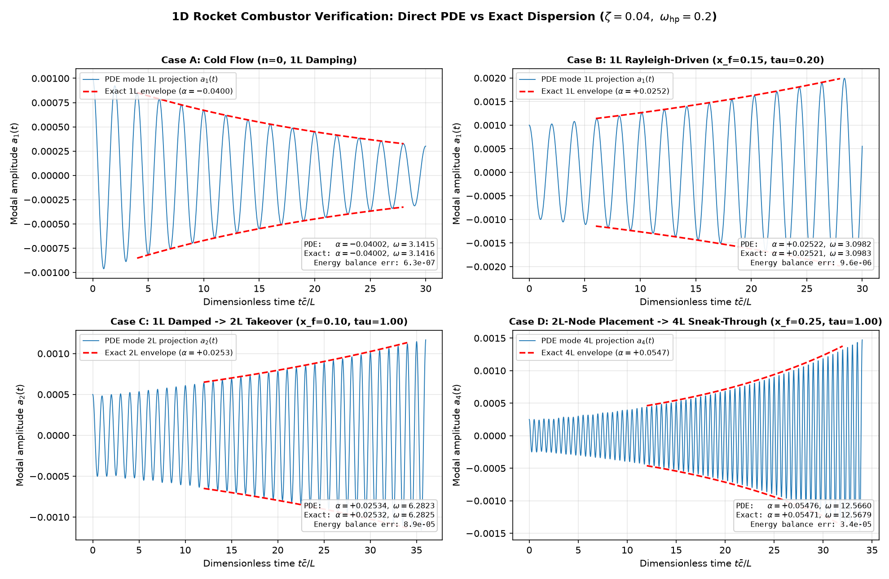

# 000 — 1D Longitudinal Combustor Baseline (DC-Blocked Crocco $n$–$\tau$)

- **Date:** 2026-11-23 *(revised post peer review)*
- **Status:** `verified`
- **Verification Script:** `../sim/baseline_1d_crocco.py`

## 1. Target

Build and cross-verify a clean, trustworthy 1D longitudinal rocket combustor baseline before adding spatial/temporal dispersion, acoustic cavities, or nonlinearities:

1. Derive the **exact dispersion relation** for a 1D closed–choked chamber with localized, DC-blocked Crocco $n$–$\tau$ pressure-coupled heat release.
2. Audit the static $k = 0$ bulk mode (showing why choked-feed DC regulation $n(0) = 0$ is physically mandatory) and verify zero positive real roots across all stability maps.
3. Verify an **energy-conserving staggered-grid time-domain PDE solver** against exact eigenvalues using a damped-sinusoid least-squares estimator across cold flow, $1L$ instability, and multi-mode harmonic takeover ($2L$, $4L$).

## 2. The Math & Assumptions

### Governing Equations (Dimensionless)

Scaling axial distance by chamber length $L$, time by acoustic transit time $L/\bar{c}$, pressure by $\bar{\rho}\bar{c}^2$, and velocity by $\bar{c}$, the linearized 1D zero-bulk-Mach acoustic equations are:

$$\frac{\partial U}{\partial t} + \frac{\partial P}{\partial x} = 0, \qquad \frac{\partial P}{\partial t} + \frac{\partial U}{\partial x} = n\,\delta(x - x_f)\,P_{\text{ac}}(x_f, t - \tau), \qquad x \in [0, 1]$$

### Physical DC-Blocking High-Pass Filter ($n(0) = 0$)

Without DC blocking, a pure pressure-coupled law $\dot{Q} = n P(x_f, t-\tau)$ has unit gain at $\omega = 0$, giving $F(0) = \zeta - n < 0$ for all $n > \zeta$ and creating an unphysical static $k = 0$ thermal-runaway root ($s = +0.05905$ on Case B). Real choked-feed liquid rocket injectors hold mean mass flow constant at $\omega = 0$; we enforce this consistently across Entries `000`–`003` with a causal high-pass filter ($\omega_{\text{hp}} = 0.20 \ll \pi$):

$$\frac{d\bar{P}_f}{dt} = \omega_{\text{hp}}\big(P(x_f, t) - \bar{P}_f\big), \qquad P_{\text{ac}} = P(x_f, t) - \bar{P}_f, \qquad H_{\text{hp}}(s) = \frac{s}{s + \omega_{\text{hp}}}$$

At $1L$ ($\omega = \pi$), $|H_{\text{hp}}(i\pi)| = 0.9980$ with a known phase lead of $+3.64^\circ$ ($\Delta\tau_{\text{eff}} \approx 0.020$).

### Boundary Conditions & Exact Rayleigh Energy Balance

- **Stiff injector faceplate ($x = 0$):** $U(0, t) = 0$
- **Lumped nozzle/end acoustic admittance ($x = 1$):** $U(1, t) = \zeta\,P(1, t)$ with $\zeta = 0.04$ (cold damping $\alpha_0 = -\operatorname{arctanh}(\zeta) = -0.040021$). *Note:* Treating $\zeta = 0.04$ as a lumped end loss (choked nozzle + wall/liner losses) keeps bulk mean Mach $\bar{M}$ small so convective $\mathcal{O}(\bar{M}^2)$ frequency/damping shifts remain minor; attributing $\zeta = 0.04$ purely to an isentropic choked nozzle at $\gamma = 1.25$ would require $\bar{M} = 0.32$, where bulk advection $(1 - \bar{M}^2) \approx 0.90$ would shift frequencies and damping by $\sim 10\%$.

Integrating $P P_t + U U_t$ over $[0, 1]$ yields the exact discrete & continuum **Rayleigh energy balance**:

$$\frac{dE}{dt} = \underbrace{n\,P(x_f, t)\,P_{\text{ac}}(x_f, t - \tau)}_{\text{Rayleigh driving } \mathcal{R}(t)} - \underbrace{\zeta\,P(1, t)^2}_{\text{End acoustic loss } \mathcal{D}(t)}, \qquad E = \frac{1}{2}\int_0^1 (P^2 + U^2)\,dx$$

### Exact Eigenvalue Dispersion Relation

$$\sinh(s) + \zeta \cosh(s) = n\,H_{\text{hp}}(s)\,e^{-s\tau}\cosh(s x_f)\Big[\cosh\big(s(1 - x_f)\big) + \zeta \sinh\big(s(1 - x_f)\big)\Big]$$

### Intentional Simplifications
- 1D longitudinal acoustics only; zero bulk mean-flow advection ($\mathcal{O}(\bar{M}^2)$ omitted).
- Linearized bulk acoustics and linear heat release; infinitesimally thin flame sheet ($\delta(x - x_f)$) and frequency-independent end admittance $\zeta$.

## 3. The Verification

Reproduce from the repo root:

```bash
uv sync
uv run python rocket-combustion/sim/baseline_1d_crocco.py
```

### Real-Axis $k = 0$ Bulk-Mode Audit (Case B: $n = 0.10, \tau = 0.20, x_f = 0.1475$)
- **Unfiltered ($H_{\text{hp}} \equiv 1$):** positive real root at $s = \mathbf{+0.05905}$ (static runaway dominates all acoustic modes).
- **DC-blocked ($\omega_{\text{hp}} = 0.20$):** **zero** positive real roots on $s \in [0, 3]$ (verified across all 4 validation cases and all 3,807 map grid points).

### Direct PDE ($N = 200$, RK4, $\text{CFL} = 0.25$) vs. Exact Dispersion (Damped-Sinusoid LSQ Fit)

| Case | Parameters ($n, \tau, x_{f,\text{grid}}$) | Mode | Exact $s = \alpha + i\omega$ | PDE LSQ Fit $s = \alpha + i\omega$ | $|\Delta\alpha|$ | Energy Balance Err |
| :--- | :--- | :---: | :---: | :---: | :---: | :---: |
| **A: Cold flow** | $0.00,\ 0.20,\ 0.1475$ | $1L$ | $-0.040021 + 3.14159i$ | $-0.040018 + 3.14155i$ | $3.1\times 10^{-6}$ | $6.3\times 10^{-7}$ |
| **B: $1L$ driven** | $0.10,\ 0.20,\ 0.1475$ | $1L$ | $+0.025215 + 3.09829i$ | $+0.025221 + 3.09824i$ | $6.4\times 10^{-6}$ | $9.6\times 10^{-6}$ |
| **C: $2L$ takeover** | $0.10,\ 1.00,\ 0.0975$ | $2L$ | $+0.025320 + 6.28254i$ | $+0.025342 + 6.28227i$ | $2.2\times 10^{-5}$ | $8.9\times 10^{-5}$ |
| **D: $4L$ sneak-through** | $0.10,\ 1.00,\ 0.2475$ | $4L$ | $+0.054707 + 12.56794i$ | $+0.054756 + 12.56600i$ | $4.9\times 10^{-5}$ | $3.4\times 10^{-5}$ |

Full metrics: [`../results/baseline_metrics.json`](../results/baseline_metrics.json).



### Multi-Mode Stability Maps ($(x_f, \tau) \in [0.05, 0.95] \times [0, 2.0]$, $n = 0.10, \zeta = 0.04$)

With $k = 0$ rigorously stable (`0` real-axis hits), the linearly stable area collapses rapidly as higher longitudinal harmonics are included *(each truncated value is an upper bound for $k > k_{\max}$)*:

- **$1L$ only:** **83.1%**
- **Modes $1L\text{--}4L$:** **45.6%** *(upper bound)*
- **Modes $1L\text{--}8L$:** **14.9%** *(upper bound)*
- **Modes $1L\text{--}12L$:** **2.5%** *(upper bound; tends toward $0\%$ as $k_{\max} \to \infty$)*


## 4. Verdict & Dead Ends

- **What worked:**
  - Applying $H_{\text{hp}}(s) = s/(s + 0.20)$ eliminates the unphysical $k = 0$ bulk runaway while keeping the exact discrete Rayleigh energy balance accurate to $10^{-7}\text{--}10^{-5}$.
  - Switching to a damped-sinusoid least-squares estimator verifies exact dispersion growth rates to **$3.1\times 10^{-6}\text{--}4.9\times 10^{-5}$** across all four cases.
- **Key pathology uncovered:**
  - **Point-Flame Harmonic Whack-a-Mole:** Tuning a single $(x_f, \tau)$ cannot stabilize all modes when $n > \zeta$: damping $1L$ triggers $2L$ (Case C), and placing $x_f$ on the $2L$ node unleashes the $4L, 8L, 12L, \dots$ comb (Case D), shrinking the stable area toward $0\%$ as $k_{\max}$ grows.
- **Next hypothesis (`001`):**
  - Test whether finite axial flame width ($\sigma_f$) or causal time-lag dispersion ($\sigma_\tau$) cures this high-frequency harmonic instability.
