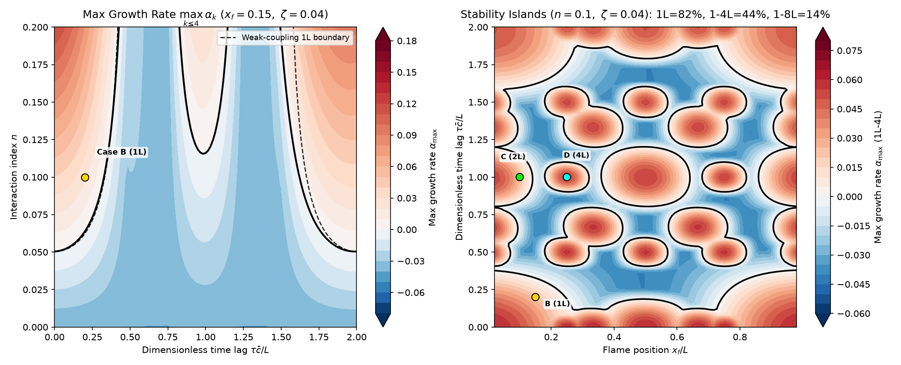

# 000 — 1D Longitudinal Combustor Baseline (Crocco $n$–$\tau$ + Choked Nozzle)

- **Date:** 2026-11-23
- **Status:** `verified`
- **Verification Script:** `../sim/baseline_1d_crocco.py`

## 1. Target

Build and cross-verify a clean, trustworthy 1D longitudinal rocket combustor baseline before adding geometric stabilizers or nonlinearities. Specifically:

1. Derive the **exact dispersion relation** for a 1D closed–choked chamber with localized Crocco $n$–$\tau$ pressure-coupled heat release.
2. Verify an **energy-conserving staggered-grid time-domain PDE solver** against the exact eigenvalues across cold flow, fundamental ($1L$) instability, and multi-mode harmonic takeover ($2L$, $4L$).
3. Map where the naive point-flame, frequency-independent-damping model succeeds—and where it breaks down physically.

## 2. The Math & Assumptions

### Governing Equations (Dimensionless)

Scaling axial distance by chamber length $L$, time by acoustic transit time $L/\bar{c}$, pressure by $\bar{\rho}\bar{c}^2$, and velocity by $\bar{c}$, the linearized 1D acoustic equations are:

$$\frac{\partial U}{\partial t} + \frac{\partial P}{\partial x} = 0, \qquad \frac{\partial P}{\partial t} + \frac{\partial U}{\partial x} = \dot{Q}(x, t), \qquad x \in [0, 1]$$

with localized Crocco $n$–$\tau$ pressure-coupled heat release at axial flame position $x_f$:

$$\dot{Q}(x, t) = n\,\delta(x - x_f)\,P(x_f, t - \tau)$$

### Boundary Conditions & Rayleigh Energy Balance

- **Stiff injector faceplate ($x = 0$):** $U(0, t) = 0$
- **Compact choked nozzle ($x = 1$, Marble–Candel admittance):** $U(1, t) = \zeta\,P(1, t)$, where $\zeta = \frac{\gamma - 1}{2}\bar{M}$.
  - Baseline parameters: $\gamma = 1.25$, $\bar{M} = 0.32 \implies \zeta = 0.04$.

Integrating $P P_t + U U_t$ over $[0, 1]$ yields the exact **Rayleigh energy balance**:

$$\frac{dE}{dt} = \underbrace{n\,P(x_f, t)\,P(x_f, t - \tau)}_{\text{Rayleigh driving } \mathcal{R}(t)} - \underbrace{\zeta\,P(1, t)^2}_{\text{Nozzle acoustic loss } \mathcal{D}(t)}, \qquad E = \frac{1}{2}\int_0^1 (P^2 + U^2)\,dx$$

### Exact Eigenvalue Dispersion Relation

Seeking eigenmodes $(P, U) \propto e^{s t}$ ($s = \alpha + i\omega$), pressure is continuous across $x_f$ while velocity jumps by $U(x_f^+) - U(x_f^-) = n e^{-s\tau} P(x_f)$. Matching the two regions gives:

$$\sinh(s) + \zeta \cosh(s) = n\,e^{-s\tau}\cosh(s x_f)\Big[\cosh\big(s(1 - x_f)\big) + \zeta \sinh\big(s(1 - x_f)\big)\Big]$$

- For cold flow ($n = 0$): $\omega_k = k\pi$ and uniform nozzle damping $\alpha_k = -\operatorname{arctanh}(\zeta) \approx -0.040021$.
- For weak coupling ($n, \zeta \ll 1$): $\alpha_k \approx -\zeta + n\cos^2(k\pi x_f)\cos(k\pi\tau)$.

### Intentional Simplifications

- 1D longitudinal acoustics only (no transverse/tangential modes yet).
- Zero mean-flow advection in the bulk ($\bar{M} \ll 1$ kept only in the choked-nozzle boundary admittance $\zeta$).
- Linearized acoustics and linear $n$–$\tau$ heat release (no nonlinear limit-cycle saturation or triggering).
- Infinitesimally thin flame sheet ($\delta(x - x_f)$) and frequency-independent nozzle admittance $\zeta$.

## 3. The Verification

Reproduce from the repo root:

```bash
uv sync
uv run python rocket-combustion/sim/baseline_1d_crocco.py
```

### Direct PDE ($N = 200$, RK4, $\text{CFL} = 0.25$) vs Exact Dispersion Relation

| Case | Parameters ($n, \tau, x_{f,\text{grid}}$) | Mode | Exact $s = \alpha + i\omega$ | PDE Fit $s = \alpha + i\omega$ | $|\Delta\alpha|$ | Energy Balance Err |
| :--- | :--- | :---: | :---: | :---: | :---: | :---: |
| **A: Cold flow** | $0.00,\ 0.20,\ 0.1475$ | $1L$ | $-0.040021 + 3.1416i$ | $-0.040014 + 3.1414i$ | $6.9\times 10^{-6}$ | $6.3\times 10^{-7}$ |
| **B: $1L$ driven** | $0.10,\ 0.20,\ 0.1475$ | $1L$ | $+0.022463 + 3.0942i$ | $+0.022118 + 3.0879i$ | $3.4\times 10^{-4}$ | $1.1\times 10^{-5}$ |
| **C: $2L$ takeover** | $0.10,\ 1.00,\ 0.0975$ | $2L$ | $+0.025245 + 6.2806i$ | $+0.025235 + 6.2828i$ | $9.9\times 10^{-6}$ | $8.9\times 10^{-5}$ |
| **D: $4L$ sneak-through** | $0.10,\ 1.00,\ 0.2475$ | $4L$ | $+0.054737 + 12.5666i$ | $+0.054768 + 12.5656i$ | $3.1\times 10^{-5}$ | $3.4\times 10^{-5}$ |

Full machine-readable metrics: [`../results/baseline_metrics.json`](../results/baseline_metrics.json).


### Multi-Mode Stability Maps

At $n = 0.10, \zeta = 0.04$, the fraction of the $(x_f, \tau) \in [0.02, 0.98] \times [0, 2]$ design space that remains linearly stable collapses rapidly as higher longitudinal harmonics are included:

- **$1L$ only:** **81.9%** stable
- **Modes $1L\text{--}4L$:** **43.7%** stable
- **Modes $1L\text{--}8L$:** **14.1%** stable



## 4. Verdict & Dead Ends

- **What worked:**
  - The staggered-grid RK4 PDE solver satisfies the discrete Rayleigh energy balance to $10^{-7}\text{--}10^{-5}$ and matches exact analytical dispersion growth rates to $10^{-6}\text{--}10^{-4}$ across both single-mode and broadband multi-mode runs.
  - We now have a fast (~10 s total runtime), verified sandbox for testing combustor stabilization ideas.

- **Key physical failure mode / pathology uncovered:**
  - **The Point-Flame Harmonic Whack-a-Mole Problem:** You *cannot* stabilize all longitudinal modes by tuning a single flame position $x_f$ and time lag $\tau$ when $n > \zeta$ under a point-flame, constant-$\zeta$ model.
    - In **Case C** ($\tau = 1.0$), putting heat release out of phase with $1L$ strongly damps $1L$ ($\alpha_{1L} = -0.1453$) but puts it directly in phase with $2L$ ($\alpha_{2L} = +0.0252$).
    - In **Case D** ($x_f \approx 0.25, \tau = 1.0$), placing the flame on the $2L$ pressure node kills $1L$, $2L$, and $3L$—only to unleash an infinite comb of unstable harmonics ($4L, 8L, 12L, \dots$, all with $\alpha \approx +0.054$).
  - Because a delta-function flame has flat spatial sensitivity across all wavenumbers and a compact choked nozzle has flat damping $-\operatorname{arctanh}(\zeta)$, the stable region shrinks toward zero as $k_{\max} \to \infty$.

- **Next single hypothesis to test (`001`):**
  - **Finite Combustion Zone Width & Multi-Plane Injection vs. Acoustic Resonator Damping:** Test how a finite axial heat-release distribution $\sigma_f$ (Gaussian / distributed injector zone) naturally low-pass filters high-$k$ harmonics (as $e^{-(k\pi\sigma_f)^2/2}$), and whether combining a finite combustion zone with either **dual-plane staggered injection** (anti-phase interference across modes) or a **quarter-wave / Helmholtz acoustic cavity** can open a genuinely broadband-stable operating window across *all* longitudinal modes.
