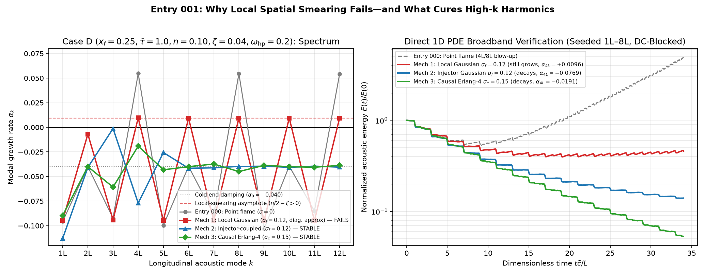
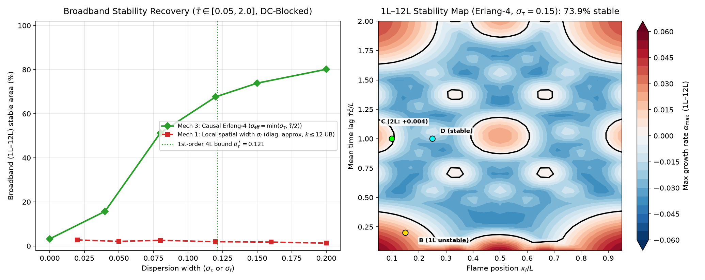

# 001 — Finite Flame Width vs. Causal Time-Lag Dispersion

- **Date:** 2026-11-23 *(revised post peer review)*
- **Status:** `verified` (includes a clean analytical & numerical negative result)
- **Verification Script:** `../sim/exp001_spatial_vs_timelag.py`

## 1. Target

Entry `000` (with DC-blocking $H_{\text{hp}}(s) = s/(s + 0.20)$ verified free of $k = 0$ roots) showed that a point flame at $n = 0.10, \zeta = 0.04$ leaves only **2.5%–3.2%** of $(x_f, \tau)$ stable across modes $1L\text{--}12L$ (an upper bound that tends to $0\%$ as $k_{\max} \to \infty$).

Here we compare **three physical extensions** under the exact same DC-blocked baseline to answer:

> *Does finite spatial flame thickness ($\sigma_f$) cure high-frequency harmonic instabilities, or do we need non-local feed-coupled spatial averaging / causal time-lag dispersion ($\sigma_\tau$)?*

## 2. The Math & Assumptions

All three models share $H_{\text{hp}}(s) = s/(s + 0.20)$, $\zeta = 0.04$ ($\alpha_0 = -\operatorname{arctanh}(\zeta) = -0.040021$), and normalized spatial profile $\int_0^1 w(x)\,dx = 1$:

### Mechanism 1 — Local Pressure Coupling + Finite Flame Width $\sigma_f$
$$\dot{Q}_{\text{loc}}(x, t) = n\,w_{\sigma_f}(x)\,P_{\text{ac}}(x, t - \tau)$$
In the diagonal modal Rayleigh approximation, the spatial coupling factor is:
$$I_k[w] = \int_0^1 w(x)\cos^2(k\pi x)\,dx = \frac{1}{2} + \frac{1}{2}\int_0^1 w(x)\cos(2k\pi x)\,dx \xrightarrow{k \to \infty} \frac{1}{2}$$
Because $I_k[w] \to \frac{1}{2}$ (not $0$), local spatial smearing obeys a sharp asymptotic threshold:
$$n_c = 2\operatorname{arctanh}(\zeta) \approx 0.080043$$
For $n > n_c$, **no smooth flame profile $w(x)$** can stabilize high-$k$ modes under single-lag local coupling (verified exactly for uniform $w \equiv 1$ via $\kappa\sinh\kappa + \zeta s\cosh\kappa = 0$, $\kappa = \sqrt{s(s - n H_{\text{hp}}(s) e^{-s\tau})}$, and directly via 1D PDE for Gaussian $w_{\sigma_f}$).

### Mechanism 2 — Injector/Feed-Coupled Distributed Flame Width $\sigma_f$
$$\dot{Q}_{\text{inj}}(x, t) = n\,w_{\sigma_f}(x)\,P_{\text{ac}}(0, t - \tau)$$
Exact Green's-function dispersion:
$$\sinh(s) + \zeta\cosh(s) = n\,H_{\text{hp}}(s)\,e^{-s\tau}\int_0^1 w(\xi)\Big[\cosh\big(s(1-\xi)\big) + \zeta\sinh\big(s(1-\xi)\big)\Big]\,d\xi$$
Modal driving scales with $\hat{w}_k = \int_0^1 w(x)\cos(k\pi x)\,dx \sim \cos(k\pi x_f)e^{-\frac{1}{2}(k\pi\sigma_f)^2}$ (super-exponential high-$k$ cutoff).

### Mechanism 3 — Local Coupling + Causal Shifted Erlang-$m$ Time-Lag Spread $\sigma_\tau$
Dead time $\tau_0 = \max(0, \bar{\tau} - \tau_d)$ plus an $m = 4$-stage Erlang cascade of mean $\tau_d = \min(\bar{\tau}, \sqrt{m}\sigma_\tau)$ (preserving exact mean lag $\bar{\tau}$ across the full domain $\bar{\tau} \in [0.05, 2.0]$ without violating causality):
$$\hat{g}(s) = \frac{e^{-s\tau_0}}{\left(1 + \frac{s\tau_d}{m}\right)^m}, \qquad \sigma_\tau^*(k) \approx \frac{\sqrt{m}}{k\pi}\sqrt{\left(\frac{n}{\operatorname{arctanh}(\zeta)}\right)^{2/m} - 1}$$
This **first-order perturbation bound** predicts $\sigma_\tau^*(4) \approx \mathbf{0.1213}$ to damp $4L$ and all higher harmonics unconditionally.

## 3. The Verification

Reproduce from the repo root:

```bash
uv run python rocket-combustion/sim/exp001_spatial_vs_timelag.py
```

### Uniform Local Flame Threshold Verification ($n_c = 2\operatorname{arctanh}(\zeta) = 0.080043$)

| Regime | $n$ | Exact $4L$ $\alpha$ | PDE LSQ $4L$ $\alpha$ | $|\Delta\alpha|$ | Exact $8L$ $\alpha$ | Outcome |
| :--- | :---: | :---: | :---: | :---: | :---: | :--- |
| Above threshold ($n > n_c$) | $0.10$ | $+0.009495$ | $+0.009530$ | $3.5\times 10^{-5}$ | $+0.009503$ | **Unstable** |
| Below threshold ($n < n_c$) | $0.07$ | $-0.004859$ | $-0.004823$ | $3.6\times 10^{-5}$ | $-0.004853$ | **Stable** |

### Case D ($x_f = 0.25, \bar{\tau} = 1.00, n = 0.10, \zeta = 0.04, \omega_{\text{hp}} = 0.20$) Comparison

| Model | Method for Analytic Col | Parameter | Analytic $4L$ $\alpha$ | PDE LSQ $4L$ $\alpha$ | $\max_{k \le 12} \alpha_k$ | Verdict |
| :--- | :--- | :--- | :---: | :---: | :---: | :--- |
| Entry `000` Point flame | Exact dispersion | $\sigma = 0$ | $+0.054707$ | $+0.054756$ | $+0.0547$ | Unstable ($4L, 8L, 12L$) |
| **Mech 1:** Local Gaussian | Diagonal Rayleigh approx | $\sigma_f = 0.12$ | $+0.009605$ | $+0.009646$ | $+0.0096$ | **FAILS** (even modes grow) |
| **Mech 2:** Injector Gaussian | Exact Green's-fn dispersion | $\sigma_f = 0.12$ | $-0.077004$ | $-0.076939$ | $-0.0012$ | **STABLE** ($3L$ near margin) |
| **Mech 3:** Causal Erlang-4 | Exact dispersion ($k=0$ checked) | $\sigma_\tau = 0.15$ | $-0.019137$ | $-0.019125$ | $-0.0191$ | **STABLE** (all modes damped) |



### Full-Domain Broadband ($1L\text{--}12L$) Stability Recovery on $(x_f, \bar{\tau}) \in [0.05, 0.95] \times [0.05, 2.0]$ ($31 \times 40$ grid, `0` real $k = 0$ hits)

| Dispersion Width | Mech 1: Local Spatial $\sigma_f$ *(diag. approx, $k \le 12$ UB)* | Mech 3: Causal Erlang-4 $\sigma_\tau$ *(exact $k \le 12$, causal cap $\bar{\tau}/2$)* |
| :---: | :---: | :---: |
| $0.00$ | — | $3.2\%$ *(UB; $k > 12$ unstable)* |
| $0.02 / 0.04$ | $2.7\%$ ($\sigma_f=0.02$) | $15.7\%$ ($\sigma_\tau=0.04$) |
| $0.05 / 0.08$ | $2.1\%$ ($\sigma_f=0.05$) / $2.6\%$ ($\sigma_f=0.08$) | $51.3\%$ ($\sigma_\tau=0.08$) |
| $0.12$ | $1.9\%$ | $67.7\%$ |
| $0.15 / 0.16$ | $1.8\%$ ($\sigma_f=0.16$) | **$73.9\%$** ($\sigma_\tau=0.15$) |
| $0.20$ | **$1.3\%$ (dead end; $\to 0\%$ as $k_{\max}\to\infty$)** | **$80.2\%$** |



Full metrics: [`../results/exp001_metrics.json`](../results/exp001_metrics.json).

## 4. Verdict & Dead Ends

- **Clean negative result (Mechanism 1):** Widening a *locally* pressure-coupled flame cannot stabilize high-$k$ harmonics whenever $n > 2\operatorname{arctanh}(\zeta) = 0.08004$; on the full domain $\bar{\tau} \in [0.05, 2.0]$, even the truncated $k \le 12$ upper bound stays at **1.3%–2.7%**.
- **What worked (Mechanisms 2 & 3):**
  - Causal Erlang-4 time-lag dispersion ($\sigma_\tau$) cuts off $k \ge 4$ cleanly past $\sigma_\tau^*(4) \approx 0.121$, lifting full-domain $1L\text{--}12L$ stability (including the $\bar{\tau} < 0.45$ $1L$ lobe!) to **73.9%** at $\sigma_\tau = 0.15$ and **80.2%** at $\sigma_\tau = 0.20$ with zero $k = 0$ instabilities.
  - Because low-frequency modes ($1L$ at $\bar{\tau} < 0.45$, and marginal $2L$ in Case C) resist time-lag dispersion, **Entry `002`** adds a faceplate Helmholtz acoustic cavity targeting $1L$.
