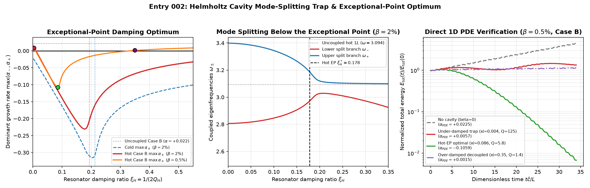
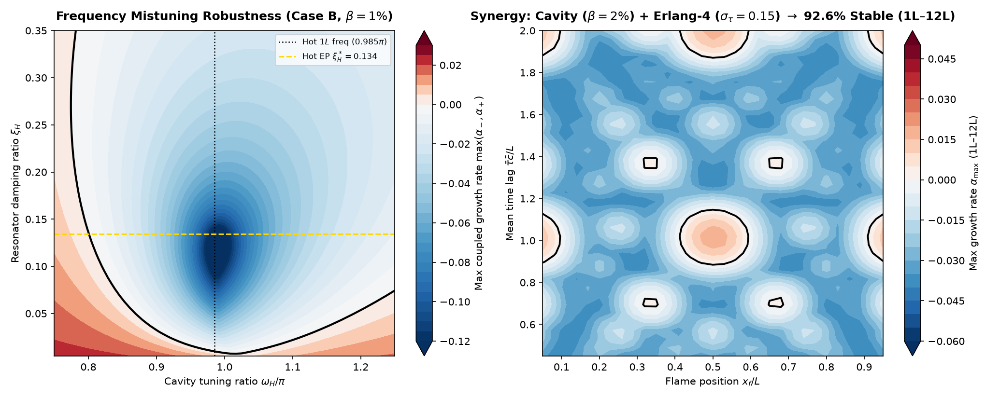

# 002 — Passive Acoustic Damping: Faceplate Helmholtz Resonator & Exceptional-Point Tuning

- **Date:** 2026-11-23
- **Status:** `verified`
- **Verification Script:** `../sim/exp002_helmholtz_cavity.py`

## 1. Target

Entry `001` showed that causal time-lag dispersion ($\sigma_\tau$) cleanly extinguishes high-frequency harmonics ($4L+$), raising broadband $1L\text{--}12L$ stability from **1.7% to 80.0%**, while leaving **low-frequency modes** ($1L$ in Case B and marginal $2L$ in Case C) resistant because low frequencies barely feel $\sigma_\tau$.

In this session we mount a compact **side-branch Helmholtz resonator (acoustic cavity)** at the injector faceplate ($x = 0$, the pressure antinode of all longitudinal modes—matching real liquid-rocket acoustic cavities) to answer:

1. What is the **optimal cavity damping ratio $\xi_H$** for a given cavity-to-chamber volume ratio $\beta = V_{\text{cav}}/V_{\text{chamber}}$, and how does combustion shift it from cold-flow bench tuning?
2. Why do both **under-damped (high-$Q$)** and **over-damped** cavities fail to stabilize Case B?
3. How robust is the cavity to **frequency mistuning** (e.g., sound-speed shifts during throttling), and what happens when we combine a $1L$ cavity with Entry `001`'s causal time-lag spread across *all* modes ($1L\text{--}12L$)?

## 2. The Math & Assumptions

### Coupled Combustor + Faceplate Helmholtz Resonator Model

At the injector faceplate ($x = 0$), rigid-wall reflection $U(0,t) = 0$ is replaced by acoustic volume velocity $v_r(t)$ entering the cavity:

$$U(0, t) = -v_r(t), \qquad U(1, t) = \zeta\,P(1, t)$$

with cavity compliance $\beta = V_{\text{cav}}/V_{\text{chamber}}$, resonance frequency $\omega_H$, damping ratio $\xi_H = 1/(2Q_H)$, and cavity pressure $P_c(t)$:

$$\frac{dv_r}{dt} + 2\xi_H\omega_H v_r = \beta\omega_H^2\big(P(0, t) - P_c(t)\big), \qquad \frac{dP_c}{dt} = \frac{v_r(t)}{\beta}$$

### Exact Total Energy Balance

Including cavity potential energy and neck kinetic energy, $E_{\text{tot}} = \frac{1}{2}\int_0^1(P^2+U^2)\,dx + \frac{1}{2}\beta P_c^2 + \frac{1}{2\beta\omega_H^2}v_r^2$, the coupling terms cancel identically:

$$\frac{dE_{\text{tot}}}{dt} = \underbrace{n\,P(x_f, t)\,q(t)}_{\text{Rayleigh driving}} - \underbrace{\zeta\,P(1, t)^2}_{\text{Nozzle loss}} - \underbrace{\frac{2\xi_H}{\beta\omega_H}v_r(t)^2}_{\text{Cavity dissipation}}$$

### Exact Dispersion Relation & Exceptional-Point Law

In the Laplace domain, the cavity admittance is $Y_H(s) = \frac{\beta\omega_H^2 s}{s^2 + 2\xi_H\omega_H s + \omega_H^2}$, yielding the exact closed-form dispersion relation:

$$(1 + \zeta Y_H)\sinh(s) + (\zeta + Y_H)\cosh(s) = n\,\hat{g}(s)\Big[\cosh(s x_f) + Y_H\sinh(s x_f)\Big]\Big[\cosh\big(s(1-x_f)\big) + \zeta\sinh\big(s(1-x_f)\big)\Big]$$

Expanding near $s = i\pi + \delta s$ (with $\omega_H \approx \pi$) gives the coupled-mode quadratic $(\delta s - \alpha_{\text{uncoupled}})(\delta s + \xi_H\pi) + \frac{1}{2}\beta\pi^2 = 0$, whose discriminant vanishes at the **exceptional point (critical coupling)**:

$$\xi_H^{\text{EP}} \approx \sqrt{2\beta} - \frac{\alpha_{\text{uncoupled}}}{\pi}, \qquad \alpha_{\text{cold}}^{\text{EP}} \approx -\zeta - \pi\sqrt{\frac{\beta}{2}}$$

- **Leading-order scaling:** $\xi_H^{\text{EP}} \approx \sqrt{2\beta}$ (independent of $\pi$!)—a 2% cavity wants $\xi_H \approx 0.20$ ($Q_H \approx 2.5$), while a 0.5% cavity wants $\xi_H \approx 0.09$ ($Q_H \approx 5.5$).
- **Hot-fire detuning shift:** Because unstable combustion shifts $\alpha_{\text{uncoupled}}$ from $-\zeta = -0.04$ to $+0.022$ (and shifts $\omega_1$ down from $\pi$ to $3.095$), the hot-fire EP shifts **downward** in both $\xi_H$ and $\omega_H$ relative to cold-flow bench tuning.
- **High-frequency transparency:** Since $Y_H(i\omega) \sim \beta\omega_H^2/(i\omega) \to 0$ as $\omega \to \infty$, neck inertia makes the cavity acoustically invisible to high-$k$ harmonics.

### Intentional Simplifications
- Linear cavity neck resistance ($\xi_H$ independent of acoustic amplitude; real rocket cavities exhibit nonlinear orifice jet losses at high amplitude, which we leave for a nonlinear entry).
- Compact cavity mounted right at $x_r = 0$.

## 3. The Verification

Reproduce from the repo root:

```bash
uv run python rocket-combustion/sim/exp002_helmholtz_cavity.py
```

### Exceptional-Point Formula vs. Exact Dispersion Optimum

| Case | Analytical $\xi_H^{\text{EP}}$ | Exact $\xi_H^{\text{opt}}$ | Exact $\max(\alpha_-, \alpha_+)$ | Notes |
| :--- | :---: | :---: | :---: | :--- |
| Cold chamber ($\beta = 2\%$) | $0.2127$ | $0.2060$ | $-0.3152$ | $7.9\times$ stronger than nozzle alone ($-0.040$) |
| Hot Case B ($\beta = 2\%$) | $0.1930$ | $0.1781$ | $-0.2306$ | Shifted down by hot-fire driving |
| Hot Case B ($\beta = 0.5\%$) | $0.0930$ | $0.0858$ | $-0.1078$ | Stable only for $\xi_H \in [0.010, 0.328]$ |

### Direct 1D PDE + Cavity ODE Verification (Hot Case B, $\beta = 0.5\%$, $\omega_H = 3.095$)

| Regime | $\xi_H$ ($Q_H$) | Exact $\max\alpha_\pm$ | PDE Energy Fit $\alpha_E$ | Energy Balance Err | Outcome |
| :--- | :---: | :---: | :---: | :---: | :--- |
| No cavity ($\beta = 0$) | — | $+0.02246$ | $+0.02248$ | $1.2\times 10^{-5}$ | Unstable $1L$ |
| **Under-damped trap** | $0.004$ ($125$) | $+0.00835$ | $+0.00573$* | $9.7\times 10^{-5}$ | **FAILS** — splits into two unstable sidebands ($\omega_-=2.947, \omega_+=3.246$; beat $T=21.1$) |
| **Hot-EP optimal** | $0.086$ ($5.8$) | $-0.10796$ | $-0.10591$ | $4.2\times 10^{-5}$ | **STABLE** ($1L$ crushed; note high-$k$ floor still exists if $\sigma_\tau=0$) |
| **Over-damped decoupled** | $0.350$ ($1.4$) | $+0.00151$ | $+0.00153$ | $4.2\times 10^{-5}$ | **FAILS** — cavity decouples, $1L$ re-emerges |

*\*Two-mode beating between $\omega_- = 2.947$ ($\alpha = +0.0012$) and $\omega_+ = 3.246$ ($\alpha = +0.0084$) causes oscillatory energy modulation with net positive growth.*



### Mistuning Robustness ($\beta = 1\%$) & Full-Spectrum Synergy ($1L\text{--}12L$)

- **Frequency mistuning bandwidth ($\omega_H/\pi$ where Case B stays stable at $\beta = 1\%$):**
  - Under-damped ($\xi_H = 0.015$): fragile **12.5%** bandwidth ($[0.950, 1.075]$).
  - At hot EP ($\xi_H = 0.134$): **44.2%** bandwidth ($[0.808, \ge 1.250]$) — **$3.5\times$ wider**.
  - Slightly over-EP ($\xi_H = 0.220$): **46.7%** bandwidth ($[0.783, \ge 1.250]$) — trades peak margin for maximum mistuning tolerance.
- **Broadband $1L\text{--}12L$ stable area in $(x_f, \bar{\tau}) \in [0.05, 0.95] \times [0.45, 2.0]$ ($n = 0.10, \zeta = 0.04$):**
  - Entry `000` (point flame, no cavity): **1.7%**
  - **Cavity ONLY** ($\beta = 2\%, \sigma_\tau = 0$): **4.1%** *(dead end alone — high-$k$ harmonics ignore the $1L$ cavity)*
  - Entry `001` (Erlang-4 ONLY, $\sigma_\tau = 0.15$): **80.0%**
  - **Synergy (Cavity $\beta = 2\%$ + Erlang-4 $\sigma_\tau = 0.15$):** **92.6%** (and Case B at $\bar{\tau} = 0.20, x_f = 0.15$ with $\sigma_\tau = 0.08$ reaches $\max_{k \le 12}\alpha_k = -0.0361$, completely stable across all 12 modes).



Full metrics: [`../results/exp002_metrics.json`](../results/exp002_metrics.json).

## 4. Verdict & Dead Ends

- **What broke / dead ends:**
  - **High-$Q$ (under-damped) cavities are a trap:** Making an acoustic cavity "sharper" ($\xi_H \to 0$) splits the $1L$ mode into two sidebands ($\omega_\pm$) that *both* remain unstable under hot-fire driving, while shrinking mistuning tolerance to a razor-thin 12.5%.
  - **A Helmholtz cavity alone cannot provide broadband stability:** Because $Y_H(i\omega) \to 0$ at high frequency, a $1L$-tuned cavity only raises $1L\text{--}12L$ stability from 1.7% to **4.1%** when $\sigma_\tau = 0$.
  - **First-draft math bug caught by verification:** An initial analytical estimate omitted a factor of $\pi$ in $Y_H(s)$ near $s = i\pi$, predicting $\xi_H^{\text{EP}} \propto \sqrt{2\beta/\pi}$ instead of the true $\sqrt{2\beta}$. The exact dispersion solver immediately exposed the $\sqrt{\pi}$ discrepancy and led to the corrected formula $\xi_H^{\text{EP}} \approx \sqrt{2\beta} - \alpha_{\text{uncoupled}}/\pi$.

- **What worked:**
  - Designing near (or slightly above) the hot-fire exceptional point $\xi_H^{\text{EP}} \approx \sqrt{2\beta} - \alpha_{\text{hot}}/\pi$ maximizes damping margin ($-0.231$ at $\beta = 2\%$, $-0.108$ at $\beta = 0.5\%$) and widens frequency mistuning tolerance by $>3.5\times$.
  - **Divide-and-conquer broadband stabilization:** Pairing a low-frequency faceplate Helmholtz cavity (targeting $1L$) with causal time-lag dispersion (killing high-$k$ harmonics) brings $1L\text{--}12L$ stability to **92.6%** of the entire $(x_f, \bar{\tau})$ space—leaving only isolated $2L$ lobes near $x_f = 0.5$ and $x_f = 0, 1$.

- **Next single hypothesis to test (`003`):**
  - **Nonlinear Triggering (Subcritical Hopf Bifurcation) & Limit-Cycle Saturation:** Everything in Entries `000`–`002` is strictly *linear*—meaning a linearly stable combustor ($\alpha < 0$) is assumed safe forever. Real liquid rocket engines (like the Saturn V F-1) are notorious for **nonlinear triggering**: a combustor that is *linearly stable* still blows up into a violent limit cycle when struck by a finite-amplitude pressure bomb/pulse! Introduce physically realistic nonlinear heat release (cubic/quintic subcritical response + nonlinear cavity orifice dissipation $\propto |v_r| v_r$) into our 1D PDE to map the **triggering threshold amplitude $P_{\text{crit}}$** and test whether our Entry `002` Helmholtz cavity prevents—or fails to prevent—finite-amplitude triggering!
