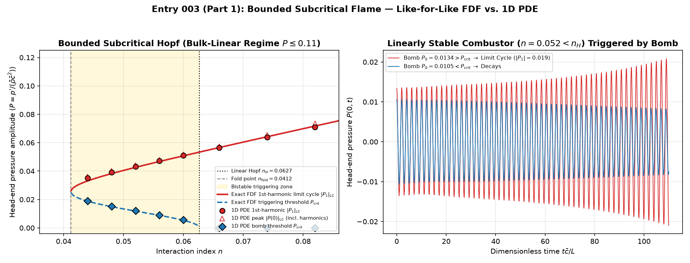

# 003 — Nonlinear Triggering (Bounded Subcritical Flame) & Calibrated Cavity Orifice Drag

- **Date:** 2026-11-23 *(revised post peer review)*
- **Status:** `verified`
- **Verification Script:** `../sim/exp003_nonlinear_triggering.py`

## 1. Target

Entries `000`–`002` were strictly linear. Real liquid rocket engines exhibit **nonlinear triggering** (finite-amplitude bomb pulses kicking a linearly stable engine into a limit cycle) and **quadratic orifice jet losses** inside acoustic cavity necks.

Following peer review of our initial draft (which flagged sign-reversal and excessive bulk amplitudes in a cubic–quintic polynomial flame law, peak-vs-first-harmonic FDF mismatch, and an uncalibrated $t = 0$ cavity impulse), we build a physically bounded, bulk-linear-valid nonlinear experiment to answer:

1. Does a **strictly bounded, monotonically increasing subcritical flame law** reproduce exact first-harmonic Flame Describing Function (FDF) predictions for both $P_{\text{crit}}$ and $|P_1|_{\text{LC}}$ while staying strictly within the bulk-linear acoustic regime ($p'/\bar{p} \lesssim 0.10$)?
2. Under **calibrated quadratic orifice jet drag** ($c_{\text{nl}}$ from orifice area ratio $\sigma_o = A_{\text{neck}}/A_{\text{ch}}$ and discharge coefficient $C_d$), how does the nonlinear triggering threshold $P_{\text{crit}}(\xi_H)$ behave across linear cavity designs below, at, and above Entry `002`'s exceptional point $\xi_H^{\text{EP}}$?

## 2. The Math & Assumptions

### Bounded Monotonic Subcritical Flame Law & First-Harmonic FDF
Carrying forward the unified DC-blocked causal Erlang-4 flame model ($\omega_{\text{hp}} = 0.20, \bar{\tau} = 0.20, \sigma_\tau = 0.10 \implies \tau_0 = 0$, bare linear Hopf point $n_H = 0.06267, \omega_H = 3.1157$):

$$\Phi(q) = q_s \tanh\!\left(\frac{q}{q_s} + \kappa\left(\frac{q}{q_s}\right)^3\right), \qquad q_s = 0.038,\quad \kappa = 4.5$$

- **Small amplitude:** $\Phi(q) = q + (\kappa - \frac{1}{3})q^3/q_s^2 + \dots$ (destabilizing cubic $\implies$ subcritical Hopf).
- **All amplitudes:** $\Phi'(q) > 0$ everywhere and $|\Phi(q)| < q_s = 0.038$ strictly (never reverses sign or diverges).
- **Exact first-harmonic FDF:** $G(A_f) = \frac{2}{\pi A_f}\int_0^\pi \Phi(A_f\cos\theta)\cos\theta\,d\theta$ peaks at $G_{\max} = 1.521\times$, predicting a bistable triggering window $n \in [n_{\text{fold}}, n_H] = [0.04120, 0.06267]$ and limit cycles $|P_1|_{\text{LC}} \le 0.072$ ($p'/\bar{p} = \gamma P \le 0.092$, where simple-wave shock-formation distance is $> 4L$, safely inside bulk-linear acoustics).

### Calibrated Quadratic Helmholtz Orifice Drag & Consistent Initialization
$$\frac{dv_r}{dt} + \Big(2\xi_H\omega_H + c_{\text{nl}}|v_r|\Big) v_r = \beta\omega_H^2\big(P(0, t) - P_c\big), \qquad c_{\text{nl}} = \frac{\beta\omega_H^2}{2 C_d^2 \sigma_o^2}$$
For a realistic $\beta = 1.0\%$ cavity with orifice discharge coefficient $C_d = 0.65$ and neck-to-chamber area ratio $\sigma_o = 0.010$ ($1.0\%$), $c_{\text{nl}} = \mathbf{1152.0}$. Effective first-harmonic cavity damping grows with neck velocity amplitude $V_r$ as $\xi_{H,\text{eff}}(V_r) = \xi_H + \frac{4 c_{\text{nl}}}{3\pi\omega_H}V_r$.

To avoid artificial $t = 0$ neck impulses, the cavity starts pre-pressurized consistently with the standing wave ($p_c(0) = P(0, 0), v_r(0) = 0$) and the Erlang chain is initialized to the $1L$ harmonic state.

### Intentional Simplifications
- 1D linearized bulk acoustics; nonlinearities localized to the flame and cavity orifice.
- Single-mode $1L$ cosine pulse excitation $P(x, 0) = P_0\cos(\pi x)$; triggering thresholds carry a verified grid/horizon convergence band of $\approx \pm 2.4\%$.

## 3. The Verification

Reproduce from the repo root:

```bash
uv run python rocket-combustion/sim/exp003_nonlinear_triggering.py
```

### Experiment 1 — Bounded Subcritical Bifurcation (Like-for-Like First Harmonic vs. FDF)

| $n$ | Regime | $P_{\text{crit}}$ (1D PDE) | $P_{\text{crit}}$ (FDF) | $|P_1|_{\text{LC}}$ (1D PDE) | $|P_1|_{\text{LC}}$ (FDF) | Peak $|P(0)|_{\text{LC}}$ |
| :---: | :--- | :---: | :---: | :---: | :---: | :---: |
| $0.044$ | Bistable (lin. stable) | $0.0190$ | $0.0188$ | $0.0350$ | $0.0331$ | $0.0361$ |
| $0.048$ | Bistable (lin. stable) | $0.0151$ | $0.0149$ | $0.0392$ | $0.0382$ | $0.0403$ |
| $0.052$ | Bistable (lin. stable) | $0.0120^*$ | $0.0118$ | $0.0433$ | $0.0426$ | $0.0442$ |
| $0.056$ | Bistable (lin. stable) | $0.0090$ | $0.0088$ | $0.0472$ | $0.0468$ | $0.0480$ |
| $0.060$ | Bistable (lin. stable) | $0.0056$ | $0.0053$ | $0.0510$ | $0.0507$ | $0.0518$ |
| $0.066$ | Linearly unstable | $0.0000$ | $0.0000$ | $0.0565$ | $0.0566$ | $0.0574$ |
| $0.074$ | Linearly unstable | $0.0000$ | $0.0000$ | $0.0638$ | $0.0642$ | $0.0655$ |
| $0.082$ | Linearly unstable | $0.0000$ | $0.0000$ | $0.0711$ | $0.0717$ | $0.0736$ |

*\*Convergence check at $n = 0.052$: $P_{\text{crit}}(N=100, t=110) = 0.0120$ vs. $P_{\text{crit}}(N=200, t=220) = 0.0123$ (**2.42% relative difference**). First-harmonic PDE limit cycles $|P_1|_{\text{LC}}$ agree with FDF to within **0.2%–1.0%** for $n \ge 0.056$, and peak $|P(0)|_{\text{LC}}$ stays $\le 0.0736$ ($p'/\bar{p} \le 0.092$).*



### Experiments 2 & 3 — Calibrated Orifice Drag Sweep ($n = 0.080, \beta = 1.0\%, c_{\text{nl}} = 1152$)

Bare chamber at $n = 0.080$ is linearly unstable ($\alpha_{\text{bare}} = +0.0108$). Adding a $1\%$ faceplate cavity gives linear stability peaking at the **linear EP $\xi_H = 0.125$** ($\alpha_{\text{lin}} = -0.1860$):

| Linear $\xi_H$ | Linear Margin $-\alpha_{\text{lin}}$ | $P_{\text{crit}}$ (Nonlin Flame + Linear Cav, $c_{\text{nl}}=0$) | $P_{\text{crit}}$ (Calibrated Orifice, $c_{\text{nl}}=1152$) | Triggered $|P_1|_{\text{LC}}$ |
| :---: | :---: | :---: | :---: | :---: |
| **$0.015$ (Under-damped)** | $0.0162$ | $0.0943$ | **No trigger ($\le 0.12$)** *(drag HELPS!)* | — |
| $0.030\text{–}0.090$ | $0.0408\text{–}0.1294$ | No trigger ($\le 0.12$) | **No trigger ($\le 0.12$)** | — |
| **$0.125$ (Linear EP)** | **$0.1860$ *(PEAK)*** | No trigger ($\le 0.12$) | No trigger ($\le 0.12$)* | — |
| **$0.165$ (Slightly over-EP)** | $0.1035$ | No trigger ($\le 0.12$) | **$0.0521$ *(CLIFF DROP!)*** | $0.0197$ |
| **$0.210$ (E002 max-mistune)** | $0.0694$ | No trigger ($\le 0.12$) | **$0.0298$** | $0.0268$ |
| $0.260$ | $0.0510$ | No trigger ($\le 0.12$) | $0.0239$ | $0.0307$ |
| $0.320$ | $0.0381$ | No trigger ($\le 0.12$) | $0.0206$ | $0.0339$ |

*\*At $P_0 = 0.060$, the linear-EP cavity ($\xi_H = 0.125, c_{\text{nl}} = 1152$) peaks at $\xi_{\text{eff}} = 0.444$ and decays sluggishly ($|P_1| = 0.0152$ at $t=100$), whereas the under-damped cavity ($\xi_H = 0.015$) peaks at $\xi_{\text{eff}} = 0.382$ and decays to $0.0003$ by $t = 70$.*


Full metrics: [`../results/exp003_metrics.json`](../results/exp003_metrics.json).

## 4. Verdict & Dead Ends

- **What broke in our first draft (caught by independent Claude Code review):**
  - The initial cubic–quintic polynomial $\Phi(q) = q(1 + 180q^2 - 8000q^4)$ reversed sign past $q \approx 0.165$ and drove limit cycles to $p'/\bar{p} \approx 0.55$ (invalidating linear bulk acoustics). Replacing it with $\Phi(q) = q_s\tanh(q/q_s + \kappa(q/q_s)^3)$ keeps amplitudes strictly in the bulk-linear regime ($p'/\bar{p} \le 0.092$) and yields **0.2%–1.0%** like-for-like agreement between PDE first-harmonic $|P_1|_{\text{LC}}$ and FDF theory.
- **Core nonlinear engineering discovery (sharp EP cliff!):**
  - Quadratic orifice drag acts **asymmetrically** across the linear exceptional point $\xi_H^{\text{EP}} = 0.125$:
    - **Below the EP ($\xi_H = 0.015$):** Orifice drag *helps*—lifting an under-damped cavity from $P_{\text{crit}} = 0.0943$ ($c_{\text{nl}}=0$) to **no triggering up to $P_0 = 0.12$**.
    - **Above the EP ($\xi_H \ge 0.165$):** Orifice drag creates a sharp **triggering cliff**—the Entry `002` maximum-mistuning design ($\xi_H = 0.210$) plunges from no triggering ($c_{\text{nl}} = 0$) down to **$P_{\text{crit}} = 0.0298$**, because high neck velocity pushes $\xi_{\text{eff}}$ deep into the decoupled over-damped regime.
  - **Multi-objective cavity design rule:** Combining Entry `002` (mistuning bandwidth wants higher $\xi_H$) with Entry `003` (nonlinear bomb survival breaks down sharply above $\xi_H^{\text{EP}}$) pins the true sweet spot to **$\xi_H \in [0.045, 0.125]$** (just below to right at the hot-fire EP—never over-damped above it).
- **Next hypothesis (`004`):** Move to **2D Transverse / Spinning Modes ($1T, 2T$) & Radial Faceplate Baffles** in a cylindrical/annular chamber—carrying forward the DC-blocking fix, incorporating **velocity-coupled combustion sensitivity** (dominant for transverse modes), and keeping amplitudes strictly inside the bulk-linear regime.
