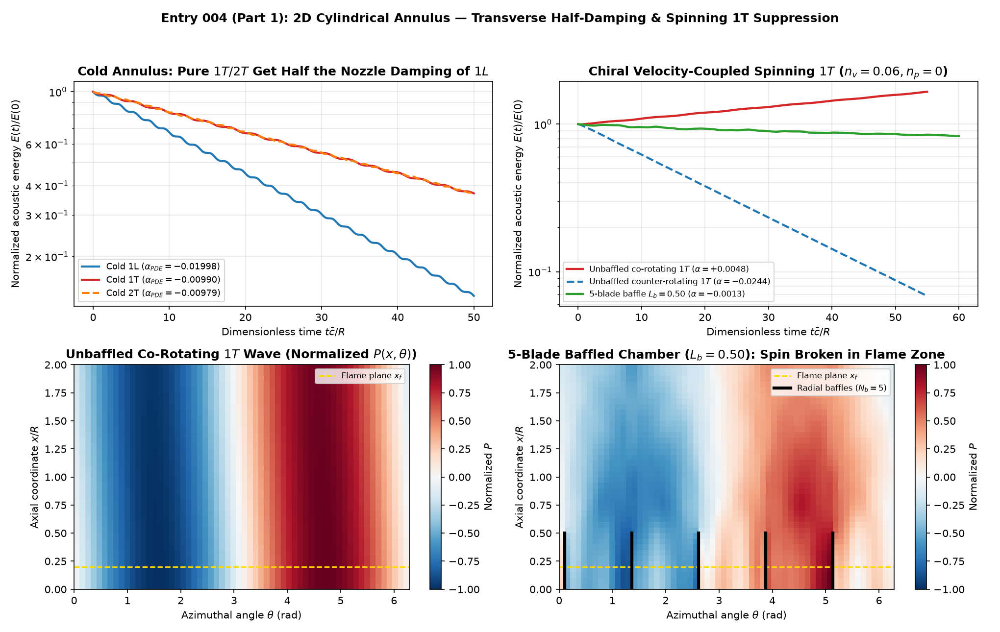

# 004 — 2D Transverse / Spinning Tangential Modes ($1T, 2T$) & Radial Faceplate Baffles

- **Date:** 2026-11-23
- **Status:** `verified`
- **Verification Script:** `../sim/exp004_2d_transverse_baffles.py`

## 1. Target

In high-thrust liquid rocket engines (Saturn V F-1, RD-170, Raptor), the most destructive instabilities are **transverse tangential waves ($1T, 2T$)**—spinning circumferential oscillations near the injector faceplate that scrub away wall thermal boundary layers in milliseconds—which 1D longitudinal models cannot capture.

In this session we build and verify a **2D cylindrical-annulus staggered C-grid PDE solver** carrying forward Entry `000`–`003`'s DC-blocking high-pass filter ($H_{\text{hp}}(s) = s/(s + 0.15)$) and causal Erlang-4 time-lag filter, and adding **transverse velocity-coupled combustion** plus **radial injector faceplate baffles**, to test:

1. Exact cold-flow 2D dispersion ($1L, 1T, 2T, 1L1T$) and why pure tangential modes suffer **half the nozzle damping** of longitudinal modes.
2. How chiral/swirled transverse velocity coupling selectively destabilizes **co-rotating spinning $1T$ waves** while damping counter-rotating waves.
3. How **radial faceplate baffle length ($L_b$)** and **blade count ($N_b \in \{0, 2, 3, 4, 5, 6\}$)** suppress spinning $1T$, detune transverse eigenfrequencies, and expose both a **short-baffle tip-amplification hazard** and the **even-vs-odd baffle symmetry trap**.

## 2. The Math & Assumptions

### Governing 2D Cylindrical-Annulus Equations

On $(x, \theta) \in [0, L_a] \times [0, 2\pi)$ (lengths scaled by chamber radius $R$, time by $R/\bar{c}$, aspect ratio $L_a = L/R = 2.0$):

$$\frac{\partial U_x}{\partial t} + \frac{\partial P}{\partial x} = 0, \qquad \frac{\partial U_\theta}{\partial t} + \frac{\partial P}{\partial \theta} = 0, \qquad \frac{\partial P}{\partial t} + \frac{\partial U_x}{\partial x} + \frac{\partial U_\theta}{\partial \theta} = \dot{Q}(x, \theta, t)$$

- **Boundaries:** stiff faceplate $U_x(0, \theta) = 0$; lumped nozzle/end admittance $U_x(L_a, \theta) = \zeta P(L_a, \theta)$ ($\zeta = 0.04$); periodic $\theta \in [0, 2\pi)$.
- **Radial faceplate baffles ($N_b$ blades of length $L_b$):** solid-wall impermeability $U_\theta(x, \theta_b, t) = 0$ for $x \in [0, L_b]$, $\theta_b = 2\pi b / N_b$. On a staggered C-grid this enforces zero flux identically, preserving the exact discrete 2D Rayleigh energy balance for any $(N_b, L_b)$.
- **Flame law (DC-blocked, causal Erlang-4, $\bar{\tau} = 0.30, \sigma_\tau = 0.15 \implies \tau_0 = 0$):**
  $$\dot{Q}(x, \theta, t) = \delta(x - x_f)\Big[n_p\,q_p(\theta, t) + n_v\,q_v(\theta, t)\Big]$$
  where $q_p, q_v$ are filtered $P(x_f, \theta)$ and azimuthal cross-flow velocity $U_\theta(x_f, \theta)$ (modeling directional/swirled coaxial injector velocity sensitivity).

### Exact 2D Unbaffled Dispersion & Two Structural Theorems

For azimuthal mode $m$ and spin direction $\sigma \in \{+1, -1\}$ ($P \propto e^{st - i\sigma m\theta}$), $\partial_t U_\theta + \partial_\theta P = 0 \implies U_\theta = (i\sigma m / s) P$, giving $\kappa_m = \sqrt{s^2 + m^2}$ and exact dispersion:

$$\kappa_m \sinh(\kappa_m L_a) + \zeta s \cosh(\kappa_m L_a) = \left(n_p + n_v\frac{i\sigma m}{s}\right)H_{\text{hp}}(s)\hat{g}(s)\,s\cosh(\kappa_m x_f)\left[\cosh\big(\kappa_m(L_a - x_f)\big) + \frac{\zeta s}{\kappa_m}\sinh\big(\kappa_m(L_a - x_f)\big)\right]$$

1. **Transverse Half-Damping Theorem (cold flow, $n_p = n_v = 0$):** Expanding pure tangential modes ($k_x = 0, m \ge 1$) near $s = im$ yields $\alpha_{mT}^{\text{cold}} \approx -\frac{\zeta}{2 L_a}$, whereas longitudinal modes ($k_x \ge 1$) get $\alpha_{kL}^{\text{cold}} \approx -\frac{\zeta}{L_a}$ — pure transverse modes experience **exactly half the nozzle damping** because their pressure energy is uniform axially rather than peaking at $2\times$ mean energy at the nozzle wall.
2. **Spinning Selection Theorem:** For a co-rotating wave ($\sigma = +1, s \approx im$), $U_\theta \approx +P$ (in phase with pressure everywhere $\implies$ full Rayleigh driving); for a counter-rotating wave ($\sigma = -1$), $U_\theta \approx -P$ (out of phase $\implies$ strong damping); for a standing wave, $\int_0^{2\pi}\cos(m\theta)\sin(m\theta)\,d\theta = 0$ (zero net linear velocity-coupled driving).

### Intentional Simplifications
- Thin-annulus cylindrical shell (no radial coordinate $r$ or radial modes $1R$ yet; pure $1T$ frequency is $1.0$ vs. Bessel root $j'_{1,1} = 1.841$ in a solid cylinder).
- Linearized bulk acoustics (zero mean bulk advection; no baffle-tip vortex-shedding acoustic dissipation—baffles here act purely through conservative geometric blockage and frequency detuning).

## 3. The Verification

Reproduce from the repo root:

```bash
uv run python rocket-combustion/sim/exp004_2d_transverse_baffles.py
```

### Experiment 1 & 2 — Exact 2D Dispersion vs. Staggered C-Grid PDE ($40 \times 60$, RK4)

| Case | Mode | Exact $s = \alpha + i\omega$ | 2D PDE Fit $s = \alpha + i\omega$ | $|\Delta\alpha|$ | Energy Balance Err |
| :--- | :---: | :---: | :---: | :---: | :---: |
| Cold $1L$ | $(m=0, k_x=1)$ | $-0.020011 + 1.57080i$ | $-0.019980 + 1.57036i$ | $3.1\times 10^{-5}$ | $4.9\times 10^{-6}$ |
| Cold $1T$ | $(m=1, k_x=0)$ | $-0.010000 + 1.00022i$ | $-0.009905 + 0.99990i$ | $9.5\times 10^{-5}$ | $1.9\times 10^{-6}$ |
| Cold $2T$ | $(m=2, k_x=0)$ | $-0.009983 + 2.00051i$ | $-0.009791 + 1.99657i$ | $1.9\times 10^{-4}$ | $2.8\times 10^{-6}$ |
| Cold $1L1T$ | $(m=1, k_x=1)$ | $-0.020014 + 1.86214i$ | $-0.020018 + 1.86142i$ | $4.1\times 10^{-6}$ | $5.3\times 10^{-6}$ |
| Hot co-rotating $1T$ ($n_v=0.06$) | $(m=1, \sigma=+1)$ | $+0.004678 + 0.99893i$ | $+0.004790 + 0.99856i$ | $1.1\times 10^{-4}$ | $7.3\times 10^{-7}$ |
| Hot counter-rotating $1T$ ($n_v=0.06$) | $(m=1, \sigma=-1)$ | $-0.024548 + 1.00260i$ | $-0.024353 + 1.00303i$ | $2.0\times 10^{-4}$ | $2.4\times 10^{-6}$ |

- Verified cold damping ratio $\alpha_{1T}/\alpha_{1L} = \mathbf{0.4997}$ (exact $1/2$ theorem).



### Experiment 3A — Baffle Length Sweep ($N_b = 5$, $x_f = 0.20$, Spinning $1T$, $n_v = 0.06$)

| $L_b / R$ | $L_b / L_a$ | Hot $\alpha$ | Cold $\omega_{1T}$ | Spin Index | Energy Err | Regime |
| :---: | :---: | :---: | :---: | :---: | :---: | :--- |
| $0.00$ | $0.000$ | $+0.00466$ | $1.0025$ | $1.004$ | $7.0\times 10^{-7}$ | Unbaffled unstable spin |
| **$0.15$ ($< x_f$)** | $0.075$ | **$+0.00561$** | $0.9921$ | **$1.052$** | $1.2\times 10^{-5}$ | **WORSE! Short-baffle tip amplification** |
| $0.25$ | $0.125$ | $+0.00143$ | $0.9715$ | $0.740$ | $2.2\times 10^{-5}$ | Partial blockage, still unstable |
| $0.35$ | $0.175$ | $+0.00014$ | $0.9508$ | $0.614$ | $2.9\times 10^{-5}$ | Near-neutral ($L_b \approx 1.8 x_f$) |
| **$0.50$** | $0.250$ | **$-0.00128^*$** | $0.9095$ | $0.475$ | $3.7\times 10^{-5}$ | **Stabilized** ($-9.3\%$ detuning) |
| $0.70$ | $0.350$ | $-0.00267$ | $0.8475$ | $0.326$ | $4.7\times 10^{-5}$ | Strongly stabilized ($-15.5\%$ detuning) |
| $0.90$ | $0.450$ | $-0.00349$ | $0.7751$ | $0.343$ | $5.7\times 10^{-5}$ | Strongly stabilized ($-22.5\%$ detuning) |

*\*Grid convergence check at $N_b = 5, L_b = 0.50$: $40 \times 60$ gives $\alpha = -0.00128$ (`E_err = 3.7e-5`) vs. $60 \times 90$ giving $\alpha = -0.00089$ (`E_err = 2.7e-5`, $|\Delta\alpha| = 4.0\times 10^{-4}$).*

### Experiment 3B — Even-vs-Odd Baffle Symmetry Trap ($L_b = 0.60$)

| $N_b$ | Vel-Coupled Spinning $1T$ $\alpha$ | Worst-Case Aligned $1T$ Detuning | Worst-Case Aligned $2T$ Detuning | Blind Spot |
| :---: | :---: | :---: | :---: | :--- |
| $0$ | $+0.00466$ | $0\%$ ($\omega = 1.001$) | $0\%$ ($\omega = 1.993$) | Unbaffled |
| **$2$** | **$-0.01457$** *(breaks spin!)* | **$0\%$ (BLIND SPOT!)** | **$0\%$ (BLIND SPOT!)** | Standing $1T$ & $2T$ untouched |
| $3$ | $+0.00060$ *(wide $120^\circ$ gaps)* | $+8.72\%$ | $+8.24\%$ | Standing $3T$ only |
| **$4$** | $-0.00074$ | $+10.69\%$ | **$0\%$ (BLIND SPOT!)** | Standing $2T$ untouched |
| **$5$** | **$-0.00203$** | **$+11.67\%$** | **$+22.47\%$** | **None below $5T$ (odd winner!)** |
| $6$ | $-0.00291$ | $+12.65\%$ | $+22.96\%$ | Standing $3T$ untouched |


Full metrics: [`../results/exp004_metrics.json`](../results/exp004_metrics.json).

## 4. Verdict & Dead Ends

- **What broke / unexpected design traps uncovered:**
  - **Short-baffle tip amplification ($L_b < x_f$):** Installing baffles that terminate upstream of the combustion plane ($L_b = 0.15 < x_f = 0.20$) actually **destabilizes** spinning $1T$ further ($+0.00466 \to +0.00561$) by funneling accelerated azimuthal cross-flow right over the baffle tips across the flame zone. Stabilizing spinning $1T$ requires extending baffles substantially past the flame plane ($L_b \gtrsim 1.8 x_f$).
  - **Even-baffle symmetry blind spots:** $N_b = 2$ leaves aligned standing $1T$ and $2T$ modes completely unperturbed ($0\%$ shift), and $N_b = 4$ leaves aligned standing $2T$ completely unperturbed ($0\%$ shift), because velocity nodes can sit squarely on the blades.
  - **Subtle positive surprise on $N_b = 2$ for pure spin:** Even though $N_b = 2$ has a standing-$1T$ blind spot (fatal under pressure coupling), it actually achieved the strongest *velocity-coupled spin* damping ($\alpha = -0.01457$) because splitting the degenerate $\cos\theta / \sin\theta$ frequencies destroys coherent $1T$ spinning waves!
- **What worked:**
  - **Odd prime blade count ($N_b = 5$, $L_b \ge 0.50$)** simultaneously stabilizes chiral velocity-coupled spinning $1T$ ($\alpha = -0.00203$), strongly detunes *all* aligned $1T$ ($+11.7\%$) and $2T$ ($+22.5\%$) standing modes, and has no geometric blind spot below $5T$—explaining from first principles why real high-thrust engines (like the F-1's 5/7-blade injectors) favor odd baffle symmetries.
- **Next single hypothesis to test (`005`):**
  - **Baffle-Free Transverse Stabilization via Azimuthally Asymmetric Acoustic Cavities vs. Non-Axisymmetric Injector Lag Phasing ($\tau(\theta)$):** Heavy protruding baffles suffer brutal heat loads and add mass. In our verified 2D annulus, can we break $SO(2)$ rotational symmetry *without protruding baffles*—comparing **(a) an azimuthally asymmetric ring of faceplate Helmholtz cavities** ($\beta(\theta), \omega_H(\theta)$) vs. **(b) additive-manufactured azimuthal injector time-lag staggering $\tau(\theta)$**—to suppress BOTH spinning velocity-coupled $1T$ AND pressure-coupled $1T/2T$ modes simultaneously?
