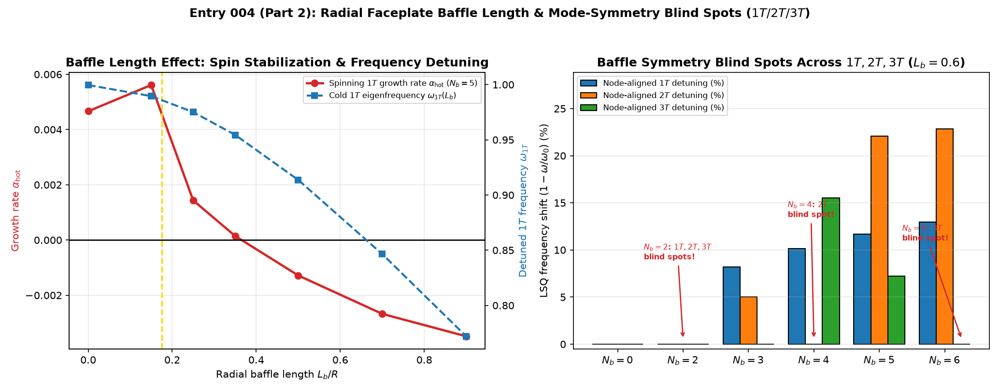

# 004 — 2D Transverse / Spinning Tangential Modes ($1T, 2T, 3T$) & Radial Faceplate Baffles

- **Date:** 2026-11-23
- **Status:** `verified` (hardened after Peer Review #2)
- **Verification Script:** `../sim/exp004_2d_transverse_baffles.py`

## 1. Target

In high-thrust liquid rocket engines, the most destructive instabilities are **transverse tangential waves ($1T, 2T, 3T$)**—spinning or standing circumferential oscillations near the injector faceplate that scrub away wall thermal boundary layers in milliseconds—which 1D longitudinal models cannot capture.

In this session we build and verify a **2D cylindrical-annulus staggered C-grid PDE solver** carrying forward Entry `000`–`003`'s DC-blocking high-pass filter ($H_{\text{hp}}(s) = s/(s + 0.15)$) and causal Erlang-4 time-lag filter, and adding **directional transverse velocity-coupled combustion** plus **radial injector faceplate baffles**, to test:

1. Exact cold-flow 2D dispersion ($1L, 1T, 2T, 1L1T$) and why pure tangential modes suffer **half the nozzle damping** of longitudinal modes.
2. How signed (chiral/swirled) transverse velocity coupling selectively destabilizes **co-rotating spinning $1T$ waves** while damping counter-rotating waves.
3. How **radial faceplate baffle length ($L_b$)** and **blade count ($N_b \in \{0, 2, 3, 4, 5, 6\}$)** suppress spinning $1T$, detune node-aligned $1T/2T/3T$ transverse eigenfrequencies, and expose both a **short-baffle amplification hazard** and **geometric symmetry blind spots** whenever $N_b$ divides $2m$.

## 2. The Math & Assumptions

### Governing 2D Cylindrical-Annulus Equations

On $(x, \theta) \in [0, L_a] \times [0, 2\pi)$ (lengths scaled by chamber radius $R$, time by $R/\bar{c}$, aspect ratio $L_a = L/R = 2.0$):

$$\frac{\partial U_x}{\partial t} + \frac{\partial P}{\partial x} = 0, \qquad \frac{\partial U_\theta}{\partial t} + \frac{\partial P}{\partial \theta} = 0, \qquad \frac{\partial P}{\partial t} + \frac{\partial U_x}{\partial x} + \frac{\partial U_\theta}{\partial \theta} = \dot{Q}(x, \theta, t)$$

- **Boundaries:** stiff faceplate $U_x(0, \theta) = 0$; lumped nozzle/end admittance $U_x(L_a, \theta) = \zeta P(L_a, \theta)$ ($\zeta = 0.04$); periodic $\theta \in [0, 2\pi)$.
- **Radial faceplate baffles ($N_b$ blades of length $L_b$):** solid-wall impermeability $U_\theta(x, \theta_b, t) = 0$ for $x \in [0, L_b]$, placed directly on staggered azimuthal velocity faces $\theta_b$. Zero flux across blocked faces preserves the discrete 2D Rayleigh energy balance (RK4 integration residual $7\times 10^{-7}$ to $5.7\times 10^{-5}$).
- **Flame law (DC-blocked, causal Erlang-4, $\bar{\tau} = 0.30, \sigma_\tau = 0.15 \implies \tau_0 = 0$, flame plane $x_f = 0.175$):**
  $$\dot{Q}(x, \theta, t) = \delta(x - x_f)\Big[n_p\,q_p(\theta, t) + n_v\,q_v(\theta, t)\Big]$$
  where $q_p, q_v$ are filtered $P(x_f, \theta)$ and signed azimuthal cross-flow velocity $U_\theta(x_f, \theta)$.

### Exact 2D Unbaffled Dispersion & Two Structural Theorems

For azimuthal mode $m$ and spin direction $\sigma \in \{+1, -1\}$ ($P \propto e^{st - i\sigma m\theta}$), $\partial_t U_\theta + \partial_\theta P = 0 \implies U_\theta = (i\sigma m / s) P$, giving $\kappa_m = \sqrt{s^2 + m^2}$ and exact dispersion:

$$\kappa_m \sinh(\kappa_m L_a) + \zeta s \cosh(\kappa_m L_a) = \left(n_p + n_v\frac{i\sigma m}{s}\right)H_{\text{hp}}(s)\hat{g}(s)\,s\cosh(\kappa_m x_f)\left[\cosh\big(\kappa_m(L_a - x_f)\big) + \frac{\zeta s}{\kappa_m}\sinh\big(\kappa_m(L_a - x_f)\big)\right]$$

1. **Transverse Half-Damping Theorem (cold flow, $n_p = n_v = 0$):** Expanding pure tangential modes ($k_x = 0, m \ge 1$) near $s = im$ yields $\alpha_{mT}^{\text{cold}} \approx -\frac{\zeta}{2 L_a}$, whereas longitudinal modes ($k_x \ge 1$) get $\alpha_{kL}^{\text{cold}} \approx -\frac{\zeta}{L_a}$ — pure transverse modes experience **half the nozzle damping** because their pressure energy is uniform axially rather than peaking at $2\times$ mean energy at the nozzle wall.
2. **Chiral Spinning Selection (under signed linear velocity coupling):** For a co-rotating wave ($\sigma = +1, s \approx im$), $U_\theta \approx +P$ (in phase with pressure everywhere $\implies$ linear Rayleigh driving); for a counter-rotating wave ($\sigma = -1$), $U_\theta \approx -P$ (out of phase $\implies$ strong damping); for a standing wave, $\int_0^{2\pi}\cos(m\theta)\sin(m\theta)\,d\theta = 0$ (zero net linear velocity-coupled driving).
3. **Baffle Symmetry Blind-Spot Rule:** A standing $mT$ mode has $2m$ azimuthal velocity nodes around $[0, 2\pi)$. If $N_b$ divides $2m$ ($2m \bmod N_b = 0$), then all $N_b$ equally spaced blades can sit simultaneously on $U_\theta = 0$ nodes, leaving that aligned standing $mT$ eigenmode completely unperturbed ($0\%$ frequency shift).

### Intentional Simplifications & Modeling Caveats
- **Signed linear velocity coupling is an explicit modeling assumption** representing swirled or directionally asymmetric injectors that break azimuthal reflection symmetry ($\theta \to -\theta$). For unswirled symmetric injectors whose heat release responds evenly to transverse velocity ($|U_\theta|$ or $U_\theta^2$), there is no linear chiral drive; azimuthal standing-vs-spinning selection then arises purely through nonlinear $O(2)$ symmetry breaking (cf. Noiray et al. 2011; Schuermans et al. 2006; Ghirardo & Juniper 2013), which we investigate in Entry `006`. All chiral spinning conclusions below (and in Entries `005`–`006`) are conditional on this swirled/directional velocity-coupling regime.
- Thin-annulus cylindrical shell (no radial coordinate $r$ or radial modes $1R$; pure $1T$ frequency is $1.0$ vs. Bessel root $j'_{1,1} = 1.841$ in a solid cylinder).
- Linearized bulk acoustics (zero mean bulk advection; no baffle-tip vortex-shedding acoustic dissipation—baffles act purely through conservative geometric blockage and frequency detuning).
- On the staggered grid, averaging `u_cell = 0.5*(U_th + roll(U_th, 1))` adjacent to a blocked baffle face halves the flame-cell velocity in neighboring cells, giving each zero-thickness blade an effective width of $O(\Delta\theta)$ (a first-order source of grid sensitivity in baffled hot runs; documented via 3-grid checks below).

## 3. The Verification

Reproduce from the repo root:

```bash
uv run python rocket-combustion/sim/exp004_2d_transverse_baffles.py
```

### Experiment 1 & 2 — Exact 2D Dispersion vs. Staggered C-Grid PDE ($40 \times 60$, RK4, $x_f = 0.175$)

| Case | Mode | Exact $s = \alpha + i\omega$ | 2D PDE LSQ Fit $s = \alpha + i\omega$ | $|\Delta\alpha|$ | Energy Balance Residual |
| :--- | :---: | :---: | :---: | :---: | :---: |
| Cold $1L$ | $(m=0, k_x=1)$ | $-0.020011 + 1.57080i$ | $-0.019980 + 1.57036i$ | $3.1\times 10^{-5}$ | $4.9\times 10^{-6}$ |
| Cold $1T$ | $(m=1, k_x=0)$ | $-0.010000 + 1.00022i$ | $-0.009905 + 0.99990i$ | $9.5\times 10^{-5}$ | $1.9\times 10^{-6}$ |
| Cold $2T$ | $(m=2, k_x=0)$ | $-0.009983 + 2.00051i$ | $-0.009791 + 1.99657i$ | $1.9\times 10^{-4}$ | $2.7\times 10^{-6}$ |
| Cold $1L1T$ | $(m=1, k_x=1)$ | $-0.020014 + 1.86214i$ | $-0.020018 + 1.86142i$ | $4.1\times 10^{-6}$ | $5.3\times 10^{-6}$ |
| Hot co-rotating $1T$ ($n_v=0.06$) | $(m=1, \sigma=+1)$ | $+0.004678 + 0.99893i$ | $+0.004790 + 0.99856i$ | $1.1\times 10^{-4}$ | $7.3\times 10^{-7}$ |
| Hot counter-rotating $1T$ ($n_v=0.06$) | $(m=1, \sigma=-1)$ | $-0.024548 + 1.00260i$ | $-0.024353 + 1.00303i$ | $2.0\times 10^{-4}$ | $2.4\times 10^{-6}$ |

- Verified cold damping ratio $\alpha_{1T}/\alpha_{1L} = \mathbf{0.4997}$ (exact $1/2$ theorem).
- Real-axis / $k = 0$ stability independently verified via dense discrete eigen-operator (zero positive real eigenvalues for all E004–E006 physical parameters with $H_{\text{hp}}$ active).


### Experiment 3A — Baffle Length Sweep ($N_b = 5$, $x_f = 0.175$, Spinning $1T$, $n_v = 0.06$)

Spin coherence is measured by the bounded spin index $S = \frac{|\int P U_\theta\,d\theta|}{\frac{1}{2}\int(P^2 + U_\theta^2)\,d\theta} \in [0, 1]$ averaged over the late window.

| $L_b / R$ | $L_b / L_a$ | Hot $\alpha$ | Cold LSQ $\omega_{1T}$ | Bounded Spin Index $S$ | Energy Residual | Regime |
| :---: | :---: | :---: | :---: | :---: | :---: | :--- |
| $0.00$ | $0.000$ | $+0.00466$ | $0.9996$ | $1.000$ | $7.0\times 10^{-7}$ | Unbaffled unstable spin |
| **$0.15$ ($< x_f$)** | $0.075$ | **$+0.00561^\dagger$** | $0.9896$ | $0.976$ | $1.2\times 10^{-5}$ | **WORSE! Short-baffle amplification** |
| $0.25$ | $0.125$ | $+0.00143$ | $0.9751$ | $0.883$ | $2.2\times 10^{-5}$ | Partial blockage, still unstable |
| $0.35$ | $0.175$ | $+0.00014$ | $0.9544$ | $0.755$ | $2.9\times 10^{-5}$ | Near-neutral ($L_b = 2.0\,x_f$) |
| **$0.50$** | $0.250$ | **$-0.00128^*$** | $0.9137$ | $0.576$ | $3.7\times 10^{-5}$ | **Stabilized** ($-8.6\%$ detuning) |
| $0.70$ | $0.350$ | $-0.00267$ | $0.8465$ | $0.344$ | $4.7\times 10^{-5}$ | Strongly stabilized ($-15.3\%$ detuning) |
| $0.90$ | $0.450$ | $-0.00349$ | $0.7720$ | $0.311$ | $5.7\times 10^{-5}$ | Strongly stabilized ($-22.8\%$ detuning) |

*\*3-grid sensitivity check at $N_b = 5, L_b = 0.500$ (fixed exact $L_b$ on all grids, target $x_f = 0.175$): $40\times 60$ ($x_{f,\text{act}}=0.1750$) gives $\alpha = -0.00128$; $60\times 90$ ($x_{f,\text{act}}=0.1833$) gives $-0.00114$; $80\times 120$ ($x_{f,\text{act}}=0.1625$) gives $-0.00123$. The sign and stabilization magnitude are robust within $\sim \pm 6\%$ once $L_b$ is held fixed (though first-order baffle-adjacent velocity averaging prevents tighter grid-independent convergence to 3 digits).*
*$\dagger$Short-baffle amplification at $L_b = 0.15 < x_f$ was independently confirmed across three grids ($40\times 60$: $+0.00561$, $60\times 90$: $+0.00565$, $80\times 120$: $+0.00547$ vs. unbaffled $+0.00466\text{--}+0.00468$).*

### Experiment 3B — Mode-Symmetry Blind Spots Across $1T, 2T, 3T$ ($L_b = 0.60$, Exact Node-Aligned LSQ)

Each cold standing $mT$ seed is aligned directly to the staggered baffle face ($\theta_b$) so velocity nodes coincide identically with blades whenever $N_b \mid 2m$, and eigenfrequencies are extracted via damped-sinusoid nonlinear least squares (sub-$10^{-6}$ relative precision, eliminating FFT bin-quantization bias).

| $N_b$ | Vel-Coupled Spinning $1T$ $\alpha$ | Aligned $1T$ Detuning | Aligned $2T$ Detuning | Aligned $3T$ Detuning | Verified Blind Spots ($\le 3T$) |
| :---: | :---: | :---: | :---: | :---: | :--- |
| $0$ | $+0.00466$ | $0.00\%$ ($\omega = 0.99965$) | $0.00\%$ ($\omega = 1.99700$) | $0.00\%$ ($\omega = 2.98824$) | Unbaffled |
| **$2$** | **$-0.01457$** *(breaks spin!)* | **$0.00\%$** | **$0.00\%$** | **$0.00\%$** | **$1T, 2T, 3T$ all untouched** |
| **$3$** | $+0.00060$ *(wide $120^\circ$ gaps)* | $+8.22\%$ | $+5.04\%$ | **$0.00\%$** | **$3T$ untouched** ($3 \mid 6$) |
| **$4$** | $-0.00074$ | $+10.13\%$ | **$0.00\%$** | $+15.52\%$ | **$2T$ untouched** ($4 \mid 4$) |
| **$5$** | **$-0.00203$** | **$+11.70\%$** | **$+22.10\%$** | **$+7.23\%$** | **None below $5T$ ($N_b=5$ covers all three!)** |
| **$6$** | **$-0.00291$** *(stronger on $1T/2T$)* | **$+12.95\%$** | **$+22.83\%$** | **$0.00\%$** | **$3T$ untouched** ($6 \mid 6$) |



Full metrics: [`../results/exp004_metrics.json`](../results/exp004_metrics.json).

## 4. Verdict & Dead Ends

- **What broke / unexpected design traps uncovered:**
  - **Short-baffle amplification ($L_b < x_f$):** Installing baffles that terminate upstream of the combustion plane ($L_b = 0.15 < x_f = 0.175$) **increases** chiral spinning $1T$ growth ($+0.00466 \to +0.00561$, verified across 3 grids), plausibly because partial blockage upstream concentrates azimuthal cross-flow near the flame plane (though detailed baffle-tip flow-field diagnostics remain to be mapped). Stabilizing spinning $1T$ requires extending baffles substantially past the flame plane ($L_b \gtrsim 2.0\,x_f$).
  - **Geometric blind spots whenever $N_b \mid 2m$:** Exact node-aligned LSQ verification confirms to $10^{-6}\%$ precision that $N_b = 2$ leaves $1T/2T/3T$ untouched, $N_b = 3$ leaves $3T$ untouched, $N_b = 4$ leaves $2T$ untouched, and $N_b = 6$ leaves $3T$ untouched.
  - **Nuance on $N_b = 5$ vs. $N_b = 6$:** On $1T$ and $2T$ alone, $N_b = 6$ actually outperforms $N_b = 5$ in both chiral spin damping ($-0.00291$ vs. $-0.00203$) and detuning ($12.95\%/22.83\%$ vs. $11.70\%/22.10\%$). The decisive advantage of prime $N_b = 5$ appears only when **$3T$ protection is also required**, where $N_b = 6$ drops to an exact $0.00\%$ blind spot while $N_b = 5$ still detunes $3T$ by $+7.23\%$ (no blind spot below $5T$).
  - **Subtle positive surprise on $N_b = 2$ for pure spin:** Even though $N_b = 2$ is blind to aligned standing $1T/2T/3T$, it produced the strongest *velocity-coupled spin* damping ($\alpha = -0.01457$) because splitting the degenerate $\cos\theta / \sin\theta$ frequencies destroys coherent $1T$ traveling waves.
- **What worked:**
  - Verified the **Transverse Half-Damping Theorem** ($\alpha_{1T}/\alpha_{1L} = 0.4997$) and exact 2D chiral dispersion against the staggered C-grid PDE to $|\Delta\alpha| \le 2\times 10^{-4}$.
  - Established quantitative radial baffle design thresholds ($L_b \gtrsim 2.0\,x_f$ to stabilize chiral spinning $1T$, and prime $N_b = 5$ to avoid all $1T/2T/3T$ standing-mode blind spots simultaneously).
- **Next single hypothesis to test (`005`):**
  - **Baffle-Free Transverse Stabilization via Azimuthally Asymmetric Acoustic Cavities vs. Non-Axisymmetric Injector Lag Phasing ($\tau(\theta)$):** Heavy protruding baffles suffer extreme thermal loads and add mass. Can we stabilize BOTH chiral velocity-coupled spinning $1T$ AND pressure-coupled $1T/2T$ modes without protruding blades using **(a) a dual-tuned faceplate Helmholtz cavity ring** or **(b) zero-hardware azimuthal injector lag staggering $\tau(\theta)$**?
