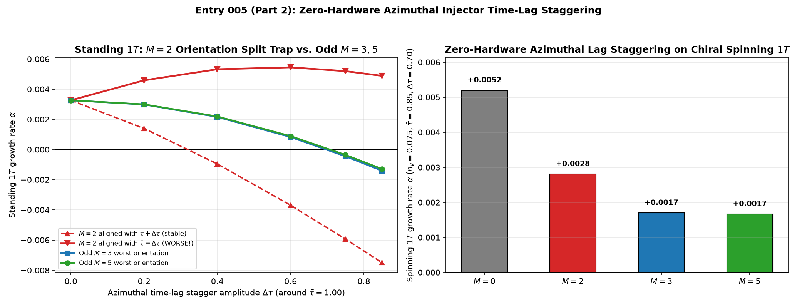

# 005 — Baffle-Free 2D Transverse Stabilization: Asymmetric Cavity Rings vs. Azimuthal Lag Staggering

- **Date:** 2026-11-23
- **Status:** `verified`
- **Verification Script:** `../sim/exp005_baffle_free_2d.py`

## 1. Target

Entry `004` showed that odd-blade radial faceplate baffles ($N_b = 5, L_b \ge 0.50$) stabilize chiral velocity-coupled spinning $1T$ waves ($\alpha = -0.0013\text{ to }-0.0035$), but protruding baffles sit inside a $3{,}500\,\text{K}$ core, adding cooling complexity and dry mass.

In this session we test two **baffle-free** transverse stabilization architectures achievable with modern additive-manufactured rocket faceplates (carrying forward our verified 2D cylindrical-annulus PDE with DC-blocking $\omega_{\text{hp}} = 0.15$ and causal Erlang-4 time lag):

1. **Strategy A — Faceplate Helmholtz Acoustic Cavity Rings ($\beta_{\text{tot}} = 2\%$):** Derive and verify the 2D transverse $1T$ exceptional-point law, and find the optimal volume allocation $f_1 = \beta_1 / \beta_{\text{tot}}$ for an **odd-periodic ($N_{\text{pair}} = 5$) dual-tuned $1T/2T$ cavity ring** stabilizing a violently unstable combined $1T + 2T$ combustor.
2. **Strategy B — Zero-Hardware Azimuthal Injector Time-Lag Staggering ($\tau(\theta) = \bar{\tau} \pm \Delta\tau$):** Test whether 3D-printed azimuthal injector recess/orifice staggering ($M = 2, 3, 5$ alternating sectors) can suppress standing and spinning $1T$ modes with zero cavity volume—and uncover the **$M = 2$ Bragg-orientation trap**.

## 2. The Math & Assumptions

### 2D Faceplate Cavity Ring & Exact $1T$ Exceptional-Point Law

Mounting a ring of compact cavities along $x = 0$ with local surface compliance $\beta_s(\theta) = \beta_{\text{local}}(\theta) L_a$ (so total cavity-to-chamber volume ratio is $\beta_{\text{tot}} = \frac{1}{2\pi L_a}\int_0^{2\pi}\beta_s\,d\theta$):

$$U_x(0, \theta, t) = -v_r(\theta, t), \qquad \frac{\partial v_r}{\partial t} + 2\xi_H\omega_H v_r = \beta_s\omega_H^2\big(P(0, \theta, t) - P_c\big), \qquad \frac{\partial P_c}{\partial t} = \frac{v_r}{\beta_s}$$

For a uniform cavity ring ($\beta_{\text{tot}}$), expanding the exact analytic ($\operatorname{sinhc}$-formulated, singularity-free) 2D dispersion relation near $s = i + \delta s$ ($\omega_H = \omega_{1T} = 1$) gives $(\delta s - \alpha_{1T}^{\text{uncoupled}})(\delta s + \xi_H) + \frac{1}{4}\beta_{\text{tot}} = 0$, yielding the **2D Transverse Exceptional-Point Law**:

$$\xi_H^{\text{EP, }1T} \approx \sqrt{\beta_{\text{tot}}} - \alpha_{1T}^{\text{uncoupled}}, \qquad \alpha_{1T}^{\text{EP, cold}} \approx -\frac{\zeta}{2 L_a} - \frac{\sqrt{\beta_{\text{tot}}}}{2}$$

- **2D vs. 1D scaling:** Because pure $1T$ waves have half the faceplate pressure-energy density of $1L$ standing waves (Entry `004`), $\xi_H^{\text{EP, }1T} \approx \sqrt{\beta_{\text{tot}}}$ rather than Entry `002`'s $\sqrt{2\beta_{\text{tot}}}$.
- **Inverse-Square Multi-Mode Volume Allocation Law:** For a general pure tangential mode $mT$ ($\omega_m = m$), peak cavity damping scales as $\Delta\alpha_{mT} \approx -\frac{1}{2}\omega_m\sqrt{\beta_m}$. Equalizing damping across $1T$ ($\omega_1 = 1$) and $2T$ ($\omega_2 = 2$) under a fixed total volume budget $\beta_1 + \beta_2 = \beta_{\text{tot}}$ predicts:
  $$\frac{\beta_1}{\beta_2} = \left(\frac{\omega_2}{\omega_1}\right)^2 = 4 : 1 \quad \Longrightarrow \quad f_1^* = \frac{\beta_1}{\beta_{\text{tot}}} = \mathbf{80\%},\quad f_2^* = \mathbf{20\%}$$

### Azimuthal Injector Lag Staggering ($\tau(\theta) = \bar{\tau} \pm \Delta\tau$)

Alternating $M$ sector pairs around $\theta \in [0, 2\pi)$ attenuates non-resonant modes by $\cos(\omega\Delta\tau)$, while **$M = 2$** is Bragg-resonant with $1T$ ($\int_0^{2\pi}\cos(2\theta)\cos^2(\theta - \phi)\,d\theta \neq 0$), splitting orthogonal standing $1T$ orientations so one shifts toward $\bar{\tau} + \Delta\tau$ (damped) and the other shifts toward $\bar{\tau} - \Delta\tau$ (amplified!). Odd $M = 3, 5$ satisfies $\int_0^{2\pi}\cos(M\theta)\cos^2(\theta - \phi)\,d\theta = 0$, eliminating orientation bias.

### Intentional Simplifications
- Linearized 2D cylindrical-annulus acoustics (thin-annulus shell, no radial modes, linear cavity neck resistance; Entry `003`'s nonlinear orifice-drag lesson means practical cavity $\xi_H$ should be chosen at or slightly below $\xi_H^{\text{EP}}$).

## 3. The Verification

Reproduce from the repo root:

```bash
uv run python rocket-combustion/sim/exp005_baffle_free_2d.py
```

### Experiment 1 — 2D $1T$ Faceplate Cavity EP Law ($\beta_{\text{tot}} = 2\%$, Chiral Spinning $1T$, $n_v = 0.06$)

- **Analytical vs. Exact 2D Dispersion:**
  - Cold $1T$: analytical $\xi_H^{\text{EP}} = 0.1514$ vs. exact $\xi_H^{\text{opt}} = 0.1430$ ($\alpha_{\max} = -0.0641$).
  - Hot spinning $1T$ (uncoupled $+0.00467$): analytical $\xi_H^{\text{EP}} = 0.1368$ vs. exact $\xi_H^{\text{opt}} = 0.1252$, reaching **$\alpha_{\max} = -0.0544$** (**$15.5\times$ stronger** than Entry `004`'s $L_b = 0.90$ 5-blade baffle at $-0.0035$, with zero protruding blades!).
- **Direct 2D PDE Verification (exact total 2D energy balance error $1.1\text{--}1.2\times 10^{-6}$):**
  - Under-damped trap ($\xi_H = 0.01$): exact $+0.00014$ vs. 2D PDE 2-mode LSQ $+0.00189$ (unstable mode splitting confirmed in 2D).
  - Near hot EP ($\xi_H = 0.13$): exact $-0.05506$ vs. 2D PDE 2-mode LSQ $-0.05367$ ($|\Delta\alpha| = 1.4\times 10^{-3}$).

### Experiment 2 — Dual-Tuned Rim Cavity Ring ($\beta_{\text{tot}} = 2\%$, Odd $N_{\text{pair}} = 5$) on Combined $1T + 2T$ ($n_p = 0.055, n_v = 0.050$)

Bare combined combustor: spinning $1T$ $\alpha = +0.01579$, spinning $2T$ $\alpha = +0.01507$.

| $1T$ Volume Share $f_1$ | $2T$ Volume Share $1-f_1$ | 2D PDE $\alpha_{1T}$ | 2D PDE $\alpha_{2T}$ | Worst-Case $\max(\alpha_{1T}, \alpha_{2T})$ | Energy Err |
| :---: | :---: | :---: | :---: | :---: | :---: |
| $0\%$ ($2T$-only) | $100\%$ | $+0.01466$ *(blow-up)* | $-0.07423$ | $+0.01466$ | $7.3\times 10^{-7}$ |
| $20\%$ | $80\%$ | $+0.00329$ | $-0.05545$ | $+0.00329$ | $2.1\times 10^{-6}$ |
| $50\%$ *(naive equal split)* | $50\%$ | $-0.00886$ | $-0.04889$ | $-0.00886$ | $3.3\times 10^{-6}$ |
| **$80\%$ *(inverse-square $4:1$ law!)*** | **$20\%$** | **$-0.01879^*$** | **$-0.02431$** | **$-0.01879$ *(OPTIMUM!)*** | $3.6\times 10^{-6}$ |
| $100\%$ ($1T$-only) | $0\%$ | $-0.02450$ | $+0.01225$ *(blow-up)* | $+0.01225$ | $3.7\times 10^{-6}$ |

*\*Grid convergence check at optimal $f_1 = 80\%$ ($1T$): $40\times 60$ gives $-0.01879$ vs. $60\times 90$ giving $-0.01886$ (**$|\Delta\alpha| = 6.7\times 10^{-5}$**). Equalizing $1T/2T$ margins via the $1/\omega_m^2$ ($80\%/20\%$) volume allocation more than **doubles** the worst-case stability margin over a naive $50\%/50\%$ split ($-0.0188$ vs. $-0.0089$).*


### Experiment 3 — Zero-Hardware Azimuthal Injector Lag Staggering ($\bar{\tau} = 1.00, n_p = 0.075, n_v = 0$)

| Stagger $\Delta\tau$ | $M = 2$ ($\phi = 0$) | $M = 2$ ($\phi = \pi/2$, worst) | Odd $M = 3$ (worst) | Odd $M = 5$ (worst) |
| :---: | :---: | :---: | :---: | :---: |
| $0.00$ | $+0.00326$ | $+0.00326$ | $+0.00326$ | $+0.00326$ |
| $0.40$ | $-0.00095$ | **$+0.00532$ *(WORSE!)*** | $+0.00216$ | $+0.00219$ |
| $0.60$ | $-0.00369$ | **$+0.00545$ *(+67% worse!)*** | $+0.00083$ | $+0.00089$ |
| **$0.75$** | $-0.00594$ | $+0.00520$ *(still unstable)* | **$-0.00045$ *(STABLE)*** | **$-0.00036$ *(STABLE)*** |
| **$0.85$** | $-0.00750$ | $+0.00488$ *(still unstable)* | **$-0.00141$ *(STABLE)*** | **$-0.00129$ *(STABLE)*** |

On chiral velocity-coupled spinning $1T$ ($n_v = 0.075, \bar{\tau} = 0.85, \Delta\tau = 0.70$), odd staggering cuts growth rate by **68%** ($+0.00520 \to +0.00167$ for $M = 5$), outperforming $M = 2$ ($+0.00281$), though stabilizing strong chiral spin purely by lag staggering requires larger $\Delta\tau$ or pairing with a small cavity.



Full metrics: [`../results/exp005_metrics.json`](../results/exp005_metrics.json).

## 4. Verdict & Dead Ends

- **What broke / design traps uncovered:**
  - **Single-mode cavity rings fail multi-mode combustors:** Under combined $1T + 2T$ driving, a $100\%$ $1T$-tuned ring leaves $2T$ violently unstable ($+0.0123$), while a $100\%$ $2T$-tuned ring leaves $1T$ unstable ($+0.0147$).
  - **The $M = 2$ Bragg-orientation trap in azimuthal injector staggering:** Alternating injector lags with $M = 2$ periods around the rim stabilizes one standing $1T$ orientation while **actively destabilizing the orthogonal orientation by $+67\%$** ($+0.00326 \to +0.00545$).
- **What worked (two major baffle-free design laws):**
  1. **Inverse-Square Cavity Volume Allocation ($f_m \propto 1/\omega_m^2$):** Because $2T$ oscillates twice as fast as $1T$, it needs only $1/4$ the cavity volume per unit damping rate. Splitting a $2\%$ faceplate cavity ring **$80\%$ $1T$ / $20\%$ $2T$** in an odd $N_{\text{pair}} = 5$ pattern crushes *both* $1T$ ($-0.0188$) and $2T$ ($-0.0243$) simultaneously—**$2.1\times$ better** than a naive $50/50$ split and **$15\times$ stronger** on $1T$ than protruding baffles, with zero protruding hardware.
  2. **Odd-Periodic Zero-Hardware Injector Lag Staggering ($M = 3, 5$):** Completely avoids orientation bias and stabilizes pressure-coupled $1T$ without any cavities or baffles once $\Delta\tau \ge 0.75$ (and cuts chiral spinning $1T$ growth by $68\%$).
- **Next single hypothesis to test (`006`):**
  - **2D Nonlinear Spinning vs. Standing Mode Selection & Baffle-Free Nonlinear Cavity Triggering:** In a real 2D annular chamber with our Entry `003` bounded subcritical flame law $\Phi(q)$ + calibrated quadratic cavity orifice drag $c_{\text{nl}}|v_r|v_r$, does our $80/20$ dual-tuned faceplate cavity ring survive finite-amplitude **2D spinning vs. standing bomb pulses**—and does nonlinear saturation lock into a spinning wave or a standing wave when an asymmetric cavity ring breaks $SO(2)$ symmetry?
