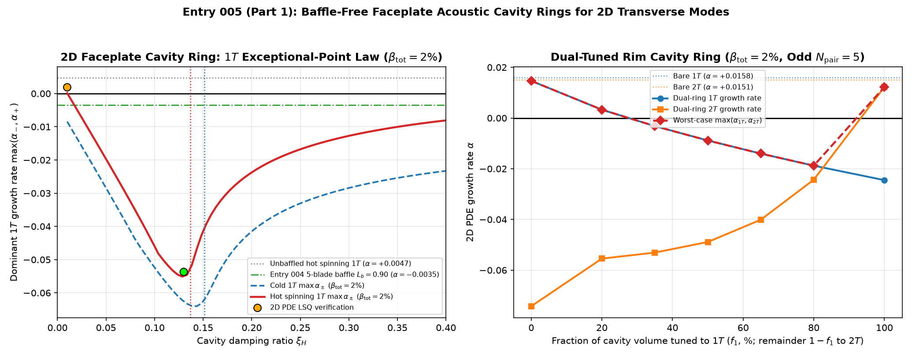

# 005 — Baffle-Free 2D Transverse Stabilization: Asymmetric Cavity Rings vs. Azimuthal Lag Staggering

- **Date:** 2026-11-23
- **Status:** `verified` (hardened after Peer Review #2)
- **Verification Script:** `../sim/exp005_baffle_free_2d.py`

## 1. Target

Entry `004` showed that radial faceplate baffles ($N_b = 5, L_b \ge 0.50$) stabilize chiral velocity-coupled spinning $1T$ waves ($\alpha = -0.0013\text{ to }-0.0035$), but protruding baffles sit inside a $3{,}500\,\text{K}$ core, adding cooling complexity and dry mass.

In this session we test two **baffle-free** transverse stabilization architectures achievable with additive-manufactured rocket faceplates (carrying forward our verified 2D cylindrical-annulus PDE with DC-blocking $\omega_{\text{hp}} = 0.15$, flame plane $x_f = 0.175$, and causal Erlang-4 time lag):

1. **Strategy A — Faceplate Helmholtz Acoustic Cavity Rings ($\beta_{\text{tot}} = 2\%$):** Derive and verify the 2D transverse $1T$ exceptional-point (EP) scaling law, and find the optimal volume allocation $f_1 = \beta_1 / \beta_{\text{tot}}$ for an **odd-periodic ($N_{\text{pair}} = 5$) dual-tuned $1T/2T$ cavity ring** stabilizing a strongly unstable combined $1T + 2T$ combustor.
2. **Strategy B — Zero-Hardware Azimuthal Injector Time-Lag Staggering ($\tau(\theta) = \bar{\tau} \pm \Delta\tau$):** Test whether 3D-printed azimuthal injector recess/orifice staggering ($M = 2, 3, 5$ alternating sectors) can suppress standing and spinning $1T$ modes with zero cavity volume—and uncover the **$M = 2$ Bragg-orientation trap**.

## 2. The Math & Assumptions

### 2D Faceplate Cavity Ring & Asymptotic $1T$ Exceptional-Point Scaling

Mounting a ring of compact cavities along $x = 0$ with local surface compliance $\beta_s(\theta) = \beta_{\text{local}}(\theta) L_a$ (so total cavity-to-chamber volume ratio is $\beta_{\text{tot}} = \frac{1}{2\pi L_a}\int_0^{2\pi}\beta_s\,d\theta$):

$$U_x(0, \theta, t) = -v_r(\theta, t), \qquad \frac{\partial v_r}{\partial t} + 2\xi_H\omega_H v_r = \beta_s\omega_H^2\big(P(0, \theta, t) - P_c\big), \qquad \frac{\partial P_c}{\partial t} = \frac{v_r}{\beta_s}$$

For a uniform cavity ring ($\beta_{\text{tot}}$), expanding the exact analytic ($\operatorname{sinhc}$-formulated, singularity-free) 2D dispersion relation near $s = i + \delta s$ ($\omega_H = \omega_{1T} = 1$) gives $(\delta s - \alpha_{1T}^{\text{uncoupled}})(\delta s + \xi_H) + \frac{1}{4}\beta_{\text{tot}} = 0$, yielding the asymptotic **2D Transverse EP Scaling**:

$$\xi_H^{\text{EP, }1T} \approx \sqrt{\beta_{\text{tot}}} - \alpha_{1T}^{\text{uncoupled}}, \qquad \alpha_{1T}^{\text{EP, cold}} \approx -\frac{\zeta}{2 L_a} - \frac{\sqrt{\beta_{\text{tot}}}}{2}$$

- **2D vs. 1D scaling:** Because pure $1T$ waves have half the faceplate pressure-energy density of $1L$ standing waves (Entry `004`), $\xi_H^{\text{EP, }1T} \approx \sqrt{\beta_{\text{tot}}}$ rather than Entry `002`'s $\sqrt{2\beta_{\text{tot}}}$.
- **Asymptotic accuracy caveat:** As verified below, the EP formula accurately predicts the **optimal damping ratio $\xi_H^{\text{opt}}$** (within $\sim 6\%$), but its leading-order damping magnitude ($-\sqrt{\beta_{\text{tot}}}/2 - \zeta/(2L_a)$) **over-predicts** exact dispersion damping by $\sim 26\%$ (and PDE dual-ring gains by $\sim 2\times$) because finite axial wave penetration ($\kappa_m L_a$) reduces cavity-mode coupling below the lumped-cavity limit.
- **Inverse-Square Multi-Mode Volume Allocation Law:** Even with the finite-$L_a$ prefactor, the *relative* scaling $\Delta\alpha_{mT} \propto -\omega_m\sqrt{\beta_m}$ predicts that equalizing $1T$ ($\omega_1 = 1$) and $2T$ ($\omega_2 = 2$) margins under a fixed total volume budget $\beta_1 + \beta_2 = \beta_{\text{tot}}$ requires:
  $$\frac{\beta_1}{\beta_2} = \left(\frac{\omega_2}{\omega_1}\right)^2 = 4 : 1 \quad \Longrightarrow \quad f_1^* = \frac{\beta_1}{\beta_{\text{tot}}} \approx \mathbf{80\%},\quad f_2^* \approx \mathbf{20\%}$$

### Azimuthal Injector Lag Staggering ($\tau(\theta) = \bar{\tau} \pm \Delta\tau$)

Alternating $M$ sector pairs around $\theta \in [0, 2\pi)$ attenuates non-resonant modes by $\cos(\omega\Delta\tau)$, while **$M = 2$** is Bragg-resonant with $1T$ ($\int_0^{2\pi}\cos(2\theta)\cos^2(\theta - \phi)\,d\theta \neq 0$), splitting orthogonal standing $1T$ orientations so one shifts toward $\bar{\tau} + \Delta\tau$ (damped) and the other shifts toward $\bar{\tau} - \Delta\tau$ (amplified!). Odd $M = 3, 5$ satisfies $\int_0^{2\pi}\cos(M\theta)\cos^2(\theta - \phi)\,d\theta = 0$, eliminating orientation bias.

### Intentional Simplifications
- Linearized 2D cylindrical-annulus acoustics (thin-annulus shell, no radial modes, linear cavity neck resistance; nonlinear orifice drag is analyzed in Entry `006`).
- Chiral spinning $1T$ tests (Exp 1, Exp 2, Exp 3B) rely on Entry `004`'s signed linear azimuthal velocity-coupling assumption (swirled/directional injectors); Exp 3A (standing $1T$) is purely pressure-coupled ($n_v = 0$).

## 3. The Verification

Reproduce from the repo root:

```bash
uv run python rocket-combustion/sim/exp005_baffle_free_2d.py
```

### Experiment 1 — 2D $1T$ Faceplate Cavity EP Law ($\beta_{\text{tot}} = 2\%$, Chiral Spinning $1T$, $n_v = 0.06, x_f = 0.175$)

- **Analytical Asymptote vs. Exact 2D Dispersion (refined 80-point $\xi_H$ sweep):**
  - Cold $1T$: asymptotic $\xi_H^{\text{EP}} = 0.1514$ vs. exact $\xi_H^{\text{opt}} = 0.1433$ ($5.7\%$ offset). Exact optimum reaches $\alpha_{\max} = -0.0640$ vs. asymptotic $-0.0807$ (asymptote over-predicts magnitude by $26\%$).
  - Hot spinning $1T$ (uncoupled $+0.00468$): asymptotic $\xi_H^{\text{EP}} = 0.1367$ vs. exact $\xi_H^{\text{opt}} = 0.1285$, reaching **$\alpha_{\max} = -0.0551$** (vs. Entry `004`'s conservative $L_b = 0.90$ 5-blade baffle at $-0.0035$ on the same $n_v = 0.06$ velocity-coupled combustor—a $15.8\times$ larger damping rate from an active dissipative absorber vs. a conservative baffle).
- **Direct 2D PDE Verification ($40\times 60$, discrete energy-balance residual $1.1\text{--}1.2\times 10^{-6}$):**
  - Near hot EP ($\xi_H = 0.13$): exact $-0.05511$ vs. 2D PDE 2-mode LSQ $-0.05369$ ($|\Delta\alpha| = 1.4\times 10^{-3}$).
  - Under-damped trap ($\xi_H = 0.01$): exact $+0.00014$ vs. 2D PDE 2-mode LSQ $+0.00189$ ($|\Delta\alpha| = 1.75\times 10^{-3}$). Both exhibit the qualitative under-damped split-mode instability (one split branch remains positive), though quantitative agreement is coarser ($1.8\times 10^{-3}$) due to weak-damping beating over the finite PDE window.

### Experiment 2 — Dual-Tuned Rim Cavity Ring ($\beta_{\text{tot}} = 2\%$, Odd $N_{\text{pair}} = 5$) on Combined $1T + 2T$ ($n_p = 0.055, n_v = 0.050, \bar{\tau} = 0.30, \sigma_\tau = 0.10, \tau_0 = 0.10$)

Bare combined combustor: spinning $1T$ $\alpha = +0.01579$, spinning $2T$ $\alpha = +0.01507$.

| $1T$ Volume Share $f_1$ | $2T$ Volume Share $1-f_1$ | 2D PDE $\alpha_{1T}$ | 2D PDE $\alpha_{2T}$ | Worst-Case $\max(\alpha_{1T}, \alpha_{2T})$ | Energy Residual |
| :---: | :---: | :---: | :---: | :---: | :---: |
| $0\%$ ($2T$-only) | $100\%$ | $+0.01466$ *(blow-up)* | $-0.07423$ | $+0.01466$ | $7.3\times 10^{-7}$ |
| $20\%$ | $80\%$ | $+0.00329$ | $-0.05545$ | $+0.00329$ | $2.1\times 10^{-6}$ |
| $35\%$ | $65\%$ | $-0.00318$ | $-0.05306$ | $-0.00318$ | $3.0\times 10^{-6}$ |
| $50\%$ *(naive equal split)* | $50\%$ | $-0.00886$ | $-0.04889$ | $-0.00886$ | $3.3\times 10^{-6}$ |
| $65\%$ | $35\%$ | $-0.01402$ | $-0.04011$ | $-0.01402$ | $3.5\times 10^{-6}$ |
| **$80\%$ *(inverse-square $4:1$ law!)*** | **$20\%$** | **$-0.01879^*$** | **$-0.02431$** | **$-0.01879$ *(BEST ON GRID)*** | $3.6\times 10^{-6}$ |
| $100\%$ ($1T$-only) | $0\%$ | $-0.02450$ | $+0.01225$ *(blow-up)* | $+0.01225$ | $3.7\times 10^{-6}$ |

*\*Grid convergence check at $f_1 = 80\%$ ($1T$): $40\times 60$ gives $-0.01879$ vs. $60\times 90$ giving $-0.01882$ (**$|\Delta\alpha| = 3.0\times 10^{-5}$**). Independent fine-grid sweeps confirm the exact max-min crossing lies at $f_1^* \approx 81\text{--}82\%$. Splitting $80\%/20\%$ more than **doubles** ($2.1\times$) the worst-case stability margin over a naive $50\%/50\%$ split ($-0.0188$ vs. $-0.0089$), while achieving $5.4\times$ stronger $1T$ damping than Entry `004`'s $L_b = 0.90$ radial baffles ($-0.0188$ vs. $-0.0035$) despite the combined combustor carrying much stronger driving ($+0.0158$ vs. $+0.0047$).*



### Experiment 3 — Zero-Hardware Azimuthal Injector Lag Staggering ($\bar{\tau} = 1.00, n_p = 0.075, n_v = 0$)

| Stagger $\Delta\tau$ | $M = 2$ ($\phi = 0$) | $M = 2$ ($\phi = \pi/2$, worst) | Odd $M = 3$ (worst) | Odd $M = 5$ (worst) |
| :---: | :---: | :---: | :---: | :---: |
| $0.00$ | $+0.00326$ | $+0.00326$ | $+0.00326$ | $+0.00326$ |
| $0.20$ | $+0.00140$ | $+0.00459$ *(WORSE!)* | $+0.00298$ | $+0.00299$ |
| $0.40$ | $-0.00095$ | **$+0.00532$ *(WORSE!)*** | $+0.00216$ | $+0.00219$ |
| $0.60$ | $-0.00369$ | **$+0.00545$ *(+67% worse!)*** | $+0.00083$ | $+0.00089$ |
| **$0.75$** | $-0.00594$ | $+0.00520$ *(still unstable)* | **$-0.00045$ *(STABLE)*** | **$-0.00036$ *(STABLE)*** |
| **$0.85$** | $-0.00750$ | $+0.00488$ *(still unstable)* | **$-0.00141$ *(STABLE)*** | **$-0.00129$ *(STABLE)*** |

On chiral velocity-coupled spinning $1T$ ($n_v = 0.075, \bar{\tau} = 0.85, \Delta\tau = 0.70$, cold nozzle floor $\alpha_{\text{cold}} = -0.010$), odd staggering reduces the **combustion driving term** $(\alpha - \alpha_{\text{cold}})$ by **23%** ($+0.01520 \to +0.01167$ for $M = 5$), which translates to a **68% cut** in the near-neutral net growth rate ($+0.00520 \to +0.00167$), outperforming $M = 2$ ($+0.00281$). Fully stabilizing strong chiral spin purely by lag staggering requires larger $\Delta\tau$ or pairing with a small cavity.


Full metrics: [`../results/exp005_metrics.json`](../results/exp005_metrics.json).

## 4. Verdict & Dead Ends

- **What broke / design traps uncovered:**
  - **Single-mode cavity rings fail multi-mode combustors:** Under combined $1T + 2T$ driving, a $100\%$ $1T$-tuned ring leaves $2T$ violently unstable ($+0.0123$), while a $100\%$ $2T$-tuned ring leaves $1T$ unstable ($+0.0147$).
  - **The $M = 2$ Bragg-orientation trap in azimuthal injector staggering:** Alternating injector lags with $M = 2$ periods around the rim stabilizes one standing $1T$ orientation while **actively destabilizing the orthogonal orientation by $+67\%$** ($+0.00326 \to +0.00545$).
- **What worked (two verified baffle-free design laws):**
  1. **Inverse-Square Cavity Volume Allocation ($f_m \propto 1/\omega_m^2$):** Because $2T$ oscillates twice as fast as $1T$, it needs only $\sim 1/4$ the cavity volume per unit damping rate. Splitting a $2\%$ faceplate cavity ring **$80\%$ $1T$ / $20\%$ $2T$** in an odd $N_{\text{pair}} = 5$ pattern stabilizes *both* $1T$ ($-0.0188$) and $2T$ ($-0.0243$) simultaneously—**$2.1\times$ better** than a naive $50/50$ split and **$5.4\times$ stronger** on $1T$ than Entry `004`'s protruding baffles (even on a more strongly driven combined combustor), with zero protruding hardware.
  2. **Odd-Periodic Zero-Hardware Injector Lag Staggering ($M = 3, 5$):** Eliminates orientation bias, obeys the analytical $\cos(\omega\Delta\tau)$ attenuation law, stabilizes pressure-coupled $1T$ without any cavities or baffles once $\Delta\tau \ge 0.75$, and cuts chiral spinning $1T$ driving by $23\%$ ($68\%$ net growth-rate drop).
- **Next single hypothesis to test (`006`):**
  - **2D Nonlinear Spinning vs. Standing Mode Selection & Nonlinear Cavity Bomb Tests:** In a 2D annular chamber with our Entry `003` bounded subcritical flame law $\Phi(q)$ + calibrated quadratic cavity orifice drag $c_{\text{nl}}|v_r|v_r$, how do standing vs. spinning $1T$ bomb thresholds compare, and how do cavity mouth area ($\sigma_o$) and linear damping ($\xi_H / \xi_H^{\text{EP}}$) control nonlinear bomb survival once long-horizon linear stability is guaranteed?
