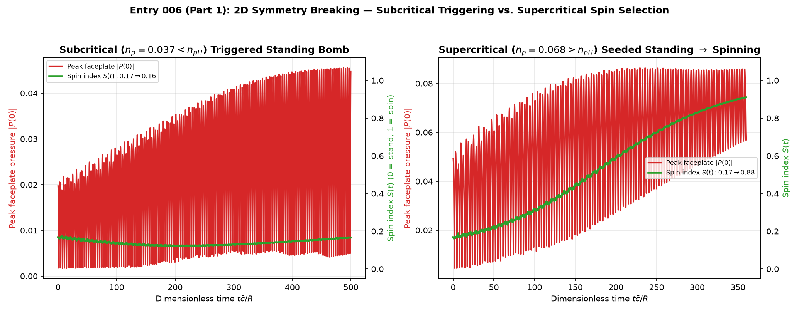
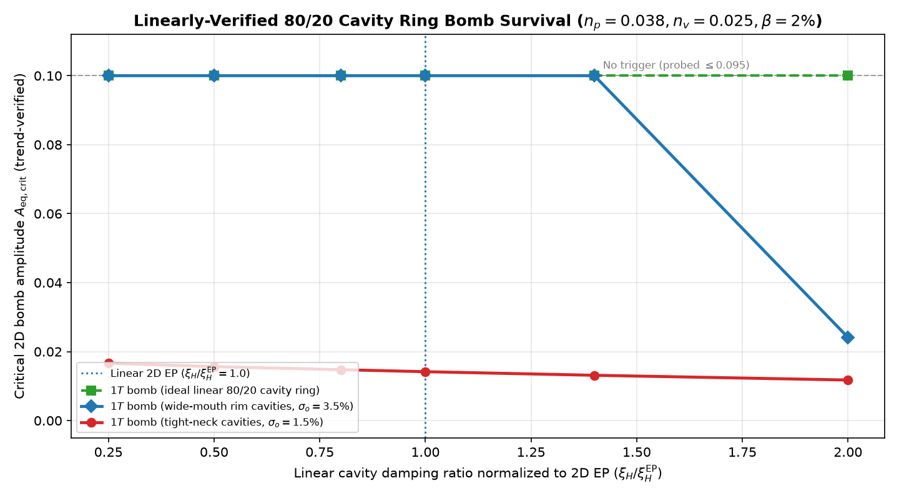

# 006 — 2D Nonlinear Spinning vs. Standing Mode Selection & Verified Nonlinear Cavity Bomb Tests

- **Date:** 2026-11-23
- **Status:** `verified` (hardened after Peer Review #2)
- **Verification Script:** `../sim/exp006_2d_nonlinear_modes.py`

## 1. Target

Unite our **1D nonlinear lessons (Entry `003`)** with our **2D transverse/baffle-free architectures (Entries `004`–`005`)** inside a single 2D nonlinear cylindrical-annulus PDE (carrying forward DC-blocking $\omega_{\text{hp}} = 0.15$, causal Erlang-4 time lag $\bar{\tau} = 0.30, \sigma_\tau = 0.15$, flame plane $x_f = 1/6 \approx 0.1667$, and the bounded monotonic subcritical flame law $\Phi(q) = q_s\tanh(q/q_s + \kappa(q/q_s)^3)$), to test:

1. **2D $O(2)$ Symmetry-Breaking Mode Selection (Axisymmetric Chamber, $n_v = 0$, bare linear Hopf $n_{pH} = 0.04094$):**
   - At equal bomb energy $E_0$ in the subcritical regime ($n_p < n_{pH}$), does a **standing $1T$ bomb** trigger at $\sim 1.50\times$ *lower* energy than a **spinning $1T$ bomb** (known cubic $O(2)$ theory; cf. Noiray et al. 2011; Ghirardo & Juniper 2013)?
   - How does spin selection ($S(t)$) evolve separately on **(a) the subcritical triggered upper branch ($n_p = 0.037 < n_{pH}$)** vs. **(b) the strongly saturated supercritical branch ($n_p = 0.068 > n_{pH}$)**?
2. **Linearly-Verified, Horizon-Converged 2D Nonlinear Bomb Survival of the $80/20$ Dual-Tuned Faceplate Cavity Ring:**
   - First verify **long-horizon ($t = 400$) broadband linear stability** across all modes ($1T, 2T$, both spin directions, $1L$) before bisecting any bomb threshold, using a strictly trend-based trigger criterion and checking horizon convergence ($t = 180$ vs. $t = 360$).
   - Under calibrated quadratic orifice jet drag ($c_{\text{nl}} = \frac{\beta_s\omega_H^2}{2 C_d^2 \sigma_o^2}$), quantify how **(a) linear damping ratio $\xi_H / \xi_H^{\text{EP}}$** and **(b) cavity mouth open-area ratio $\sigma_o$ ($1.5\%$ vs. $3.5\%$)** govern finite-amplitude $1T$ bomb survival compared to bare and 5-blade baffled chambers.

## 2. The Math & Assumptions

### Bounded Subcritical 2D Flame Law & Energy-Matched Bomb Ratio
$$\Phi(q) = q_s \tanh\!\left(\frac{q}{q_s} + \kappa\left(\frac{q}{q_s}\right)^3\right), \qquad q_s = 0.036,\quad \kappa = 4.5$$

Consider two $1T$ initial perturbations with **identical total acoustic energy** $E_0 = \pi L_a A_{\text{eq}}^2$:
- **Spinning $1T$:** $P(\theta, t) = A_{\text{eq}}\cos(\theta - \omega t)$, $U_\theta = +P$ (constant amplitude $A_{\text{eq}}$ around the rim at every point over a cycle).
- **Standing $1T$:** $P(\theta, t) = \sqrt{2}\,A_{\text{eq}}\cos(\theta)\cos(\omega t)$, $U_\theta = \sqrt{2}\,A_{\text{eq}}\sin(\theta)\sin(\omega t)$ (peak amplitude $\sqrt{2}A_{\text{eq}}$ at antinodes $\theta = 0, \pi$).

In the small-amplitude subcritical cubic expansion ($\Phi(q) \approx q + c_3 q^3$), the **space-time averaged** quartic Rayleigh energy boost over $\theta \in [0, 2\pi)$ and one period $T = 2\pi/\omega$ is:
$$\langle P_{\text{stand}}^4 \rangle_{\theta,t} = (\sqrt{2}\,A_{\text{eq}})^4 \langle\cos^4\theta\rangle_\theta \langle\cos^4\omega t\rangle_t = 4 \cdot \frac{3}{8} \cdot \frac{3}{8}\,A_{\text{eq}}^4 = \frac{9}{16} A_{\text{eq}}^4$$
$$\langle P_{\text{spin}}^4 \rangle_{\theta,t} = A_{\text{eq}}^4 \langle\cos^4(\theta - \omega t)\rangle_{\theta,t} = \frac{3}{8} A_{\text{eq}}^4$$
$$\Longrightarrow \quad \frac{\langle P_{\text{stand}}^4 \rangle_{\theta,t}}{\langle P_{\text{spin}}^4 \rangle_{\theta,t}} = \frac{9/16}{3/8} = \mathbf{1.50}$$
Thus standing bombs require $\sim 1.50\times$ **less** total energy $E_0$ to cross the subcritical fold than spinning bombs (matching known $O(2)$-symmetric thermoacoustic bifurcation theory; Noiray et al. 2011; Schuermans et al. 2006; Ghirardo & Juniper 2013). Conversely, at strongly saturating upper-branch amplitudes where $\Phi(q)/q$ declines rapidly with $|q|$, standing antinodes saturate harder than a uniform-amplitude traveling wave, favoring spinning waves—tracked via the bounded spin index $S(t) = \frac{|\int P U_\theta\,d\theta|}{\frac{1}{2}\int(P^2 + U_\theta^2)\,d\theta} \in [0, 1]$.

### Calibrated 2D Cavity Orifice Drag & Discrete Energy Bookkeeping
Each rim cavity sector obeys $\frac{\partial v_r}{\partial t} + (2\xi_H\omega_H + c_{\text{nl}}|v_r|)v_r = \beta_s\omega_H^2(P(0, \theta) - P_c)$ with $c_{\text{nl}} = \frac{\beta_s\omega_H^2}{2 C_d^2 \sigma_o^2}$ ($C_d = 0.65$), pre-pressurized consistently at $t = 0$ ($p_c(0) = P(0, \theta), v_r(0) = 0$). Full 2D nonlinear energy balance (acoustic + cavity stored energy vs. nozzle loss + linear/quadratic orifice dissipation + nonlinear Rayleigh flame power) is verified directly on the nonlinear cavity PDE (`rel err = 4.89e-06`).

### Intentional Simplifications & Validity Caveats
- Thin-annulus 2D bulk-linear acoustics ($30\times 60$ grid; $x_f = 1/6 \approx 0.1667$ exact cell center).
- Dimensionless pressure $P = p'/(\gamma \bar{p})$ converts to physical relative pressure fluctuation via $p'/\bar{p} = \gamma_{\text{ref}} P$ with reference combustion-gas ratio of specific heats $\gamma_{\text{ref}} = 1.25$. In the subcritical regime ($n_p \le 0.040$), settled amplitudes are $P_{\text{LC}} = 0.038\text{--}0.047$ ($p'/\bar{p} \approx 4.8\text{--}5.9\%$, comfortably bulk-linear). In the supercritical spin-selection run ($n_p = 0.068$), $P_{\text{peak}} = 0.0859$ ($p'/\bar{p} \approx 10.7\%$), which enters the **weakly nonlinear acoustic regime** where gasdynamic steepening of spinning waves would begin in a compressible Euler solver (omitted here).
- In Experiment 2, chiral velocity coupling ($n_v = 0.025$) uses Entry `004`'s signed linear azimuthal velocity-coupling model (swirled/directional injectors).

## 3. The Verification

Reproduce from the repo root:

```bash
uv run python rocket-combustion/sim/exp006_2d_nonlinear_modes.py
```

### Experiment 1 — 2D Subcritical Standing vs. Spinning Triggering & Regime-Dependent Spin Selection ($n_v = 0$)

Exact bare 2D $1T$ linear Hopf bifurcation (at $x_f = 1/6$): **$n_{pH} = 0.04094$**, $\omega_H = 0.99923$.

| $n_p$ ($< n_{pH}$) | $A_{\text{crit}}(\text{spin})$ | $A_{\text{crit}}(\text{stand})$ | Energy Ratio $E_{\text{crit}}(\text{spin})/E_{\text{crit}}(\text{stand})$ | Settled Upper-Branch $P_{\text{LC}}(\text{spin})$ | Analytical Cubic Theory |
| :---: | :---: | :---: | :---: | :---: | :---: |
| $0.033$ | $0.0108$ | $0.0089$ | **$1.466$** | $0.0383$ ($4.8\%\,p'/\bar{p}$) | $1.500$ |
| $0.037$ | $0.0070^*$ | $0.0058^*$ | **$1.488^*$** *(0.8% from theory)* | $0.0431$ ($5.4\%\,p'/\bar{p}$) | $1.500$ |
| $0.040$ | $0.0035$ | $0.0029$ | **$1.490$** *(0.7% from theory)* | $0.0468$ ($5.8\%\,p'/\bar{p}$) | $1.500$ |

*\*Horizon convergence check at $n_p = 0.037$: doubling horizon from $t = 180$ to $t = 360$ yields $A_{\text{spin}} = 0.00700$, $A_{\text{stand}} = 0.00568$, $E_{\text{ratio}} = \mathbf{1.519}$ ($1\text{--}2\%$ shift).*

- **Subcritical vs. supercritical spin selection (both initialized with a seeded chiral asymmetry $\epsilon_s = 0.12 \implies S_0 = 0.169$, NOT spontaneous noise):**
  - **Subcritical triggered standing bomb ($n_p = 0.037 < n_{pH}$, $A_{\text{eq}} = 0.014$, $t = 500$):** Reaches a settled upper-branch amplitude $P_{\text{peak}} = 0.0456$ ($5.7\%\,p'/\bar{p}$). During the growth phase through the cubic-boost region ($t \lesssim 200$), $S(t)$ dips slightly ($0.169 \to 0.13$); once saturation sets in ($t = 250\text{--}500$), $S(t)$ reverses slope and begins a very slow upward drift ($S_{\text{final}} = 0.159$ at $t = 500$). Thus immediately above the subcritical fold, triggered standing waves remain predominantly standing over hundreds of acoustic periods.
  - **Supercritical saturated chamber ($n_p = 0.068 > n_{pH}$, $t = 360$):** Reaches deeper saturation ($P_{\text{peak}} = 0.0859 \implies p'/\bar{p} = 10.7\%$, weakly nonlinear acoustic regime), where strong $\tanh$ antinode saturation rapidly amplifies the seeded chirality from $S_0 = 0.169$ to **$S = 0.879$** at $t = 360$ (still approaching $1.0$).



### Experiment 2 — Linearly-Verified 2D Nonlinear Bomb Sweep on $80/20$ Dual-Tuned Cavity Ring ($n_p = 0.038, n_v = 0.025, \beta_{\text{tot}} = 2\%, N_{\text{pair}} = 5$)

Before any bomb bisection, every configuration is tested for **broadband linear stability over $t = 400$** (simultaneously seeding $1T$ co/counter-spin, $2T$ co/counter-spin, and $1L$ at $10^{-4}$ amplitude):
- **Bare combined combustor:** **Linearly unstable** ($\alpha_{\text{late}} = +0.00492$).
- **Pure 5-blade protruding baffles ($L_b = 0.60$, no cavities):** **Linearly unstable** ($\alpha_{\text{late}} = +0.01664$, *worse* than bare here because conservative baffle detuning shifts the $1T$ phase toward stronger pressure-coupled Rayleigh driving without dissipating pressure-coupled acoustic energy).
- **2D nonlinear energy-balance check** (flame + quadratic orifice drag): **`rel err = 4.89e-06`**.
- **All six $80/20$ dual-tuned cavity ring designs** ($\xi_H/\xi_H^{\text{EP}} \in [0.25, 2.00]$) pass the $t = 400$ broadband linear stability check (`stable = True`, $\alpha_{\text{late}} = -0.00638$ to $-0.01183$). Bomb bisection uses a strictly trend-based late-energy trigger criterion (`e_w3 > 1.005 * e_w2` or sustained upper-branch `p_peak > 0.032` with non-decaying energy `e_w3 >= 0.995 * e_w2`), probed up to $A_{\text{eq}} \le 0.095$:

| $\xi_H / \xi_H^{\text{EP}}$ | Broadband Linear $\alpha$ ($t=400$) | $1T$ $A_{\text{crit}}$ (Ideal Linear Cav) | $1T$ $A_{\text{crit}}$ (Wide Mouth $\sigma_o=3.5\%$) | $1T$ $A_{\text{crit}}$ (Tight Neck $\sigma_o=1.5\%$) | Tight-Neck Change vs. EP / vs. $\xi=0.25$ |
| :---: | :---: | :---: | :---: | :---: | :---: |
| **$0.25$ (Under-EP)** | $-0.00638$ | `NO TRIG <= 0.095` | **`NO TRIG <= 0.095`** | **$0.0166$ *(BEST)*** | $+17.3\%$ / $0\%$ |
| $0.50$ | $-0.00686$ | `NO TRIG <= 0.095` | **`NO TRIG <= 0.095`** | $0.0156$ | $+10.4\%$ / $-5.9\%$ |
| $0.80$ | $-0.00841$ | `NO TRIG <= 0.095` | **`NO TRIG <= 0.095`** | $0.0148$ | $+4.1\%$ / $-11.2\%$ |
| **$1.00$ (2D Linear EP)** | $-0.00925$ | `NO TRIG <= 0.095` | **`NO TRIG <= 0.095`** | **$0.0142^*$** | $0\%$ / $-14.8\%$ |
| $1.40$ (Over-EP) | $-0.01159$ | `NO TRIG <= 0.095` | **`NO TRIG <= 0.095`** | $0.0131$ | $-7.3\%$ / $-21.0\%$ |
| **$2.00$ (Over-damped)** | **$-0.01183$ *(best linear!)*** | `NO TRIG <= 0.095` | **$0.0241$ *(CRACKS!)*** | **$0.0118$ *(WORST)*** | **$-17.0\%$ / $-29.3\%$** |

*\*Exp 2 horizon convergence check at $\xi_H/\xi_H^{\text{EP}} = 1.00$ ($\sigma_o = 1.5\%$): $t = 180$ gives $A_{\text{crit}} = 0.01417$ vs. $t = 360$ giving $0.01396$ (**$1.5\%$ difference**).*



Full metrics: [`../results/exp006_metrics.json`](../results/exp006_metrics.json).

## 4. Verdict & Dead Ends

- **What broke / failure modes uncovered:**
  - **Linear-vs-nonlinear cavity optimization inversion:** Under broadband $t = 400$ linear stability checks, increasing $\xi_H/\xi_H^{\text{EP}}$ from $0.25$ to $2.00$ monotonically *improves* linear stability ($\alpha: -0.00638 \to -0.01183$). Yet under calibrated quadratic orifice drag ($\sigma_o = 1.5\%$), the exact same increase monotonically **degrades** finite-amplitude bomb survival ($A_{\text{crit}}: 0.0166 \to 0.0118$, a **$-29\%$** drop in amplitude / **$-50\%$** drop in survivable bomb energy; **$-17\%$** relative to the linear EP).
  - **Over-damping cracks even wide-mouth cavities:** Wide-mouth cavities ($\sigma_o = 3.5\%$) remain completely bomb-proof across the entire bulk-linear range (`NO TRIG <= 0.095`) for $\xi_H/\xi_H^{\text{EP}} \le 1.40$, but over-damping to $\xi_H/\xi_H^{\text{EP}} = 2.00$ causes a sharp cliff down to $A_{\text{crit}} = 0.0241$.
  - **Pure conservative baffles fail combined pressure + velocity driving:** At $n_p = 0.038, n_v = 0.025$, $N_b = 5, L_b = 0.60$ baffles remain linearly unstable ($\alpha = +0.01664$, worse than the bare chamber $+0.00492$).
  - **Regime boundary on standing-to-spinning transition:** Near the subcritical fold ($n_p = 0.037 < n_{pH}$), a triggered standing wave stays predominantly standing for $t = 500$ ($S: 0.169 \to 0.159$) and only begins a very slow upward spin drift after settling; rapid spin-up ($S: 0.169 \to 0.879$) occurs only deeper into the saturating supercritical regime ($n_p = 0.068 > n_{pH}$, seeded chirality $\epsilon_s = 0.12$).
- **What worked (verified 2D nonlinear design laws):**
  1. **Standing bombs are the worst-case 2D subcritical test:** Because standing antinodes concentrate space-time quartic Rayleigh driving by $\frac{9/16}{3/8} = 1.50\times$, 2D PDE bisections confirm $E_{\text{crit}}(\text{spin})/E_{\text{crit}}(\text{stand}) = 1.47\text{--}1.49$ ($1.52$ at $t = 360$), matching cubic $O(2)$ theory within $1\text{--}2\%$.
  2. **Wide-mouth, at-or-below-EP $80/20$ dual-tuned rim cavities dominate 2D nonlinear bomb tests:** Increasing cavity open-area ratio from $\sigma_o = 1.5\%$ to $3.5\%$ ($2.33\times$ area) raises nonlinear $1T$ bomb survival from $A_{\text{crit}} = 0.014\text{--}0.017$ to **$> 0.095$** ($> 5.7\times$ amplitude / $> 32\times$ bomb energy, eliminating subcritical triggering across the entire bulk-linear regime) provided $\xi_H \le 1.4\,\xi_H^{\text{EP}}$.
- **Track Milestone:** Entries `000`–`006` complete the first verified arc of `rocket-combustion/`. See [`../SYNTHESIS.md`](../SYNTHESIS.md) for the consolidated engineering design laws, verified vs. assumed table, documented dead ends, and open problems.
