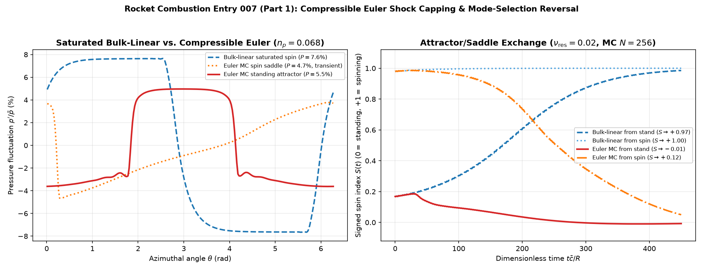
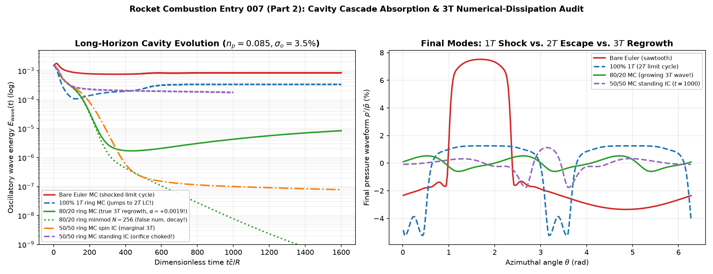

# 007 — Compressible Nonlinear Euler Transverse Acoustics: Shock Steepening, Mode-Selection Reversal & Cavity Cascade Audit

- **Date:** 2026-11-24
- **Status:** `verified` (hardened after Peer Review #5)
- **Verification Script:** `../sim/exp007_compressible_euler_steepening.py`

## 1. Target

Tackle Open Problem #1 from [`../SYNTHESIS.md`](../SYNTHESIS.md): replace the bulk-linear transverse wave operator of Entries `004`–`006` with the **full conservative 1D periodic compressible Euler equations** on the azimuthal ring $\theta \in [0, 2\pi)$ ($\gamma = 1.25$) coupled to Entry `006`'s DC-blocked Erlang-4 bounded subcritical flame law and calibrated quadratic-drag faceplate cavities, to answer four concrete questions:

1. **Verification & Numerical-Dissipation Audit:** Does our 2nd-order MUSCL (monotonized-central MC vs. `minmod`) + HLLC + SSP-RK2 solver conserve inviscid mass/momentum/energy to machine precision, pass the small-amplitude linear consistency check ($\alpha_{mT} = -\zeta / (2 L_a) = -0.010$), quantify its per-mode excess numerical damping ($1T, 2T, 3T$), and reproduce the exact analytical Riemann shock birth time $t_{\text{shock}} = \frac{2}{(\gamma + 1) u_0}$, Fay–Burgers maximum shock-jump time $\frac{\pi}{2} t_{\text{shock}}$, and Rankine–Hugoniot $O(u_0^3)$ weak-shock dissipation law?
2. **Attractor-vs-Attractor Capping & Harmonic Cascade:** At supercritical driving ($n_p = 0.068 > n_{pH,1T} = 0.04137$), how much does gasdynamic shock steepening cap the saturated limit-cycle amplitude relative to the saturated bulk-linear attractor, and how much energy cascades into $2T/3T$ harmonics?
3. **Attractor/Saddle Exchange, Residence-Flush Sensitivity & Subcritical Quenching:** Under what closure assumptions does Rankine–Hugoniot $O(A^3)$ shock dissipation **reverse** Entry `006`'s bulk-linear supercritical selection of spinning waves ($S \to +1$) to a **standing-wave attractor ($S \to 0$)**—and does it quench Entry `006`'s subcritical bistability window ($n_p < n_{pH,1T}$) across multi-amplitude $N = 512$ sweeps?
4. **Shocked-Wave Cavity Absorption ($n_p = 0.085$):** Combining an exact Fourier-collocation linear eigen-spectrum with long-horizon ($t = 1600$) low-dissipation MC PDE runs, which modes actually stabilize vs. regrow under $100\%\,1T$, $80/20$, and $50/50$ cavity rings—and what happens when `minmod` numerical dissipation masks weak $3T$ instability?

## 2. The Math & Assumptions

### Governing 1D Periodic Compressible Euler Ring ($\theta \in [0, 2\pi)$, $\gamma = 1.25$)

$$\frac{\partial \rho}{\partial t} + \frac{\partial (\rho u)}{\partial \theta} = -\frac{1}{L_a}\,\rho\,(u_{\text{noz}} + v_{\text{cav}}) - S_{\text{ent}}$$
$$\frac{\partial (\rho u)}{\partial t} + \frac{\partial (\rho u^2 + p)}{\partial \theta} = -\frac{1}{L_a}\,\rho u\,(u_{\text{noz}} + v_{\text{cav}}) - S_{\text{ent}}\,u$$
$$\frac{\partial E}{\partial t} + \frac{\partial \bigl(u(E + p)\bigr)}{\partial \theta} = -\frac{1}{L_a}\,(E + p)\,(u_{\text{noz}} + v_{\text{cav}}) - \frac{1}{2} S_{\text{ent}}\,u^2 + \frac{1}{\gamma - 1}\frac{n_p}{L_a}\Phi(q_p)$$

where $E = \frac{p}{\gamma - 1} + \frac{1}{2}\rho u^2$, reference state $(\bar{\rho} = 1, \bar{u} = 0, \bar{p} = 1/\gamma = 0.80, \bar{c} = 1)$, $P = p - \bar{p}$ (so $p'/\bar{p} = \gamma P = 1.25 P$), $u_{\text{noz}} = \zeta P$ ($L_a = 2.0, \zeta = 0.04$), and $\Phi(q) = q_s \tanh(q/q_s + \kappa(q/q_s)^3)$ ($q_s = 0.036, \kappa = 4.5$) driven by the DC-blocked ($\omega_{\text{hp}} = 0.15$) Erlang-4 ($\bar{\tau} = 0.30, \sigma_\tau = 0.15$) pressure lag.

- **Controlling Modeling Closure — Isobaric Chamber-Residence Entropy Flush ($S_{\text{ent}}$):**
  $$S_{\text{ent}} = \nu_{\text{res}}\bigl(\rho - \bar{\rho}(p/\bar{p})^{1/\gamma}\bigr), \qquad \nu_{\text{res}} = \frac{\zeta}{L_a} = 0.02 \text{ (default; } 0 \text{ when } \zeta = 0\text{)}$$
  Algebraically, the source triplet $(-S_{\text{ent}}, -S_{\text{ent}} u, -\frac{1}{2} S_{\text{ent}} u^2)$ gives $\partial_t u = 0$ and $\partial_t p = 0$ instantaneously and vanishes to $O(\epsilon^2)$ on cold isentropic acoustic waves. **Crucial caveat (Peer Review #5 C2):** because the flame adds heat at fixed mass, $\partial_t(\rho' - P) = -\frac{n_p}{L_a} q - \nu_{\text{res}}(\rho' - P)$, so $S_{\text{ent}}$ acts at **first order $O(\epsilon)$ whenever the flame is active**, damping flame- and shock-generated entropy inhomogeneities that would otherwise modulate local sound speed $c(\theta)$ at second order. Without this residence-flush closure ($\nu_{\text{res}} = 0$), quadratic nozzle enthalpy extraction drives a secular mean-density drift ($\bar{\rho} \to 1.033$ by $t = 600$, $+7\%$ by $t = 1000$) with **no stationary limit cycle**; thus $S_{\text{ent}}$ is a **controlling closure assumption** of Laws #10 and #11, quantified explicitly below across $\nu_{\text{res}} \in \{0, 0.01, 0.02, 0.05\}$.
- **Model Limitation — Secular Negative Mean Swirl ($\bar{u}$):** Because the nozzle and cavity mass sinks remove traveling-wave momentum ($-\frac{1}{L_a}\langle \rho u u_{\text{ext}} \rangle \approx -\frac{\zeta}{L_a}\langle u P \rangle < 0$ for a $+1T$ wave) with no zero-swirl axial propellant inflow restoring term, any persistent spinning wave drives a **negative secular mean azimuthal swirl $\bar{u} < 0$** opposite to wave propagation (freezing once cavities damp the wave or once the wave stands, e.g. $\bar{u} \approx -0.0029$ in `80/20`, $\frac{1}{2}\bar{u}^2 \approx 4\times 10^{-6}$). All wave energies and signed spin indices therefore use oscillatory perturbations $(P_{\text{osc}}, u_{\text{osc}}) = (P - \langle P \rangle, u - \langle u \rangle)$.
- **Exact continuum linear Hopf thresholds** of $s^2 + \frac{\zeta - n_p H(s)}{L_a} s + m^2 = 0$:
  - $1T$: **$n_{pH,1T} = 0.04137$** ($\omega_H = 0.99849$)
  - $2T$: **$n_{pH,2T} = 0.04828$** ($\omega_H = 1.99430$)
  - $3T$: **$n_{pH,3T} = 0.06560$** ($\omega_H = 2.98904$)

### Exact Fay–Burgers–Rankine–Hugoniot Theory & Landau Mode-Selection Criterion

1. **Weak-shock energy dissipation:** For an inviscid simple wave $u(\theta, 0) = u_0 \cos\theta$, shock birth occurs at $t_{\text{shock}} = \frac{2}{(\gamma + 1) u_0}$, peak jump $\Delta u = 2 u_0$ occurs at $\tau = t/t_{\text{shock}} = \frac{\pi}{2}$ via $\phi = \tau \sin\phi$, $\Delta u(\tau) = 2 u_0 \sin\phi$, and the exact ring-averaged weak-shock acoustic dissipation rate is:
   $$-\frac{dE_{\text{wave}}}{dt} = \frac{\gamma + 1}{24\pi}(\Delta u)^3 = \frac{\gamma + 1}{3\pi}\,u_0^3\,\sin^3\phi(\tau)$$
   Over $\tau \in [1.15, 1.75]$, the exact **least-squares linear-fit slope** is $-\frac{dE_{\text{wave}}}{dt}/u_0^3 = \mathbf{0.22090}$ (mean instantaneous rate `0.21299`; fit-method dependent).
2. **Landau Amplitude Criterion for Attractor/Saddle Exchange (Peer Review #5 M2):** Let $A_\pm$ be the $+1T$ and $-1T$ wave amplitudes under flame cross-saturation ($a_c > a_s$, Entry `006`) and leading-order weak-shock self-dissipation ($-k_{\text{sh}} A_\pm^2$, which has zero leading-order cross-loss between counter-propagating weak shocks):
   $$\frac{dA_+}{dt} = \sigma A_+ - (a_s A_+^2 + a_c A_-^2) A_+ - k_{\text{sh}} A_+^2, \qquad \frac{dA_-}{dt} = \sigma A_- - (a_s A_-^2 + a_c A_+^2) A_- - k_{\text{sh}} A_-^2$$
   Linear stability of the two fixed points yields the exact selection thresholds:
   - **Standing wave ($A_+ = A_- = A$) is stable** iff $k_{\text{sh}} A > 2(a_c - a_s) A^2$.
   - **Spinning wave ($A_+ = \sqrt{2} A, A_- = 0$) is unstable** iff $k_{\text{sh}} A > (a_c - a_s) A^2$.
   Mode selection therefore depends on the **absolute** weak-shock dissipation coefficient $k_{\text{sh}}$ relative to the flame cross-saturation excess $(a_c - a_s) A$ (not on comparing the dimensionless ratios $\sqrt{2}$ vs. $1.50$). At $n_p = 0.068$, $k_{\text{sh}} A$ exceeds $2(a_c - a_s) A^2$, exchanging the bulk-linear spinning attractor for a standing-wave attractor.

### Intentional Simplifications
- Purely tangential 1D periodic ring ($k_x = 0$, no axial or radial $1R$ modes); bulk-linear reference uses 2/3-dealiased Fourier RK4 on the same grid, flame, and cavities.
- Inviscid Euler with 2nd-order MUSCL-MC + HLLC shock capturing (no physical viscosity/thermal conduction).

## 3. The Verification

Reproduce from the repo root:

```bash
uv run python rocket-combustion/sim/exp007_compressible_euler_steepening.py
```

### Experiment 1 — Conservation, Per-Mode Numerical Damping & Fay–Burgers Verification

- **Exp 1A (Inviscid conservation, $\zeta = 0, n_p = 0, A = 0.10, t = 25$, MC $N = 256$):** Mass relative error **`4.23e-16`**, momentum error **`1.67e-16`**, total energy relative error **`3.52e-16`**.
- **Exp 1B (Small-amplitude linear consistency check against $-\zeta/(2 L_a) = -0.010$ & excess numerical damping $\alpha_{\text{num}} = \alpha_{\text{PDE}} + 0.010$ at $N = 256$):**

| Limiter ($N = 256$) | $\alpha_{\text{num}}(1T)$ | $\alpha_{\text{num}}(2T)$ | $\alpha_{\text{num}}(3T)$ | Implication for Weakly Unstable Modes |
| :--- | :---: | :---: | :---: | :--- |
| `minmod` | $-1.04\times 10^{-4}$ | $-1.06\times 10^{-3}$ | **$-5.64\times 10^{-3}$** | **Masks** $3T$ growth up to $+5.6\times 10^{-3}$ (artifact in early draft!) |
| **`mc` (default)** | **$-2.36\times 10^{-6}$** | **$-6.40\times 10^{-5}$** | **$-4.19\times 10^{-4}$** | **$13.5\times$ less $3T$ damping** — resolves $+1.9\times 10^{-3}$ growth cleanly |

- **Exp 1C (Riemann shock birth, Fay–Burgers peak jump, and $O(u_0^3)$ Rankine–Hugoniot dissipation, MC $N = 512$):**

| $u_0$ ($p'/\bar{p}$) | Exact Birth $t_{\text{shock}}$ | RH Entropy Onset | Exact Peak Jump $\frac{\pi}{2} t_{\text{shock}}$ | $-\partial_\theta u$ Peak (Err) | $-\frac{dE_{\text{wave}}}{dt}/u_0^3$ *(Exact LSQ: `0.2209`)* |
| :---: | :---: | :---: | :---: | :---: | :---: |
| $0.04$ ($5.0\%$) | $22.22$ | $23.09$ | $34.91$ | $34.56$ (`-1.0%`) | **`0.2235`** (`+1.2%`) |
| $0.08$ ($10.0\%$) | $11.11$ | $11.77$ | $17.45$ | $17.22$ (`-1.3%`) | **`0.2244`** (`+1.6%`) |
| $0.12$ ($15.0\%$) | $7.41$ | $7.93$ | $11.64$ | $11.34$ (`-2.5%`) | **`0.2241`** (`+1.4%`) |

*(Under `minmod` at $N=512\text{--}1024$, the same LSQ slope converges to `0.2217-0.2219`, $+0.4\%$ above `0.2209` due to $O(u_0)$ finite-amplitude corrections.)*

### Experiment 2 — Attractor-vs-Attractor Capping, $\nu_{\text{res}}$ Closure Sensitivity & Subcritical Quenching

- **Exp 2A (Saturated Attractor-vs-Attractor Capping at $n_p = 0.068, \nu_{\text{res}} = 0.02$):**

| State & Scheme | Horizon | Late $P_{\text{peak}}/\bar{p}$ | `late/mid` | $E_{2T}/E_{1T}$ | Signed $S_{\text{late}}$ | Capping vs. Bulk-Linear Attractor |
| :--- | :---: | :---: | :---: | :---: | :---: | :---: |
| Bulk-linear saturated spin ($N=256$) | $t = 600$ | **$7.65\%$** | $1.036$ | $0.00\%$ | $+1.000$ | Baseline attractor |
| Euler MC spinning saddle ($N=256$, transient) | $t = 220$ | $4.72\%$ | $0.858$ | $28.6\%$ | $+0.999$ | $-38.3\%$ *(transient saddle)* |
| **Euler MC standing attractor ($N=256$)** | $t = 450$ | **$5.51\%$** | $1.002$ | $17.8\%$ | $-0.0090$ | **$-28.0\%$** |
| **Euler MC standing attractor ($N=512$)** | $t = 450$ | **$5.52\%$** | $1.001$ | $17.9\%$ | $-0.0096$ | **$-27.9\%$** *(grid-converged to $0.01\%$!)* |

- **Exp 2B (Attractor/Saddle Exchange & $\nu_{\text{res}}$ Closure Sensitivity at $n_p = 0.068$, MC $N = 256, t = 600$):**

| $\nu_{\text{res}}$ | From Seeded Standing ($S_0 = 0.17$): $S_{\text{late}}, P_{\text{peak}}/\bar{p}, \bar{\rho}$, `l/m` | From Perturbed Spin ($S_0 = 0.98$): $S_{\text{late}}, P_{\text{peak}}/\bar{p}, \bar{\rho}$ | Closure Verdict |
| :---: | :--- | :--- | :--- |
| **$0.00$** | $S=+0.0184,\; P=5.85\%,\; \bar{\rho}=1.0328,\;$ `l/m = 1.132` | $S=+0.2559,\; P=5.67\%,\; \bar{\rho}=1.0277$ | **No steady limit cycle** (secular $\bar{\rho}$ drift!) |
| $0.01$ | $S=+0.0193,\; P=5.53\%,\; \bar{\rho}=1.0016,\;$ `l/m = 1.004` | $S=-0.0741,\; P=5.55\%,\; \bar{\rho}=1.0015$ | Standing attractor locked |
| **$0.02$ (default)** | **$S=-0.0030,\; P=5.51\%,\; \bar{\rho}=0.9993,\;$ `l/m = 1.000`** | **$S=-0.0074,\; P=5.50\%,\; \bar{\rho}=0.9993$** | **Both ICs lock to $S \approx 0$** |
| $0.05$ | $S=+0.0114,\; P=5.49\%,\; \bar{\rho}=0.9983,\;$ `l/m = 1.000` | $S=+0.1563,\; P=5.50\%,\; \bar{\rho}=0.9984$ | Standing attractor (slower spin collapse) |

*(Compare Bulk-Linear at $t = 450$: seeded standing spins up to $S = +0.97$ and perturbed spin stays at $S = +1.00$; independent Peer Review #5 checks with Rusanov-minmod $N=512$, HLLC-MC-RK3 $N=512$, and HLLC-minmod $N=1024$ confirm the Euler standing attractor at $P = 5.40\text{--}5.50\%$.)*

- **Exp 2C (Subcritical bistability quenching at $n_p = 0.037, 0.039 < n_{pH,1T} = 0.04137$ — $N = 512$ MC multi-amplitude sweep closing the probe gap):**
  - **Bulk-linear:** Triggers cleanly at $n_p = 0.037$ ($A_{\text{spin}} = 0.0074, A_{\text{stand}} = 0.0061, E_{\text{ratio}} = 1.461$) and $n_p = 0.039$ ($A_{\text{spin}} = 0.0053, A_{\text{stand}} = 0.0045, E_{\text{ratio}} = 1.424$).
  - **Compressible Euler ($N = 512$ MC across $A \in \{0.008, 0.015, 0.030, 0.045\}$, $t = 300$):** **ALL 16 runs decay cleanly** (`triggered = False`), with spinning waves consistently decaying faster than equal-energy standing waves:
    - $n_p = 0.037$: spinning $e_3/e_2 \in [0.508, 0.650]$, standing $e_3/e_2 \in [0.761, 0.868]$.
    - $n_p = 0.039$: spinning $e_3/e_2 \in [0.545, 0.687]$, standing $e_3/e_2 \in [0.811, 0.961]$.



### Experiment 3 — Exact Linear Eigen-Spectrum & Low-Dissipation MC Cavity Audit ($n_p = 0.085, \beta_{\text{tot}} = 2\%, \sigma_o = 3.5\%, A_0 = 6.9\%, t = 1600$)

| Configuration & Scheme | Exact Linear $\alpha_{\max}$ (Mode) | Horizon | Late $P_{\text{peak}}/\bar{p}$ | Late $E_{\text{wave}}$ (`l/m`) | Late $e_3$ | $\bar{u}$ | Verdict |
| :--- | :---: | :---: | :---: | :---: | :---: | :---: | :--- |
| **Bare Euler (MC)** | $+0.01042$ ($1T$) | $t=1600$ | $6.60\%$ | $8.46\times 10^{-4}$ (`1.002`) | $9.8\times 10^{-5}$ | $-0.0079$ | Sustained sawtooth shock LC |
| **100% $1T$ Ring (MC)** | $+0.00630$ ($2T$) | $t=1600$ | $4.26\%$ | $3.37\times 10^{-4}$ (`1.000`) | $2.1\times 10^{-21}$ | $-0.0030$ | **Fails:** jumps to pure $2T$ LC |
| **80/20 Dual Ring (MC)** | **`+0.00191` ($3T$)** | $t=1600$ | **$0.61\%$** | **$7.39\times 10^{-6}$ (`1.940`!)** | **$1.3\times 10^{-5}$** | $-0.0029$ | **Kills $1T/2T$, but $3T$ REGROWS!** |
| *80/20 Dual Ring (`minmod`)* | *(same `+0.00191`)* | $t=1600$ | *$0.00\%$* | *$7.43\times 10^{-10}$ (`0.053`)* | *$1.5\times 10^{-9}$* | $-0.0028$ | **Numerical-dissipation artifact!** |
| **50/50 Dual Ring (MC, spin IC)** | $+0.00002$ ($3T$, marg.) | $t=1600$ | $0.05\%$ | $8.31\times 10^{-8}$ (`0.789`) | $1.7\times 10^{-7}$ | $-0.0033$ | Marginal slow decay (spin IC only) |
| **50/50 Dual Ring (MC, stand IC)** | *(same `+0.00002`)* | $t=1000$ | **$2.99\%$** | **$1.82\times 10^{-4}$ (`0.926`)** | $1.2\times 10^{-5}$ | $0.0000$ | **Fails on standing bomb** (orifice choked!) |



Full metrics: [`../results/exp007_metrics.json`](../results/exp007_metrics.json).

## 4. Verdict & Dead Ends

- **Critical pitfalls caught & resolved via Peer Review #5:**
  1. **`minmod` $N = 256$ numerical dissipation masking $3T$ instability (C1):** Because `minmod` adds $-5.64\times 10^{-3}$ numerical damping on $3T$, it completely masked the $80/20$ ring's true linear $3T$ instability ($\alpha = +0.00191$ at $n_p = 0.085 > n_{pH,3T} = 0.0656$), producing a $10{,}000\times$ false decay artifact (`7.4e-10` vs. true MC `7.4e-6` growing with `l/m = 1.940`). **Rule for all future shock-capturing cavity studies:** always pair PDE runs with an exact linear eigen-spectrum and a per-mode numerical-damping audit, and use low-dissipation limiters (`MC` or higher-order).
  2. **Isobaric entropy-flush closure $S_{\text{ent}}$ is a controlling assumption (C2):** With $\nu_{\text{res}} = 0$, mean density drifts secularly ($\bar{\rho} \to 1.033$ by $t = 600$, no stationary limit cycle). With $\nu_{\text{res}} \in [0.01, 0.05]$, the standing attractor locks cleanly at $P = 5.49\text{--}5.53\%$ ($\bar{\rho} = 0.998\text{--}1.002$).
  3. **50/50 cavity initial-state dependence (M6):** While `50/50` is marginal on $3T$ and slowly decays from a spinning $6.9\%$ wave, an equal-energy **standing** $1T$ bomb ($9.7\%$ peak) chokes its smaller $1T$ cavity neck and persists at $P = 2.99\%$ at $t = 1000$.
- **What worked (Verified Law #10 for `SYNTHESIS.md`):**
  1. **Exact conservation & Fay–Burgers verification:** Machine-precision inviscid conservation ($4\times 10^{-16}$), peak shock jump within $1.0\text{--}2.5\%$ of $\frac{\pi}{2} t_{\text{shock}}$, and post-shock cubic dissipation matching the exact LSQ weak-shock constant ($0.2209\,u_0^3$) to $1.2\text{--}1.6\%$ under MC $N=512$ ($0.4\%$ under `minmod` $N=1024$).
  2. **Gasdynamic Attractor/Saddle Exchange, $-28\%$ Capping & Subcritical Quenching:** Under residence-flush closure ($\nu_{\text{res}} \in [0.01, 0.05]$), compressible Euler shock steepening caps the saturated limit cycle by **$-28\%$** relative to the saturated bulk-linear attractor ($7.65\% \to 5.52\%\,p'/\bar{p}$, $N=512$ converged to $0.01\%$; $17.9\%$ $2T$ cascade), quenches subcritical triggering across all 16 $N=512$ MC runs at $n_p = 0.037\text{--}0.039$, and exchanges the spinning attractor for a **standing-wave attractor ($S \to 0$)** governed by the Landau criterion $k_{\text{sh}} A > 2(a_c - a_s) A^2$.
  3. **Dual-tuned $80/20$ ring limits above $n_{pH,3T}$:** At $n_p = 0.085 > n_{pH,3T} = 0.0656$, `100% 1T` fails into a $4.26\%$ $2T$ limit cycle, and `80/20` kills $1T$ and $2T$ completely ($e_1, e_2 < 10^{-10}$) **but leaves a slowly growing $3T$ mode ($\alpha = +0.00191$)**—motivating broadband hybrid stabilization in Entry [`008`](008-chiral-shock-competition.md).
