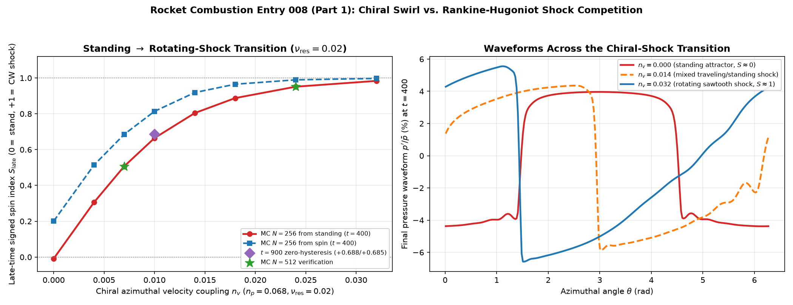
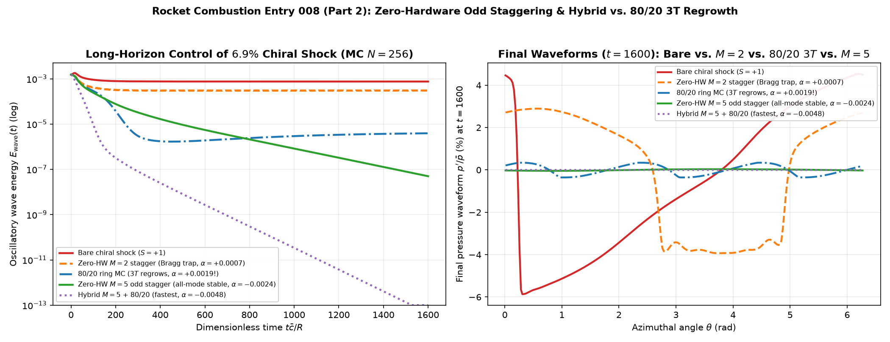

# 008 — Chiral Swirl vs. Gasdynamic Shock Competition, Even-$|u|$ Coupling & Rotating-Shock Control

- **Date:** 2026-11-24
- **Status:** `verified` (hardened after Peer Review #5)
- **Verification Script:** `../sim/exp008_chiral_shock_competition.py`

## 1. Target

Extend Entry [`007`](007-compressible-euler-steepening.md)'s hardened 1D periodic compressible Euler ring ($\gamma = 1.25$, low-dissipation MC limiter + HLLC + SSP-RK2, explicit residence-flush closure parameter $\nu_{\text{res}}$) with **swirled chiral velocity coupling ($n_v > 0$)**, **non-swirled even-symmetry speed coupling ($n_{|u|} > 0$)**, and **azimuthal injector lag staggering $\tau(\theta)$** to answer three concrete questions:

1. **Chiral Dispersion Verification:** Does our MC compressible Euler ring match the exact continuum chiral dispersion roots of $s^2 + \frac{\zeta - (n_p \pm n_v)H(s)}{L_a} s + m^2 = 0$ to $O(10^{-5})$ in the linear limit?
2. **Standing-to-Rotating-Shock Transition, $\nu_{\text{res}}$ Closure Dependence & Even-$|u|$ Coupling ($n_p = 0.068$):**
   - Under the residence-flush closure ($\nu_{\text{res}} > 0$), how does chiral swirl $n_v$ flip Entry `007`'s standing attractor ($S \approx 0$) into a **rotating detonation-like sawtooth shock ($S \to +1$)**—and how does the branch $S^*(n_v)$ depend on $\nu_{\text{res}} \in \{0, 0.01, 0.02, 0.05\}$?
   - Over long horizons ($t = 900$), does non-swirled **even-symmetry $|u|$ speed coupling** ($n_v = 0, n_{|u|} > 0$) ever trigger a strong spinning shock or $2T$ instability?
3. **All-Mode Rotating-Shock Control Shootout ($n_p = 0.060, n_v = 0.025, A_0 = 6.9\%\,p'/\bar{p}, t = 1600$):** Combining exact Fourier-collocation linear eigen-spectra with low-dissipation MC PDE runs to $t = 1600$, which baffle-free architecture genuinely stabilizes **ALL modes ($1T, 2T, 3T$)** against a $6.9\%$ chiral rotating shock: $M = 2$ staggering, **zero-hardware odd $M = 5$ staggering**, the $80/20$ dual cavity ring alone, or the **hybrid $M = 5 + 80/20$**?

## 2. The Math & Assumptions

### Governing Equations (Chiral + Even-$|u|$ + Spatially Staggered Causal Erlang-4 Euler Ring)

Entry `007`'s conservative 1D periodic compressible Euler ring ($\gamma = 1.25, L_a = 2.0, \zeta = 0.04$, explicit free closure parameter $\nu_{\text{res}}$, default $0.02$) is driven by:
$$Q_{\text{flame}, E}(\theta, t) = \frac{1}{(\gamma - 1) L_a}\Bigl[ n_p \Phi(q_p) + n_v \Phi(q_u) + n_{|u|} \Phi(q_{|u|}) \Bigr]$$
where $q_p, q_u, q_{|u|}$ are local 4-stage causal Erlang-4 delayed, DC-blocked ($\omega_{\text{hp}} = 0.15$) responses to $p - \bar{p}$, signed azimuthal velocity $u$, and flow speed $|u|$, with local injector lag $\tau(\theta)$.

- **Oscillatory diagnostics & secular swirl caveat:** All wave energies $E_{\text{wave}}$ and signed spin indices $S_{\text{signed}} = \langle P_{\text{osc}} u_{\text{osc}} \rangle / E_{\text{wave}}$ subtract the spatial mean $(\langle P \rangle, \langle u \rangle)$. As established in Peer Review #5 (M3), the nozzle momentum sink $-\frac{1}{L_a}\langle \rho u u_{\text{ext}} \rangle < 0$ drives a secular negative mean swirl $\bar{u}$ whenever a spinning wave persists (reaching $\bar{u} = -0.0248$ on the bare $t = 1600$ rotating shock) because this 1D ring lacks zero-swirl axial propellant inflow.
- **Causal staggered Erlang-4 phase cancellation:** Alternating sectors $\tau(\theta) \in \{0.30, 2.50\}$ with $M$ periods gives spatially averaged transfer function $\bar{H}(i\omega) = \frac{1}{2}[H(0.30) + H(2.50)]$:
  - Odd $M = 5$: $\operatorname{Re}[\bar{H}(i)] = +0.3575$, $\operatorname{Re}[\bar{H}(2i)] = +0.343$, $\operatorname{Re}[\bar{H}(3i)] = +0.293$, so $(n_p + n_v)\operatorname{Re}[\bar{H}(i)] = 0.0304 < \zeta = 0.04$ (exact eigen-spectrum $\alpha_{\max} = -0.00235$, linearly stabilizing **all modes** with zero cavities and zero baffles!).
  - Even $M = 2$ (Bragg-resonant): the $\tau_1$-aligned standing orientation experiences weight $\frac{1}{2} + \frac{1}{\pi} = 0.8183$, giving an $n_v = 0$ analytic Bragg gain $0.060 \times 0.745 = 0.0447 > 0.04$ ($\alpha = +0.00118$); including $n_v = 0.025$ in the exact eigen-spectrum gives $\alpha_{\max} = \mathbf{+0.00067}$ ($S = -0.10$, confirming the Bragg-trapped standing instability).

## 3. The Verification

Reproduce from the repo root:

```bash
uv run python rocket-combustion/sim/exp008_chiral_shock_competition.py
```

### Experiment 1 — Exact Continuum Chiral Dispersion vs. Euler MC PDE ($n_p = 0.050, n_v = 0.020, A = 10^{-4}$)

| Mode | Exact Continuum $\alpha$ ($\omega$) | Compressible Euler MC PDE $\alpha$ | $|\Delta \alpha|$ |
| :---: | :---: | :---: | :---: |
| $+1T$ (chiral-boosted) | $+0.006854$ ($0.99744$) | $+0.006871$ | **`1.73e-05`** |
| $-1T$ (chiral-damped) | $-0.002736$ ($0.99890$) | $-0.002741$ | **`5.09e-06`** |

### Experiment 2A — Smooth Chiral-Shock Transition ($\nu_{\text{res}} = 0.02$) & Closure Sensitivity ($n_p = 0.068$)

| Chiral $n_v$ | From Standing ($t = 400$): $S_{\text{late}}$ | $P_{\text{peak}}/\bar{p}$ | From Perturbed Spin ($t = 400$): $S_{\text{late}}$ | MC $N = 512$ Check ($t = 400$) |
| :---: | :---: | :---: | :---: | :---: |
| $0.000$ *(seeded $S_0=0.17$)* | **$-0.009$** | $5.50\%$ | $+0.201$ *(relaxing to $0$)* | — |
| $0.004$ | **$+0.305$** | $5.62\%$ | $+0.514$ | — |
| **$0.007$** | **$+0.507$** | $5.75\%$ | $+0.685$ | **`+0.5051`** (`0.4%` diff, `5.73%`) |
| $0.010$ | **$+0.664$** | $5.88\%$ | $+0.814$ | *(see $t=900$ check below)* |
| $0.014$ | **$+0.804$** | $6.06\%$ | $+0.919$ | — |
| $0.018$ | **$+0.888$** | $6.20\%$ | $+0.965$ | — |
| **$0.024$** | **$+0.951$** | $6.41\%$ | $+0.990$ | **`+0.9517`** (`0.07%` diff, `6.41%`) |
| $0.032$ | **$+0.984$** | $6.83\%$ | $+0.998$ | — |

- **Committed zero-hysteresis $t = 900$ check ($n_v = 0.010, \nu_{\text{res}} = 0.02$):** From pure standing $S(900) = \mathbf{+0.6860}$ ($E_{\text{wave}} = 6.727\times 10^{-4}$) and from perturbed spin $S(900) = \mathbf{+0.6846}$ ($E_{\text{wave}} = 6.730\times 10^{-4}$), proving the $t = 400$ gap is pure slow relaxation ($\tau_{\text{spin}} \sim 150$) onto a unique mixed-wave attractor $S^*(n_v)$ (consistent with the Landau shock-loss potential of Entry `007` tilted by linear chiral bias).
- **Controlling Closure Sensitivity — $\nu_{\text{res}} \in \{0, 0.01, 0.02, 0.05\}$ at $n_v = 0.010$ (from standing, $t = 600$):**

| $\nu_{\text{res}}$ | Late Signed $S_{\text{late}}$ | Range over $t \in [200, 600]$ | Final $\bar{\rho}$ | Final $\bar{u}$ | Closure Verdict |
| :---: | :---: | :---: | :---: | :---: | :--- |
| **$0.00$** | **$+0.0025$** | **`[-0.355, +0.440]`** | $1.0279$ | $-0.0005$ | **Smooth branch disappears!** Large sign reversals + secular $\bar{\rho}$ drift |
| $0.01$ | $+0.4735$ | `[+0.472, +0.569]` | $1.0009$ | $-0.0039$ | Smooth positive mixed branch |
| **$0.02$ (default)** | **$+0.6826$** | **`[+0.606, +0.687]`** | $0.9992$ | $-0.0051$ | Smooth positive mixed branch |
| $0.05$ | $+0.8119$ | `[+0.635, +0.821]` | $0.9978$ | $-0.0058$ | Smooth positive mixed branch (higher $S^*$) |

*(Physical interpretation per Peer Review #5 C2: without residence entropy flushing, flame- and shock-generated entropy inhomogeneities modulate local $c(\theta)$, scattering $+1T \leftrightarrow -1T$ and destroying the smooth chiral branch $S^*(n_v)$. Law #11's smooth chiral transition therefore explicitly assumes $\nu_{\text{res}} > 0$.)*

### Experiment 2B — Non-Swirled Even-Symmetry $|u|$ Speed Coupling Extended to $t = 900$ ($n_p = 0.068, n_v = 0$, Signed $S$)

| $n_{|u|}$ | From Seeded Standing ($S_0 = +0.17$): $S_{\text{signed}}(900)$ | From Perturbed Spin ($S_0 = +0.98$): $S_{\text{signed}}(900)$ | Peak $p'/\bar{p}$ | $E_{2T}/E_{1T}$ | Verdict |
| :---: | :---: | :---: | :---: | :---: | :--- |
| $0.02$ | $-0.0030$ | $-0.0431$ | $5.75\%$ | $17.7\%$ | No spinning shock; no $2T$ blow-up |
| $0.05$ | $-0.0045$ | $-0.0929$ | $6.57\%$ | $18.0\%$ | No spinning shock; slow reversed-sign residual |
| $0.08$ | $-0.0040$ | $-0.1172$ | $7.85\%$ | $18.7\%$ | No spinning shock; slow mixed residual ($|S|\approx 0.12$) |

*(From seeded standing, $S \to 0$ cleanly across all $n_{|u|}$; from perturbed spin, $S$ overshoots slightly negative and decays slowly—from Peer Review #5's $-0.21$ at $t=600$ to $-0.117$ at $t=900$ for $n_{|u|} = 0.08$—confirming **no strong spinning shock** and **no $2T$ instability**, while avoiding over-claiming strict standing lock-in.)*



### Experiment 3 — Exact Eigen-Spectrum & Rotating-Shock Control Shootout ($n_p = 0.060, n_v = 0.025, A_0 = 6.9\%$, MC $N = 256, t = 1600$)

| Architecture | Hardware Added | Exact Linear $\alpha_{\max}$ (Mode) | Late $P_{\text{peak}}/\bar{p}$ | Late $E_{\text{wave}}$ (`l/m`) | Late $e_3$ | $\bar{u}$ | Verdict |
| :--- | :---: | :---: | :---: | :---: | :---: | :---: | :--- |
| **Bare Chiral Shock** | None | $+0.01045$ ($1T^+$) | $5.87\%$ | $7.54\times 10^{-4}$ (`0.999`) | $7.0\times 10^{-5}$ | $-0.0248$ | Sustained rotating sawtooth shock |
| **Zero-HW $M = 2$ Stagger** | **Zero** | $+0.00067$ ($1T$, $S=-0.10$) | $3.83\%$ | $3.03\times 10^{-4}$ (`1.009`) | $2.2\times 10^{-5}$ | $+0.0011$ | **Fails (Bragg Trap):** standing shock LC |
| **$80/20$ Dual Cavity Ring** | $\beta=2\%, \sigma_o=3.5\%$ | **`+0.00192` ($3T^+$)** | **$0.35\%$** | **$3.73\times 10^{-6}$ (`1.367`!)** | **$7.1\times 10^{-6}$** | $-0.0029$ | **Fails on $3T$:** kills $1T/2T$, co-rotating $3T$ regrows! |
| **Zero-HW $M = 5$ Odd Stagger** | **Zero** | **`-0.00235` ($1T^+$)** | **$0.06\%$** | **$1.15\times 10^{-7}$ (`0.092`)** | $5.4\times 10^{-11}$ | $-0.0004$ | **ALL-MODE STABLE!** $6{,}500\times$ energy decay, zero hardware! |
| **Hybrid $M = 5$ + $80/20$** | Both | **`-0.00477` ($3T^+$)** | **$0.00\%$** | **$4.23\times 10^{-13}$ (`0.004`)** | $8.4\times 10^{-13}$ | $-0.0003$ | **Strongest all-mode stabilizer:** $2\times$ faster decay (`1.8e9×` cut)! |



Full metrics: [`../results/exp008_metrics.json`](../results/exp008_metrics.json).

## 4. Verdict & Dead Ends

- **Critical findings incorporated from Peer Review #5:**
  1. **$80/20$ dual cavity ring alone is NOT all-mode stable here (C1):** While it crushes $1T$ and $2T$, co-rotating $3T$ is linearly unstable ($\alpha = +0.00192$) and regrows under low-dissipation MC numerics (`l/m = 1.367`, crossing above zero-hardware $M = 5$ staggering around $t \approx 800$).
  2. **The smooth chiral branch $S^*(n_v)$ requires residence entropy flushing $\nu_{\text{res}} > 0$ (C2):** At $\nu_{\text{res}} = 0$, entropy/sound-speed inhomogeneities destroy the smooth branch (`S` swings across `[-0.355, +0.440]` at $n_v = 0.010$); for $\nu_{\text{res}} \in [0.01, 0.05]$, $S^*(0.010)$ increases smoothly from `+0.47` to `+0.81`.
  3. **Even-periodic $M = 2$ Bragg trap:** Confirmed in exact eigen-spectrum ($\alpha = +0.00067, S = -0.10$) and $t = 1600$ MC PDE ($3.83\%$ standing shock).
- **What worked (Hardened Law #11 for `SYNTHESIS.md`):**
  1. **Zero-hardware odd-periodic ($M = 5$) lag staggering is the ONLY single-mechanism all-mode stabilizer of this shocked chiral chamber:** With $\tau \in \{0.30, 2.50\}$, $M = 5$ achieves $\alpha_{\max} = -0.00235$ across $1T, 2T, 3T$ (verified by Peer Review #5 across $A \le 0.10$, standing/spinning/$2T$/$3T$ ICs, and even $\nu_{\text{res}} = 0$), exponentially quenching the $6.9\%$ rotating shock by **$6{,}500\times$** in energy by $t = 1600$—beating the $80/20$ cavity ring alone (which loses to $3T$).
  2. **Hybrid $M = 5$ staggering + $80/20$ dual cavity ring doubles the all-mode stability margin ($\alpha_{\max} = -0.00477$):** Pairing broadband injector phase cancellation with high-authority $1T/2T$ cavity damping annihilates the $6.9\%$ rotating shock to $E_{\text{wave}} = 4.2\times 10^{-13}$ by $t = 1600$.
  3. **Conditional chiral-shock phase transition ($\nu_{\text{res}} > 0$):** Under residence-time entropy flushing ($\nu_{\text{res}} = 0.02$), chiral swirl $n_v$ smoothly tilts the standing attractor along a hysteresis-free mixed branch $S^*(n_v)$ ($t = 900$: $+0.6860$ vs. $+0.6846$; $N = 512$ agrees to $0.4\%$ at $n_v = 0.007$ and $0.07\%$ at $n_v = 0.024$), locking into a rotating sawtooth shock ($S^* \ge 0.95$) for $n_v \ge 0.024$, while non-swirled even-$|u|$ coupling never produces a strong spinning shock.
- **Next high-value step (`009`):** Replace the 1D ring's ad-hoc residence-flush closure $S_{\text{ent}}$ and zero-inflow momentum sink with a **2D $(x, \theta)$ compressible Euler annular combustor with physical steady axial throughflow** ($\bar{M}_x > 0$: constant-mass zero-swirl propellant injection at $x = 0$ + exact choked nozzle at $x = L_a$), naturally resolving both entropy advection and azimuthal swirl relaxation from first principles!
