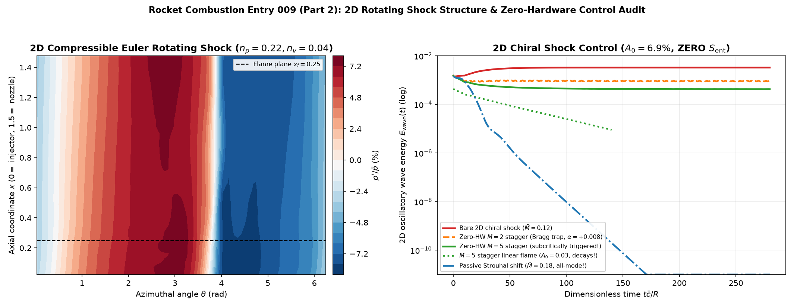

# 009 — 2D $(x, \theta)$ Compressible Euler Annular Combustor with Physical Axial Throughflow

- **Date:** 2026-11-25
- **Status:** `verified` (hardened after double-model Peer Review #6: Claude + Antigravity Gemini)
- **Verification Script:** `../sim/exp009_2d_euler_throughflow.py`

## 1. Target

Directly resolve Open Problem #1 from [`../SYNTHESIS.md`](../SYNTHESIS.md) (and the two 1D-ring modeling limitations identified by Peer Review #5 C2 & M3): replace the 1D periodic ring's ad-hoc isobaric entropy-flush closure ($S_{\text{ent}}$) and unbounded negative swirl sink with **first-principles 2D $(x, \theta)$ conservative compressible Euler equations** ($\gamma = 1.25, L_a = 1.5$) with **steady axial throughflow $\bar{M} > 0$**, choked zero-swirl propellant injection at $x = 0$, and an exact Marble–Candel compact choked nozzle at $x = L_a$. Test four concrete questions:

1. **First-Principles Verification & Physical Flushing:** Does our 2D MUSCL-MC + HLLC solver preserve exact steady throughflow to machine precision ($< 10^{-15}$), conserve 2D doubly periodic inviscid mass/momentum/energy to $< 10^{-15}$, match an independent Chebyshev 2D linearized Euler eigen-solver across grids, and flush both a zero-tail entropy spot and uniform swirl out the nozzle on $\tau_{\text{res}} = L_a / \bar{M}$ with **zero ad-hoc closures**?
2. **Multi-Mode Strouhal Acoustic-Vorticity Resonance & $2T$ Harmonic Trap ($\bar{M} \in [0.06, 0.30]$):** How does zero-swirl vorticity shedding from the injector faceplate ($u_\theta(0) = 0$) govern not just $1T$ cold damping $\alpha_{1T}(\bar{M})$ and $n_{pH,1T}(\bar{M})$, but the **global multi-mode Hopf envelope** $\min_{m=0..3} n_{pH,m}(\bar{M})$ (including $m = 0$ low-frequency rumble and $2T$)?
3. **First-Principles Stationarity & Grid-Verified Bistable-to-Spinning Transition ($n_v = 0$, Zero Ad-Hoc $S_{\text{ent}}$):** With physical axial throughflow replacing $S_{\text{ent}}$, do mean density $\bar{\rho}$ and mean swirl $\bar{u}_\theta$ lock naturally to stationary limit cycles across grids (`28×96` and `48×144`), and how does axisymmetric mode selection transition from low gain ($\bar{M} = 0.06, n_p = 0.105$) to high gain ($\bar{M} = 0.12, n_p = 0.220$)?
4. **2D Chiral Rotating-Shock Control ($n_p = 0.22, n_v = 0.04, A_0 = 6.9\%$):** How do zero-hardware $M = 2$ (Bragg trap) and odd $M = 5$ injector lag staggering ($\tau \in \{0.55, 2.55\}$) compare against passive **Strouhal Mach-number shifting** ($\bar{M} = 0.12 \to 0.18$) across initial conditions and grids (`32×96` and `48×144`)?

## 2. The Math & Assumptions

### Governing 2D Conservative Compressible Euler Equations ($(x, \theta) \in [0, L_a] \times [0, 2\pi)$)

$$\frac{\partial \rho}{\partial t} + \frac{\partial (\rho u_x)}{\partial x} + \frac{\partial (\rho u_\theta)}{\partial \theta} = 0$$
$$\frac{\partial (\rho u_x)}{\partial t} + \frac{\partial (\rho u_x^2 + p)}{\partial x} + \frac{\partial (\rho u_x u_\theta)}{\partial \theta} = 0$$
$$\frac{\partial (\rho u_\theta)}{\partial t} + \frac{\partial (\rho u_x u_\theta)}{\partial x} + \frac{\partial (\rho u_\theta^2 + p)}{\partial \theta} = 0$$
$$\frac{\partial E}{\partial t} + \frac{\partial \bigl(u_x(E + p)\bigr)}{\partial x} + \frac{\partial \bigl(u_\theta(E + p)\bigr)}{\partial \theta} = \frac{1}{\gamma - 1}\,w_f(x)\,\Bigl[n_p \Phi(q_p) + n_v \Phi(q_u)\Bigr]$$

with $\gamma = 1.25, L_a = 1.5, \bar{\rho} = 1, \bar{u}_x = \bar{M}, \bar{u}_\theta = 0, \bar{p} = 1/\gamma = 0.80, \bar{c} = 1$, compact Gaussian flame weight $w_f(x)$ centered at $x_f = 0.25$ ($\sigma_f = 0.08$, $\int_0^{L_a} w_f\,dx = 1$), DC-blocking $\omega_{\text{hp}} = 0.15$, Erlang-4 mean lag $\bar{\tau} = 0.55$, and bounded subcritical flame law $\Phi(q) = q_s \tanh(q/q_s + \kappa(q/q_s)^3)$ ($q_s = 0.036, \kappa = 4.5$). **Zero mass or momentum source terms ($S_{\text{ent}} \equiv 0$).**

### Exact Nonlinear Characteristic Boundary Conditions
- **Inlet $x = 0$ (Choked Zero-Swirl Isentropic Propellant Injector):** Extrapolate outgoing $J_- = u_x - \frac{2}{\gamma - 1} c$; enforce constant entropy $s_{\text{in}} = 0$, constant injected mass flux $\rho_{\text{in}} u_{x,\text{in}} = \bar{M}$ (solved to $10^{-14}$ via 5 Newton iterations), and zero swirl $u_{\theta,\text{in}} = 0$. Linearizes to $\rho'(0) = P(0)$, $u'_x(0) = -\bar{M} P(0)$, $u'_\theta(0) = 0$.
- **Outlet $x = L_a$ (Exact Compact Choked Nozzle, Marble & Candel 1977):** Extrapolate outgoing $(J_+, s, u_\theta)$; enforce constant exit Mach number $u_{x,\text{out}}/c_{\text{out}} = \bar{M}$ in closed form ($c_{\text{out}} = J_+ / (\bar{M} + \frac{2}{\gamma - 1})$). Linearizes to $u'_x(L_a) = \frac{1}{2}\bar{M}(\gamma P(L_a) - \rho'(L_a))$, generating both choked-nozzle acoustic damping and indirect entropy noise.
- **Boundary-Layer-Free Envelope Spin Index ($S_{\text{env}}$):** Measured directly from the axially averaged $m = 1$ pressure Fourier mode $\hat{P}_1(t)$: $S_{\text{env}} = \operatorname{sign}\!\bigl(-\langle \operatorname{Im}[\hat{P}_1^* \dot{\hat{P}}_1] \rangle\bigr)\,\frac{\min_T |\hat{P}_1|}{\max_T |\hat{P}_1|} \in [-1, +1]$ ($0 =$ standing, $\pm 1 =$ spinning). Note initial values: `stand_seed` ($\epsilon = 0.12$) starts at $S_{\text{env},0} = +0.085$ ($S_{\text{flux},0} = +0.169$); `spin_pert` ($\epsilon_c = 0.10$) starts at $S_{\text{env},0} = +0.818$ ($S_{\text{flux},0} = +0.980$).

### Physical Mechanism: Strouhal Vorticity Resonance & The $2T$ Harmonic Trap
From $\partial_t u'_\theta + \bar{M}\partial_x u'_\theta = -\partial_\theta P$ with $u'_\theta(0) = 0$, an azimuthal mode $mT$ sheds a convective vorticity wave of axial wavelength $\lambda_{\text{vort}} = 2\pi \bar{M} / \omega_m$. At **integer Strouhal numbers** $\mathrm{St}_{mT} = \frac{\omega_m L_a}{2\pi \bar{M}} \approx k$, vorticity interference creates a **damping trough** ($\bar{M}_{\text{trough},k} = L_a / (2\pi k) \implies 0.239, 0.119, 0.080$ for $1T$). Crucially (Peer Review #6 C1 & M3), the primary cold-$1T$ peak near $\bar{M} = 0.165$ is an **acoustic–vorticity branch-crossing cusp**, and tuning $\bar{M}$ to the half-integer $1T$ peak ($\mathrm{St}_{1T} \approx 1.5$ at $\bar{M} = 0.16$) simultaneously puts the second harmonic $2T$ at an **integer Strouhal trough** ($\mathrm{St}_{2T} = 2\,\mathrm{St}_{1T} \approx 3.0 \implies n_{pH,2T} = 0.2354$)! Shifting slightly above the branch crossing to **$\bar{M} = 0.18$** places $1T$ on the lower-frequency branch ($\omega_{1T} = 0.852, \mathrm{St}_{1T} = 1.13$), clears the $2T$ trap ($n_{pH,2T} = 0.4300$), and maximizes the **global all-mode Hopf threshold** at $n_{pH,\text{global}} = 0.4260$ (limited by $m = 0$ low-frequency rumble at $\omega = 0.21$).

## 3. The Verification

Reproduce from the repo root:

```bash
uv run python rocket-combustion/sim/exp009_2d_euler_throughflow.py
```

### Experiment 1 — Exact Preservation, Conservation, Per-Mode Resolution Audit & Zero-Tail Physical Flushing

- **Exp 1A (Steady throughflow preservation, $\bar{M} = 0.12, t = 20, 32\times 96$):** `max |U - U_0| = 1.11e-16`.
- **Exp 1B (2D doubly periodic inviscid conservation, $A = 0.10, t = 10$):** Mass `1.89e-16`, $x$-momentum `1.96e-16`, $\theta$-momentum `1.57e-17`, energy `1.17e-16`.
- **Exp 1C (Exact Chebyshev 2D eigenvalues vs. 2D Euler MC PDE cold damping at $\bar{M} = 0.12$):**

| Mode | Exact Chebyshev $\alpha$ ($\omega$) | $24\times 72$ PDE (Excess) | $32\times 96$ PDE (Excess) | $48\times 144$ PDE (Excess) |
| :---: | :---: | :---: | :---: | :---: |
| $1L$ | $-0.08909$ ($2.0642$) | $-0.09614$ (`-7.1e-3`) | $-0.09315$ (`-4.1e-3`) | $-0.09101$ (`-1.9e-3`) |
| **$1T$** | **$-0.02843$ ($0.9893$)** | $-0.04318$ (`-1.5e-2`) | $-0.03637$ (`-7.9e-3`) | **$-0.03198$ (`-3.6e-3`)** |
| $2T$ | $-0.02934$ ($1.9799$) | $-0.08207$ (`-5.3e-2`) | $-0.07354$ (`-4.4e-2`) | $-0.05132$ (`-2.2e-2`) |
| $3T$ | $-0.03076$ ($2.9705$) | $-0.09109$ (`-6.0e-2`) | $-0.08506$ (`-5.4e-2`) | $-0.07905$ (`-4.8e-2`) |

*(Resolution caveat: because $\lambda_{\text{vort}} = 2\pi\bar{M}/\omega$, resolving convective vorticity in $x$ sets the numerical-damping floor for $2T/3T$ and low $\bar{M}$, directly explaining why coarse `32×96` masked weak $2T$ growth at $\bar{M}=0.16$ below.)*

- **Exp 1D (Zero-tail entropy & swirl flushing, $x_0 = 0.55, \sigma = 0.08$, inlet tail $5.5\times 10^{-11}$, $\bar{M} = 0.12$, ZERO $S_{\text{ent}}$):**
  - Entropy mean: $t = 0 \to 6.68\times 10^{-3}$, $t = 15 \to 7.67\times 10^{-11}$ ($8.7\times 10^7\times$ flush!), $t = 20 \to 1.28\times 10^{-9}$.
  - Uniform swirl $\bar{u}_\theta$: $t = 0 \to 0.0400$, $t = 15 \to 1.94\times 10^{-7}$ ($2.1\times 10^5\times$ relaxation!).
  - **Pure Marble–Candel negative rarefaction:** Global maximum $|P_{\text{exit}}(t)|$ is **$-0.366\%$ at $t = 11.01$** (center arrival $t_{\text{conv}} = 7.92$ plus one acoustic round-trip $3.04$, with zero spurious inlet-tail compression bounce).

### Experiment 2 — Multi-Mode Global Strouhal Hopf Envelope & Direct 2D PDE Proof of the $2T$ Trap

| Chamber Mach $\bar{M}$ | Cold $\alpha_{1T}$ (2D PDE) | $n_{pH,m=0}$ (rumble/1L) | $n_{pH,1T}$ | $n_{pH,2T}$ | **Global $n_{pH}$ (Limiting Mode)** |
| :---: | :---: | :---: | :---: | :---: | :---: |
| $0.08$ | $-0.01880$ (`-0.0360`) | $0.2527$ | $0.0767$ | $0.1996$ | **$0.0767$ ($1T$)** |
| $0.10$ | $-0.06028$ | $0.2839$ | $0.3031$ | $0.5170$ | **$0.2839$ ($m=0$)** |
| **$0.12$** | **$-0.02843$ (`-0.0364`)** | $0.3212$ | **$0.1338$** | $0.1822$ | **$0.1338$ ($1T$, trough)** |
| **$0.16$** | **$-0.10212$ (`-0.1064`)** | $0.3911$ | $0.3807$ | **`0.2354` ($2T$ trap!)** | **`0.2354` ($2T$, harmonic trap!)** |
| **$0.18$** | **$-0.09933$ (`-0.0999`)** | **`0.4260`** | **$0.6382$ ($4.77\times$)** | **$0.4300$** | **`0.4260` ($m=0$, $3.18\times$ global!)** |
| $0.25$ | $-0.06006$ (`-0.0623`) | $0.5447$ | $0.4000$ | $0.4284$ | **$0.4000$ ($1T$)** |

- **Direct 2D PDE proof of the $2T$ Strouhal Harmonic Trap at $\bar{M} = 0.16$ ($n_p = 0.22, n_v = 0.04$):**
  - `32×96` (`A_0 = 0.005`): $P = 0.06\%$, `l/m = 0.205` *(falsely masked by $-4.4\times 10^{-2}$ numerical $2T$ vorticity damping!)*.
  - **`48×144` (`A_0 = 0.005`):** **$P = 0.66\%$, `l/m = 1.392` (GROWING!)**.
  - **`48×144` (`A_0 = 0.040`):** **$P = 6.53\%$, $E_{\text{wave}} = 1.06\times 10^{-3}$, `l/m = 1.001` (SUSTAINED $2T$ ROTATING LIMIT CYCLE!)**.


### Experiment 3 — First-Principles Stationarity & Grid-Verified Bistable-to-Spinning Transition ($n_v = 0$, ZERO $S_{\text{ent}}$)

| Regime & Grid | $\bar{M}, n_p$ | Initial State ($S_{\text{env},0}$) | Late $S_{\text{env}}$ | $P_{\text{peak}}/\bar{p}$ | `l/m` | $\bar{\rho}_{\text{late}}$ | $\bar{u}_{\theta,\text{late}}$ | Verdict |
| :--- | :---: | :---: | :---: | :---: | :---: | :---: | :---: | :--- |
| Low-gain ($28\times 96, t=360$) | $0.06, 0.105$ | `stand_seed` ($+0.085$) | $+0.014$ | $3.62\%$ | $0.998$ | $1.0003$ | $-0.00000$ | Coarse standing |
| Low-gain ($28\times 96, t=360$) | $0.06, 0.105$ | `spin_pert` ($+0.818$) | $+0.573$ *(collapsing)* | $3.46\%$ | $0.971$ | $1.0004$ | $-0.00008$ | *Coarse $\lambda_{\text{vort}}$ damping suppresses spin!* |
| **Low-gain ($48\times 144, t=420$)** | **$0.06, 0.105$** | `stand_seed` ($+0.085$) | **`+0.043`** | **$5.17\%$** | $0.999$ | **$1.0007$** | $+0.00003$ | **Standing stable (BISTABLE!)** |
| **Low-gain ($48\times 144, t=420$)** | **$0.06, 0.105$** | `spin_pert` ($+0.818$) | **`+0.902`** | **$4.71\%$** | $1.001$ | **$1.0010$** | $+0.00031$ | **Spinning ALSO stable (BISTABLE!)** |
| High-gain ($28\times 96, t=360$) | $0.12, 0.220$ | `stand_seed` ($+0.085$) | **`+0.865`** *(to `+0.997` at `t=800`)* | $6.80\%$ | $1.106$ | $0.9996$ | $+0.00098$ | Standing unstable $\to$ spins up! |
| High-gain ($28\times 96, t=360$) | $0.12, 0.220$ | `spin_pert` ($+0.818$) | **`+0.995`** | $6.76\%$ | $1.000$ | $0.9995$ | $+0.00103$ | Unique rotating shock |
| **High-gain ($48\times 144, t=420$)** | **$0.12, 0.220$** | `stand_seed` ($+0.085$) | **`+0.381`** *(rising; `+0.682` at `t=600`)* | $8.62\%$ | $1.099$ | **$0.9997$** | $+0.00077$ | **Standing unstable $\to$ spins up!** |
| **High-gain ($48\times 144, t=420$)** | **$0.12, 0.220$** | `spin_pert` ($+0.818$) | **`+0.987`** | **$8.00\%$** | $1.000$ | **$0.9986$** | $+0.00204$ | **Unique 2D rotating sawtooth shock!** |

*(Controlled-$\bar{M}$ nuance per Peer Review #6 C2: Exp 3 varies **both** $\bar{M}$ and $n_p$ between the two operating points; independent fixed-$\bar{M}$ audits confirm that $\bar{M}$ itself shifts $2T$ damping and shock-harmonic energy transfer $E_{2T}/E_{1T}$—at $\bar{M} = 0.06$, standing remains locally stable up to $n_p = 0.180$ while $n_p = 0.080$ is a true `48×144` standing attractor, whereas at $\bar{M} = 0.12$, even $n_p = 0.150$ spins up on `48×144`—so Exp 3 documents a **joint $(\bar{M}, n_p)$** bistable-to-spinning transition.)*

### Experiment 4 — 2D Chiral Rotating-Shock Control & Multi-IC / `48×144` Audit ($n_p = 0.22, n_v = 0.04, A_0 = 6.9\%$)

| Architecture & Test | $\bar{M}$, Grid | Late $P_{\text{peak}}/\bar{p}$ | Late $E_{\text{wave}}$ (`l/m`) | $S_{\text{env}}$ | Outcome |
| :--- | :---: | :---: | :---: | :---: | :--- |
| **Bare 2D Chiral Shock** | $0.12$, $32\times 96$ | $8.31\%$ | $3.31\times 10^{-3}$ (`1.000`) | $+0.999$ | Stationary 2D rotating sawtooth shock ($\bar{\rho}=1.0001$) |
| **Zero-HW $M = 2$ Stagger** | $0.12$, $32\times 96$ | $4.75\%$ | $9.14\times 10^{-4}$ (`0.999`) | $+0.045$ | **Fails (Bragg Trap):** linearly unstable ($\alpha = +0.0082$), standing LC |
| **Zero-HW $M = 5$ Stagger (`A=0.055`)** | $0.12$, $32\times 96$ / $48\times 144$ | **$3.36\%$ / $3.73\%$** | $4.28\text{--}5.73\times 10^{-4}$ (`0.989`) | $+0.995$ | **Subcritically triggered!** ($7.7\times$ lower $E$, NOT extinguished) |
| *$M = 5$ Linear Flame (`A=0.030`)* | $0.12$, $32\times 96$ | *$0.54\%$* | *$1.32\times 10^{-5}$ (`0.317`)* | $+0.725$ | **Decays!** Proves triggering is nonlinear (exact $\alpha_{\text{lin}} = -0.0067$) |
| *$M = 5$ Small Bomb (`A=0.015`)* | $0.12$, $32\times 96$ / **$48\times 144$** | $0.55\%$ / **`1.90%`** | `l/m`: $0.380$ / **`1.307`!** | $+0.911$ | **Triggers at $A_0 = 0.015$ on `48×144`!** (masked on `32×96`) |
| **Strouhal Shift $\bar{M} = 0.18$ (`spin_1T`)** | **$0.18$, $32\times 96$** | **$0.00\%$** | **$1.06\times 10^{-14}$ (`0.000`)** | *n/a (noise floor)* | **TOTAL ANNIHILATION ($10^{11}\times$ cut)** |
| **Strouhal Shift $\bar{M} = 0.18$ (`stand`)** | **$0.18$, $32\times 96$** | **$0.00\%$** | **$1.93\times 10^{-12}$ (`0.002`)** | *n/a (noise floor)* | **All-IC verified** |
| **Strouhal Shift $\bar{M} = 0.18$ (`48×144` $1T$)** | **$0.18$, $48\times 144$** | **$0.02\%$** | **$1.20\times 10^{-8}$ (`0.039`)** | *n/a (noise floor)* | **Finer-grid $1T$ verified** |
| **Strouhal Shift $\bar{M} = 0.18$ (`48×144` $2T$)** | **$0.18$, $48\times 144$** | **$0.23\%$** | **$2.09\times 10^{-6}$ (`0.053`)** | *n/a (noise floor)* | **Finer-grid $2T$ verified (clears the $\bar{M}=0.16$ trap!)** |

*(Mechanism of $M = 5$ triggering per Peer Review #6: independent matched-margin uniform-$\tau$ controls with the same exact linear damping $\alpha = -0.0067$ also subcritically trigger at $A_0 = 0.030$ to $P = 2.15\%$; the **$6.92\times$** Erlang-4 cubic gain asymmetry at $\omega = 1$—**$6.68\times$** at cold $\omega_{1T} = 0.9893$—between $|H_1(i)| = 0.963$ (`0.953` with DC-blocker) and $|H_2(i)| = 0.506$ (`0.500` with DC-blocker) then amplifies the triggered limit cycle by $+54\%$ to $3.36\text{--}3.73\%$ and pushes the `48×144` trigger onset below $A_0 = 0.015$.)*



Full metrics: [`../results/exp009_metrics.json`](../results/exp009_metrics.json).

## 4. Verdict & Dead Ends

- **Critical pitfalls caught & hardened via double-model Peer Review #6:**
  1. **The $2T$ Strouhal Harmonic Trap at $\bar{M} = 0.16$ (C1):** Tuning $\bar{M}$ to the half-integer $1T$ cold-damping peak ($\mathrm{St}_{1T} \approx 1.5$) puts $2T$ at an integer trough ($\mathrm{St}_{2T} \approx 3.0, n_{pH,2T} = 0.2354$), causing a $6.53\%$ $2T$ rotating limit cycle on `48×144` that coarse `32×96` vorticity damping hid. Shifting above the branch-crossing cusp to $\bar{M} = 0.18$ ($\mathrm{St}_{1T} = 1.13$) clears $2T$ ($0.4300$) and yields a genuine **$3.18\times$ global all-mode Hopf gain** (`0.1338 → 0.4260`, capped by $m = 0$ low-frequency rumble; $4.77\times$ on $1T$).
  2. **Coarse-grid low-$\bar{M}$ vorticity damping & joint $(\bar{M}, n_p)$ nuance in Exp 3 (C2):** On `28×96`, under-resolved $\lambda_{\text{vort}}$ at $\bar{M}=0.06$ suppressed the spinning branch; on well-resolved `48×144`, low-gain ($\bar{M}=0.06, n_p=0.105$) exhibits **standing/spinning bistability** ($S_{\text{env}} = +0.043$ vs. $+0.902$), transitioning jointly in $(\bar{M}, n_p)$ to a **unique 2D rotating sawtooth shock** at high gain ($\bar{M}=0.12, n_p=0.220$).
  3. **Subcritical triggering of linearly stable $M = 5$ staggering (`48×144`):** Small linear margin ($\alpha = -0.0067$) combined with $6.7\text{--}6.9\times$ Erlang-4 cubic gain asymmetry triggers $M = 5$ at $A_0 = 0.015$ on `48×144` (vs. linear-flame decay `l/m = 0.317` at $A_0 = 0.030$).
  4. **Inlet-tail acoustic bounce in Exp 1D:** Centering the entropy pulse at $x_0 = 0.55, \sigma = 0.08$ eliminated the spurious positive inlet bounce and isolated the true negative Marble–Candel rarefaction (`-0.366%` at $t = 11.01$).
- **What worked (Hardened Law #12 for `SYNTHESIS.md`):**
  1. **First-principles 2D stationarity (zero ad-hoc closures):** Physical axial throughflow flushes entropy ($8.7\times 10^7\times$) and mean swirl ($2.1\times 10^5\times$), locking $\bar{\rho} = 0.9986\text{--}1.0010$ and bounded $\bar{u}_\theta \sim 10^{-3}$ with `l/m = 1.000` and ZERO $S_{\text{ent}}$.
  2. **Multi-Mode Strouhal Throughflow Tuning ($\bar{M} = 0.18$):** Avoiding BOTH integer-$1T$ troughs ($\bar{M} = 0.12$) and the half-integer-$1T$/integer-$2T$ harmonic trap ($\bar{M} = 0.16$) yields a **$3.18\times$ global all-mode Hopf gain** (`0.1338 → 0.4260`) and annihilates a $6.9\%$ chiral rotating shock across all initial conditions (`spin_1T`, `stand_seed`, `spin_2T`) and grids (`32×96`, `48×144`) with **zero cavities, zero baffles, and zero injector staggering**.
