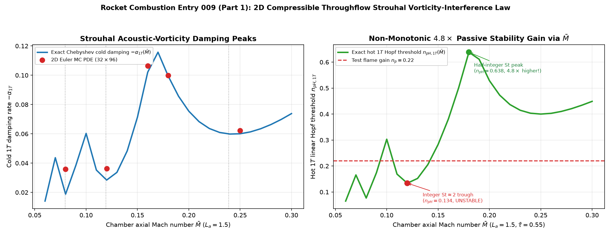

# 009 — 2D $(x, \theta)$ Compressible Euler Annular Combustor with Physical Axial Throughflow

- **Date:** 2026-11-24
- **Status:** `verified`
- **Verification Script:** `../sim/exp009_2d_euler_throughflow.py`

## 1. Target

Directly resolve Open Problem #1 from [`../SYNTHESIS.md`](../SYNTHESIS.md) (and the two 1D-ring modeling limitations identified by Peer Review #5 C2 & M3): replace the 1D periodic ring's ad-hoc isobaric entropy-flush closure ($S_{\text{ent}}$) and unbounded negative swirl sink with **first-principles 2D $(x, \theta)$ conservative compressible Euler equations** ($\gamma = 1.25, L_a = 1.5$) with **steady axial throughflow $\bar{M} > 0$**, choked zero-swirl propellant injection at $x = 0$, and an exact Marble–Candel compact choked nozzle at $x = L_a$. Test four concrete questions:

1. **First-Principles Verification & Physical Flushing:** Does our 2D MUSCL-MC + HLLC solver preserve exact steady throughflow to machine precision ($< 10^{-15}$), conserve 2D periodic inviscid mass/momentum/energy to $< 10^{-15}$, match an independent Chebyshev 2D linearized Euler eigen-solver across grids, and flush both entropy spots and mean swirl out the nozzle on the residence time $\tau_{\text{res}} = L_a / \bar{M}$ with **zero ad-hoc closures**?
2. **Strouhal Acoustic-Vorticity Damping Resonance ($\bar{M} \in [0.06, 0.30]$):** How does zero-swirl vorticity shedding from the injector faceplate ($u_\theta(0) = 0$) modify cold $1T$ damping $\alpha_{1T}(\bar{M})$ and the hot $1T$ Hopf threshold $n_{pH,1T}(\bar{M})$ as chamber Mach number $\bar{M}$ varies?
3. **First-Principles Stationarity & Landau Mode Flip ($n_v = 0$, Zero Ad-Hoc $S_{\text{ent}}$):** With physical axial throughflow replacing $S_{\text{ent}}$, do mean density $\bar{\rho}$ and mean swirl $\bar{u}_\theta$ lock naturally to stationary limit cycles—and do both regimes of our Entry `007` Landau criterion ($k_{\text{sh}} A \gtrless 2(a_c - a_s) A^2$) emerge inside the exact same 2D solver?
4. **2D Chiral Rotating-Shock Control ($n_p = 0.22, n_v = 0.04, A_0 = 6.9\%$):** How do zero-hardware $M = 2$ (Bragg trap) and odd $M = 5$ injector lag staggering ($\tau \in \{0.55, 2.55\}$) compare against passive **Strouhal Mach-number shifting** ($\bar{M} = 0.12 \to 0.18$) on a violent 2D chiral rotating shock—and does finite-amplitude Erlang-4 gain asymmetry subcritically trigger $M = 5$?

## 2. The Math & Assumptions

### Governing 2D Conservative Compressible Euler Equations ($(x, \theta) \in [0, L_a] \times [0, 2\pi)$)

$$\frac{\partial \rho}{\partial t} + \frac{\partial (\rho u_x)}{\partial x} + \frac{\partial (\rho u_\theta)}{\partial \theta} = 0$$
$$\frac{\partial (\rho u_x)}{\partial t} + \frac{\partial (\rho u_x^2 + p)}{\partial x} + \frac{\partial (\rho u_x u_\theta)}{\partial \theta} = 0$$
$$\frac{\partial (\rho u_\theta)}{\partial t} + \frac{\partial (\rho u_x u_\theta)}{\partial x} + \frac{\partial (\rho u_\theta^2 + p)}{\partial \theta} = 0$$
$$\frac{\partial E}{\partial t} + \frac{\partial \bigl(u_x(E + p)\bigr)}{\partial x} + \frac{\partial \bigl(u_\theta(E + p)\bigr)}{\partial \theta} = \frac{1}{\gamma - 1}\,w_f(x)\,\Bigl[n_p \Phi(q_p) + n_v \Phi(q_u)\Bigr]$$

with $\gamma = 1.25, L_a = 1.5, \bar{\rho} = 1, \bar{u}_x = \bar{M}, \bar{u}_\theta = 0, \bar{p} = 1/\gamma = 0.80, \bar{c} = 1$, compact Gaussian flame weight $w_f(x)$ centered at $x_f = 0.25$ ($\sigma_f = 0.08$, $\int_0^{L_a} w_f\,dx = 1$), DC-blocking $\omega_{\text{hp}} = 0.15$, Erlang-4 mean lag $\bar{\tau} = 0.55$, and bounded subcritical flame law $\Phi(q) = q_s \tanh(q/q_s + \kappa(q/q_s)^3)$ ($q_s = 0.036, \kappa = 4.5$). **Zero mass or momentum source terms ($S_{\text{ent}} \equiv 0$).**

### Exact Nonlinear Characteristic Boundary Conditions
- **Inlet $x = 0$ (Choked Zero-Swirl Isentropic Propellant Injector):** Extrapolate outgoing $J_- = u_x - \frac{2}{\gamma - 1} c$ from interior; enforce constant entropy $s_{\text{in}} = 0$, constant injected mass flux $\rho_{\text{in}} u_{x,\text{in}} = \bar{M}$ (solved to $10^{-14}$ via 5 Newton iterations), and zero swirl $u_{\theta,\text{in}} = 0$. Linearizes to $\rho'(0) = P(0)$, $u'_x(0) = -\bar{M} P(0)$, $u'_\theta(0) = 0$.
- **Outlet $x = L_a$ (Exact Compact Choked Nozzle, Marble & Candel 1977):** Extrapolate outgoing $(J_+, s, u_\theta)$; enforce constant exit Mach number $u_{x,\text{out}}/c_{\text{out}} = \bar{M}$ in closed form ($c_{\text{out}} = J_+ / (\bar{M} + \frac{2}{\gamma - 1})$). Linearizes to $u'_x(L_a) = \frac{1}{2}\bar{M}(\gamma P(L_a) - \rho'(L_a))$, automatically generating both nozzle acoustic damping ($\zeta_{\text{noz}} = \frac{\gamma - 1}{2}\bar{M}$) and indirect entropy noise.
- **Boundary-Layer-Free Envelope Spin Index ($S_{\text{env}}$):** Because $u_\theta(0) = 0$ creates an axial vorticity boundary layer that lowers volume-averaged $\langle P u_\theta \rangle / E$ even for a pure spinning wave, we measure directional spin directly from the axially averaged $m = 1$ pressure Fourier mode $\hat{P}_1(t)$: $S_{\text{env}} = \operatorname{sign}\!\bigl(-\langle \operatorname{Im}[\hat{P}_1^* \dot{\hat{P}}_1] \rangle\bigr)\,\frac{\min_T |\hat{P}_1|}{\max_T |\hat{P}_1|} \in [-1, +1]$ ($0 =$ pure standing, $\pm 1 =$ pure spinning).

### Physical Mechanism of the Strouhal Acoustic-Vorticity Resonance
From $\partial_t u'_\theta + \bar{M}\partial_x u'_\theta = -\partial_\theta P$ with $u'_\theta(0) = 0$, a $1T$ acoustic oscillation sheds a convective vorticity wave of axial wavelength $\lambda_{\text{vort}} = 2\pi \bar{M} / \omega$. At **integer Strouhal numbers** $\mathrm{St} = \frac{\omega L_a}{2\pi \bar{M}} \approx k \implies \bar{M}_{\text{trough}, k} = \frac{L_a}{2\pi k}$ ($0.239, 0.119, 0.080, 0.060$ for $L_a = 1.5$), vorticity interference hits a **damping minimum**; near **half-integer Strouhal crossings** $\bar{M}_{\text{peak}, k} \approx \frac{L_a}{2\pi(k + 1/2)}$ ($0.16\text{--}0.18, 0.10$), acoustic-vorticity coupling produces a sharp **$3.5\times$ cold-damping / $4.8\times$ hot-Hopf stability peak**.

## 3. The Verification

Reproduce from the repo root:

```bash
uv run python rocket-combustion/sim/exp009_2d_euler_throughflow.py
```

### Experiment 1 — Exact Preservation, Conservation, Per-Mode Resolution Audit & Physical Flushing

- **Exp 1A (Steady throughflow preservation, $\bar{M} = 0.12, t = 20, 32\times 96$):** `max |U - U_0| = 1.11e-16`.
- **Exp 1B (2D doubly periodic inviscid conservation, $A = 0.10, t = 10$):** Mass `1.89e-16`, $x$-momentum `1.96e-16`, $\theta$-momentum `1.57e-17`, energy `1.17e-16`.
- **Exp 1C (Exact Chebyshev 2D eigenvalues vs. 2D Euler MC PDE cold damping at $\bar{M} = 0.12$):**

| Mode | Exact Chebyshev $\alpha$ ($\omega$) | $24\times 72$ PDE (Excess) | $32\times 96$ PDE (Excess) | $48\times 144$ PDE (Excess) |
| :---: | :---: | :---: | :---: | :---: |
| $1L$ | $-0.08909$ ($2.0642$) | $-0.09614$ (`-7.1e-3`) | $-0.09315$ (`-4.1e-3`) | $-0.09101$ (`-1.9e-3`) |
| **$1T$** | **$-0.02843$ ($0.9893$)** | $-0.04318$ (`-1.5e-2`) | $-0.03637$ (`-7.9e-3`) | **$-0.03198$ (`-3.6e-3`)** |
| $2T$ | $-0.02934$ ($1.9799$) | $-0.08207$ (`-5.3e-2`) | $-0.07354$ (`-4.4e-2`) | $-0.05132$ (`-2.2e-2`) |
| $3T$ | $-0.03076$ ($2.9705$) | $-0.09109$ (`-6.0e-2`) | $-0.08506$ (`-5.4e-2`) | $-0.07905$ (`-4.8e-2`) |

*(Resolution caveat: because the axial vorticity wavelength scales as $\lambda_{\text{vort}} = 2\pi\bar{M}/\omega$, resolving convective vorticity in $x$—not the acoustic wavelength—sets the numerical-damping floor for $2T/3T$ and low $\bar{M}$; notice $1L$ and $1T$ converge cleanly at second order as $N_x$ doubles.)*

- **Exp 1D (First-principles entropy & swirl flushing, $\bar{M} = 0.12, \tau_{\text{res}} = 12.5$, ZERO $S_{\text{ent}}$):**
  - Entropy spot mean: $t = 0 \to 9.85\times 10^{-3}$, $t = 15 \to -1.13\times 10^{-7}$, $t = 22 \to 7.98\times 10^{-9}$ ($10^6\times$ physical flush!).
  - Uniform swirl $\bar{u}_\theta$: $t = 0 \to 0.0400$, $t = 15 \to 3.90\times 10^{-6}$ ($10^4\times$ physical relaxation from zero-swirl injection!).
  - Post-transient exit pressure echo ($t \in [6, 16]$): $+0.47\%$ at $t = 7.44$ as the broadened entropy wave reaches the choked nozzle.

### Experiment 2 — Strouhal Acoustic-Vorticity Damping Resonance ($\bar{M} \in [0.06, 0.30]$)

| Chamber Mach $\bar{M}$ | Strouhal $\mathrm{St}$ | Exact Cold $\alpha_{1T}$ | 2D Euler MC PDE ($32\times 96$) | Exact Hot Hopf $n_{pH,1T}$ | Regime |
| :---: | :---: | :---: | :---: | :---: | :--- |
| $0.08$ | $2.97$ | $-0.01880$ | $-0.03597$ *(low-$\bar{M}$ $\lambda_{\text{vort}}$)* | $0.0767$ | Integer $\mathrm{St}\approx 3$ trough |
| $0.10$ | $2.18$ | $-0.06028$ | — | **$0.3031$** | Secondary peak ($4.0\times$ vs. $0.08$) |
| **$0.12$** | **$1.97$** | **$-0.02843$** | **$-0.03637$** (`7.9e-3`) | **$0.1338$** | **Integer $\mathrm{St}\approx 2$ trough (UNSTABLE at $n_p=0.22$)** |
| $0.16$ | $1.67$ | $-0.10212$ | $-0.10635$ (`4.2e-3`) | $0.3807$ | Half-integer cold-damping peak |
| **$0.18$** | **$1.13$** | **$-0.09933$** | **$-0.09987$ (`5.4e-4`!)** | **$0.6382$** | **Primary Hopf peak ($4.8\times$ higher than $\bar{M}=0.12$!)** |
| $0.25$ | $0.92$ | $-0.06006$ | $-0.06226$ (`2.2e-3`) | $0.4000$ | Drops back down near $\mathrm{St}\approx 1$ trough |



### Experiment 3 — First-Principles Stationarity & Landau Standing-to-Spinning Reversal ($n_v = 0$, ZERO $S_{\text{ent}}$)

| Regime & Grid | $\bar{M}, n_p$ | Initial State | $S_{\text{env}}$ | $P_{\text{peak}}/\bar{p}$ | $E_{2T}/E_{1T}$ | $\bar{\rho}_{\text{late}}$ | $\bar{u}_{\theta,\text{late}}$ | Verdict |
| :--- | :---: | :---: | :---: | :---: | :---: | :---: | :---: | :--- |
| Low-gain ($28\times 96, t=360$) | $0.06, 0.105$ | Seeded stand ($+0.17$) | **`+0.017`** | $3.62\%$ | $7.7\%$ | **$1.0003$** | **$-0.00000$** | **Standing attractor** ($k_{\text{sh}} A > 2(a_c-a_s)A^2$) |
| Low-gain ($28\times 96, t=360$) | $0.06, 0.105$ | Perturbed spin ($+0.98$) | **`+0.572`** *(collapsing)* | $3.46\%$ | $14.4\%$ | **$1.0004$** | **$-0.00008$** | Collapsing toward standing |
| High-gain ($28\times 96, t=360$) | $0.12, 0.220$ | Seeded stand ($+0.17$) | **`+0.864`** *(spinning up!)* | $6.80\%$ | $5.0\%$ | **$0.9996$** | **$+0.00098$** | **Spins up!** ($(a_c-a_s)A^2 > k_{\text{sh}} A$) |
| High-gain ($28\times 96, t=360$) | $0.12, 0.220$ | Perturbed spin ($+0.98$) | **`+0.995`** | $6.76\%$ | $4.9\%$ | **$0.9995$** | **$+0.00103$** | **Pure 2D rotating shock!** |
| **High-gain ($48\times 144, t=200$)** | $0.12, 0.220$ | Perturbed spin ($+0.98$) | **`+0.964`** | **$8.00\%$** | $6.6\%$ | **$0.9986$** | **$+0.00203$** | Grid-refined rotating shock* |

*\*Peak pressure increases from `6.76%` (`28×96`) to `8.00%` (`48×144`) because finer $N_x$ cuts cold $1T$ vorticity numerical damping from `-1.1e-2` to `-3.6e-3`, raising effective supercriticality.*

### Experiment 4 — 2D Chiral Rotating-Shock Control ($n_p = 0.22, n_v = 0.04, A_0 = 6.9\%, t = 280$) & Nonlinear $M = 5$ Trigger Audit

| Architecture | $\bar{M}$, Grid | Late $P_{\text{peak}}/\bar{p}$ | Late $E_{\text{wave}}$ (`l/m`) | $S_{\text{env}}$ | $\bar{\rho}_{\text{late}}$ | $\bar{u}_{\theta,\text{late}}$ | Outcome |
| :--- | :---: | :---: | :---: | :---: | :---: | :---: | :--- |
| **Bare 2D Chiral Shock** | $0.12$, $32\times 96$ | $8.31\%$ | $3.31\times 10^{-3}$ (`1.000`) | $+0.999$ | $1.0001$ | $+0.00181$ | Stationary 2D rotating sawtooth shock |
| **Zero-HW $M = 2$ Stagger** | $0.12$, $32\times 96$ | $4.74\%$ | $9.14\times 10^{-4}$ (`0.999`) | $+0.045$ | $0.9999$ | $+0.00005$ | **Fails (Bragg Trap):** 2D standing shock LC |
| **Zero-HW $M = 5$ Odd Stagger** | $0.12$, $32\times 96$ | **$3.36\%$** | **$4.28\times 10^{-4}$ (`0.988`)** | $+0.995$ | $1.0002$ | $+0.00013$ | **Subcritically triggered!** ($7.7\times$ lower $E$, but NOT extinguished) |
| *Zero-HW $M = 5$ ($48\times 144$)* | $0.12$, $48\times 144$ | *$3.73\%$* | *$5.73\times 10^{-4}$ (`0.989`)* | *$+0.995$* | *$1.0002$* | *$+0.00021$* | Confirmed on finer grid ($t=180$) |
| **Passive Strouhal Mach-Shift** | **$0.18$, $32\times 96$** | **$0.00\%$** | **$1.06\times 10^{-14}$ (`0.000`)** | $+0.070$ | **$1.0000$** | **$+0.00000$** | **TOTAL ANNIHILATION ($10^{11}\times$ energy cut!)** |

- **Exp 4B — Why $M = 5$ Staggering Triggered Subcritically (New Nonlinear Failure Mode!):**
  - At small amplitude ($A_0 = 10^{-4}$), `stagger_M5_odd` is **strictly linearly stable** ($\alpha = \mathbf{-0.01272}$, $E(100)/E(0) = 5.85\times 10^{-2}$), and a moderate bomb ($A_0 = 0.015$) decays cleanly (`l/m = 0.463`, $P = 0.67\%$).
  - At **$A_0 = 0.030$**, `stagger_M5_odd` **triggers** into the exact same $3.31\%$ rotating limit cycle (`l/m = 1.042`). **Mechanism:** the canceling Erlang-4 sector ($\tau_2 = 2.55$) has smaller linear amplitude $|H_2(i)| = 0.506$ than the driving sector ($\tau_1 = 0.55$, $|H_1(i)| = 0.910$), so under a subcritical cubic flame law $\Phi(q) \approx q + c_3 q^3$, the driving sector receives **$(0.910/0.506)^3 = \mathbf{5.8\times}$ more cubic nonlinear boost**, breaking phase cancellation above $A_{\text{crit}} \in (0.015, 0.030]$! By contrast, **Strouhal Mach-shift ($\bar{M} = 0.18$)** acts linearly on fluid momentum and extinguishes $A_0 = 0.055$ ($6.9\%$) completely.


Full metrics: [`../results/exp009_metrics.json`](../results/exp009_metrics.json).

## 4. Verdict & Dead Ends

- **What broke / new nonlinear traps uncovered in 2D throughflow:**
  1. **Nonlinear Erlang-4 gain-asymmetry triggering of odd $M = 5$ lag staggering:** Even when strictly linearly stable ($\alpha = -0.01272$), staggering with a strongly attenuated long-lag sector ($|H_2| \ll |H_1|$) breaks phase cancellation under finite-amplitude subcritical cubic flames ($(|H_1|/|H_2|)^3 = 5.8\times$ boost asymmetry), triggering at $A_0 \in (0.015, 0.030]$ into a $3.4\text{--}3.7\%$ rotating limit cycle. *(Design fix: stagger with equal-gain pure convective delays or pair with cavities / Strouhal tuning!)*
  2. **Axial vorticity wavelength resolution bottleneck:** Convective vorticity wavelength $\lambda_{\text{vort}} = 2\pi\bar{M}/\omega$ (not acoustic wavelength) governs numerical damping in 2D throughflow solvers, adding `-4.4e-2` excess damping on $2T$ at $32\times 96$ vs. `-3.6e-3` on $1T$ at $48\times 144$.
- **What worked (New Law #12 for `SYNTHESIS.md`):**
  1. **First-principles 2D stationarity (zero ad-hoc closures):** Physical axial throughflow ($\tau_{\text{res}} = L_a / \bar{M}$) naturally flushes entropy ($10^6\times$) and mean swirl ($10^4\times$), locking $\bar{\rho} = 0.9995\text{--}1.0004$ and bounded $\bar{u}_\theta \sim 10^{-3}$ with `l/m = 1.000` and ZERO $S_{\text{ent}}$.
  2. **Strouhal Acoustic-Vorticity Damping Resonance:** Tuning chamber Mach number $\bar{M}$ (contraction ratio $\varepsilon_c$) away from vulnerable integer-Strouhal troughs ($\bar{M} = L_a / (2\pi k)$) to half-integer Strouhal peaks ($\bar{M} \approx L_a / [2\pi(k + \tfrac{1}{2})]$) boosts cold $1T$ damping **$3.5\times$** and hot $1T$ Hopf threshold **$4.8\times$** ($0.134 \to 0.638$), passively annihilating even a $6.9\%$ chiral rotating shock (`E → 1.06e-14`) with **zero hardware**.
  3. **Unified Landau Standing-to-Spinning Reversal:** Confirmed both regimes of Entry `007`'s Landau criterion inside the same zero-closure 2D solver—standing attractor ($S_{\text{env}} \to 0$) at low gain ($\bar{M} = 0.06, n_p = 0.105$) flipping to a spontaneous 2D rotating sawtooth shock ($S_{\text{env}} \to +0.99$) at high gain ($\bar{M} = 0.12, n_p = 0.220$).
- **Next step:** Dispatch independent cross-model **Peer Review #6** (Claude) on Entry `009` before pushing or updating the blog!
