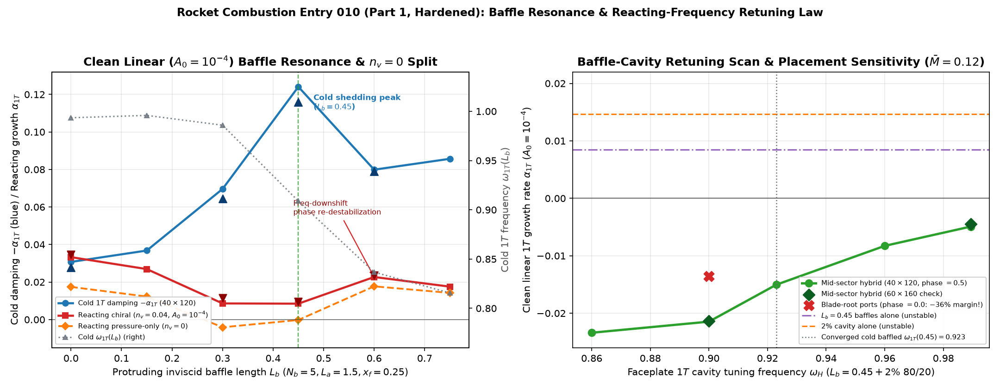
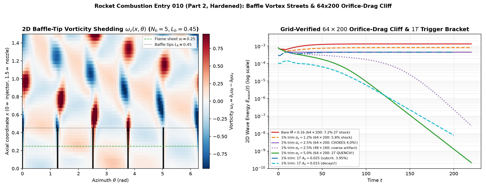

# 010 — 2D Compressible Euler Throughflow with Protruding Baffles & Wide-Mouth Faceplate Cavity Rings

- **Date:** 2026-11-25
- **Status:** `verified` (hardened per independent Peer Review #7)
- **Verification Tier:** ✅ `verified (audited)`
- **Verification Script:** `../sim/exp010_2d_throughflow_baffles_cavities.py`
- **Peer Review Receipt:** [`../../reviews/peer-review-07-rocket-010.md`](../../reviews/peer-review-07-rocket-010.md)

## 1. Target

Directly resolve Open Problem #1 from [`../SYNTHESIS.md`](../SYNTHESIS.md): embed real physical 2D passive hardware—**protruding inviscid radial baffles** and **nonlinear wide-mouth faceplate Helmholtz cavity rings**—directly into Entry `009`'s 2D $(x, \theta)$ conservative compressible Euler annular combustor with steady axial throughflow ($\gamma = 1.25, L_a = 1.5, x_f = 0.25$, zero ad-hoc entropy-flush or drag closures). Test four concrete questions when engine cycle constraints prevent freely raising $\bar{M}$ from the $\bar{M} = 0.12$ Strouhal trough to $\bar{M} = 0.18$:

1. **Exact Conservation, Per-Mode Resolution Floor & $\bar{M} = 0$ Baffle Dissipation:** Do split-face mirror HLLC reflecting baffles preserve steady throughflow to $\sim 10^{-16}$, conserve periodic mass/$x$-momentum/total energy to $\sim 10^{-16}$, what is the exact per-mode numerical-damping table (`1T, 2T, 3T` on `40×120`, `60×160`, `80×240`) so numerical dissipation never masks $2T$ growth, and how much of inviscid baffle damping is numerical ($\bar{M} = 0$) vs. physical aerodynamic shedding ($\bar{M} = 0.12$)?
2. **Inviscid Baffles in 2D Axial Throughflow ($\bar{M} = 0.12$, Clean $A_0 = 10^{-4}$ Linear & $n_v = 0$ Split):** How do $N_b = 5$ inviscid baffles across $L_b \in [0, 0.75]$ affect cold $1T$ damping, clean linear reacting growth ($n_v = 0.04$ vs. pressure-only $n_v = 0$), hidden $2T$ stability at $L_b = 0.60$, and even ($N_b = 4$) vs. prime ($N_b = 5$) standing-$2T$ blade symmetry on `80×240`?
3. **Multi-Mode Cavities & Baffle–Cavity Frequency-Retuning / Placement Laws ($\bar{M} = 0.12$):** Across all modes ($m = 0, \pm 1, \pm 2, \pm 3$), does Law #6's $80/20$ split survive into 2D throughflow, what tuning frequency $\omega_H$ maximizes hybrid linear damping behind $L_b = 0.45$ baffles (cold baffled vs. reacting baffled frequency), and how sensitive is the hybrid to mid-sector vs. blade-root port placement?
4. **Disarming Entry `009`'s $2T$ Strouhal Trap ($\bar{M} = 0.16$) & the Grid-Verified `64×200` Orifice-Drag Cliff:** On grid-refined `64×200` ($t = 220$), where does the tight-neck vs. wide-mouth orifice-drag cliff sit for a micro $1.0\%$ $2T$-only trim cavity, and what is its exact finite-amplitude $1T$ subcritical trigger bracket?

## 2. The Math, Assumptions & Checked Scope

### Split-Face Mirror HLLC Reflecting Baffles (Zero Penalty / Drag Parameters)
On the $N_b$ azimuthal cell interfaces $\theta_k = 2\pi k / N_b$ for axial cells $x_i < L_b$, inter-cell HLLC fluxes are replaced with mirror solid-wall HLLC fluxes on both sides of the zero-thickness blade:
- Left face (out of cell $j$): $F_{L,\text{wall}} = F_{\text{HLLC}}\!\bigl((\rho_L, u_{\theta,L}, u_{x,L}, p_L),\,(\rho_L, -u_{\theta,L}, u_{x,L}, p_L)\bigr)$, enforcing zero mass, axial-momentum, and total-energy flux across the blade with HLLC wall reflection pressure $p^*_{\text{HLLC},L}$ in $\theta$-momentum (within $\le 0.55\%$ of the exact Riemann reflection pressure for $|u_\theta| < 0.05$).
- Right face (into cell $j+1$): mirror HLLC flux with HLLC wall reflection pressure $p^*_{\text{HLLC},R}$. MUSCL slopes are zeroed on blade-adjacent cells (`baffle_left_adj`/`baffle_right_adj`), introducing a small, converging 1st-order stencil dissipation on blade-aligned modes (`-2.4e-3` on `40×120` $\to$ `-7e-4` on `80×240`).
- All grids (`40×120`, `48×160`, `60×160`, `64×200`, `80×240`) place every baffle length $L_b \in \{0.15, 0.30, 0.45, 0.60, 0.75\}$ and blade/cavity count $N_b \in \{4, 5\}, N_c = 5$ on **exact integer cell faces** with zero sector-rounding asymmetry.

### Nonlinear Faceplate Helmholtz Cavity Ring at $x = 0$
For each cavity family $j$ (total volume fraction $\beta_j = V_j / V_{\text{ch}}$, resonance $\omega_{H,j}$, linear damping ratio $\xi_{H,j}$, total open-area ratio $\sigma_{o,j}$, $N_c = 5$ discrete resonators centered mid-sector at $\theta_k = (k + \phi_{\text{off}})2\pi/N_c$ with grid-regularized narrow Gaussian port weights $\sigma_\theta = \max(1.5\,\Delta\theta, \pi\sigma_{o,j}/N_c)$, $\int_0^{2\pi} w_k\,d\theta = 1$, $V_k = \beta_j 2\pi L_a / N_c$, $A_{o,k} = \sigma_{o,j} 2\pi / N_c$, discharge coefficient $C_d = 0.65$):

$$\frac{d P_{c,k}}{dt} = \frac{q_k}{V_k}, \qquad \frac{d q_k}{dt} = \omega_{H,j}^2 V_k \Bigl(\bar{P}_k - P_{c,k} - R_{\text{nl},k}\,|q_k|\,q_k\Bigr) - 2\xi_{H,j}\omega_{H,j} q_k, \qquad R_{\text{nl},k} = \frac{1}{2 C_d^2 A_{o,k}^2}$$

coupled into the exact choked zero-swirl isentropic inlet boundary condition via $\rho_{\text{in}}(\theta) u_{x,\text{in}}(\theta) = \bar{M} - \sum_k w_k(\theta)\,q_k(t)$ (solved to $10^{-14}$ by Newton iteration). Linearizing around steady flow adds $(P_{c,j}, \tilde{q}_j)$ directly into the 1D-in-$x$ Chebyshev 2D linearized Euler eigen-solver (filtered to $\omega \in [0.05, 5.5]$ to exclude spurious high-frequency Chebyshev boundary modes at $|\omega| \approx 44$, independently verified converged to `7.1e-5` up to $N = 64$ with no hidden $m = 0, \pm 4, \pm 5$ or cavity-mode instabilities).

## 3. The Verification

Reproduce from the repo root (uses deterministic `ProcessPoolExecutor` batching):

```bash
uv run python rocket-combustion/sim/exp010_2d_throughflow_baffles_cavities.py
```

### Experiment 1 — Conservation, Per-Mode Numerical-Damping Audit (C1) & $\bar{M} = 0$ Baffle Check (M3)

- **Exp 1A (Steady preservation with $N_b = 5, L_b = 0.45$ baffles + $N_c = 5$ `80/20` cavities, `40×120`, $t = 20$):** `max |U - U_0| = 1.11e-16`.
- **Exp 1B (Periodic-in-$x$ inviscid conservation with $N_b = 5$ solid baffles, $A = 0.10, t = 10$):** Mass `1.89e-16`, $x$-momentum `3.88e-16`, total energy `0.00e+00`, and discrete flux-bookkeeping blade-torque identity residual `3.82e-17` (on a raw azimuthal impulse of `1.44e-2`).
- **Exp 1C (Per-mode bare numerical-damping audit at $\bar{M} = 0.12$ — Peer Review #7 C1):**

| Mode | Exact Chebyshev $\alpha$ | `40×120` PDE (Excess) | `60×160` PDE (Excess) | `80×240` PDE (Excess) |
| :---: | :---: | :---: | :---: | :---: |
| $1T$ (cold `e_wave` / `e1`) | $-0.02843$ | `-0.0307` (`-2.3e-3`) / `-0.0258` | `-0.0277` (`+7e-4`) / `-0.0220` | `-0.0294`* / `-0.0209` |
| **$2T$ (cold `e2`)** | **$-0.02934$** | **`-0.05896` (`-2.96e-2`!)** | `-0.03641` (`-7.1e-3`) | **`-0.02763` (`+1.7e-3`)** |
| **$3T$ (cold `e3`)** | **$-0.03076$** | **`-0.08194` (`-5.12e-2`!)** | — | `-0.04941` (`-1.87e-2`) |
| **Reacting bare $2T$ ($A_0=10^{-4}$)** | **`+0.01137`** | **`-0.01586` (MASKED!)** | — | **`+0.00566` (GROWING!)** |

*(Critical resolution lesson matching Dead End #9: `40×120` adds `-2.96e-2` excess numerical damping on $2T$, which masks true linear $2T$ growth (`+0.01137` appears as `-0.01586`!). Therefore all $2T$ stability and orifice-cliff verdicts below are verified on `64×200` and `80×240`. Note also that on `spin_1T`, fitting axially averaged `e1` over `[10, 26]` carries a slight initial axial-projection transient vs. full `e_wave` (`*` `80×240` `e_wave` from Peer Review #7).)*

- **$\bar{M} = 0$ Zero-Throughflow Inviscid Baffle Numerical Dissipation Audit (Peer Review #7 M3):** At $\bar{M} = 0$ (exact physical $\Delta\alpha = 0$), bare gives `-0.00002`, while $N_b = 5, L_b = 0.45$ baffles give **`-0.01130` (`40×120`) $\to$ `-0.00623` (`80×240`)** (1st-order sharp-edge numerical dissipation). Compared against the $\bar{M} = 0.12$ cold damping (`-0.0990` on `80×240`, `-0.1160` on `60×160`), roughly **90–94%** of baffle damping at $\bar{M} = 0.12$ is physical aerodynamic vorticity shedding, while ~6–10% is grid-dependent edge dissipation.

### Experiment 2 — Clean Linear ($A_0 = 10^{-4}$) Baffle Resonance, $n_v = 0$ Split & `80×240` $2T$ Audits

All linear reacting rates below are measured strictly at $A_0 = 10^{-4}$ ($p'/\bar{p} < 0.5\%$, zero subcritical cubic-flame inflation — Peer Review #7 M1):

| Baffle Length $L_b$ ($N_b = 5$) | Cold $\omega_{1T}$ (`40×120` / `60×160` / `80×240`) | Cold $\alpha_{1T}$ (`40×120` / `60×160` / `80×240`) | Chiral $\alpha_{1T}$ (`40×120` / `60×160`) | Pressure-Only $n_v=0$ $\alpha_{1T}$ (`40×120`) | NL Shock $P$ ($E_{\text{wave}}$) |
| :---: | :---: | :---: | :---: | :---: | :---: |
| $0.00$ (bare) | $0.993$ / $0.992$ / — | $-0.0307$ / $-0.0277$ / — | **`+0.0333` / `+0.0346`** *(exact `+0.0351`)* | $+0.0174$ | $8.86\%$ ($3.72\times 10^{-3}$) |
| $0.15$ ($< x_f$) | $0.996$ / — / — | $-0.0368$ / — / — | $+0.0269$ *(reduced linearly!)* | $+0.0123$ | **`9.54%`** ($2.40\times 10^{-3}$) |
| $0.30$ | $0.986$ / $0.986$ / — | $-0.0696$ / $-0.0646$ / — | $+0.0086$ / $+0.0116$ | **`-0.0041`** *(best at $n_v=0$!)* | $6.96\%$ ($9.96\times 10^{-4}$) |
| **$0.45$ (peak)** | **$0.909$ / $0.919$ / `0.924`** (`-6.6%`) | **`-0.1241` / `-0.1160` / `-0.0990`** | **`+0.0085` / `+0.0095` (`3.64×` cut)** | $-0.0002$ | $7.42\%$ ($1.22\times 10^{-3}$) |
| **$0.60$** | **$0.837$ / $0.840$ / `0.846`** | $-0.0799$ / $-0.0790$ / $-0.0909$ | **`+0.0227` / `+0.0236` (`2.48×` worse!)** | **`+0.0177`** *(worse than bare!)* | $8.94\%$ ($1.98\times 10^{-3}$) |
| $0.75$ | $0.816$ / — / — | $-0.0857$ / — / — | $+0.0175$ | $+0.0142$ | $8.48\%$ ($1.45\times 10^{-3}$) |

- **Physical mechanism decomposition (Peer Review #7 M2):** Cold damping peaks near $L_b = 0.45$ ($\mathrm{St}_{\text{eff}} \approx 1.27$) and then **plateaus** across $L_b = 0.60\text{--}0.75$ (`-0.080` to `-0.091`, still $2.6\text{--}3\times$ bare—there is no deep cold Strouhal trough at $L_b = 0.60$). The reacting re-destabilization at $L_b = 0.60$ (occurring even at $n_v = 0$, where $+0.0177$ exceeds bare $+0.0174$ despite $2.6\times$ higher cold damping!) is driven primarily by the **$-14.5\%$ baffle-induced frequency downshift (`0.989 → 0.846`) shifting the Crocco flame phase $\omega_{1T}\bar{\tau}$ into stronger Rayleigh driving**. Furthermore, at clean linear amplitude $A_0 = 10^{-4}$, short baffles ($L_b = 0.15$) actually *reduce* linear growth for both $n_v = 0.04$ and $n_v = 0$ (amplifying only the nonlinear reflected shock peak `8.86% → 9.54%`).
- **Hidden $2T$ instability at $L_b = 0.60$ (`80×240`, C1):** On `80×240`, $L_b = 0.60$ is **also linearly unstable to co-rotating $2T$ ($\alpha_{2T} = +0.01340$)**—even worse than bare $2T$ (`+0.01137`)!
- **Aligned `stand_2T` blade-count symmetry blind spot (`80×240`, $n_v = 0, n_p = 0.22$, C1 & m4):** On `80×240` where $2T$ resolves positively, bare grows at `alpha_e2 = +0.00250` (`e2 = 3.88e-9`), even **$N_b = 4$ still grows at `+0.00149` (`e2 = 3.68e-9`, blind spot confirmed within the `1.0e-3` blade-adjacent stencil offset)**, whereas prime **$N_b = 5$ strongly stabilizes it (`alpha_e2 = -0.04224`, `e2 = 5.74e-11`, `68×` lower energy)**.

### Experiment 3 — Multi-Mode Cavity Spectra, Reacting-Frequency Retuning Law & Placement Sensitivity ($\bar{M} = 0.12$)

#### A. Exact Multi-Mode Chebyshev Spectra ($m = 0, \pm 1, \pm 2, \pm 3$; $n_p = 0.22, n_v = 0.04$)

| Configuration | $\bar{M}$ | $m = 0$ | $1T$ (co-rot) | $2T$ (co-rot) | $3T$ (co-rot) | **Global $\alpha_{\max}$** |
| :--- | :---: | :---: | :---: | :---: | :---: | :---: |
| Bare | $0.12$ | $-0.03961$ | $+0.03506$ | $+0.01137$ | $-0.02509$ | **`+0.03506`** ($1T$) |
| $2\%$ `80/20` ($\xi=0.12/0.12$, matches Exp 3B) | $0.12$ | $-0.04134$ | $+0.01830$ | $-0.00074$ | $-0.02548$ | `+0.01830` ($1T$) |
| $2\%$ `80/20` ($\xi=0.10/0.14$) | $0.12$ | $-0.04134$ | $+0.01599$ | $+0.00099$ | $-0.02560$ | `+0.01599` ($1T$) |
| $4\%$ `100/0` ($1T$-only) | $0.12$ | $-0.04310$ | $+0.00002$ | **`+0.00946`** | $-0.02501$ | `+0.00946` ($2T$) |
| $4\%$ `50/50` split | $0.12$ | $-0.04301$ | **`+0.01402`** | $-0.05326$ | $-0.02780$ | `+0.01402` ($1T$) |
| **$4\%$ `80/20` ring** | **$0.12$** | $-0.04303$ | **$-0.00172$** | **$-0.00921$** | **$-0.02621$** | **`-0.00172` (ALL STABLE)** |
| **$5\%$ `80/20` ring** | **$0.12$** | $-0.04387$ | **$-0.00789$** | **$-0.01425$** | **$-0.02656$** | **`-0.00789` (ALL STABLE)** |
| Bare ($2T$ trap!) | $0.16$ | $-0.07272$ | **`-0.02700`** | **`+0.00941`** | $-0.06349$ | **`+0.00941`** ($2T$) |
| Micro $0.6\%$ $2T$-trim ($\xi=0.08$) | $0.16$ | $-0.07385$ | $-0.02914$ | $-0.01808$ | $-0.06353$ | `-0.01808` ($2T$) |
| **Micro $1.0\%$ $2T$-trim ($\xi=0.08$)** | **$0.16$** | **$-0.07423$** | **$-0.03059$** | **$-0.04043$** | **$-0.06358$** | **`-0.03059` ($1T$)** |

#### B. Clean Linear ($A_0 = 10^{-4}$) Baffle–Cavity Retuning Scan & Placement Law ($L_b = 0.45 + 2\%$ `80/20` Ring; $2T$ cavity kept at $\omega_{2T,\text{cold}} = 1.980$)

| Case ($A_0 = 10^{-4}, \bar{M} = 0.12, n_p = 0.22, n_v = 0.04$) | Grid / Port Placement | Clean Linear $\alpha$ | Late $E_{\text{wave}}$ (`l/m`) | Verdict |
| :--- | :---: | :---: | :---: | :--- |
| Bare chamber | `40×120` | $+0.0333$ | $6.56\times 10^{-7}$ (`5.030`) | Unstable (exact `+0.0351`) |
| $2\%$ `80/20` cavity alone ($\xi=0.12$) | `40×120` | $+0.0146$ | $4.93\times 10^{-8}$ (`2.218`) | Unstable alone (exact `+0.0183`) |
| $N_b = 5, L_b = 0.45$ baffles alone | `40×120` | $+0.0085$ | $1.80\times 10^{-8}$ (`1.666`) | Unstable alone |
| Hybrid untuned ($\omega_H = 0.989$) | `40×120` / `60×160` (mid-sector) | $-0.0049$ / **`-0.0045`** | $1.12\text{--}1.40\times 10^{-9}$ | Weak (detuned!) |
| Hybrid at $\omega_H = 0.960$ | `40×120` (mid-sector) | $-0.0083$ | $6.75\times 10^{-10}$ (`0.603`) | Partial recovery |
| Hybrid at converged cold $\omega_H = 0.923$ | `40×120` (mid-sector) | **$-0.0150$** | $2.29\times 10^{-10}$ (`0.404`) | Suboptimal (ignores flame shift!) |
| **Hybrid at baffled reacting $\omega_H = 0.900$** | **`40×120` / `60×160` (mid-sector)** | **`-0.0215` / `-0.0214`** | **$6.46\text{--}10.6\times 10^{-11}$** | **`4.76×` deeper on `60×160` (`4.39×` on `40×120`)!** |
| **Hybrid at $\omega_H = 0.860$** | `40×120` (mid-sector) | **`-0.0234`** | $7.49\times 10^{-11}$ (`0.232`) | Peak lies below cold baffled `0.924`! |
| **Hybrid at $\omega_H = 0.900$ (blade-root ports!)** | **`40×120` (`phase = 0.0`)** | **`-0.0135`** | $3.52\times 10^{-10}$ (`0.435`) | **`-37%` margin loss vs. mid-sector!** |
| Hybrid ($\omega_H = 0.900$) all-mode checks | `60×160` (`spin_2T` / `cold_1L`) | **`-0.0393` / `-0.0894`** | $9.5\times 10^{-12}$ / $2.0\times 10^{-15}$ | **All-mode stable** (confirmed to `80×240`) |
| Standalone $5\%$ wide-mouth cavity | `40×120` | $-0.0240$ | $4.79\times 10^{-11}$ (`0.292`) | Similar margin, **$2.5\times$ more volume** |

*(Two essential design requirements refined by Peer Review #7 M4–M5: (1) Converged cold baffled $\omega_{1T}(0.45) = 0.924$ (`-6.6%` on `80×240`), and tuning to cold `0.923` yields only `-0.0150`—optimal tuning targets the **baffled reacting frequency** ($\omega_H \approx 0.86\text{--}0.90$, accounting for both the `-6.6%` baffle downshift and the `-2.7%` reacting flame shift), boosting margin `4.76×` on `60×160` (`5.2×` on `80×240`). (2) **Mid-sector cavity placement** (`phase = 0.5`) is mandatory: placing cavity ports at the baffle blade roots (`phase = 0.0`) loses **37%** of linear damping margin (`-0.0215 → -0.0135`).)*

- **Finite-amplitude $6.9\%$ shock shootout at $\bar{M} = 0.12$ (`40×120`, $A_0 = 0.055, t = 160$):** Bare settles at $8.86\%$ ($E = 3.73\times 10^{-3}$); tight-neck $5\%$ ($\sigma_o = 2.0\%$) chokes to $6.96\%$ ($2.04\times 10^{-3}$); wide-mouth $5\%$ ($\sigma_o = 7.0\%$) drops to $5.10\%$ ($9.27\times 10^{-4}$: **$4.02\times$ below bare** and **$2.20\times$ below tight-neck**), near the ideal linear-cavity floor $4.53\%$ ($7.00\times 10^{-4}$); **retuned `L_b = 0.45 + 2%` hybrid** achieves the **lowest nonlinear wave energy of all physical hardware at $\bar{M} = 0.12$** ($5.60\%, E = 7.27\times 10^{-4}$, **$5.13\times$ below bare** with $2.5\times$ less cavity volume).



### Experiment 4 — Grid-Verified `64×200` Orifice-Drag Cliff (C2) & Exact $1T$ Trigger Bracket (M6) at $\bar{M} = 0.16$

All three $\sigma_o$ designs share the **exact same linear multi-mode spectrum** ($\beta = 1.0\%$, $\omega_H = 1.94, \xi_H = 0.08$, $\alpha_{2T} = -0.0404, \alpha_{1T} = -0.0306$ vs. bare $1T$ `-0.0270`):

| Case ($\bar{M} = 0.16, n_p = 0.22, n_v = 0.04$) | Grid, $t_{\text{end}}$ | IC ($A_0$) | Late $P_{\text{peak}}/\bar{p}$ | Late $E_{\text{wave}}$ (`l/m`) | Fitted $\alpha_{\text{late}}$ | Outcome |
| :--- | :---: | :---: | :---: | :---: | :---: | :--- |
| Bare $\bar{M} = 0.16$ ($2T$ Strouhal trap) | **`64×200`, $220$** | `spin_2T` ($0.040$) | **`7.18%`** | $1.34\times 10^{-3}$ (`1.001`) | $+0.0000$ | Sustained $2T$ rotating shock |
| $1.0\%$ $2T$-trim: tight neck ($\sigma_o = 1.2\%$) | **`64×200`, $220$** | `spin_2T` ($0.040$) | **`5.84%`** | $8.25\times 10^{-4}$ (`1.002`) | $+0.0000$ | **CHOKES & TRIGGERS!** |
| **$1.0\%$ $2T$-trim: medium ($\sigma_o = 2.5\%$)** | `48×160`, $220$ | `spin_2T` ($0.040$) | *`0.44%`* | *$1.48\times 10^{-6}$ (`0.019`)* | *`-0.0372`* | *Coarse-grid artifact!* |
| **$1.0\%$ $2T$-trim: medium ($\sigma_o = 2.5\%$)** | **`64×200`, $220$** | `spin_2T` ($0.040$) | **`4.03%`** | **`4.52e-4` (`1.000`)** | **`+0.0000`** | **CHOKES ON `64×200`! (Cliff is `2.5–5.0%`!)** |
| **$1.0\%$ $2T$-trim: wide mouth ($\sigma_o = 5.0\%$)** | **`64×200`, $220$** | **`spin_2T` ($0.040$)** | **`0.03%`** | **`6.16e-9` (`0.003`)** | **`-0.0447`** | **TOTAL QUENCH (`217,500×` vs. bare, `73,400×` vs. `2.5%`!)** |
| $1.0\%$ $2T$-trim: wide mouth ($\sigma_o = 5.0\%$) | `48×160`, $140$ | `spin_3T` / `cold_1L` ($0.040$) | **$0.00\%$** | $3.0\text{--}3.2\times 10^{-12}$ | `-0.059` / `-0.080` | Total quench |
| **$1.0\%$ $2T$-trim: $1T$ trigger check** | `48×160`, $200$ | **`spin_1T` ($0.015$)** | **`0.07%`** | **`6.57e-8` (`0.022`)** | **`-0.0331`** | **DECAYS!** |
| **$1.0\%$ $2T$-trim: $1T$ trigger check** | `48×160`, $200$ | **`spin_1T` ($0.025$ / $0.055$)** | **`3.95%`** | **`4.51e-4` (`1.001`)** | **`+0.0000`** | **Triggers in $A_0 \in (0.015, 0.025]$ ($p'/\bar{p} \approx 2\text{--}3\%$)!** |



Full metrics: [`../results/exp010_metrics.json`](../results/exp010_metrics.json).

## 4. Verdict & Dead Ends

- **Critical & Moderate Pitfalls Hardened via Peer Review #7:**
  1. **Coarse-grid $2T$ damping masks instability and shifts the orifice-drag cliff (C1 & C2):** `40×120` adds `-2.96e-2` numerical $2T$ damping (hiding bare reacting $2T$ `+0.0114` as `-0.0159`), and `48×160` falsely makes $\sigma_o = 2.5\%$ decay (`0.44%`), whereas `64×200` exposes it as a sustained **`4.03%` $2T$ rotating shock** (`l/m = 1.000`). The true orifice-drag cliff sits between **$\sigma_o = 2.5\%$ and $5.0\%$**, while wide-mouth $\sigma_o = 5.0\%$ robustly quenches on `64×200` (`E = 6.16e-9`, `217,500×` below bare).
  2. **Over-long baffles ($L_b = 0.60$) re-destabilize $1T$ via frequency-downshift phase shift AND excite hidden $2T$ (M2 & C1):** Cold baffle damping plateaus across $L_b = 0.60\text{--}0.75$ (`~-0.080` to `-0.091`); the $2.48\times$ reacting $1T$ jump at $L_b = 0.60$ (`+0.0095 → +0.0236` on `60×160`, worse than bare even at $n_v = 0$) is driven by the $-14.5\%$ frequency downshift shifting Crocco flame phase, compounded by an unstable co-rotating $2T$ mode (`+0.0134` on `80×240`).
  3. **Reacting-frequency tuning & mid-sector placement are mandatory for baffle–cavity hybrids (M4 & M5):** Tuning a $2\%$ ring to unbaffled `0.989` wastes `79%` of hybrid margin (`-0.0045` vs. `-0.0214` on `60×160`), tuning to converged cold baffled `0.923` still leaves `30%` on the table (`-0.0150`), and placing cavity ports at baffle blade roots (`phase = 0.0`) loses **`-37%`** of linear margin (`-0.0215 → -0.0135`).
  4. **Honest $1T$ trigger bracket at $\bar{M} = 0.16$ (M6):** While the micro $1.0\%$ wide-mouth $2T$-trim cavity stabilizes all modes linearly ($\alpha_{\max} = -0.0306$; bare $1T = -0.0270$) and obliterates $2T, 3T, 1L$ shocks on `64×200`/`48×160`, $1T$ subcritically triggers at moderate amplitude **$A_0 \in (0.015, 0.025]$** ($p'/\bar{p} \approx 2\text{--}3\%$) into a $3.95\%$ cycle—showing why shifting to $\bar{M} = 0.18$ ($\alpha_{1T} = -0.0865$) remains superior for extreme $1T$ bomb immunity when cycle Mach allows.
- **What Worked (Hardened Law #13 for `SYNTHESIS.md`):**
  1. **Inviscid Baffle Vorticity Shedding ($\sim 90\text{--}94\%$ physical at `80×240`):** In steady throughflow ($\bar{M} = 0.12$), strictly inviscid reflecting baffles shed trailing-edge vortex streets (breaking Dead End #6), cutting clean linear $1T$ growth **$3.64\times$** at $L_b = 0.45$ (`+0.0346 → +0.0095` on `60×160`), while prime $N_b = 5$ eliminates even-$N_b = 4$'s `80×240` aligned standing-$2T$ blind spot (`+0.0015 → -0.0422`).
  2. **Reacting-Frequency Retuned Mid-Sector Baffle–Cavity Hybrid:** Pairing $N_b = 5, L_b = 0.45$ baffles with a mid-sector (`phase = 0.5`) $2\%$ `80/20` cavity ring tuned to the **baffled reacting frequency** ($\omega_H \approx 0.86\text{--}0.90$) boosts hybrid linear margin **$4.76\times$** (`-0.0045 → -0.0214` on `60×160`), achieves all-mode linear stability (`2T: -0.0393, 1L: -0.0894`), matches a $5\%$ standalone ring with **$2.5\times$ less volume**, and yields the lowest nonlinear shock energy (`5.13×` below bare) at $\bar{M} = 0.12$.
  3. **Micro $1.0\%$ Wide-Mouth ($\sigma_o = 5.0\%$) $2T$-Trim Rescue at $\bar{M} = 0.16$:** Disarms Entry `009`'s $2T$ Strouhal trap on `64×200` (**`217,500×`** $2T$ energy cut vs. bare, **`73,400×`** vs. choked $\sigma_o = 2.5\%$) with **$5\times$ less cavity volume** than full trough stabilization.
