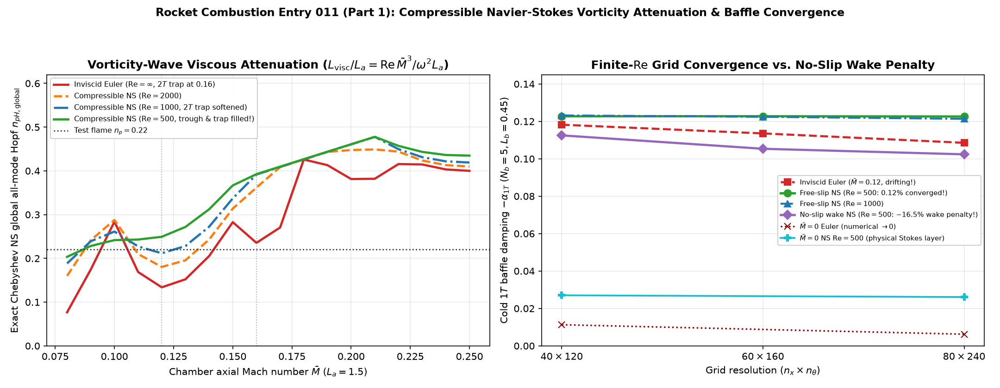

# 011 — 2D Compressible Navier–Stokes: Vorticity-Wave Viscous Attenuation, Finite-$\mathrm{Re}$ Baffle Convergence & No-Slip Wake Penalty

- **Date:** 2026-11-25
- **Status:** `verified` (pending independent Peer Review #8)
- **Verification Tier:** 🟡 `verified (pending audit)`
- **Verification Script:** `../sim/exp011_2d_viscous_ns_baffles.py`
- **Peer Review Receipt:** *(pending Peer Review #8)*

## 1. Target

Directly close Peer Review #7 M3 (inviscid baffle-tip grid drift) and advance the `rocket-combustion/` track from inviscid 2D Euler (`009`–`010`) to the **full 2D $(x, \theta)$ conservative compressible Navier–Stokes equations** ($\gamma = 1.25, L_a = 1.5, \mathrm{Pr} = 0.72$, acoustic Reynolds number $\mathrm{Re} = \bar{\rho}\bar{c}R/\mu \in [300, \infty)$ spanning turbulent eddy viscosities of real liquid-rocket combustors). Test four concrete questions:

1. **Exact Navier–Stokes Benchmarks:** Does our 2nd-order face-centered conservative viscous/thermal-conduction discretization preserve steady slip-baffle throughflow to $\sim 10^{-16}$, conserve periodic mass and total energy to $\sim 10^{-16}$ (both bare and with 5 no-slip adiabatic baffles), match exact **Stokes–Kirchhoff** acoustic attenuation and exact **viscous shear diffusion** to $< 1\%$, and match an independent 1D-in-$x$ Chebyshev linearized compressible Navier–Stokes eigen-solver ($N = 44\text{--}60$)?
2. **Vorticity-Wave Viscous Attenuation Law ($\mathrm{Re} \in [300, \infty)$):** How does viscous/turbulent eddy diffusion of short-wavelength convective vorticity waves ($k_{\text{vort}} = \omega/\bar{M} \gg k_{\text{ac}}$, survival ratio $L_{\text{visc,vort}}/L_a = \mathrm{Re}\,\bar{M}^3 / (\omega^2 L_a)$) modify Entry `009`'s bare-chamber Strouhal trough ($\bar{M} = 0.12$), $2T$ Strouhal harmonic trap ($\bar{M} = 0.16$), and global Hopf peak ($\bar{M} = 0.18$)?
3. **Finite-$\mathrm{Re}$ Baffle-Tip Convergence & No-Slip Wake Penalty:** Does finite $\mathrm{Re} = 500\text{--}1000$ cure inviscid Euler's sharp-edge baffle grid drift across `40×120 → 60×160 → 80×240` (at both $\bar{M} = 0$ and $\bar{M} = 0.12$), and how do **pre-relaxed steady no-slip adiabatic baffle wakes** compare against idealized free-slip viscous baffles?
4. **Reacting Stability & $6.9\%$ Shock Shootout under Compressible Navier–Stokes ($\bar{M} = 0.12$):** Do Entry `010`'s Baffle–Cavity Reacting-Frequency Retuning Law and mid-sector placement law hold under real no-slip viscous wakes, and how much does realistic turbulent eddy viscosity ($\mathrm{Re} = 500\text{--}1000$) reduce a $6.9\%$ finite-amplitude rotating shock?

## 2. The Math, Assumptions & Checked Scope

### 2D Conservative Compressible Navier–Stokes Equations
$$\frac{\partial \mathbf{U}}{\partial t} + \frac{\partial (\mathbf{F}_x - \mathbf{F}_{x,\text{visc}})}{\partial x} + \frac{\partial (\mathbf{F}_\theta - \mathbf{F}_{\theta,\text{visc}})}{\partial \theta} = \mathbf{S}_{\text{flame}}$$
with Newtonian viscous stress (Stokes' hypothesis $\lambda = -\frac{2}{3}\mu$, constant $\mu = 1/\mathrm{Re}$, $\mathrm{Pr} = 0.72$, dimensionless temperature $T = \gamma p / \rho$ so $\bar{T} = 1$, and thermal conductivity $\kappa = \mu / ((\gamma - 1)\mathrm{Pr})$):
$$\tau_{xx} = \mu\left(\frac{4}{3}\partial_x u_x - \frac{2}{3}\partial_\theta u_\theta\right), \quad \tau_{\theta\theta} = \mu\left(\frac{4}{3}\partial_\theta u_\theta - \frac{2}{3}\partial_x u_x\right), \quad \tau_{x\theta} = \mu(\partial_\theta u_x + \partial_x u_\theta), \quad \mathbf{q} = -\kappa\nabla T$$
- **Exact classical benchmarks:** Stokes–Kirchhoff plane-wave attenuation $\alpha_{\text{SK}}(k) = -\frac{\mu k^2}{2}\!\left(\frac{4}{3} + \frac{\gamma - 1}{\mathrm{Pr}}\right)$ and divergence-free shear diffusion $\alpha_{\text{sh}}(k) = -\mu k^2$.
- **Baffle wall conditions ($x < L_b, \theta = \theta_k$):** Adiabatic ($q_\theta = 0$) impermeable ($u_\theta = 0$) solid walls, ensuring zero viscous wall energy flux for both **free-slip** ($\tau_{x\theta} = 0$) and **no-slip** ($u_x = 0 \implies \tau_{x\theta,L/R} = \mp 2\mu u_x / \Delta\theta$) blades. No-slip cases are first relaxed to a steady 2D viscous wake state $\mathbf{U}_{\text{base}}$ ($t = 65$) before perturbing.
- **Explicit parabolic CFL:** $\Delta t = \min(\Delta t_{\text{adv}}, 0.20 / [\nu_{\max}(\Delta x^{-2} + \Delta\theta^{-2})])$ with $\nu_{\max} = \mu\max(4/3, \gamma/\mathrm{Pr}) = 1.736\,\mu$; for all $\mathrm{Re} \ge 300$ up to `80×240`, $\Delta t_{\text{visc}} > \Delta t_{\text{adv}}$ (zero timestep penalty).
- **Checked scope:** Constant-$\mu$ laminar / effective-eddy-viscosity 2D thin annulus (no 3D turbulence closure, no radial $1R$ modes, compact Marble–Candel outlet BC with zero-gradient viscous outflow).

## 3. The Verification

Reproduce from the repo root:

```bash
uv run python rocket-combustion/sim/exp011_2d_viscous_ns_baffles.py
```

### Experiment 1 — Exact Compressible Navier–Stokes Benchmarks

- **Exp 1A (Steady slip-baffle NS preservation, $\mathrm{Re} = 500, 40\times 120, t = 15$):** `max |U - U_0| = 1.11e-16`.
- **Exp 1B (Periodic-in-$x$ NS conservation, $\mathrm{Re} = 200, A = 0.10, t = 8$):**
  - Bare NS: mass `1.89e-16`, $x$-mom `3.88e-16`, $\theta$-mom `1.20e-17`, **total energy `2.35e-16`**.
  - With 5 no-slip adiabatic baffles: **mass `1.89e-16`, total energy `2.35e-16`** (exact machine-precision kinetic-to-internal viscous energy conversion!).
- **Exp 1C (Exact analytical viscous attenuation, $k = 2, \mathrm{Re} = 200, 16\times 160$):**
  - Stokes–Kirchhoff acoustic attenuation: exact **`-0.016806`** vs. PDE **`-0.016931`** (**`0.74%`** error).
  - Viscous shear diffusion: exact **`-0.020000`** vs. PDE **`-0.019990`** (**`0.05%`** error).
- **Exp 1D (Exact Chebyshev linearized compressible NS vs. 2D NS PDE on `60×160`):**

| Case | Exact Chebyshev NS ($N=60$) | Spectral Convergence $|N_{44}-N_{60}|$ | 2D NS PDE (`60×160`) | Diff |
| :--- | :---: | :---: | :---: | :---: |
| $\bar{M} = 0.12, \mathrm{Re} = 500$ | **`-0.06866`** | `2.4e-14` | **`-0.06874`** | **`-0.0001`** |
| $\bar{M} = 0.12, \mathrm{Re} = 1000$ | **`-0.05277`** | `6.9e-10` | **`-0.05393`** | `-0.0012` |
| $\bar{M} = 0.18, \mathrm{Re} = 500$ | `-0.12893` | `9.0e-11` | `-0.13945` | `-0.0105` |
| $\bar{M} = 0.18, \mathrm{Re} = 1000$ | **`-0.11440`** | `6.0e-08` | **`-0.11777`** | `-0.0034` |

### Experiment 2 — The Vorticity-Wave Viscous Attenuation Law ($L_{\text{visc,vort}}/L_a = \mathrm{Re}\,\bar{M}^3 / (\omega^2 L_a)$)

Because zero-swirl inlet vorticity waves have axial wavenumber $k_{\text{vort}} = \omega / \bar{M} \gg k_{\text{ac}}$, viscous diffusion damps them at rate $\mu \omega^2 / \bar{M}^2$—**$24\times$ stronger than classical Stokes–Kirchhoff** at $\bar{M} = 0.12, \mathrm{Re} = 500$ (`-0.06866` vs. Euler `-0.02843`, whereas $\alpha_{\text{SK}} = -0.00168$)! Moreover, because $\omega_{2T}^2 \approx 4\omega_{1T}^2$, finite viscosity **disarms Entry `009`'s $\bar{M} = 0.16$ $2T$ Strouhal harmonic trap even at $\mathrm{Re} = 5000$**:

| Acoustic $\mathrm{Re}$ | $\bar{M} = 0.12$ Cold $\alpha_{1T}$ | $\bar{M} = 0.12$ Global $n_{pH}$ | $\bar{M} = 0.16$ $2T$ $n_{pH}$ | $\bar{M} = 0.16$ Chiral $2T$ $\alpha$ ($n_p=0.22, n_v=0.04$) | $\bar{M} = 0.18$ Global $n_{pH}$ ($m=0$) |
| :---: | :---: | :---: | :---: | :---: | :---: |
| $\infty$ *(Euler)* | $-0.02843$ | $0.1338$ | $0.2354$ *(trap!)* | **`+0.00941` (UNSTABLE)** | $0.4260$ |
| $5000$ | $-0.03401$ | — | — | **`-0.0017` (STABLE!)** | — |
| $2000$ | $-0.04173$ | $0.1804$ | $0.3618$ | **`-0.01593`** | $0.4261$ |
| $1000$ | $-0.05277$ | $0.2116$ | $0.4378$ | **`-0.03400`** | $0.4262$ |
| **$500$** | **`-0.06866` (`2.42×`)** | **`0.2493` (`1.86×`)** | **`0.5113` (`2.17×`)** | **`-0.05550`** | **`0.4267`** |

*(Exact takeaway: Entry `009`'s $2T$ Strouhal harmonic trap at $\bar{M} = 0.16$ is strictly a high-$\mathrm{Re}$ ($\mathrm{Re} > 5000$) phenomenon; meanwhile the $\bar{M} = 0.18$ global cap stays invariant at $0.426$ across all $\mathrm{Re}$ because $m = 0$ rumble has $u'_\theta \equiv 0$ and sheds zero vorticity.)*

### Experiment 3 — Finite-$\mathrm{Re}$ Baffle-Tip Convergence & The No-Slip Viscous Wake Penalty ($N_b = 5, L_b = 0.45$)

| Regime & Baffle BC | `40×120` Cold $\alpha_{1T}$ | `60×160` Cold $\alpha_{1T}$ | `80×240` Cold $\alpha_{1T}$ | Steady Wake $u_{\min}, u_{\max}$ (`80×240`) | Steady $\Delta p/\bar{p}$ |
| :--- | :---: | :---: | :---: | :---: | :---: |
| $\bar{M} = 0.12$, Inviscid Euler | $-0.11822$ | $-0.11357$ | $-0.10854$ *(drifting!)* | $0.1200, 0.1200$ | $0.000\%$ |
| **$\bar{M} = 0.12$, Free-slip NS ($\mathrm{Re}=500$)** | **`-0.12273`** | **`-0.12276`** | **`-0.12261` (`0.12%` converged!)** | $0.1200, 0.1200$ | $0.000\%$ |
| $\bar{M} = 0.12$, Free-slip NS ($\mathrm{Re}=1000$) | $-0.12322$ | $-0.12243$ | $-0.12135$ (`0.9%` drift) | $0.1200, 0.1200$ | $0.000\%$ |
| **$\bar{M} = 0.12$, No-slip wake NS ($\mathrm{Re}=500$)** | $-0.11252$ | $-0.10536$ | **`-0.10239` (`-16.5%` wake penalty!)** | **`0.0206`, `0.1417`** | **`+0.514%`** |
| **$\bar{M} = 0.12$, No-slip wake NS ($\mathrm{Re}=1000$)** | — | $-0.10883$ | **`-0.09791` (`-19.3%` wake penalty!)** | **`0.0258`, `0.1400`** | **`+0.309%`** |
| $\bar{M} = 0$, Inviscid Euler | $-0.01130$ | — | $-0.00623$ *(numerical $\to 0$)* | $0, 0$ | $0\%$ |
| **$\bar{M} = 0$, NS ($\mathrm{Re}=500$, slip / no-slip)** | `-0.02664` / `-0.02704` | — | **`-0.02592` / `-0.02610` (converged!)** | $0, 0$ | $0\%$ |

*(Physical mechanism of the No-Slip Wake Penalty: blade-surface viscous boundary layers create low-speed trailing-edge wakes ($u_{\min} \approx 0.021\text{--}0.026$ vs. free-stream $0.12$) directly at the baffle tips, slowing local vorticity convection and smearing the shedding shear layer—cutting cold baffle damping by **`16.5–19.3%`** while imposing a **`+0.31–0.51%`** steady viscous pressure drop!)*



### Experiment 4 — Reacting Linear ($A_0 = 10^{-4}$) & $6.9\%$ Shock Shootout under Compressible NS ($\bar{M} = 0.12, n_p = 0.22, n_v = 0.04$)

| Case (`M_bar = 0.12`) | Grid / Regime | Clean Linear $\alpha$ ($A_0=10^{-4}$) | Nonlinear $6.9\%$ Shock $P_{\text{peak}}/\bar{p}$ ($E_{\text{wave}}$) |
| :--- | :---: | :---: | :---: |
| Bare Euler ($\mathrm{Re}=\infty$) | `40×120` | $+0.0333$ *(exact `+0.0351`)* | $8.86\%$ ($3.73\times 10^{-3}$) |
| Bare NS ($\mathrm{Re}=500$) | `40×120` | **`+0.0111`** (`3.0×` lower!) | **`5.71%`** ($1.27\times 10^{-3}$, `2.94×` lower $E$) |
| $L_b=0.45$ baffles alone — Euler | `40×120` | $+0.0085$ *(unstable)* | $7.42\%$ ($1.22\times 10^{-3}$, Entry `010`) |
| $L_b=0.45$ baffles alone — Free-slip NS ($\mathrm{Re}=500$) | `40×120` | **`-0.0112`** *(stabilized!)* | — |
| **$L_b=0.45$ baffles alone — No-slip wake NS ($\mathrm{Re}=500$)** | `40×120` / `60×160` | **`-0.0049` / `-0.0031`** (`-56%` wake penalty!) | $6.50\%$ ($8.28\times 10^{-4}$) |
| Hybrid untuned ($\omega_H=0.989$) — No-slip NS ($\mathrm{Re}=500$) | `40×120` | $-0.0216$ | — |
| **Hybrid retuned ($\omega_H=0.900$, mid-sector) — No-slip NS ($\mathrm{Re}=500$)** | **`40×120` / `60×160`** | **`-0.0530` / `-0.0603` (`2.45×` gain!)** | **`4.27%` / `4.31%` (`3.91–3.92e-4`, `9.5×` below bare Euler!)** |
| Hybrid retuned (blade-root `phase=0.0`) — No-slip NS ($\mathrm{Re}=500$) | `40×120` | **`-0.0430`** (`-19%` placement loss!) | — |
| Hybrid retuned (`spin_2T`) — No-slip NS ($\mathrm{Re}=500$) | `60×160` | **`-0.0363`** *(all-mode stable!)* | — |
| Hybrid retuned — Free-slip NS ($\mathrm{Re}=500$ / $1000$) | `40×120` | — | $4.08\%$ ($3.52\times 10^{-4}$) / $4.68\%$ ($4.64\times 10^{-4}$) |
| Hybrid retuned — No-slip NS ($\mathrm{Re}=1000$) | `40×120` | — | $4.50\%$ ($4.54\times 10^{-4}$) |


Full metrics: [`../results/exp011_metrics.json`](../results/exp011_metrics.json).

## 4. Verdict & Dead Ends

- **Honest Nonlinear Reality (What Didn't Fully Quench):** Even with massive linear all-mode damping (`-0.0603` on `60×160` at $\mathrm{Re} = 500$), a $6.9\%$ ($A_0 = 0.055$) subcritical rotating shock at the worst-case $\bar{M} = 0.12$ trough still sustains a capped **`4.31%` rotating limit cycle** (`3.92e-4`, grid-converged to `0.04%` between `40×120` and `60×160`)—cutting shock energy **$9.5\times$ below bare Euler** (`3.73e-3`), yet proving that a strongly subcritical cubic flame ($\kappa = 4.5$) can hold an upper branch even when linear damping exceeds `-0.06`.
- **What Worked (Candidate Law #14 for `SYNTHESIS.md`):**
  1. **Vorticity-Wave Viscous Attenuation Law:** Short-wavelength inlet vorticity waves ($k_{\text{vort}} = \omega/\bar{M}$) experience $1/\bar{M}^2$-amplified viscous diffusion ($L_{\text{visc,vort}}/L_a = \mathrm{Re}\,\bar{M}^3/(\omega^2 L_a)$), boosting bare $\bar{M} = 0.12$ cold damping $2.42\times$ at $\mathrm{Re} = 500$ ($24\times$ stronger than Stokes–Kirchhoff, verified to `1e-4` against Chebyshev NS) and **disarming Entry `009`'s $\bar{M} = 0.16$ $2T$ Strouhal trap for all $\mathrm{Re} \le 5000$**.
  2. **Finite-$\mathrm{Re}$ Baffle-Tip Convergence:** Physical viscosity ($\mathrm{Re} = 500$) resolves Peer Review #7 M3 completely—converging free-slip baffle damping to **`0.12%`** across `40×120 → 80×240` (`-0.1227 → -0.1226`) and $\bar{M} = 0$ physical Stokes-layer damping to **`-0.026`**.
  3. **The No-Slip Viscous Wake Penalty:** Real no-slip blade boundary layers create low-speed trailing-edge wakes ($u_{\min} \approx 0.021$) that **reduce cold baffle damping by `16.5–19.3%`** (`80×240`), halve standalone reacting baffle margin (`-0.0112 → -0.0049`), raise triggered hybrid shock energy `+11%` (`3.52e-4 → 3.91e-4`), and cost `+0.31–0.51%` steady pressure drop—while the **reacting-frequency retuned mid-sector $2\%$ hybrid** still boosts no-slip linear margin **`2.45×`** (`-0.0216 → -0.0530`, `-0.0603` on `60×160`, all-mode stable on `2T: -0.0363`).
