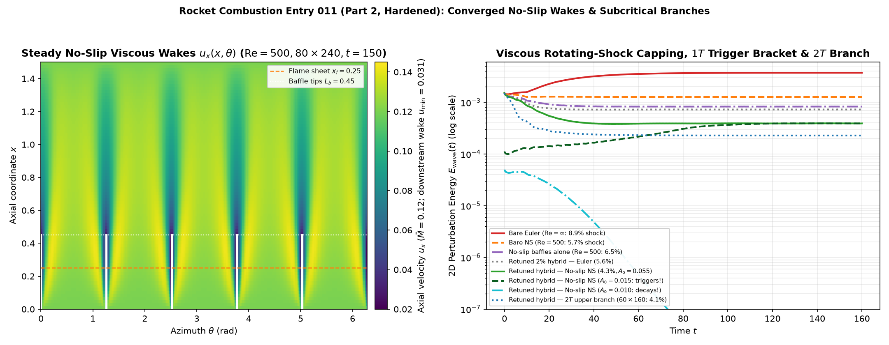

# 011 — 2D Compressible Navier–Stokes: Vorticity-Wave Viscous Attenuation, Finite-$\mathrm{Re}$ Baffle Convergence & No-Slip Wake Penalty

- **Date:** 2026-11-25
- **Status:** `verified` (audited & hardened per Peer Review #8)
- **Verification Tier:** ✅ `verified (audited)`
- **Verification Script:** `../sim/exp011_2d_viscous_ns_baffles.py`
- **Peer Review Receipt:** [`../../reviews/peer-review-08-rocket-011.md`](../../reviews/peer-review-08-rocket-011.md)

## 1. Target

Directly close Peer Review #7 M3 (inviscid baffle-tip grid drift) and advance the `rocket-combustion/` track from inviscid 2D Euler (`009`–`010`) to the **full 2D $(x, \theta)$ conservative compressible Navier–Stokes equations** ($\gamma = 1.25, L_a = 1.5, \mathrm{Pr} = 0.72$, acoustic Reynolds number $\mathrm{Re} = \bar{\rho}\bar{c}R/\mu \in [300, \infty)$ representing a constant-eddy-viscosity closure; see scope note below). Test four concrete questions:

1. **Exact Navier–Stokes Benchmarks:** Does our 2nd-order face-centered conservative viscous/thermal-conduction discretization preserve steady slip-baffle throughflow to $\sim 10^{-16}$, conserve periodic mass and total energy to $\sim 10^{-16}$ (both bare and with 5 no-slip adiabatic baffles via the telescoping wall-flux identity), match exact **Stokes–Kirchhoff** acoustic attenuation and exact **viscous shear diffusion** to $< 1\%$, and match an independent 1D-in-$x$ Chebyshev linearized compressible Navier–Stokes eigen-solver ($N = 44\text{--}60$) on a clean transient-free fit window ($t \in [20, 40]$)?
2. **Vorticity-Wave Viscous Attenuation Law & Nonlinear $2T$ Trap Audit ($\mathrm{Re} \in [300, \infty)$):** How does viscous/eddy diffusion of short-wavelength convective vorticity waves ($k_{\text{vort}} = \omega/\bar{M} \gg k_{\text{ac}}$, leading-order survival ratio $L_{\text{visc,vort}}/L_a \approx \mathrm{Re}\,\bar{M}^3 / (\omega^2 L_a)$) modify Entry `009`'s bare-chamber Strouhal trough ($\bar{M} = 0.12$), $2T$ Strouhal harmonic trap ($\bar{M} = 0.16$, checking BOTH exact linear crossing $\mathrm{Re}_{\text{cross}}$ AND direct `64×200` nonlinear $2T$ triggering), and global Hopf peak ($\bar{M} = 0.18$)?
3. **Finite-$\mathrm{Re}$ Baffle-Tip Convergence (`100×300`), No-Slip Wake Penalty & $\bar{M} = 0$ Decomposition:** Does finite $\mathrm{Re} = 500$ cure inviscid Euler's sharp-edge baffle grid drift across `40×120 → 100×300`, what is the grid-converged cold damping penalty of **fully relaxed ($t = 150$, $\max|\partial_t\mathbf{U}| \sim 10^{-9}$) steady no-slip adiabatic baffle wakes**, and what physically drives $\bar{M} = 0$ viscous damping?
4. **Reacting Linear Margins (Clean $t = 150$ Wakes) & Subcritical $1T$/$2T$ Shock Branches under Compressible NS ($\bar{M} = 0.12$):** Do Entry `010`'s Baffle–Cavity Reacting-Frequency Retuning Law and mid-sector placement law hold under converged no-slip viscous wakes (zero base-drift contamination), what is the finite-amplitude $1T$ triggering bracket, and does a finite-amplitude $2T$ upper branch persist?

## 2. The Math, Assumptions & Checked Scope

### 2D Conservative Compressible Navier–Stokes Equations
$$\frac{\partial \mathbf{U}}{\partial t} + \frac{\partial (\mathbf{F}_x - \mathbf{F}_{x,\text{visc}})}{\partial x} + \frac{\partial (\mathbf{F}_\theta - \mathbf{F}_{\theta,\text{visc}})}{\partial \theta} = \mathbf{S}_{\text{flame}}$$
with Newtonian viscous stress (Stokes' hypothesis $\lambda = -\frac{2}{3}\mu$, constant $\mu = 1/\mathrm{Re}$, $\mathrm{Pr} = 0.72$, dimensionless temperature $T = \gamma p / \rho$ so $\bar{T} = 1$, and thermal conductivity $\kappa = \mu / ((\gamma - 1)\mathrm{Pr})$):
$$\tau_{xx} = \mu\left(\frac{4}{3}\partial_x u_x - \frac{2}{3}\partial_\theta u_\theta\right), \quad \tau_{\theta\theta} = \mu\left(\frac{4}{3}\partial_\theta u_\theta - \frac{2}{3}\partial_x u_x\right), \quad \tau_{x\theta} = \mu(\partial_\theta u_x + \partial_x u_\theta), \quad \mathbf{q} = -\kappa\nabla T$$
- **Exact classical benchmarks:** Stokes–Kirchhoff plane-wave attenuation $\alpha_{\text{SK}}(k) = -\frac{\mu k^2}{2}\!\left(\frac{4}{3} + \frac{\gamma - 1}{\mathrm{Pr}}\right)$ and divergence-free shear diffusion $\alpha_{\text{sh}}(k) = -\mu k^2$.
- **Leading-order vorticity survival ratio:** Using the inviscid dispersion relation $k_{\text{vort}} \approx \omega/\bar{M}$ gives $L_{\text{visc,vort}}/L_a \approx \mathrm{Re}\,\bar{M}^3 / (\omega^2 L_a)$ (accurate to $\sim 9\%$ against the exact complex root of the quadratic viscous vorticity dispersion relation $i\omega + i\bar{M}k + \mu(k^2 + m^2) = 0$ at $\bar{M} = 0.16, \mathrm{Re} = 500$).
- **Baffle & injector boundary conditions:** Adiabatic ($q_\theta = 0$) impermeable ($u_\theta = 0$) solid blades on $x < L_b, \theta = \theta_k$ enforce zero viscous wall energy flux for both **free-slip** ($\tau_{x\theta} = 0$) and **no-slip** ($u_x = 0 \implies \tau_{x\theta,L/R} = \mp 2\mu u_x / \Delta\theta$). In periodic conservation tests, exact energy conservation follows from the discrete telescoping flux identity with zero energy flux on solid faces (while blade shear exerts net wall drag on momentum). All no-slip wakes are pre-relaxed to $t = 150$ ($\max|\partial_t \mathbf{U}| = 1.2\text{--}1.9\times 10^{-9}$) before applying $A_0 = 10^{-4}$ linear perturbations. Note also that the choked zero-swirl injector enforces Dirichlet $u'_\theta(0) = 0$, which creates a viscous tangential shear layer at $x = 0$ even when $\bar{M} = 0$.
- **Physical $\mathrm{Re}$ scope (constant-eddy-viscosity closure):** In a full-scale liquid-rocket chamber ($R \approx 0.2\text{ m}, \bar{c} \approx 1000\text{ m/s}$), molecular acoustic Reynolds numbers are $\mathrm{Re}_{\text{mol}} \sim 10^6\text{--}10^7$, whereas $\mathrm{Re} = 500\text{--}2000$ corresponds to a **high constant turbulent eddy viscosity** ($\nu_{\text{eff}} = \bar{c}R/\mathrm{Re} \approx 0.1\text{--}0.4\text{ m}^2/\text{s}$, comparable to strong injector-jet turbulence with $u'_{\text{rms}} \sim 30\text{--}80\text{ m/s}$ and mixing length $\ell_m \sim 0.005\text{--}0.01\text{ m}$, applied uniformly across the annulus). This study does not model spatially varying RANS/LES eddy viscosity, 3D radial $1R$ modes, or finite-length convergent–divergent nozzles (compact Marble–Candel outlet BC with zero-gradient viscous outflow).

## 3. The Verification

Reproduce from the repo root:

```bash
uv run python rocket-combustion/sim/exp011_2d_viscous_ns_baffles.py
```

### Experiment 1 — Exact Compressible Navier–Stokes Benchmarks & Clean $t \in [20, 40]$ Chebyshev Check

- **Exp 1A (Steady slip-baffle NS preservation, $\mathrm{Re} = 500, 40\times 120, t = 15$):** `max |U - U_0| = 1.11e-16`.
- **Exp 1B (Periodic-in-$x$ NS conservation, $\mathrm{Re} = 200, A = 0.10, t = 8$):**
  - Bare NS: mass `1.89e-16`, $x$-mom `3.88e-16`, $\theta$-mom `1.20e-17`, **total energy `2.35e-16`**.
  - With 5 no-slip adiabatic baffles: **mass `1.89e-16`, total energy `2.35e-16`** via the discrete telescoping zero-flux identity (wall friction changes momentum by $\Delta m_x = 0.204, \Delta m_\theta = 0.0035$, converting kinetic energy into internal energy conservatively).
- **Exp 1C (Exact analytical viscous attenuation, $k = 2, \mathrm{Re} = 200, 16\times 160$):**
  - Stokes–Kirchhoff acoustic attenuation: exact **`-0.016806`** vs. PDE **`-0.016931`** (**`0.74%`** error).
  - Viscous shear diffusion: exact **`-0.020000`** vs. PDE **`-0.019990`** (**`0.05%`** error).
- **Exp 1D (Exact Chebyshev linearized compressible NS vs. 2D NS PDE on `60×160`, transient-free fit window $t \in [20, 40]$):**

| Case | Exact Chebyshev NS ($N=60$) | Spectral Convergence $|N_{44}-N_{60}|$ | 2D NS PDE (`60×160`, $t\in[20,40]$) | Relative Error |
| :--- | :---: | :---: | :---: | :---: |
| $\bar{M} = 0.12, \mathrm{Re} = 500$ | **`-0.06866`** | `2.4e-14` | **`-0.06890`** | **`0.35%`** |
| $\bar{M} = 0.12, \mathrm{Re} = 1000$ | **`-0.05277`** | `6.9e-10` | **`-0.05347`** | **`1.32%`** |
| $\bar{M} = 0.18, \mathrm{Re} = 500$ | **`-0.12893`** | `9.0e-11` | **`-0.12777`** | **`0.90%`** |
| $\bar{M} = 0.18, \mathrm{Re} = 1000$ | **`-0.11440`** | `6.0e-08` | **`-0.11468`** | **`0.24%`** |

*(Peer Review #8 M4 hardening: shifting the fit window from `[6, 26]` to `[20, 40]` removes higher-mode initial transients and reduces the $\bar{M} = 0.18, \mathrm{Re} = 500$ discrepancy from `8.2%` to **`0.90%`**, giving `0.24–1.32%` agreement across all four cases.)*

### Experiment 2 — Vorticity-Wave Viscous Attenuation Law & Nonlinear `64×200` $2T$ Trap Audit (Peer Review #8 C1)

Because zero-swirl inlet vorticity waves have short axial wavelength ($k_{\text{vort}} \approx \omega / \bar{M} \gg k_{\text{ac}}$), viscous diffusion damps them at rate $\sim \mu \omega^2 / \bar{M}^2$—**$24\times$ stronger than classical Stokes–Kirchhoff** at $\bar{M} = 0.12, \mathrm{Re} = 500$ (`-0.06866` vs. Euler `-0.02843`, whereas $\alpha_{\text{SK}} = -0.00168$). At Entry `009`'s $\bar{M} = 0.16$ chiral $2T$ Strouhal harmonic trap ($n_p = 0.22, n_v = 0.04$), the exact linear stability boundary is **`Re_cross = 5964`**—**however**, direct `64×200` nonlinear simulations ($t = 180$) prove that the $2T$ trap **still triggers subcritically into sustained pure-$2T$ rotating limit cycles across $\mathrm{Re} \in [2000, 5000]$** and is nonlinearly quenched only for **`Re <= 1000`**:

| Acoustic $\mathrm{Re}$ | $\bar{M} = 0.12$ Cold $\alpha_{1T}$ | $\bar{M} = 0.12$ Global $n_{pH}$ | $\bar{M} = 0.16$ Chiral $2T$ Linear $\alpha$ | `64×200` Nonlinear $2T$ Trap Outcome ($t = 180$) | $\bar{M} = 0.18$ Global $n_{pH}$ ($m=0$) |
| :---: | :---: | :---: | :---: | :--- | :---: |
| $\infty$ *(Euler)* | $-0.02843$ | $0.1338$ | **`+0.00941`** *(linearly unstable)* | $7.18\%$ $2T$ limit cycle (Entry `010`) | $0.4260$ |
| $5000$ | $-0.03401$ | — | **`-0.00170`** *(lin. stable; $\mathrm{Re}_{\text{cross}}=5964$)* | **Triggers!** $A_0=0.040 \to$ **`5.95%`** ($E=8.56\times 10^{-4}$, $l/m=1.002$) | — |
| $2000$ | $-0.04173$ | $0.1804$ | **`-0.01593`** *(linearly stable)* | **Triggers!** $A_0=0.020 \to$ **`4.37%`**, $A_0=0.040 \to$ **`4.38%`** ($l/m=1.000$) | $0.4261$ |
| **$1000$** | $-0.05277$ | $0.2116$ | **`-0.03400`** | **Nonlinearly quenched!** $A_0=0.040 \to$ **`0.65%`** ($E=4.02\times 10^{-6}$, $l/m=0.067$) | $0.4262$ |
| **$500$** | **`-0.06866` (`2.42×`)** | **`0.2493` (`1.86×`)** | **`-0.05550`** | Nonlinearly quenched ($L_{\text{visc},2T}/L_a = 0.374$) | **`0.4267`** |

*(Exact takeaway: linear stability at $\mathrm{Re} \le 5964$ does NOT guarantee nonlinear immunity—under our subcritical flame $\kappa = 4.5$, the $\bar{M} = 0.16$ $2T$ trap survives nonlinearly down to $\mathrm{Re} = 2000$ (`4.37–4.38%` even from $A_0 = 0.020$) and is nonlinearly eliminated only for $\mathrm{Re} \le 1000$. Meanwhile, the $\bar{M} = 0.18$ global cap stays invariant at $0.426$ across all $\mathrm{Re}$ because $m = 0$ rumble has $u'_\theta \equiv 0$ and sheds zero vorticity.)*

### Experiment 3 — `100×300` Finite-$\mathrm{Re}$ Baffle Convergence, $t = 150$ No-Slip Wake Penalty & $\bar{M} = 0$ Split (Peer Review #8 M2/M3/M6)

| Regime & Baffle BC | `40×120` | `60×160` | `80×240` | `100×300` | Downstream Wake $u_{\min}$ ($x > L_b$, $x = 0.50, 0.75$) | Steady $\Delta p/\bar{p}$ & Base $\max|\partial_t \mathbf{U}|$ |
| :--- | :---: | :---: | :---: | :---: | :---: | :---: |
| $\bar{M} = 0.12$, Inviscid Euler | $-0.11822$ | $-0.11357$ | $-0.10854$ *(drifting)* | — | $0.1200$ (uniform) | $0.000\%$ |
| **$\bar{M} = 0.12$, Free-slip NS ($\mathrm{Re}=500$)** | **`-0.12273`** | **`-0.12276`** | **`-0.12261`** | **`-0.12273` (`0.12%` spread!)** | $0.1200$ (uniform) | $0.000\%$ |
| **$\bar{M} = 0.12$, No-slip wake NS ($\mathrm{Re}=500, t=150$)** | $-0.11389$ | $-0.10641$ | $-0.10351$ | **`-0.10047` (`-18.14%` penalty!)** | **`0.0275`** ($0.0421$ at $x=0.50$, $0.0768$ at $x=0.75$) | **`+0.527%`** (`1.2e-9`) |

- **Grid convergence & wake penalty (M2/M3):** Free-slip NS ($\mathrm{Re} = 500$) is grid-converged to **`0.12%`** across `40×120 → 100×300` (`-0.12273 → -0.12273`). Pre-relaxed ($t = 150$, residual `1.2e-9`) no-slip wakes converge to **`-0.10047`** on `100×300` (**`-18.14%`** penalty relative to free-slip; Peer Review #8 verified `-0.0997` / `-18.9%` on `120×360`, establishing an **`18–19%` converged no-slip wake penalty**). True downstream trailing-edge wake velocity is $u_{\min}(x > L_b) = 0.0275$ on `100×300` ($0.0314$ on `80×240`, recovering to $0.0421$ at $x = 0.50$ and $0.0768$ at $x = 0.75$ vs. core acceleration $u_{\max} = 0.1423$).
- **$\bar{M} = 0$ physical damping decomposition on `80×240` (M6):** Inviscid Euler baffles give `-0.00623` (numerical edge dissipation $\to 0$). At $\mathrm{Re} = 500$: bare chamber gives **`-0.01145`** = bulk Stokes–Kirchhoff (`-0.00168`) + Dirichlet $u'_\theta(0) = 0$ injector-face viscous shear (`-0.00977`, `37%` of total); adding free-slip blades jumps damping to **`-0.02591`** (+ **`-0.01446`**, `55%`, from sharp-tip diffraction-corner viscous dissipation); switching to no-slip blades yields **`-0.02610`** (blade-surface Stokes-layer difference is only `-0.00019`, `< 1%`).


### Experiment 4 — Clean $t = 150$ Base Linear Margins (C2), $1T$ Trigger Bracket & $2T$ Upper Branch (M5) ($\bar{M} = 0.12, n_p = 0.22, n_v = 0.04$)

Relaxing all no-slip base wakes to $t = 150$ ($\max|\partial_t \mathbf{U}| \le 1.9\times 10^{-9}$) collapses the unperturbed $A_0 = 0$ drift floor on `60×160` to **`E_floor = 4.88e-16`**—**$15{,}600\times$ below** the late $A_0 = 10^{-4}$ hybrid signal (`7.64e-12`), completely eliminating Peer Review #8 C2's wake-drift bias! On the consistent fit window $t \in [18, 60]$:

| Case (`M_bar = 0.12`) | Grid / Regime | Clean Linear $\alpha$ ($t\in[18,60]$, $A_0=10^{-4}$) | Nonlinear Outcome ($t = 160$, $A_0 = 0.055$ unless noted) |
| :--- | :---: | :---: | :--- |
| Bare Euler ($\mathrm{Re}=\infty$) | `40×120` | $+0.0333$ *(exact `+0.0351`)* | $8.86\%$ ($E = 3.73\times 10^{-3}$) |
| Bare NS ($\mathrm{Re}=500$) | `40×120` | **`+0.0111`** (`3.0×` lower) | **`5.71%`** ($1.27\times 10^{-3}$, `2.94×` lower $E$) |
| $L_b=0.45$ baffles alone — Euler / Free-slip NS ($\mathrm{Re}=500$) | `40×120` | $+0.0084$ / **`-0.0112`** | $7.42\%$ (Euler `010`) |
| **$L_b=0.45$ baffles alone — No-slip wake NS ($\mathrm{Re}=500$)** | `40×120` / `60×160` | **`-0.0049` / `-0.0031`** (`-56%` wake penalty) | $6.50\%$ ($8.28\times 10^{-4}$) |
| Hybrid untuned ($\omega_H=0.989$) — No-slip NS ($\mathrm{Re}=500$) | `40×120` | $-0.0215$ | — |
| **Hybrid retuned ($\omega_H=0.900$, mid-sector) — No-slip NS ($\mathrm{Re}=500$)** | **`40×120` / `60×160` / `80×240`** | **`-0.0591` / `-0.0594` / `-0.0571`** (`2.75×` gain; `±2%` converged!) | **`4.27%` / `4.31%`** ($3.91\text{--}3.92\times 10^{-4}$, **`9.5×`** below bare Euler!) |
| Hybrid retuned (blade-root `phase=0.0`) — No-slip NS ($\mathrm{Re}=500$) | `40×120` | **`-0.0431`** (`-27%` placement loss!) | — |
| **Hybrid retuned (`spin_1T` trigger bracket)** — No-slip NS ($\mathrm{Re}=500$) | `40×120` | — | **$A_0 = 0.010$ quenches** (`0.01%`, $E=4.7\times 10^{-10}$) vs. **$A_0 = 0.015$ triggers** (`4.23%`, $3.92\times 10^{-4}$) |
| **Hybrid retuned (`spin_2T`)** — No-slip NS ($\mathrm{Re}=500$) | **`60×160`** | **`-0.0370`** *(linearly all-mode stable)* | **$A_0 = 0.055$ sustains `4.13%` pure-$2T$ limit cycle** ($E=2.28\times 10^{-4}$, $l/m=0.998$) |
| Hybrid retuned — Euler / Free-slip NS ($\mathrm{Re}=500$) / No-slip NS ($\mathrm{Re}=1000$) | `40×120` | — | $5.59\%$ ($7.27\times 10^{-4}$) / $4.08\%$ ($3.52\times 10^{-4}$) / $4.50\%$ ($4.54\times 10^{-4}$) |



Full metrics: [`../results/exp011_metrics.json`](../results/exp011_metrics.json).

## 4. Verdict & Dead Ends

- **Honest Nonlinear Reality & Dead End #13:**
  1. **Subcritical survival of the $\bar{M} = 0.16$ $2T$ trap at $\mathrm{Re} = 2000\text{--}5000$ (C1):** Linear stability ($\mathrm{Re} \le 5964$) does not prevent nonlinear $2T$ limit cycles (`4.37–5.95%` on `64×200`); full nonlinear quenching requires $\mathrm{Re} \le 1000$.
  2. **Upper branches persist on the retuned hybrid (M5):** The retuned mid-sector $2\%$ hybrid at $\bar{M} = 0.12, \mathrm{Re} = 500$ is **strictly linearly all-mode stable** (`1T: -0.059` converged to `±2%` across `40/60/80`; `2T: -0.037`), yet under our strongly subcritical cubic flame ($\kappa = 4.5$) it triggers on $1T$ for **$A_0 \in (0.010, 0.015]$** (`4.27–4.31%`, cutting shock energy **$9.5\times$** below bare Euler) and also sustains a **`4.13%` pure-$2T$ upper branch** (`60×160`) when bombed with $A_0 = 0.055$.
  3. **Unrelaxed wake-drift contamination (C2):** Relaxing no-slip wakes only to $t = 65$ left $\max|\partial_t \mathbf{U}| \sim 1.4\times 10^{-5}$ (contaminating `32–86%` of $A_0 = 10^{-4}$ hybrid energy); relaxing to $t = 150$ ($\sim 10^{-9}$, floor `4.88e-16`) is mandatory for clean linear perturbation fits.
- **What Worked (Verified Law #14 for `SYNTHESIS.md`):**
  1. **Vorticity-Wave Viscous Attenuation Law:** Short-wavelength inlet vorticity waves ($k_{\text{vort}} \approx \omega/\bar{M}$) decay with leading-order survival ratio $L_{\text{visc,vort}}/L_a \approx \mathrm{Re}\,\bar{M}^3/(\omega^2 L_a)$, boosting bare $\bar{M} = 0.12$ cold damping $2.42\times$ at $\mathrm{Re} = 500$ (`-0.02843 → -0.06866`, $24\times$ stronger than Stokes–Kirchhoff; `0.24–1.32%` Chebyshev-vs-PDE agreement across all 4 cases on $t \in [20, 40]$), linearly stabilizing the $\bar{M} = 0.16$ $2T$ trap below $\mathrm{Re}_{\text{cross}} = 5964$, and nonlinearly quenching it on `64×200` for $\mathrm{Re} \le 1000$.
  2. **Finite-$\mathrm{Re}$ Baffle-Tip Convergence & $\bar{M} = 0$ Decomposition:** Physical viscosity ($\mathrm{Re} = 500$) cures Peer Review #7 M3 completely—converging free-slip baffle damping to **`0.12%`** across `40×120 → 100×300` (`-0.12273 → -0.12273`), while $\bar{M} = 0$ damping (`-0.0261`) splits into bulk Stokes–Kirchhoff (`-0.0017`), Dirichlet injector-face shear (`-0.0098`), and sharp-tip viscous dissipation (`-0.0145`, blade no-slip delta `< 1%`).
  3. **The No-Slip Viscous Wake Penalty:** Converged ($t = 150$) no-slip blade wakes (downstream $u_{\min} = 0.0275$ on `100×300`, $\Delta p/\bar{p} = +0.527\%$) **reduce cold baffle damping by `18–19%`** (`-0.10047` on `100×300`, `-0.0997` on `120×360`), halve standalone reacting baffle margin (`-0.0112 → -0.0049`), and raise triggered hybrid shock energy `+11%` (`3.52e-4 → 3.91e-4`), while the **reacting-frequency retuned mid-sector $2\%$ hybrid** still boosts no-slip linear margin **`2.75×`** (`-0.0215 → -0.0591`, converged `-0.0571` to `-0.0594` across `40/60/80`; blade-root loses `-27%`) and cuts $6.9\%$ rotating-shock energy **`9.5×`** below bare Euler.
