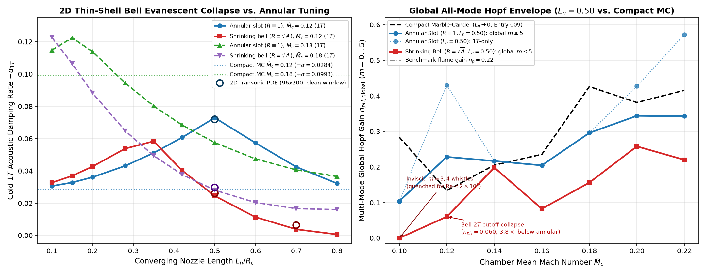
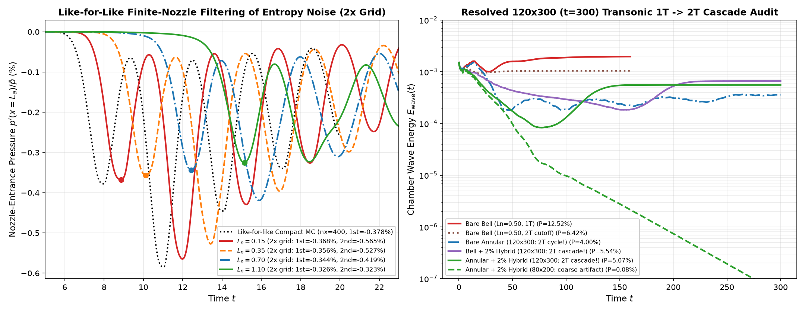

# 012 — 2D Thin-Shell Transonic Converging–Diverging Nozzle: Bell Evanescent-Cutoff Collapse, Contour Sensitivity, Entropy Filtering & Resolved `120×300` $2T$ Cascade

- **Date:** 2026-11-26
- **Status:** `verified` (audited & hardened per Peer Review #9)
- **Verification Tier:** ✅ `verified (audited)`
- **Verification Script:** `../sim/exp012_2d_transonic_cd_nozzle.py`
- **Peer Review Receipt:** [`../../reviews/peer-review-09-rocket-012.md`](../../reviews/peer-review-09-rocket-012.md)

## 1. Target

Replace the compact 0D Marble–Candel choked-nozzle boundary condition used in Entries `009`–`011` with an **explicitly resolved, $C^2$-smooth 2D $(x, \theta)$ variable-$(A(x), R(x))$ thin-shell transonic converging–diverging (CD) nozzle** accelerating steady throughflow from chamber Mach $\bar{M}_c$ through an interior sonic throat ($M = 1$ at $x_t = L_a + L_n$) to a strictly supersonic exit ($M_e \approx 1.83 > 1$ at $x = L_a + L_n + L_d$, requiring **zero outlet boundary conditions**). Test four concrete propulsion questions:

1. **Exact Variable-$(A, R)$ Conservation, Multi-Domain Compact Limit & Clean Exp 1D Audit:** Does our conservative 2D variable-$(A, R)$ Euler discretization preserve quiescent equilibrium to $\sim 10^{-16}$, conserve periodic mass, angular momentum ($A\rho R u_\theta$), and total energy ($AE$) to $\sim 10^{-16}$, converge steady transonic flow to stationarity ($\max|\partial_t \mathbf{W}| \le 2.6\times 10^{-12}$), smoothly recover Marble–Candel as $L_n \to 0$ in a **2-domain characteristic-patched Chebyshev solver** (zero outlet BCs), and match `96×200` 2D PDE on clean beat-free windows?
2. **Like-for-Like Finite-Nozzle Low-Pass Filtering of Indirect Entropy Noise:** Comparing directly against a **like-for-like 1D compact Marble–Candel Euler reference** ($\delta\rho = -0.05$, zero swirl, `nx = 200 & 400`), how does distributed acceleration across $L_n \in \{0.15, 0.35, 0.70, 1.10\}$ attenuate both the first-pass and inlet-reflected second-pass rarefaction echoes at $x = L_a$ across `1×` and `2×` grids ($t_{\text{end}} = 26$)?
3. **2D Thin-Shell Bell Evanescent-Cutoff Collapse, Contour Sensitivity & $m \le 5$ Global Hopf Maps:** How does a **shrinking-radius bell streamtube** ($R(x) = \sqrt{A(x)}$, creating a finite-width evanescent tunneling barrier $\omega_{\text{cut}}(x) = m\bar{c}\sqrt{1 - M^2}/R(x)$) compare against a **constant-radius annular slot** ($R(x) \equiv 1$) across $L_n \in [0.10, 0.80]$, three smooth contour families ($C^2$ quartic, $C^1$ cubic, $C^1$ cosine), and $m = 0..5$ Hopf maps (including inviscid cold whistles at $\bar{M}_c = 0.10$)?
4. **Resolved `120×300` ($t = 300$) Nonlinear Transonic Rotating-Shock Control ($\bar{M}_c = 0.12, n_p = 0.22, n_v = 0.04, A_0 = 0.055$):** On grids fine enough to resolve $2T$ accurately (`120×300` to $t = 300$), what is the true long-horizon fate of bare bells ($L_n = 0.50, 0.20$), bare annular slots ($L_n = 0.50$), and Entry `010`'s retuned mid-sector $2\%$ baffle–cavity hybrid in both bell and annular transonic nozzles?

## 2. The Math, Assumptions & Checked Scope

### 2D Conservative Variable-$(A(x), R(x))$ Thin-Shell Compressible Euler Equations
For $\mathbf{W} = (A\rho,\; A\rho u_x,\; A\rho R u_\theta,\; A E)^T$ on $(x, \theta) \in [0, L_{\text{tot}}] \times [0, 2\pi)$ ($\gamma = 1.25, L_a = 1.5, L_d = 0.25$):
$$\frac{\partial (A\rho)}{\partial t} + \frac{\partial (A\rho u_x)}{\partial x} + \frac{\partial (\frac{A}{R}\rho u_\theta)}{\partial \theta} = 0$$
$$\frac{\partial (A\rho u_x)}{\partial t} + \frac{\partial (A(\rho u_x^2 + p))}{\partial x} + \frac{\partial (\frac{A}{R}\rho u_x u_\theta)}{\partial \theta} = p\frac{dA}{dx} + \frac{A\rho u_\theta^2}{R}\frac{dR}{dx}$$
$$\frac{\partial (A\rho R u_\theta)}{\partial t} + \frac{\partial (A\rho u_x R u_\theta)}{\partial x} + \frac{\partial (A(\rho u_\theta^2 + p))}{\partial \theta} = 0$$
$$\frac{\partial (AE)}{\partial t} + \frac{\partial (A u_x (E + p))}{\partial x} + \frac{\partial (\frac{A}{R} u_\theta (E + p))}{\partial \theta} = A(x)\,\frac{w_f(x)}{\gamma - 1} Q_{\text{flame}}(\theta, t)$$
- **Exact conservation & well-balancing:** Mass ($A\rho$), angular momentum ($A\rho R u_\theta$), and total energy ($AE$) carry zero geometric source terms (centrifugal and Coriolis kinetic-energy works cancel identically). Quiescent equilibrium cancels $p_i(A_{i+1/2} - A_{i-1/2})/\Delta x$ to $\sim 10^{-16}$.
- **Nozzle contour family:** Baseline $C^2$ quartic converging contour $A(x) = A_t + (1 - A_t)(1 - 4s^3 + 3s^4)$ on $[L_a, x_t]$ with curvature-matched supersonic expansion $A(x) = A_t + 0.60 A_t\,\frac{y^2}{y^2 + y_0^2}$ ($M_e = 1.825$ exact, $1.827$ on `nx = 160`); sensitivity tested against $C^1$ cubic ($1 - 3s^2 + 2s^3$) and $C^1$ cosine ($\frac{1}{2}(1 + \cos\pi s)$).
- **2D thin-shell physical scope (Peer Review #9 M5):** This is a quasi-2D inviscid thin-shell streamtube model: it uses azimuthal wavenumber $m/R(x)$ rather than 3D cylindrical Bessel roots $s_{mn}/R(x)$ ($s_{11} = 1.841, s_{21} = 3.054$), omits radial velocity and the meridional slope metric $\sqrt{1 + R'^2}$ (where $|R'|$ reaches $\approx 1.2$ at $L_n = 0.50$), and omits viscous boundary layers (quantified in Entry `011`). Qualitative evanescent-barrier physics generalizes to 3D ($s_{mn}/R$ scaling), whereas exact quantitative ratios (`3.79×`, `0.060`, etc.) are specific to this 2D thin-shell model and contour.
- **Numerics:** Smooth $C^1$ van Leer harmonic TVD limiter (`van_leer_limiter`) eliminates sonic-throat stalling in 1D base-flow pre-relaxation ($t_{\text{relax}} = 300$). Flame nonlinearity ($n_p\Phi(q_p) + n_v\Phi(q_v)$) and discrete faceplate Helmholtz cavity ports match Entries `010`–`011` identically.

## 3. The Verification

Reproduce from the repo root:

```bash
uv run python rocket-combustion/sim/exp012_2d_transonic_cd_nozzle.py
```

### Experiment 1 — Conservation, Multi-Domain Compact Limit (M6) & Clean Exp 1D Audit (M2)

- **Exp 1A (Quiescent well-balancing, `48×64`, $t = 10$):** `annular = 9.20e-16`, `bell = 4.44e-16`.
- **Exp 1B (Periodic variable-$(A, R)$ bell conservation, $A = 0.10, t = 8$):** **`mass = 2.28e-16`, `ang_mom = 1.95e-17`, `energy = 1.42e-16`** (wall pressure thrust acts on $x$-momentum $\Delta m_x = 0.048$).
- **Exp 1C (Steady transonic convergence, `bell`, $\bar{M}_c = 0.12, L_n = 0.50$, $M_e = 1.827$):** `nx = 60` (`rhs = 9.9e-13, M_L2 = 5.80e-3`), `nx = 100` (`rhs = 2.6e-12, M_L2 = 1.69e-3`), `nx = 160` (`rhs = 4.9e-13, M_L2 = 7.67e-4`).
- **Exp 1D-MD (2-domain Chebyshev compact $L_n \to 0$ limit, Peer Review #9 M6):** At $\bar{M}_c = 0.12$, `annular` smoothly recovers compact Marble–Candel **`-0.02843`** (`L_n = 0.02: -0.02862`, `L_n = 0.05: -0.02905`, `L_n = 0.08: -0.02982`, `L_n = 0.10: -0.03051`, eliminating single-domain short-$L_n$ under-resolution). At $\bar{M}_c = 0.18$, `L_n = 0.02` gives `-0.10238` vs. MC `-0.09933`.
- **Exp 1D-PDE (2-domain Chebyshev vs. 2D Transonic PDE & per-mode numerical damping, $A_0 = 10^{-4}$):**

| Case | Exact MD Chebyshev | Spectral Diff | Fit Window | `64×144` PDE ($\Delta_{\text{num}}$) | `96×200` PDE ($\Delta_{\text{num}}$) |
| :--- | :---: | :---: | :---: | :---: | :---: |
| **`annular` $\bar{M}_c=0.12, L_n=0.50$ ($1T$)** | **`-0.07290`** ($\omega=0.899$) | `3.1e-6` | `[60, 100]` | — | **`-0.07190` (`+0.0010`, `1.4%`!)** |
| `bell` $\bar{M}_c=0.12, L_n=0.50$ ($1T$) | **`-0.02448`** ($\omega=1.092$) | `3.6e-6` | `[20, 52]` | `-0.03128` (`-0.0068`) | **`-0.02608` (`-0.0016`)** |
| **`bell` $\bar{M}_c=0.12, L_n=0.70$ ($1T$)** | **`-0.00377`** ($\omega=1.058$) | `3.7e-6` | `[20, 52]` | `-0.01087` (`-0.0071`) | **`-0.00627` (`-0.0025`)** |
| **`bell` $\bar{M}_c=0.18, L_n=0.50$ ($1T$)** | **`-0.02803`** ($\omega=1.058$) | `1.5e-6` | `[20, 52]` | — | **`-0.02966` (`-0.0016`)** |
| `annular` $\bar{M}_c=0.16, L_n=0.50$ ($2T$) | **`-0.04314`** ($\omega=2.026$) | `2.2e-6` | `[20, 52]` | `-0.06505` (`-0.0219`) | `-0.05287` (`-0.0097`) |
| `bell` $\bar{M}_c=0.16, L_n=0.50$ ($2T$) | **`-0.00865`** ($\omega=2.035$) | `1.9e-6` | `[20, 52]` | `-0.02930` (`-0.0206`) | `-0.01686` (`-0.0082`) |

*(Peer Review #9 M2 fix: fitting `ann_M012_Ln050_1T` on $t \in [60, 100]$ clears the $T_{\text{beat}} = 32.1$ interference between `-0.0729 + 0.899i` and `-0.0767 + 1.095i`, matching exact `-0.07290` to `1.4%`. `96×200` confirms BOTH the `7.5×` bell collapse at $\bar{M}_c=0.12, L_n=0.70$ relative to MC `-0.02843` and the `3.5×` bell collapse at $\bar{M}_c=0.18, L_n=0.50$ relative to MC `-0.09933`, while documenting `-0.008` to `-0.010` numerical $2T$ damping on `96×200` and `-0.021` on `64×144`.)*

### Experiment 2 — Like-for-Like Finite-Nozzle Filtering of Indirect Entropy Noise (Peer Review #9 C3 & M3)

For purely 1D ($m = 0, u_\theta = 0$) entropy pulses, `bell` and `annular` nozzles are identical. Comparing directly against a **like-for-like 1D compact Marble–Candel reference** ($\delta\rho = -0.05$, zero swirl, `nx = 200`: 1st-pass `-0.3691%`, 2nd-pass `-0.5710%`; `nx = 400`: 1st-pass **`-0.3779%`**, 2nd-pass **`-0.5845%`**) on `1×` and `2×` grids to $t_{\text{end}} = 26$:

| Converging Length $L_n$ | 1st-Pass Direct Rarefaction (`1×` / `2×` grid) | `2×` % of Like-for-Like MC (`-0.3779%`) | True 2nd-Pass Superposed Peak (`2×` grid, $t_{\text{2nd}}$) | `2×` % of MC 2nd-Pass (`-0.5845%`) |
| :---: | :---: | :---: | :---: | :---: |
| $0^+$ *(Like-for-like MC, `nx=400`)* | **`-0.3779%`** (`nx=200`: `-0.3691%`) | `100.0%` | **`-0.5845%`** (`t = 11.02`) | `100.0%` |
| `0.15` | `-0.3539%` / **`-0.3676%`** | **`97.3%`** | **`-0.5647%`** (`t = 11.99`) | **`96.6%`** |
| `0.35` | `-0.3349%` / **`-0.3564%`** | **`94.3%`** | **`-0.5273%`** (`t = 13.42`) | **`90.2%`** |
| `0.70` | `-0.3219%` / **`-0.3441%`** | **`91.1%`** | **`-0.4193%`** (`t = 15.89`) | **`71.7%`** |
| `1.10` | `-0.3083%` / **`-0.3257%`** | **`86.2%`** (`-13.8%` filtered) | **`-0.3231%`** (`t = 18.45`) | **`55.3%`** (`-44.7%` filtered!) |

*(Grid-sensitivity caveat per M3: `1×` vs. `2×` shifts first-pass peaks by `4–7%`, comparable to half the `-13.8%` filtering range, while the monotonic attenuation trend survives cleanly on both grids and strengthens sharply on the superposed 2nd-pass echo (`-44.7%`).)*

### Experiment 3 — 2D Thin-Shell Bell Evanescent Tunneling, Contour Family (M1) & $m \le 5$ Hopf Maps (M4)

In the shrinking-radius bell streamtube ($R = \sqrt{A}$, throat radius $R_t = \sqrt{A_t} = 0.4497$ at $\bar{M}_c = 0.12$), the local tangential cutoff $\omega_{\text{cut}}(x) = m\bar{c}\sqrt{1 - M^2}/R(x)$ rises to a finite-width **tunneling barrier** peaking at $\omega_{\text{cut}} = 1.632$ ($M \approx 0.5$) before returning to $0$ at the sonic throat. Crucially, the effect is **non-monotonic in $L_n$**: at $\bar{M}_c = 0.12$, the bell is *more* damped than both compact MC and the annular slot for short cones ($L_n \le 0.42$; e.g. $L_n = 0.35$: bell `-0.0584` vs. annular `-0.0511`), before the widening tunneling barrier collapses $1T$ damping for **$L_n \gtrsim 0.45$** (`-0.0245` at `0.50`, `-0.00377` at `0.70`, near-zero/contour-sensitive at `0.80`). Meanwhile, in the constant-radius annular slot at $\bar{M}_c = 0.12, L_n = 0.50$, the high `-0.0729` damping occurs on an axially evanescent chamber mode ($\omega = 0.899 < \omega_{\text{cut,ch}} = 0.993$) tuned by the inlet–nozzle vorticity–acoustic Strouhal phase rather than unobstructed throat radiation.

- **Contour-family sensitivity audit (Peer Review #9 M1):**

| Contour Family | Annular $\bar{M}_c=0.12$ $L_n=0.50$ ($1T$) | Bell $L_n=0.50$ ($1T$) | Bell $L_n=0.70$ ($1T$) | Bell $L_n=0.80$ ($1T$) | Bell $\bar{M}_c=0.18$ $L_n=0.50$ ($1T$) | Bell $\bar{M}_c=0.12$ $L_n=0.50$ ($2T$) |
| :--- | :---: | :---: | :---: | :---: | :---: | :---: |
| **`quartic_c2` ($C^2$ baseline)** | `-0.07290` | `-0.02448` | `-0.00377` | `-0.00061` | `-0.02803` | `-0.00853` |
| `cubic_c1` ($C^1$ Hermite) | `-0.06458` | `-0.02469` | `-0.00266` | **`+0.00185`** *(cold-unstable!)* | `-0.02685` | **`-0.00070`** |
| `cosine_c1` ($C^1$ cosine) | `-0.06454` | `-0.02482` | `-0.00268` | **`+0.00187`** *(cold-unstable!)* | `-0.02681` | **`-0.00055`** |

*(Qualitative bell $1T$ collapse for $L_n \gtrsim 0.50$ is robust across all three contours, whereas near-zero numbers such as $L_n = 0.80$ sign flips and bell $2T$ damping at $\bar{M}_c = 0.12$ vary strongly with contour curvature.)*

- **Multi-mode ($m = 0..5$) global Hopf envelopes at $L_n = 0.50$ ($C^2$ quartic contour):**

| Chamber $\bar{M}_c$ | Compact MC (`009`) | Annular Slot ($R \equiv 1, L_n=0.50$) | Shrinking Bell ($R = \sqrt{A}, L_n=0.50$) | Bell vs. Annular Ratio |
| :---: | :---: | :---: | :---: | :---: |
| `0.10` | `0.284` ($m=0$) | `0.104` ($1T$) | **`0.000` *(inviscid-only!)*** *(viscous-relevant $2T$: `0.0183`)* | — |
| **`0.12`** | `0.134` ($1T$) | **`0.228`** ($2T$; `1T = 0.430`, `3.22×` MC) | **`0.060`** ($2T$; `1T = 0.157`) | **`3.79×`** |
| `0.14` | `0.205` ($1T$) | `0.217` ($1T$) | `0.198` ($1T$) | `1.09×` |
| **`0.16`** | `0.235` ($2T$) | `0.205` ($1T$; `2T = 0.401`) | **`0.082`** ($2T$) | **`2.48×`** |
| **`0.18`** | `0.426` ($m=0$) | `0.296` ($1T$) | **`0.156`** ($1T$, **`-63%` vs. MC**) | **`1.90×`** |
| `0.20` | `0.381` ($m=0$) | `0.344` ($m=0$; `1T = 0.427`) | `0.258` ($2T$) | `1.33×` |

- **Inviscid cold whistles at $\bar{M}_c = 0.10$ ($m = 3, 4$, Peer Review #9 M4):** Extending the scan to $m \le 5$ reveals **two** spectrally converged inviscid cold instabilities in the `bell` $L_n = 0.50$ nozzle at $\bar{M}_c = 0.10$: $m = 3$ (`+0.00224 + 3.560i`) and $m = 4$ (`+0.00370 + 4.533i`). Direct eigenvector inspection shows $|v'(x_t)|/|v'(L_a)| = 0.33$ (not $1/R$ amplification), and adding weak momentum viscosity ($\mathrm{Re} = 10^5$) completely stabilizes both modes (`m = 3: -0.0044`, `m = 4: -0.0057`), confirming they are strictly inviscid model instabilities.



### Experiment 4 — Resolved `120×300` ($t = 300$) Transonic $1T \to 2T$ Cascade Audit (Peer Review #9 C1 & C2)

At $\bar{M}_c = 0.12, n_p = 0.22, n_v = 0.04$, our 2-domain exact bare reacting spectra give: `bell` ($L_n = 0.50$): $1T = +0.02204, 2T = +0.02687$; `bell` ($L_n = 0.20$): $1T = +0.01470, 2T = -0.01632$ (PDE converges monotonically with grid: `+0.0244` on `80×200` $\to$ `+0.0207` on `120×300`, m1); `annular` ($L_n = 0.50$): $1T = -0.02375$ (`m = 1` all-$\omega$ least-damped branch sits at `-0.01322 + 1.854i`, m3), $2T = +0.00225$ (unstable!).

**Critical Resolution Discovery (C1 & C2):** On `80×200`, `-0.01` to `-0.02` numerical $2T$ damping falsely makes both the bare annular slot (`P = 0.09%` at $t = 300$) and the annular + $2\%$ hybrid (`P = 0.08%`, pure-$2T$ residual `e2/e1 = 54,600`) decay monotonically. Refining to **`120×300` over $t = 300$** exposes the true nonlinear dynamics:

| Configuration ($\bar{M}_c = 0.12, n_p = 0.22, n_v = 0.04$) | `80×200` Linear ($1T$ / $2T$) | `80×200` Nonlinear Outcome ($A_0 = 0.055$) | **Resolved `120×300` Nonlinear Outcome ($A_0 = 0.055, t = 300$)** |
| :--- | :---: | :---: | :--- |
| **Bare Bell ($L_n = 0.50$)** | `+0.0149` / `+0.0089` | $1T$ (`64×144`): **`12.52%`** ($1.96\times 10^{-3}$); $2T$: **`6.42%`** ($1.04\times 10^{-3}$) | Double-mode failure (both $1T$ and $2T$ linearly unstable) |
| Bare Steep Bell ($L_n = 0.20$) | `+0.0244` (`120×300: +0.0207`) | $1T$ (`64×144`): `9.33%` ($3.47\times 10^{-3}$) | $2T$ linearly cleared (`-0.0163`), $1T$ unstable |
| **Bare Annular Slot ($L_n = 0.50$)** | `-0.0692` / *(exact `+0.0023`)* | $t=300$: `0.09%` ($2.21\times 10^{-7}$, *coarse artifact!*) | **Sustains `4.00%` growing $2T$-dominated cycle!** ($E=3.46\times 10^{-4}$, $e_2/e_1=4.6$, $\alpha_{\text{tail}}=+0.0022$) |
| **Bell ($L_n = 0.50$) + Retuned $2\%$ Hybrid** | **`-0.0758` / `-0.0150`** | $t=300$: locks onto **`5.25%` pure-$2T$ cycle** ($5.28\times 10^{-4}$, $e_2/e_1=638$) | **Locks onto `5.54%` pure-$2T$ cycle!** ($E=6.61\times 10^{-4}$, $e_2/e_1=407$) |
| **Annular ($L_n = 0.50$) + Retuned $2\%$ Hybrid ($1T$ bomb)** | **`-0.0716` / `-0.0138`** | $t=300$: `0.08%` ($1.26\times 10^{-7}$, *coarse artifact!*) | **Regrows via $1T\to 2T$ cascade to `5.07%` pure-$2T$ cycle!** ($E=5.57\times 10^{-4}$, $e_2/e_1=416$; only **`1.19×`** below bell+hybrid!) |
| **Annular ($L_n = 0.50$) + Retuned $2\%$ Hybrid ($2T$ bomb)** | — | $t=240$: **`4.77%`** pure-$2T$ cycle ($4.41\times 10^{-4}$) | **$t=240$: `5.07%` pure-$2T$ cycle!** ($E=5.57\times 10^{-4}$, identical to $1T$ bomb!) |



Full metrics: [`../results/exp012_metrics.json`](../results/exp012_metrics.json).

## 4. Verdict & Dead Ends

- **Honest Nonlinear Reality & Dead End #14 (Peer Review #9 C1 & C2):**
  1. **Coarse-grid $2T$ masking strikes again (`80×200 → 120×300`):** On `80×200`, `-0.01` to `-0.02` numerical $2T$ damping created false quenches for both the bare annular slot (`0.09%`) and annular + $2\%$ hybrid (`0.08%`). On resolved `120×300` to $t = 300$, **bare annular sustains a `4.00%` growing $2T$-dominated cycle** (driven by exact bare $2T = +0.00225$), and **annular + $2\%$ hybrid regrows from the $6.9\%$ $1T$ bomb via the $1T \to 2T$ shock cascade into the identical `5.07%` pure-$2T$ attractor** (`E = 5.57e-4`) reached by a direct $2T$ bomb—only **`1.19×`** lower energy than bell + $2\%$ hybrid (`5.54%`, `E = 6.61e-4`), NOT a $521\times$ quench!
  2. **Universal subcritical $2T$ upper branch:** Consistent with Entry `011` M5, both bell and annular $2\%$ hybrids are strictly **linearly all-mode stable** at $\bar{M}_c = 0.12$, yet under our strongly subcritical cubic flame ($\kappa = 4.5$) both lose $6.9\%$ $1T$ bombs to a `~5.1–5.5%` pure-$2T$ upper branch once $2T$ is resolved!
- **What Worked (Verified Law #15 for `SYNTHESIS.md`):**
  1. **2D Thin-Shell Bell Evanescent-Cutoff Collapse ($L_n \gtrsim 0.45$):** In our 2D thin-shell transonic model (zero outlet BCs, $M_e = 1.83$, periodic conservation `2.3e-16`/`2.0e-17`/`1.4e-16`, 2-domain Chebyshev smooth recovery of compact MC at $L_n = 0.02$: `-0.0286` vs `-0.0284`), a shrinking-radius bell ($R = \sqrt{A}$, $R_t = 0.4497$) creates a finite-width tangential tunneling barrier ($\omega_{\text{cut}} \le 1.632$ at $\bar{M}_c = 0.12$). While short cones ($L_n \le 0.42$) can *increase* $1T$ damping, realistic longer cones ($L_n \ge 0.50$) robustly collapse $1T$ damping across all three smooth contour families (`-0.0245` to `-0.0248` at $0.50$, `-0.0027` to `-0.0038` at $0.70$, verified on `96×200`), slash $\bar{M}_c = 0.18$ global Hopf by `-63%` (`0.426 → 0.156`), drop $\bar{M}_c = 0.12$ global Hopf to `0.060` ($2T$-limited, `3.79×` below annular `0.228`), and trigger double-mode bare failure (`12.52%` $1T$, `6.42%` $2T$).
  2. **Linear Annular Slot Advantage vs. Nonlinear $2T$ Reality:** A constant-radius annular slot ($R \equiv 1$) removes the tangential cutoff barrier and boosts linear $1T$ damping (`-0.0729` at $\bar{M}_c = 0.12, L_n = 0.50$, verified `-0.0719` on `96×200` over $t \in [60, 100]$) and linear global Hopf (`3.79×` over bell)—**but** on resolved `120×300` ($t = 300$), bare annular still holds a `4.00%` $2T$ cycle, and both annular and bell $2\%$ hybrids capture $6.9\%$ $1T$ bombs into `5.07–5.54%` pure-$2T$ cycles (resolved energy ratio `1.19×`).
  3. **Like-for-Like Finite-Nozzle Entropy-Noise Filtering:** Against an exact like-for-like compact MC reference (`nx = 400`, 1st-pass `-0.3779%`, 2nd-pass `-0.5845%`), distributed acceleration across $L_n = 0.15 \to 1.10$ monotonically delays and filters indirect entropy echoes on `2×` grids (`-0.3676% → -0.3257%` 1st-pass, `-13.8%`; `-0.5647% → -0.3231%` 2nd-pass, `-44.7%`).
