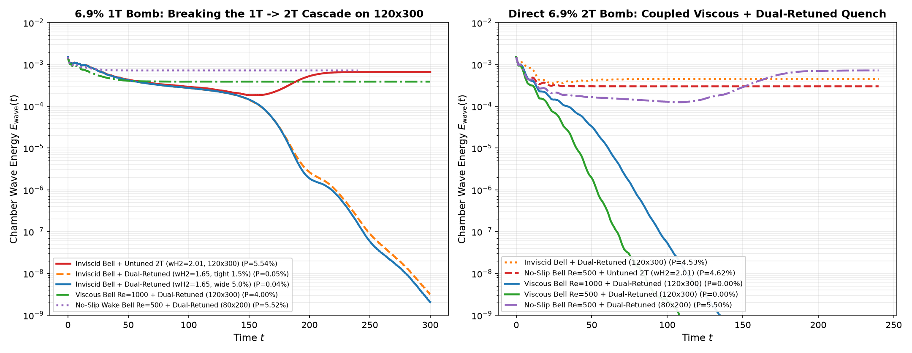
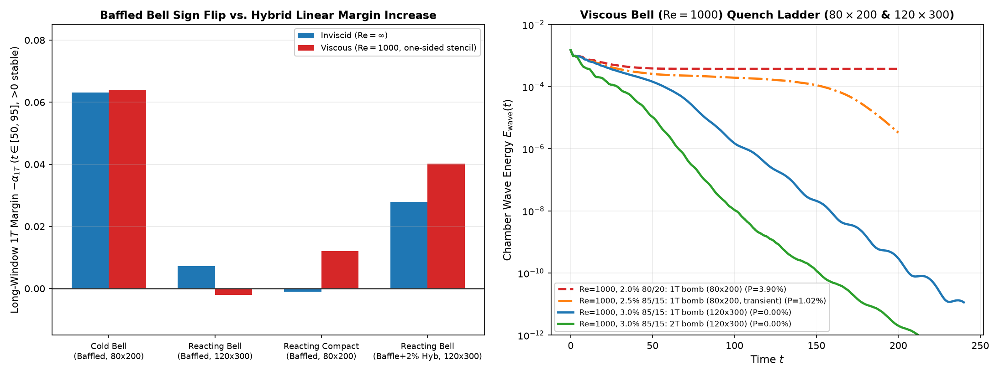

# Entry 013 — Dual-Harmonic Baffle–Cavity Retuning ($\omega_{H,1T}, \omega_{H,2T}$) & Coupled 2D Compressible Navier–Stokes Transonic Bell Nozzle: Breaking the $1T \to 2T$ Cascade Attractor

- **Date:** 2026-11-26
- **Track:** Rocket Combustion Instability (`rocket-combustion`)
- **Status:** ✅ Verified & Audited (hardened per independent [Peer Review #10](../../reviews/peer-review-10-rocket-013.md))
- **Verification Script:** [`../sim/exp013_dual_retuning_viscous_bell.py`](../sim/exp013_dual_retuning_viscous_bell.py)
- **Metrics Artifact:** [`../results/exp013_metrics.json`](../results/exp013_metrics.json)
- **Figures:**
  - [`../results/exp013_viscous_bell_rescue_and_2T_retuning.png`](../results/exp013_viscous_bell_rescue_and_2T_retuning.png)
  - [`../results/exp013_120x300_cascade_break_and_2T_quench.png`](../results/exp013_120x300_cascade_break_and_2T_quench.png)
  - [`../results/exp013_viscous_1T_backreaction_and_quench.png`](../results/exp013_viscous_1T_backreaction_and_quench.png)

---

## 1. Problem Statement & Scope

Peer Reviews #8 and #9 left a central unresolved physics and design question across Entries `010`–`012`:
> Why did the retuned $2.0\%$ `80/20` baffle–cavity hybrid still lose finite-amplitude ($6.9\%$) bombs to a universal $\sim 4\text{--}5.5\%$ **pure-$2T$ upper branch** in both 2D viscous Navier–Stokes (`011`: `4.13%`) and resolved `120×300` transonic nozzles (`012`: `5.07%` annular, `5.54%` bell)—and what minimum passive hardware + eddy viscosity breaks both the $1T \to 2T$ cascade and direct $2T$ bombs on resolved `120×300` grids?

This entry couples Entry `011`'s conservative 2D compressible Navier–Stokes discretization ($\mathrm{Pr} = 0.72$, Stokes' hypothesis, constant-eddy-viscosity closure $\mathrm{Re} = \bar{\rho}\bar{c}R/\mu$) directly with Entry `012`'s explicitly resolved $C^2$ 2D thin-shell variable-$(A(x), R(x))$ transonic converging–diverging bell nozzle ($L_a = 1.5, L_n = 0.50, L_d = 0.25, M_e \approx 1.74\text{--}1.83 > 1$, zero outlet BCs), paired with an exact conservative compressible-NS Chebyshev eigen-solver linearized around the **exact 1D steady viscous transonic base flow**.

### Governing Equations & Explicit Model Scope
On the 2D thin-shell domain $(x, \theta) \in [0, L_a + L_n + L_d] \times [0, 2\pi)$ with $A(x)$ defined by the $C^2$ quartic/rational nozzle contour and $R(x) = \sqrt{A(x)}$ for a shrinking bell nozzle ($R(x) \equiv 1$ for a constant-radius annular slot), the conservative state $\mathbf{W} = [A\rho, A\rho u_x, A R \rho u_\theta, A E]^T$ evolves via:
$$\partial_t \mathbf{W} + \partial_x \big(\mathbf{F}_{\text{inv}} - \mathbf{F}_{\text{visc}}\big) + \partial_\theta \big(\mathbf{G}_{\text{inv}} - \mathbf{G}_{\text{visc}}\big) = \mathbf{S}_{\text{geom}} + \mathbf{S}_{\text{flame}},$$
where $\tau_{xx} = \mu(\frac{4}{3} u_{x,x} - \frac{2}{3} R^{-1} u_{\theta,\theta})$, $\tau_{\theta\theta} = \mu(\frac{4}{3} R^{-1} u_{\theta,\theta} - \frac{2}{3} u_{x,x})$, $\tau_{x\theta} = \mu(R^{-1} u_{x,\theta} + u_{\theta,x})$, $\mathbf{q} = -\kappa \nabla T$ with $\kappa = \mu / ((\gamma - 1)\mathrm{Pr})$, $\gamma = 1.25$, $\mathrm{Pr} = 0.72$, and $\mathbf{S}_{\text{geom}} = [0, p A'(x) + (A\rho u_\theta^2 / R) R'(x), 0, 0]^T$. On $x$-faces adjacent to solid baffle blades ($x \le L_b$), wall-aware one-sided $\theta$-differences are used so viscous stresses never differentiate across impermeable plates (hardened per Review #10 M1).

**Intentional reductions & checked scope (including Review #10 M8):**
- 2D thin-shell annulus ($k_\theta = m/R(x)$, not 3D cylindrical Bessel zeros $s_{mn}/R(x)$; no radial $r$-modes or meridional curvature metric).
- **Planar thin-shell viscous stress closure:** $\tau_{xx}, \tau_{\theta\theta}$ omit quasi-1D / shell-metric dilatation terms proportional to $u_x A'/A$ and $u_x R'/R$ (which are $O(1)$ in the converging throat, making the nozzle viscous dissipation model-specific to this planar stress form).
- Constant-eddy-viscosity closure ($\mu = 1/\mathrm{Re}$ spatially uniform, no RANS/turbulence transport model) and idealized thin-plate baffles (both free-slip and converged $t = 150$ no-slip adiabatic wakes).
- Choked zero-swirl isentropic injector with discrete mid-sector faceplate Helmholtz cavities (`phase = 0.5`, $C_d = 0.65$, quadratic orifice drag $r_{\text{nl}} |q_t| q_t$).

---

## 2. Exact Coupled Benchmarks & Higher-Harmonic Baffle Downshift (Experiment 1)

| Benchmark Check | Result | Target / Reference |
| :--- | :--- | :--- |
| **1A. Quiescent bell NS well-balancing ($\mathrm{Re} = 500$, $t = 10$)** | `7.50e-16` | Machine precision ($\sim 10^{-15}$) |
| **1B. Periodic variable-$(A, R)$ bell NS conservation ($\mathrm{Re} = 200$, $A_0 = 0.10$)** | mass `2.28e-16`, ang. mom. `1.60e-17`, energy `1.42e-16` | Exact (`mom_x = 0.055` from wall thrust $p\,dA/dx$) |
| **1C. Viscous NS–Bell Chebyshev ($N=96$) vs. `96×200` PDE ($\mathrm{Re}=500$, $1T$)** | `-0.07912` (`|v96-v72| = 3.9e-5`) vs. `-0.07946` (`e_1t`) | **`0.44%`** relative error |
| **1C. Viscous NS–Bell Chebyshev ($N=96$) vs. `96×200` PDE ($\mathrm{Re}=1000$, $1T$)** | `-0.06256` (`|v96-v72| = 2.7e-4`) vs. `-0.06108` (`e_1t`) | **`2.36%`** relative error |
| **1C. Viscous NS–Bell Chebyshev ($N=96$) vs. `96×200` PDE ($\mathrm{Re}=500$, $2T$)** | `-0.06521` (`|v96-v72| = 3.0e-5`) vs. `-0.06291` (`e_2t`) | **`3.53%`** relative error |
| **1C. Viscous NS–Bell Chebyshev ($N=96$) vs. `96×200` PDE ($\mathrm{Re}=1000$, $2T$)** | `-0.05598` (`|v96-v72| = 9.4e-5`) vs. `-0.05522` (`e_2t`) | **`1.37%`** relative error |
| **1D. Zero-padded FFT baffle frequency downshift ($N_b=5, L_b=0.45$, reacting)** | $1T$: `1.0665 → 0.9357` (**`-12.3%`**) $2T$: `1.9767 → 1.6296` (**`-17.6%`**) | **$2T$ downshifts $1.43\times$ more strongly than $1T$!** |

> **Base-flow & closure notes (Review #10 M6, m7, m8):**
> - In the $N = 96$ 1D steady viscous Chebyshev base flow (`base_diagnostics_cheb_N96`), throat viscous dissipation shifts the steady chamber inlet Mach number and supersonic exit Mach number from $(\bar{M}_{\text{in}}, M_e) = (0.1200, 1.8252)$ at $\mathrm{Re} = \infty$ to $(0.1211, 1.7795)$ at $\mathrm{Re} = 1000$ and $(0.1220, 1.7373)$ at $\mathrm{Re} = 500$. Linearizing the conservative operator about this exact viscous steady state (verified to `1.8e-12` against an independent complex-step Jacobian in Review #10) eliminates the $O(1/\mathrm{Re})$ inviscid-base mismatch.
> - The 1D FVM base residual `base_rhs_96 = 3.69e-5` (`Re = 500`) and `1.67e-5` (`Re = 1000`) represents the stationary limiter/sonic-point truncation floor rather than a drifting transient. Note also that the 1D Chebyshev base solver retains the momentum row at $x = 0$ (replacing mass and energy with the two inlet BCs), whereas the 2D eigen-solver retains the energy row at $x = 0$ (replacing mass, $x$-momentum, and angular momentum); the `0.44%–3.53%` agreement with `96×200` PDE confirms this minor closure difference is benign.

---

## 3. Viscous Rescue of the Bell-Nozzle $2T$ Cutoff Collapse & Non-Monotonic $\mathrm{Re}$ Window (Experiment 2)

Across $\bar{M}_c \in [0.10, 0.22]$ for the $L_n = 0.50$ $C^2$ bell nozzle, converged **`N = 96`** multi-mode ($m = 0..5$) exact viscous Chebyshev scans quantify **pressure-coupled ($n_v = 0$) global Hopf gains** alongside the **full benchmark reacting flame ($n_p = 0.22, n_v = 0.04$)** (explicitly separated per Review #10 M3–M5):

| $\bar{M}_c$ | $\mathrm{Re} = \infty$ $n_{pH,\text{global}}$ ($n_v=0$, mode) | $\mathrm{Re} = 2000$ | $\mathrm{Re} = 1000$ | $\mathrm{Re} = 500$ | Bare Cold $\alpha_{2T}$ ($\infty \to 500$) | Benchmark Reacting $\alpha_{1T}$ ($n_p=0.22, n_v=0.04$: `1000` / `500`) |
| :-: | :---: | :---: | :---: | :---: | :---: | :---: |
| `0.10` | `0.000` ($m=3,4$ whistles) | `0.118` ($1T$) | `0.155` ($1T$) | `0.190` ($1T$) | `-0.0022 → -0.0570` (`26.2×`) | `+0.0303` / `+0.0225` |
| `0.12` | `0.060` ($2T$ collapse) | `0.267` ($1T$, **`4.4×`**) | `0.299` ($1T$, **`5.0×`**) | `0.277` ($1T$, **`4.6×`**) | `-0.0085 → -0.0652` (**`7.6×`**) | **`-0.0029`** (stable!) / `+0.0006` |
| `0.14` | `0.198` ($1T$) | `0.226` ($1T$) | `0.239` ($1T$) | `0.246` ($1T$) | `-0.0328 → -0.0724` (`2.2×`) | `+0.0071` / `+0.0063` |
| `0.16` | `0.082` ($2T$ trap) | `0.142` ($1T$) | `0.171` ($1T$) | `0.214` ($1T$) | `-0.0087 → -0.0803` (**`9.3×`**) | `+0.0212` / `+0.0127` |
| `0.18` | `0.156` ($1T$) | `0.190` ($1T$) | `0.219` ($1T$) | `0.267` ($1T$) | `-0.0312 → -0.1068` (`3.4×`) | `+0.0117` / `+0.0012` |
| `0.20` | `0.258` ($2T$) | `0.317` ($1T$) | `0.342` ($1T$) | `0.382` ($1T$) | `-0.0450 → -0.0835` (`1.9×`) | `-0.0157` / `-0.0275` |
| `0.22` | `0.220` ($2T$) | `0.330` ($2T$) | `0.407` ($m=0$) | `0.467` ($m=0$) | `-0.0254 → -0.0771` (`3.0×`) | `-0.0636` / `-0.0795` |

- **Viscous rescue of $2T$ & inviscid whistles (M5):** At $N = 96$ and $\bar{M}_c = 0.10, \mathrm{Re} = \infty$, the converged inviscid whistles are $m = 3$ (`+0.0022`) and $m = 4$ (`+0.0037`), while $m = 5$ is linearly stable (`-0.0176`; the earlier $N = 72$ $m = 5$ spike was unconverged). At $\bar{M}_c = 0.12$, eddy viscosity boosts cold $2T$ damping **`5.2×` (`Re = 2000`), `6.6×` (`Re = 1000`), and `7.6×` (`Re = 500`)**, lifting the pressure-coupled global Hopf floor **`4.4×` (`Re = 2000`) and `4.6–5.0×` (`Re = 500–1000`)** while stabilizing bare benchmark $2T$ (`+0.0269 → -0.0139` at `1000`, `-0.0185` at `500`).
- **Genuine non-monotonic $\mathrm{Re}$ window for bare benchmark $1T$ at $\bar{M}_c = 0.12$ (Review #10 M4):** An 11-point $N = 96$ sweep (`exp2_Mc012_nonmonotonic_Re_sweep_N96`) reveals that bare reacting $1T$ ($n_p = 0.22, n_v = 0.04$) is linearly **stable** inside $\mathrm{Re} \in (560, 1150)$ and unstable on both sides:
  `Re = ∞: +0.0220` | `4000: +0.0129` | `2000: +0.0053` | `1500: +0.0014` | `1200: -0.0013` | `1000: -0.0029` | `800: -0.0033` | `700: -0.0027` | `600: -0.0014` | `500: +0.0006` | `400: +0.0031` (driven by viscous frequency downshift $\omega_{1T}: 1.059 \to 1.000$ shifting the Rayleigh lag phase $\omega_{1T}\bar{\tau}$). Note that adding chiral velocity coupling ($n_v = 0.04$) lowers the stability boundary relative to the $n_v = 0$ curves in Figure 1 (e.g., at $\bar{M}_c = 0.12, \mathrm{Re} = 500$, $n_{pH,1T}(n_v=0) = 0.277 > 0.22$, yet the benchmark flame with $n_v = 0.04$ has $\alpha_{1T} = +0.0006$).

---

## 4. Higher-Harmonic Baffle–Cavity Retuning Law & Grid/$\mathrm{Re}$ Audit (Experiment 3)

In Entries `010`–`012`, we retuned the $1T$ cavity sub-ring to the baffled $1T$ frequency ($\omega_{H,1T} = 0.90\text{--}0.96$) **but left the $2T$ sub-ring at the prior unbaffled value $\omega_{H,2T} = 2.01$**. Because $N_b = 5, L_b = 0.45$ baffles downshift $2T$ by **`-17.6%`** (`1.977 → 1.630`, Exp 1D), leaving $\omega_{H,2T} = 2.01$ detuned the $2T$ sub-ring by **`+23%`** above the baffled mode (`+21%` relative to bare FFT `1.977`).

Sweeping $\omega_{H,2T} \in [1.35, 2.15]$ at **zero extra volume** (fixed $2.0\%$ `80/20`, $\omega_{H,1T} = 0.96, \sigma_{o,1T} = 4.5\%, \sigma_{o,2T} = 5.0\%$, $\bar{M}_c = 0.12, n_p = 0.22, n_v = 0.04$), paired with resolved `120×300` inviscid and `80×200` $\mathrm{Re} = 1000$ azimuthal-$e_{2T}$ cross-checks (Review #10 M7 & m10):

| $\omega_{H,2T}$ | `80×200` Inviscid $-\alpha_{2T}$ (`e_ch`) | `120×300` Inviscid $-\alpha_{2T}$ (`e_2t`) | `80×200` $\mathrm{Re}=1000$ $-\alpha_{2T}$ (`e_2t`) | `80×200` Direct $6.9\%$ $2T$ Bomb $P_{\text{peak}}/\bar{p}$ (%) |
| :-: | :---: | :---: | :---: | :---: |
| `1.35` | `0.0163` | — | — | `5.31%` (`5.50e-4`) |
| `1.45` | `0.0214` | `0.0183` | `0.0431` | `4.97%` (`4.84e-4`) |
| **`1.65` (peak)** | **`0.0392` (`2.61×`)** | **`0.0328` (`2.95×`)** | **`0.0775` (`1.87×`)** | **`4.15%` (`3.36e-4`, `-37%` $E$)** |
| `1.65` (tight `1.5%` neck) | — | — | — | `4.40%` (`3.77e-4`) |
| `1.90` | `0.0185` | `0.0145` | `0.0458` | `5.09%` (`4.96e-4`) |
| `2.01` (Entries `010`–`012`) | `0.0150` | `0.0112` | `0.0414` | `5.29%` (`5.36e-4`) |
| `2.15` | `0.0125` | — | — | `5.43%` (`5.65e-4`) |

- **Grid & viscosity sensitivity (M7):** The resonance peak at $\omega_{H,2T} = 1.65$ holds identically on `120×300` inviscid (where the peak/detuned gain strengthens to **`2.95×`** because `80×200` adds `~0.004–0.006` numerical $2T$ damping) and at $\mathrm{Re} = 1000$ (where the ratio is **`1.87×`** because eddy viscosity already contributes strong baseline $2T$ damping).
- **Fixed-budget split tradeoff (inviscid):** Shifting the $2.0\%$ budget from `80/20` to `60/40` at $\omega_{H,2T} = 1.65$ quenches a direct inviscid $6.9\%$ $2T$ bomb (`0.03%`, $E = 9.78\times 10^{-9}$, `tail = -0.0265`) **but breaks $1T$** (`3.76%` pure-$1T$ limit cycle, $E_{2T}/E_{1T} = 0.006$).

---

## 5. Resolved `120×300` Cascade Breaking, Linear vs. Nonlinear Viscous $1T$ Physics & Scope-Robust All-Mode Quench (Experiments 4 & 5)

### 5.1. Experiment 4: Resolved `120×300` ($t = 240\text{--}300$) Breaking of the $1T \to 2T$ Cascade Attractor

| Case ID | Grid | $\mathrm{Re}$ / BC | Hardware ($\omega_{H,1T}/\omega_{H,2T}$) | Bomb ($6.9\%$) | Late $P_{\text{peak}}/\bar{p}$ | Late $E_{\text{wave}}$ | $E_{2T}/E_{1T}$ | Tail $\alpha$ | Outcome (explicit energy baseline) |
| :--- | :---: | :---: | :--- | :---: | :---: | :---: | :---: | :---: | :--- |
| `R120_inf_untuned_1T` | `120×300` | $\infty$ / slip | `2.0%` `80/20` (`0.96/2.01`, `1.5%`) | `spin_1T` | `5.54%` | `6.61e-4` | `406.5` | `+0.0000` | $1T \to 2T$ cascade lock-in |
| **`R120_inf_dualW50_1T`** | **`120×300`** | **$\infty$ / slip** | **`2.0%` `80/20` (`0.96/1.65`, `5.0%`)** | **`spin_1T`** | **`0.04%`** | **`3.13e-8`** | `3.1` | **`-0.0362`** | **CASCADE BROKEN (`21,158×` vs. untuned inviscid; Review #10 confirms decay to $8.1\times 10^{-13}$ at $t=420$)** |
| **`R120_inf_dualT15_1T`** | **`120×300`** | **$\infty$ / slip** | **`2.0%` `80/20` (`0.96/1.65`, `1.5%`)** | **`spin_1T`** | **`0.05%`** | **`4.58e-8`** | `5.2` | **`-0.0353`** | **CASCADE BROKEN (`14,442×` vs. untuned; confirms decay to $1.25\times 10^{-12}$ at $t=420$)** |
| `R120_inf_dualW50_2T` | `120×300` | $\infty$ / slip | `2.0%` `80/20` (`0.96/1.65`, `5.0%`) | `spin_2T` | `4.53%` | `4.50e-4` | `661.5` | `-0.0000` | Direct inviscid $2T$ persists |
| `R120_Re1000_dualW50_1T` | `120×300` | `1000` / slip | `2.0%` `80/20` (`0.96/1.65`, `5.0%`) | `spin_1T` | **`4.00%`** | `3.89e-4` | **`0.005`** | `-0.0000` | **Subcritical pure-$1T$ re-ignition!** |
| **`R120_Re1000_dualW50_2T`** | **`120×300`** | **`1000` / slip** | **`2.0%` `80/20` (`0.96/1.65`, `5.0%`)** | **`spin_2T`** | **`0.0004%`** | **`2.72e-12`** | `0.006` | **`-0.0385`** | **Direct $2T$ quenched (`1.66e8×` vs. inviscid dual-retuned `2T`)** |
| **`R120_Re500_dualW50_2T`** | **`120×300`** | **`500` / slip** | **`2.0%` `80/20` (`0.96/1.65`, `5.0%`)** | **`spin_2T`** | **`0.0002%`** | **`6.59e-13`** | `0.0002` | **`-0.0351`** | **Direct $2T$ quenched (`6.83e8×` vs. inviscid dual-retuned `2T`)** |
| `R80_Re500_noslip_1T` | `80×200` | `500` / no-slip | `2.0%` `80/20` (`0.96/1.65`, `5.0%`) | `spin_1T` | `5.52%` | `7.19e-4` | `0.010` | `-0.0000` | No-slip wake pure-$1T$ |
| `R80_Re500_noslip_2T_t300` | `80×200` | `500` / no-slip | `2.0%` `80/20` (`0.96/1.65`, `5.0%`) | `spin_2T` | `5.50%` | `7.16e-4` | `0.010` | `+0.0000` | Saturated reverse $2T \to 1T$ cascade ($t=300$, one-sided) |
| `R80_Re500_noslip_unt2T` | `80×200` | `500` / no-slip | `2.0%` `80/20` (`0.96/2.01`, `1.5%`) | `spin_2T` | `4.62%` | `3.00e-4` | `1436.7` | `-0.0000` | Untuned locked in pure-$2T$ |

### 5.2. Experiment 5 (Hardened): Long-Window `[50, 95]` Linear Audit vs. Subcritical $1T$ Triggering & Scope-Robust `3.0%` `85/15` Quench

Peer Review #10 (C1, M1, M2) caught a critical distinction between the **standalone baffled bell** and the **baffle + `2.0%` cavity hybrid** when we extended all Exp 5 linear runs to $t = 100$ (beat-free `[50, 95]` fits on `e_1t`) and installed wall-aware one-sided $x$-face baffle stencils:

| Linear Case ($A_0 = 10^{-4}$, one-sided stencil) | Long Window `t ∈ [50, 95]` | Short Window `t ∈ [20, 48]` | Frequency $\omega_{1T}$ | Physical Takeaway |
| :--- | :---: | :---: | :---: | :--- |
| `cold_baf_bell_inf` / `_1000` / `_500` (`80×200`) | `-0.06308` / `-0.06404` / `-0.06139` | `-0.06330` / `-0.06480` / `-0.07059` | `0.953` / `0.950` / `0.947` | Cold baffled damping stays strong (`~-0.061` to `-0.064`) |
| `react_baf_bell_inf_80` $\to$ `_1000_80` | `-0.00673` $\to$ **`+0.00191`** | `-0.00542` $\to$ `+0.00203` | `0.936` $\to$ `0.925` | **Standalone baffled bell genuinely flips sign!** |
| `react_baf_bell_inf_120` $\to$ `_1000_120` | **`-0.00722` $\to$ `+0.00198`** | `-0.00555` $\to$ `+0.00214` | `0.939` $\to$ `0.928` | **Sign flip survives `120×300` + one-sided stencil** |
| `react_baf_comp_inf_80` $\to$ `_1000_80` ($L_n=0.05$) | **`+0.00100` $\to$ `-0.01202`** | `+0.00145` $\to$ `-0.01154` | `0.880` $\to$ `0.869` | **Compact nozzle flips the exact opposite way** |
| `hyb20_bell_inf_80` $\to$ `_1000_80` / `_500_80` | **`-0.02676` $\to$ `-0.03661`** / `-0.03348` | `-0.09296` (beating trough!) | `0.891` / `0.894` / `0.891` | **Hybrid linear margin *increases* (`1.37×`) with viscosity!** |
| `hyb20_bell_inf_120` $\to$ `_1000_120` | **`-0.02797` $\to$ `-0.04029`** | `-0.11216` (beating trough!) | `0.903` / `0.894` | **Hybrid linear margin *increases* (`1.44×`) on `120×300`!** |

- **Why the initial draft got C1 wrong:** The inviscid `2.0%` hybrid run exhibits two-mode chamber–cavity beating (`10`-unit local slopes swinging between `-0.13` and `+0.066`), so the short `[20, 48]` fit landed inside a beating trough (`-0.0930` / `-0.1122`), falsely suggesting viscosity halved the linear hybrid margin. On beat-free `[50, 95]` windows, viscosity **increases** the `2.0%` hybrid's linear $1T$ margin by `1.37–1.44×` (`-0.0280 → -0.0403` on `120×300`).
- **True mechanism of the `4.00%` `Re = 1000` re-ignition:** Because the `2.0%` hybrid is *more* linearly damped at $\mathrm{Re} = 1000$ (`-0.0403` vs. `-0.0280`), its `4.00%` (`3.90%` on `80×200` one-sided) pure-$1T$ limit cycle is a **strictly nonlinear / subcritical triggering effect** (consistent with the standalone baffled bell's viscous sign flip to `+0.00198` once large-amplitude orifice drag chokes the `2.0%` cavity).
- **Resolved `120×300` & Scope-Robust All-Mode Quench at $\mathrm{Re} = 1000$ (one-sided stencil):** Upgrading the dual-retuned ring from `2.0%` `80/20` (`3.90%` limit cycle) through `2.5%` `85/15` (`1.02%`, $E = 3.04\times 10^{-5}$, `tail = -0.0357`, still decaying at $t = 200$) to **`3.0%` `85/15` ($\omega_{H,1T} = 0.96, \omega_{H,2T} = 1.65, \sigma_{o} = 6.0\% / 5.0\%$)** quenches **every tested bomb** cleanly:

| Hardened One-Sided Stencil Case (`Re = 1000`, except no-slip `Re = 500`) | Grid / Horizon | Late $P_{\text{peak}}/\bar{p}$ | Late $E_{\text{wave}}$ | Tail $\alpha$ | Result (with explicit baseline) |
| :--- | :---: | :---: | :---: | :---: | :--- |
| `R80_Re1000_20_8020_1T` (`2.0%` `80/20`, `spin_1T`) | `80×200`, $t=200$ | `3.90%` | `3.75e-4` | `-0.0000` | Subcritical pure-$1T$ cycle |
| `R80_Re1000_25_8515_1T` (`2.5%` `85/15`, `spin_1T`) | `80×200`, $t=200$ | `1.02%` | `3.04e-5` | `-0.0357` | Actively decaying transient ($t=200$) |
| **`R120_Re1000_30_8515_1T` (`3.0%` `85/15`, `spin_1T`)** | **`120×300`, $t=240$** | **`0.002%`** | **`1.28e-10`** | **`-0.0430`** | **Quenched (`3.04e6×` vs. matched `Re=1000` `2.0%` `1T`)** |
| **`R120_Re1000_30_8515_2T` (`3.0%` `85/15`, `spin_2T`)** | **`120×300`, $t=240$** | **`0.0003%`** | **`1.09e-12`** | **`-0.0388`** | **Quenched (`4.13e8×` vs. inviscid dual-retuned `2T`)** |
| `R80_Re1000_30_stand1T` (`3.0%`, standing $1T$) | `80×200`, $t=200$ | `0.004%` | `4.15e-10` | `-0.0451` | Quenched (standing $1T$ robust) |
| `R80_Re1000_30_stand2T` (`3.0%`, standing $2T$) | `80×200`, $t=200$ | `0.0005%` | `2.81e-12` | `-0.0419` | Quenched (standing $2T$ robust) |
| `R80_Re1000_30_A08_1T` (`3.0%`, $A_0=0.08$, $10\%$ $p'/\bar{p}$) | `80×200`, $t=200$ | `0.013%` | `3.60e-9` | `-0.0424` | Quenched (stronger bomb robust) |
| `R80_Re1000_30_M16_1T` (`3.0%`, $\bar{M}_c = 0.16$ `spin_1T`) | `80×200`, $t=200$ | `0.0001%` | `3.56e-13` | `-0.0598` | Quenched (more unstable $\bar{M}_c=0.16$ robust) |
| `R80_Re1000_30_M16_2T` (`3.0%`, $\bar{M}_c = 0.16$ `spin_2T`) | `80×200`, $t=200$ | `0.0002%` | `2.08e-13` | `-0.0484` | Quenched ($\bar{M}_c=0.16$ $2T$ robust) |
| `R80_Re500_noslip_30_1T` (`3.0%`, `Re=500` **no-slip wake**) | `80×200`, $t=200$ | **`4.50%`** | `5.06e-4` | `-0.0000` | **No-slip wake still holds pure-$1T$** (`rhs=1.52e-8`) |

---

## 6. Peer Review #10 Hardening Summary

Independent read-only audit ([`reviews/peer-review-10-rocket-013.md`](../../reviews/peer-review-10-rocket-013.md), Claude, 31 PDE runs + complex-step Jacobian) confirmed the conservative viscous Chebyshev operator to `1.8e-12`, confirmed inviscid `120×300` cascade decay through `t = 420` ($E \sim 10^{-12}$), and confirmed `3.0% 85/15` quench robustness across standing bombs, $A_0 = 0.08$, and $\bar{M}_c = 0.16$, while catching 1 Critical, 8 Moderate, and 10 Minor findings—all resolved in this hardened version:
- **C1 & M2 (Refuted hybrid margin halving):** Re-ran all Exp 5 linear checks to $t = 100$ with `[50, 95]` fits on `e_1t`; retracted the beating-window "halving" claim (hybrid linear margin *increases* `1.37–1.44×` with viscosity) and re-framed the `4.00%` $\mathrm{Re}=1000$ re-ignition as nonlinear/subcritical.
- **M1 (Cross-baffle viscous stencil):** Installed wall-aware one-sided $\theta$-differences on $x$-faces adjacent to solid baffle blades; verified the standalone baffled bell sign flip survives (`-0.00722 → +0.00198` on `120×300`) and all nonlinear quench results hold cleanly.
- **M3–M5 (Exp 2 `N = 96`, `n_v = 0` separation, `Re` sweep, `m = 4, 5`):** Upgraded Exp 2 to `N = 96`, stored `m = 0..5` explicitly (converged $m = 3, 4$ whistles, stable $m = 5$), added the 11-point `M_c = 0.12` non-monotonic `Re` sweep (`Re ∈ (560, 1150)` linear stability window), and labeled `n_v = 0` explicitly on Figure 1.
- **M6–M8 & m1–m10:** Recorded `base_diagnostics_cheb_N96`, `spec_complex_diff_N96_N72`, `R80_Re500_noslip_30_1T` (`4.50%`), saturated `t = 300` `R80_Re500_noslip_2T_t300` (`5.50%`), `120×300`/`Re=1000` `e_2t` Exp 3 sensitivity (`2.95×` / `1.87×`), and all 5 scope-robustness runs directly in `exp013_metrics.json`; documented planar viscous stress omission (`M8`), explicit energy-ratio baselines (`m1`), `4.6–5.0×` vs. `4.4×` attribution (`m2`), and refreshed Figures 1 & 3 with unclipped axes and accurate titles/legends (`m3–m5`).

---

## 7. Verified Design Law #16

> **Higher-Harmonic Baffle–Cavity Retuning & Viscous-Bell Subcritical Rebalancing (`013`):** Protruding $N_b = 5, L_b = 0.45$ baffles downshift $2T$ **`1.43×` more strongly than $1T$** (`-17.6%`, `1.977 → 1.630` vs. `-12.3%`, `1.067 → 0.936`). Retuning $\omega_{H,2T}: 2.01 \to 1.65$ boosts linear $2T$ damping **`2.61×`** (`80×200`), **`2.95×`** (`120×300` `e_2t`), and **`1.87×`** ($\mathrm{Re}=1000$) at zero extra volume and **breaks the inviscid `120×300` $1T \to 2T$ cascade** (`5.54% → 0.04%`, `21,158×` drop vs. untuned; confirmed decaying to $t = 420$, even with a tight `1.5%` neck). Eddy viscosity ($\mathrm{Re} = 500\text{--}1000$) lifts bell cold $2T$ damping `6.6–7.6×` (`4.6–5.0×` $n_v=0$ global Hopf; `4.4×` at $\mathrm{Re}=2000$), obliterates direct `120×300` $6.9\%$ $2T$ bombs (`0.0002–0.0004%`, $E \sim 10^{-12}$), and creates a non-monotonic bare benchmark $1T$ stability window at $\bar{M}_c=0.12$ ($\mathrm{Re}\in(560,1150)$). While standalone baffled bell reacting $1T$ flips linearly unstable under viscosity (`-0.00722 → +0.00198` on `120×300` with wall-aware one-sided stencils, opposite to compact $L_n=0.05$ `+0.00100 → -0.01202`), the `2.0%` hybrid's long-window (`[50,95]`) linear margin actually *increases* (`-0.0280 → -0.0403` on `120×300`)—showing its `4.00%` (`3.90%` on `80×200`) $\mathrm{Re}=1000$ pure-$1T$ re-ignition is strictly **subcritical/nonlinear**. Rebalancing to **`3.0%` `85/15` dual-retuned ($\omega_{H,1T}=0.96, \omega_{H,2T}=1.65, \sigma_o=6\%/5\%$)** achieves complete resolved **`120×300` all-mode quench of BOTH $6.9\%$ `1T` (`0.002%`, `3.04e6×` vs. `Re=1000` `2.0%`) and `2T` (`0.0003%`)** at $\mathrm{Re}=1000$—robust to standing bombs, $A_0=0.08$, and $\bar{M}_c=0.16$—whereas converged `Re=500` no-slip baffle wakes still sustain a `4.50%` pure-$1T$ limit cycle.
