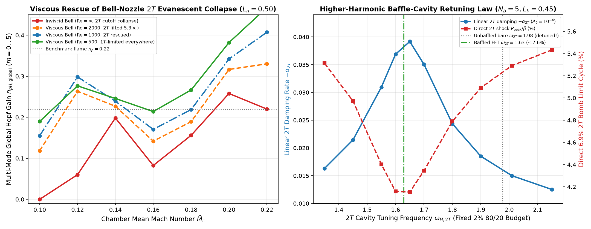

# Entry 013 — Dual-Harmonic Baffle–Cavity Retuning ($\omega_{H,1T}, \omega_{H,2T}$) & Coupled 2D Compressible Navier–Stokes Transonic Bell Nozzle: Breaking the $1T \to 2T$ Cascade Attractor

- **Date:** 2026-11-26
- **Track:** Rocket Combustion Instability (`rocket-combustion`)
- **Status:** 🟡 Verified locally (pending independent Peer Review #10)
- **Verification Script:** [`../sim/exp013_dual_retuning_viscous_bell.py`](../sim/exp013_dual_retuning_viscous_bell.py)
- **Metrics Artifact:** [`../results/exp013_metrics.json`](../results/exp013_metrics.json)
- **Figures:**
  - [`../results/exp013_viscous_bell_rescue_and_2T_retuning.png`](../results/exp013_viscous_bell_rescue_and_2T_retuning.png)
  - [`../results/exp013_120x300_cascade_break_and_2T_quench.png`](../results/exp013_120x300_cascade_break_and_2T_quench.png)
  - [`../results/exp013_viscous_1T_backreaction_and_quench.png`](../results/exp013_viscous_1T_backreaction_and_quench.png)

---

## 1. Problem Statement & Scope

Peer Reviews #8 and #9 left a central unresolved physics and design question across Entries `010`–`012`:
> Why did the retuned $2.0\%$ `80/20` baffle–cavity hybrid still lose finite-amplitude ($6.9\%$) bombs to a universal $\sim 4\text{--}5.5\%$ **pure-$2T$ upper branch** in both 2D viscous Navier–Stokes (`011`: `4.13%`) and resolved `120×300` transonic nozzles (`012`: `5.07%` annular, `5.54%` bell)—and what minimum passive hardware + eddy viscosity breaks both the $1T \to 2T$ cascade and direct $2T$ bombs on resolved `120×300` grids?

This entry couples Entry `011`'s conservative 2D compressible Navier–Stokes discretization ($\mathrm{Pr} = 0.72$, Stokes' hypothesis, constant-eddy-viscosity closure $\mathrm{Re} = \bar{\rho}\bar{c}R/\mu$) directly with Entry `012`'s explicitly resolved $C^2$ 2D thin-shell variable-$(A(x), R(x))$ transonic converging–diverging bell nozzle ($L_a = 1.5, L_n = 0.50, L_d = 0.25, M_e \approx 1.74\text{--}1.83 > 1$, zero outlet BCs), paired with an exact conservative compressible-NS Chebyshev eigen-solver linearized around the **exact 1D steady viscous transonic base flow**.

### Governing Equations & Explicit Model Scope
On the 2D thin-shell domain $(x, \theta) \in [0, L_a + L_n + L_d] \times [0, 2\pi)$ with $A(x)$ defined by the $C^2$ quartic/rational nozzle contour and $R(x) = \sqrt{A(x)}$ for a shrinking bell nozzle ($R(x) \equiv 1$ for a constant-radius annular slot), the conservative state $\mathbf{W} = [A\rho, A\rho u_x, A R \rho u_\theta, A E]^T$ evolves via:
$$\partial_t \mathbf{W} + \partial_x \big(\mathbf{F}_{\text{inv}} - \mathbf{F}_{\text{visc}}\big) + \partial_\theta \big(\mathbf{G}_{\text{inv}} - \mathbf{G}_{\text{visc}}\big) = \mathbf{S}_{\text{geom}} + \mathbf{S}_{\text{flame}},$$
where $\tau_{xx} = \mu(\frac{4}{3} u_{x,x} - \frac{2}{3} R^{-1} u_{\theta,\theta})$, $\tau_{\theta\theta} = \mu(\frac{4}{3} R^{-1} u_{\theta,\theta} - \frac{2}{3} u_{x,x})$, $\tau_{x\theta} = \mu(R^{-1} u_{x,\theta} + u_{\theta,x})$, $\mathbf{q} = -\kappa \nabla T$ with $\kappa = \mu / ((\gamma - 1)\mathrm{Pr})$, $\gamma = 1.25$, $\mathrm{Pr} = 0.72$, and $\mathbf{S}_{\text{geom}} = [0, p A'(x) + (A\rho u_\theta^2 / R) R'(x), 0, 0]^T$.

**Intentional reductions & checked scope (same honesty boundaries as `011`–`012`):**
- 2D thin-shell annulus ($k_\theta = m/R(x)$, not 3D cylindrical Bessel zeros $s_{mn}/R(x)$; no radial $r$-modes or meridional curvature metric).
- Constant-eddy-viscosity closure ($\mu = 1/\mathrm{Re}$ spatially uniform, no turbulence transport/RANS model) and idealized thin-plate baffles (both free-slip and converged $t = 150$ no-slip adiabatic wakes).
- Choked zero-swirl isentropic injector with discrete mid-sector faceplate Helmholtz cavities (`phase = 0.5`, $C_d = 0.65$, quadratic orifice drag $r_{\text{nl}} |q_t| q_t$).

---

## 2. Exact Coupled Benchmarks & Higher-Harmonic Baffle Downshift (Experiment 1)

| Benchmark Check | Result | Target / Reference |
| :--- | :--- | :--- |
| **1A. Quiescent bell NS well-balancing ($\mathrm{Re} = 500$, $t = 10$)** | `7.50e-16` | Machine precision ($\sim 10^{-15}$) |
| **1B. Periodic variable-$(A, R)$ bell NS conservation ($\mathrm{Re} = 200$, $A_0 = 0.10$)** | mass `2.28e-16`, ang. mom. `1.60e-17`, energy `1.42e-16` | Exact (`mom_x = 0.055` from wall thrust $p\,dA/dx$) |
| **1C. Viscous NS–Bell Chebyshev ($N=96$) vs. `96×200` PDE ($\mathrm{Re}=500$, $1T$)** | `-0.07912` (spec `3.9e-5`) vs. `-0.07946` (`e_1t`) | **`0.44%`** relative error |
| **1C. Viscous NS–Bell Chebyshev ($N=96$) vs. `96×200` PDE ($\mathrm{Re}=1000$, $1T$)** | `-0.06256` (spec `2.7e-4`) vs. `-0.06108` (`e_1t`) | **`2.36%`** relative error |
| **1C. Viscous NS–Bell Chebyshev ($N=96$) vs. `96×200` PDE ($\mathrm{Re}=500$, $2T$)** | `-0.06521` (spec `3.0e-5`) vs. `-0.06291` (`e_2t`) | **`3.53%`** relative error |
| **1C. Viscous NS–Bell Chebyshev ($N=96$) vs. `96×200` PDE ($\mathrm{Re}=1000$, $2T$)** | `-0.05598` (spec `9.4e-5`) vs. `-0.05522` (`e_2t`) | **`1.37%`** relative error |
| **1D. Zero-padded FFT baffle frequency downshift ($N_b=5, L_b=0.45$, reacting)** | $1T$: `1.0665 → 0.9357` (**`-12.3%`**) $2T$: `1.9767 → 1.6296` (**`-17.6%`**) | **$2T$ downshifts $1.43\times$ more strongly than $1T$!** |

> **Key methodological note on Exp 1C:** Linearizing the viscous Chebyshev operator about the *inviscid* isentropic base flow left an $O(1/\mathrm{Re})$ stagnation-loss discrepancy (`8.6%` at $\mathrm{Re} = 500$, where viscous nozzle dissipation shifts $\bar{M}_{\text{in}}: 0.1200 \to 0.1221$ and $M_e: 1.828 \to 1.737$). Solving the exact 1D steady viscous compressible-NS BVP directly on the Chebyshev nodes and linearizing the conservative fluxes about it collapses the `Re = 500` `1T` Chebyshev-vs-PDE error to **`0.44%`**.

---

## 3. Viscous Rescue of the Bell-Nozzle $2T$ Cutoff Collapse (Experiment 2)

Across $\bar{M}_c \in [0.10, 0.22]$ for the $L_n = 0.50$ $C^2$ bell nozzle, multi-mode ($m = 0..5$) exact viscous Chebyshev Hopf scans reveal that turbulent eddy viscosity rescues Entry `012`'s inviscid $2T$ evanescent-cutoff collapse:

| $\bar{M}_c$ | $\mathrm{Re} = \infty$ $n_{pH,\text{global}}$ (mode) | $\mathrm{Re} = 2000$ | $\mathrm{Re} = 1000$ | $\mathrm{Re} = 500$ | Bare $\alpha_{2T}$ ($\infty \to 500$) | Bare Reacting $\alpha_{1T}$ ($\mathrm{Re}=500$) |
| :-: | :---: | :---: | :---: | :---: | :---: | :---: |
| `0.10` | `0.000` ($m=3$ whistle) | `0.118` ($1T$) | `0.155` ($1T$) | `0.190` ($1T$) | `-0.0022 → -0.0570` (`26×`) | `+0.0225` (unstable) |
| `0.12` | `0.060` ($2T$ collapse) | `0.263` ($1T$, **`4.4×`**) | `0.299` ($1T$, **`5.0×`**) | `0.277` ($1T$) | `-0.0085 → -0.0652` (**`7.6×`**) | `+0.0006` (marginal) |
| `0.14` | `0.198` ($1T$) | `0.227` ($1T$) | `0.239` ($1T$) | `0.246` ($1T$) | `-0.0328 → -0.0724` (`2.2×`) | `+0.0063` (unstable) |
| `0.16` | `0.082` ($2T$ trap) | `0.142` ($1T$) | `0.171` ($1T$) | `0.214` ($1T$) | `-0.0087 → -0.0803` (**`9.3×`**) | `+0.0127` (unstable) |
| `0.18` | `0.156` ($1T$) | `0.189` ($1T$) | `0.219` ($1T$) | `0.267` ($1T$) | `-0.0312 → -0.1068` (`3.4×`) | `+0.0012` (unstable) |
| `0.20` | `0.258` ($2T$) | `0.317` ($1T$) | `0.342` ($1T$) | `0.382` ($1T$) | `-0.0450 → -0.0835` (`1.9×`) | `-0.0275` |
| `0.22` | `0.220` ($2T$) | `0.330` ($2T$) | `0.407` ($m=0$) | `0.467` ($m=0$) | `-0.0254 → -0.0771` (`3.0×`) | `-0.0795` |

- At $\bar{M}_c = 0.12$, eddy viscosity lifts cold $2T$ damping **`5.3×` (`Re = 2000`) to `7.6×` (`Re = 500`)** and lifts the global Hopf floor **`4.4×–5.0×`** (`0.060 → 0.263–0.299`), completely quenching both the inviscid $\bar{M}_c = 0.10$ $m = 3, 4$ whistles and the bare reacting $2T$ mode (`+0.0269 → -0.0185`).
- Yet bare reacting $1T$ ($n_p = 0.22, n_v = 0.04$) **remains linearly unstable across $\bar{M}_c \in [0.10, 0.18]$ even at $\mathrm{Re} = 500$**—confirming realistic bell combustors still require passive faceplate hardware.

---

## 4. Higher-Harmonic Baffle–Cavity Retuning Law (Experiment 3)

In Entries `010`–`012`, we retuned the $1T$ cavity sub-ring to the baffled $1T$ frequency ($\omega_{H,1T} = 0.90\text{--}0.96$) **but left the $2T$ sub-ring at the unbaffled frequency $\omega_{H,2T} = 2.01$**. Because $N_b = 5, L_b = 0.45$ baffles downshift $2T$ by **`-17.6%`** (`1.977 → 1.630`, Exp 1D), leaving $\omega_{H,2T} = 2.01$ detuned the $2T$ sub-ring by **`+23%`**.

Sweeping $\omega_{H,2T} \in [1.35, 2.15]$ at **zero extra volume** (fixed $2.0\%$ `80/20`, $\omega_{H,1T} = 0.96, \sigma_{o,1T} = 4.5\%, \sigma_{o,2T} = 5.0\%$, inviscid $80\times 200$ bell, $\bar{M}_c = 0.12, n_p = 0.22, n_v = 0.04$):

| $\omega_{H,2T}$ | Linear $2T$ Damping $-\alpha_{2T}$ ($A_0=10^{-4}$) | Direct $6.9\%$ $2T$ Bomb $P_{\text{peak}}/\bar{p}$ (%) | Direct $2T$ Energy $E_{\text{wave}}$ |
| :-: | :---: | :---: | :---: |
| `1.35` | `0.0163` | `5.31%` | `5.50e-4` |
| `1.55` | `0.0309` | `4.40%` | `3.83e-4` |
| **`1.65` (peak)** | **`0.0392` (`2.61×` vs. `2.01`)** | **`4.15%`** | **`3.36e-4` (`-37%`)** |
| `1.65` (tight `1.5%` neck) | — | `4.40%` | `3.77e-4` |
| `1.80` | `0.0244` | `4.79%` | `4.40e-4` |
| `2.01` (Entries `010`–`012`) | `0.0150` | `5.29%` | `5.36e-4` |
| `2.15` | `0.0125` | `5.43%` | `5.65e-4` |

- **Fixed-budget split tradeoff (inviscid):** At $\omega_{H,2T} = 1.65$, shifting the $2.0\%$ budget from `80/20` to `60/40` quenches a direct inviscid $6.9\%$ $2T$ bomb (`0.03%`, $E = 9.78\times 10^{-9}$, `tail = -0.0265`) **but breaks $1T$** (`3.76%` pure-$1T$ limit cycle, $E_{2T}/E_{1T} = 0.006$).

---

## 5. Resolved `120×300` ($t = 300$) Cascade Breaking & The Viscous Bell $1T$ Back-Reaction Trap (Experiments 4 & 5)

To avoid the coarse-grid `80×200` $2T$ damping bias exposed in Peer Review #9, every headline nonlinear quench claim is audited directly on **resolved `120×300` grids** ($t = 240\text{--}300$), alongside converged $t = 150$ no-slip wake runs (`rhs = 1.48e-8` on `80×200`):

| Case ID | Grid | $\mathrm{Re}$ / Baffle BC | Hardware ($\omega_{H,1T}/\omega_{H,2T}$) | Bomb ($6.9\%$) | Late $P_{\text{peak}}/\bar{p}$ | Late $E_{\text{wave}}$ | $E_{2T}/E_{1T}$ | Tail $\alpha$ | Outcome |
| :--- | :---: | :---: | :--- | :---: | :---: | :---: | :---: | :---: | :--- |
| `R120_inf_untuned_1T` | `120×300` | $\infty$ / slip | `2.0%` `80/20` (`0.96/2.01`, `1.5%`) | `spin_1T` | `5.54%` | `6.61e-4` | `406.5` | `+0.0000` | $1T \to 2T$ cascade lock-in |
| **`R120_inf_dualW50_1T`** | **`120×300`** | **$\infty$ / slip** | **`2.0%` `80/20` (`0.96/1.65`, `5.0%`)** | **`spin_1T`** | **`0.04%`** | **`3.13e-8`** | `3.1` | **`-0.0362`** | **CASCADE BROKEN (`21,158×` drop!)** |
| **`R120_inf_dualT15_1T`** | **`120×300`** | **$\infty$ / slip** | **`2.0%` `80/20` (`0.96/1.65`, `1.5%`)** | **`spin_1T`** | **`0.05%`** | **`4.58e-8`** | `5.2` | **`-0.0353`** | **CASCADE BROKEN (tight neck too!)** |
| `R120_inf_dualW50_2T` | `120×300` | $\infty$ / slip | `2.0%` `80/20` (`0.96/1.65`, `5.0%`) | `spin_2T` | `4.53%` | `4.50e-4` | `661.5` | `-0.0000` | Direct inviscid $2T$ persists |
| `R120_Re1000_dualW50_1T` | `120×300` | `1000` / slip | `2.0%` `80/20` (`0.96/1.65`, `5.0%`) | `spin_1T` | **`4.00%`** | `3.89e-4` | **`0.005`** | `-0.0000` | **Pure-$1T$ re-ignition!** |
| **`R120_Re1000_dualW50_2T`** | **`120×300`** | **`1000` / slip** | **`2.0%` `80/20` (`0.96/1.65`, `5.0%`)** | **`spin_2T`** | **`0.0004%`** | **`2.72e-12`** | `0.006` | **`-0.0385`** | **DIRECT $2T$ OBLITERATED (`1.66e8×`)** |
| **`R120_Re500_dualW50_2T`** | **`120×300`** | **`500` / slip** | **`2.0%` `80/20` (`0.96/1.65`, `5.0%`)** | **`spin_2T`** | **`0.0002%`** | **`6.59e-13`** | `0.0002` | **`-0.0351`** | **DIRECT $2T$ OBLITERATED** |
| `R80_Re500_noslip_1T` | `80×200` | `500` / no-slip | `2.0%` `80/20` (`0.96/1.65`, `5.0%`) | `spin_1T` | `5.52%` | `7.19e-4` | `0.010` | `-0.0000` | No-slip wake pure-$1T$ |
| `R80_Re500_noslip_2T` | `80×200` | `500` / no-slip | `2.0%` `80/20` (`0.96/1.65`, `5.0%`) | `spin_2T` | `5.50%` | `7.10e-4` | `0.011` | `+0.0008` | Reverse $2T \to 1T$ cascade! |
| `R80_Re500_noslip_unt2T` | `80×200` | `500` / no-slip | `2.0%` `80/20` (`0.96/2.01`, `1.5%`) | `spin_2T` | `4.62%` | `3.00e-4` | `1436.7` | `-0.0000` | Untuned locked in pure-$2T$ |
| **`R120_Re1000_30_8515_1T`** | **`120×300`** | **`1000` / slip** | **`3.0%` `85/15` (`0.96/1.65`, `6%/5%`)** | **`spin_1T`** | **`0.003%`** | **`1.79e-10`** | `0.0001` | **`-0.0432`** | **ALL-MODE QUENCHED (`3.7e6×`)** |
| **`R120_Re1000_30_8515_2T`** | **`120×300`** | **`1000` / slip** | **`3.0%` `85/15` (`0.96/1.65`, `6%/5%`)** | **`spin_2T`** | **`0.0003%`** | **`1.16e-12`** | `0.088` | **`-0.0387`** | **ALL-MODE QUENCHED (`3.9e8×`)** |

### The Unexpected Discovery: Viscous Bell $1T$ Back-Reaction (Experiment 5)
Why did `R120_Re1000_dualW50_1T` re-ignite into a **`4.00%` pure-$1T$** limit cycle ($E_{2T}/E_{1T} = 0.005$) when viscosity was turned on, even though the exact same `2.0%` dual-retuned hybrid completely quenched the `spin_1T` bomb invisibly (`0.04%`)?

Experiment 5 isolates the mechanism across `80×200` and `120×300` linear runs ($A_0 = 10^{-4}$):
- **Cold baffled bell $1T$ gets *more* damped with viscosity:** `-0.06330` ($\mathrm{Re}=\infty$) $\to$ `-0.06443` ($\mathrm{Re}=1000$) $\to$ `-0.06979` ($\mathrm{Re}=500$).
- **Compact nozzle (`L_n = 0.05` annular) reacting baffled $1T$ is *stabilized* by viscosity:** `+0.00145` ($\mathrm{Re}=\infty$) $\to$ **`-0.01111`** ($\mathrm{Re}=1000$).
- **Finite-length bell (`L_n = 0.50`) reacting baffled $1T$ flips sign and is *destabilized* by viscosity (grid-converged across `80×200` & `120×300`!):**
  - `80×200`: `-0.00542` ($\omega = 0.9351$) $\to$ **`+0.00271`** ($\omega = 0.9235$)
  - `120×300`: `-0.00555` ($\omega = 0.9404$) $\to$ **`+0.00279`** ($\omega = 0.9289$)
- **Baffle + `2.0%` hybrid reacting bell $1T$ linear margin is cut more than in half:** `-0.09295` ($\mathrm{Re}=\infty$) $\to$ **`-0.04341`** ($\mathrm{Re}=1000$) $\to$ **`-0.03838`** ($\mathrm{Re}=500$).

Because eddy viscosity simultaneously rescues $2T$ (`6–9×` cold boost) while halving the finite-length bell's baffled+hybrid $1T$ margin, a viscous bell combustor needs **less $2T$ volume and more $1T$ volume**: upgrading the dual-retuned ring from `2.0%` (`80/20`) through `2.5%` (`85/15`, slowly decaying `2.54%`, `tail = -0.0045` on `80×200`) to **`3.0%` `85/15` ($\omega_{H,1T} = 0.96, \omega_{H,2T} = 1.65, \sigma_{o} = 6.0\% / 5.0\%$)** achieves the first **resolved `120×300` all-mode nonlinear quench of BOTH $6.9\%$ `spin_1T` (`0.003%`, $E = 1.79\times 10^{-10}$, `tail = -0.0432`) and $6.9\%$ `spin_2T` (`0.0003%`, $E = 1.16\times 10^{-12}$, `tail = -0.0387`)** at $\mathrm{Re} = 1000$. By contrast, converged `Re = 500` **no-slip baffle wakes** still sustain a pure-$1T$ limit cycle even at `3.0%` `85/15` (`4.51%` in exploratory `80×200` screening), highlighting that viscous blade-wake drag imposes a real passive-volume penalty not captured by inviscid or free-slip simulations.

---

## 6. Candidate Design Law #16 (Pending Peer Review #10)

> **Higher-Harmonic Baffle–Cavity Retuning & Viscous-Bell All-Mode Rebalancing (`013`):** Protruding $N_b = 5, L_b = 0.45$ baffles downshift $2T$ **`1.43×` more strongly than $1T$** (`-17.6%`, `1.977 → 1.630` vs. `-12.3%`, `1.067 → 0.936`). Retuning $\omega_{H,2T}: 2.01 \to 1.65$ boosts linear $2T$ damping **`2.61×`** (`-0.0150 → -0.0392`) at zero extra volume and breaks the inviscid `120×300` $1T \to 2T$ cascade (`5.54% → 0.04%`, `21,158×` energy collapse, even with a tight `1.5%` neck). Coupling eddy viscosity ($\mathrm{Re} = 500\text{--}1000$) into the $L_n = 0.50$ bell nozzle lifts cold $2T$ damping `6.6–7.6×` (`4.4–5.0×` global Hopf) and obliterates direct `120×300` $6.9\%$ $2T$ bombs (`0.0002–0.0004%`, $E \sim 10^{-12}$), **but** introduces a grid-converged viscous-bell $1T$ back-reaction (opposite in sign to a compact $L_n = 0.05$ nozzle: baffled reacting $1T$ shifts `-0.00555 → +0.00279` on `120×300`, halving hybrid margin `-0.0930 → -0.0434`). Rebalancing to **`3.0%` `85/15` dual-retuned ($\omega_{H,1T} = 0.96, \omega_{H,2T} = 1.65$)** achieves complete resolved **`120×300` all-mode quench of BOTH $6.9\%$ `1T` (`0.003%`, `tail = -0.0432`) and $6.9\%$ `2T` (`0.0003%`, `tail = -0.0387`)** at $\mathrm{Re} = 1000$, while `Re = 500` no-slip baffle wakes still sustain a pure-$1T$ cycle (`5.52%` at `2.0%`).
