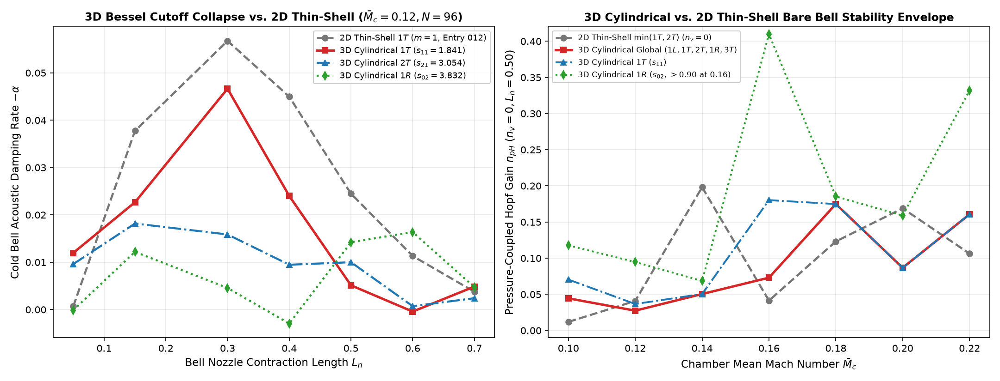
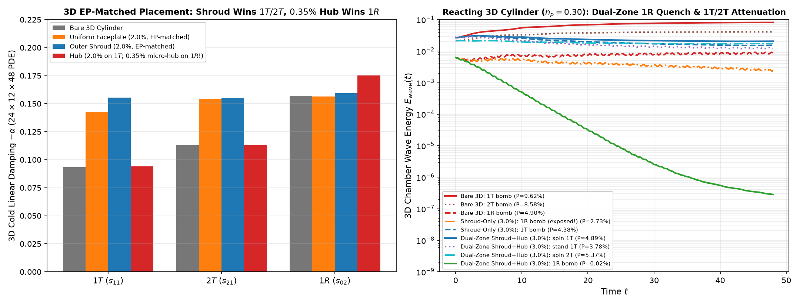

# 014 — Full 3D Cylindrical $(x, r, \theta)$ Chamber & Transonic Bell Nozzle: Bessel Cutoff Collapse, Chiral $1T \to 1R$ Selection & Shroud-vs.-Hub Cavities

- **Date:** 2026-11-26
- **Status:** `verified`
- **Verification Tier:** `🟡 Verified (Pending Audit)`
- **Verification Script:** [`../sim/exp014_3d_cylindrical_bell_bessel.py`](../sim/exp014_3d_cylindrical_bell_bessel.py)
- **Metrics JSON:** [`../results/exp014_metrics.json`](../results/exp014_metrics.json)
- **Peer Review Receipt:** *(pending independent cross-model Peer Review #11)*

---

## 1. Target

Upgrade the rocket-combustion track (`004`–`013`) from the 2D thin-shell annulus ($k_\theta = m/R(x)$) to a **true 3D cylindrical $(x, r, \theta)$ conservative finite-volume compressible Euler chamber & body-fitted conical-frustum transonic bell nozzle**, and test three fundamentally 3D phenomena that 2D thin-shell models cannot capture:

1. **3D Bessel Bell-Nozzle Cutoff Collapse & True 3D Curved Sonic Line:** How replacing integer thin-shell wavenumbers ($m = 1, 2$) with exact 3D cylindrical Bessel zeros ($s_{11} = 1.8412$ for $1T$, $s_{21} = 3.0542$ for $2T$, $s_{02} = 3.8317$ for $1R$, $s_{31} = 4.2012$ for $3T$) alters bell evanescent cutoff collapse, bare $n_v = 0$ stability envelopes, and true 3D axisymmetric throat bowing.
2. **3D Chiral $1T \to 1R$ vs. $1T \to 2T$ Nonlinear Cascade Selection Rule:** Because $s_{21}/s_{11} = 1.6588$ is strongly detuned from $2.0$ whereas $s_{02}/s_{11} = 2.0811$ lies within $3.9\%$ of $2\omega_{1T}$, test whether $SO(2)$ rotational invariance forbids spinning $1T$ from pumping oscillating $1R$ while standing $1T$ drives near-resonant AC $1R$ pumping with quartic $A_0^4$ scaling.
3. **3D Shroud ($r = 1$) vs. Hub ($r = 0$) Faceplate Cavity Placement & 3D EP Scaling Law:** Quantify how exact Bessel modal energy weights $W_{mn}(r)$ separate outer-shroud ($1T/2T$) and centerline-hub ($1R$) damping, derive the 3D exceptional-point damping law $\xi_H^{\text{EP,3D}} \propto \sqrt{\beta W_{mn}(r)}$, and test a `3.0%` Dual-Zone (Shroud $1T/2T$ + Micro-Hub $1R$) architecture in reacting 3D cylindrical throughflow.

---

## 2. The Math, Assumptions & Checked Scope

### 2.1 Governing Equations & Exact 3D Conical-Frustum Finite-Volume Discretization

We solve the 3D inviscid compressible Euler equations ($\gamma = 1.25$, $\bar{p} = 1/\gamma = 0.80$, $\bar{\rho} = 1$, $\bar{c} = 1$) in body-fitted cylindrical coordinates $(x, \eta, \theta)$ where $r(x, \eta) = \eta R(x)$, $\eta \in [0, 1]$, $\theta \in [0, 2\pi)$, and $x \in [0, L_{\text{tot}}]$ ($L_a = 1.5$ chamber + optional converging–diverging bell nozzle $L_n + L_d$):

$$\frac{\partial}{\partial t}\!\left(V_{ijk}\,\mathbf{U}_{ijk}\right) + \Delta_x \mathbf{F}_x + \Delta_\eta \mathbf{F}_\eta + \Delta_\theta \mathbf{G}_\theta = \mathbf{S}_{\text{hoop},ijk} + \mathbf{S}_{q,ijk},$$

with conserved vector $\mathbf{U} = (\rho,\, \rho u_x,\, \rho u_r,\, r\rho u_\theta,\, E)^T$ (conserving axial angular momentum $L_x = r\rho u_\theta$ directly via face radii $r_{xf}, r_{ef}, r_{\theta f}$ and centroid $r_{\text{bar}}$) and radial pressure–centrifugal hoop source $S_{\text{hoop},r} = (p + \rho u_\theta^2)\,\Delta S_{\eta,r}$.

- **Exact 3D Geometric Conservation Law (GCL):** Cell volumes $V = \frac{1}{2}\Delta(\eta^2)\Delta\theta\int R^2\,dx$, axial face areas $S_x = \frac{1}{2}R_f^2\Delta(\eta^2)\Delta\theta$, and conical-frustum lateral face projections $S_{\eta r} = \eta_f\Delta\theta\int R\,dx$, $S_{\eta x} = \frac{1}{2}(R_{i+1/2}^2 - R_{i-1/2}^2)\eta_f^2\Delta\theta$ satisfy $(S_{x,i+1/2} - S_{x,i-1/2}) - (S_{\eta x,j+1/2} - S_{\eta x,j-1/2}) = 0$ to machine precision (`2.60e-18`) and exact quiescent well-balancing (`4.74e-18`).
- **Singularity-Free Centerline & Exact Curved Outer Wall:** At $r = 0$, the degenerate face area is identically zero ($S_{\eta,0} \equiv 0$) while radial MUSCL (`van_leer`) slopes use antipodal $\theta + \pi$ ghosts with $(u_r, u_\theta) \to (-u_r, -u_\theta)$. At the slanted outer bell wall $\eta = 1$, normal velocity is mirrored directly on the reconstructed face state ($v_{n,R} = -v_{n,L}$) inside `hllc_3d`, guaranteeing zero wall mass, angular-momentum, and energy leakage (`1.14e-16`, `1.02e-18`, `1.42e-16`).
- **Time Integration & Boundary Conditions:** 2nd-order SSP-RK2 (`CFL = 0.32`) with HLLC Riemann fluxes; choked zero-swirl acoustic inlet ($\dot{m}_{\text{in}} + \rho u_{\text{port}} = \bar{M}_c$, $u_r = u_\theta = 0$); compact Marble–Candel exit ($u_x = \bar{M}_c c$) for straight-cylinder studies (`mode="straight"`), or zero-gradient supersonic exit ($M_e \approx 1.66\text{--}1.83$) for transonic 3D bells (`mode="bell_smooth"`).

### 2.2 Exact 3D Cylindrical Bessel Constants & Modal Weights

Hard-wall cylindrical eigenmodes $\psi_{mn}(r,\theta) \propto J_m(s_{mn} r)e^{im\theta}$ satisfy $J'_m(s_{mn}) = 0$:

| Mode | $(m, n)$ | Exact Zero $s_{mn}$ | Ratio $s_{mn}/s_{11}$ | Shroud Weight $W_{mn}(1)$ | Hub Weight $W_{mn}(0)$ |
| :--- | :---: | :---: | :---: | :---: | :---: |
| **$1T$** | $(1,1)$ | **`1.841184`** | `1.0000` | **`1.4184`** | `0.0000` |
| **$2T$** | $(2,1)$ | **`3.054237`** | **`1.6588`** *(detuned from `2.0`!)* | **`1.7507`** | `0.0000` |
| **$1R$** | $(0,2)$ | **`3.831706`** | **`2.0811`** *(within `3.9%` of `2.0`!)* | `1.0000` | **`6.1647`** (`6.16×` shroud!) |
| **$3T$** | $(3,1)$ | **`4.201189`** | `2.2818` | **`2.0405`** | `0.0000` |
| **$1T1R$** | $(1,2)$ | `5.331443` | `2.8957` | — | `0.0000` |

where $W_{mn}(r) = |J_m(s_{mn} r)|^2 / [(1 - m^2/s_{mn}^2) J_m(s_{mn})^2]$ is the normalized faceplate modal pressure-energy density ($\frac{1}{\pi}\int_0^{2\pi}\!\!\int_0^1 W_{mn}(r)\,r\,dr\,d\theta = 1$).

### 2.3 Flame, Faceplate Cavity Ports & Explicit Scope Limits

- **Reacting Flame Closure:** Bounded subcritical Crocco–Erlang-4 pressure-coupled flame (`n_v = 0`, `X_F = 0.25`, `SIG_F = 0.08`, `OMEGA_HP = 0.15`, `Q_S = 0.045`, `KAPPA_NL = 4.5`) applied independently along each $(r, \theta)$ ray with `TAU_BAR = 0.16` (scaled down from 2D thin-shell's `0.40` so that the `1.84–3.83×` higher 3D Bessel modes $1T, 2T, 1R$ all sit inside the active Rayleigh amplification band).
- **3D Faceplate Cavities:** Discrete area-weighted adjoint ports $W_k(r, \theta)$ on the faceplate $x = 0$ ($\int W_k\,dA = 1$) coupled to Helmholtz oscillators ($\beta_k = V_k/(\pi L_a)$, $\omega_H$, $\xi_H$, quadratic orifice drag $r_{\text{nl}} = 1/(2 C_d^2 A_{o,k}^2)$ with $C_d = 0.65$) via the choked-inlet boundary condition.
- **Explicit Scope Limits:**
  1. The 3D PDE solver is **inviscid compressible Euler** (no physical viscosity $\mu$ or thermal conductivity $\kappa$); as quantified directly in Exp 1E, finite grid resolution (`24×12×48` / `20×12×48`) introduces measurable mode-dependent numerical dissipation (`-0.00953` on $1T$, `-0.03270` on $2T$, `-0.07026` on $1R$) and attenuates ultra-short 3D inlet vorticity waves ($\lambda_{\text{vort}} = 2\pi\bar{M}_c / s_{mn} = 0.20\text{--}0.41$ at $\bar{M}_c = 0.12$).
  2. Quasi-3D Chebyshev sweeps (`Exp 2A`) use the local WKB wavenumber $k_\perp(x) = s_{mn}/R(x)$ on 1D isentropic base flows (neglecting 3D meridional throat bowing, which `Exp 2B` audits directly in the true 3D conical-frustum bell PDE).
  3. Reacting 3D cavity shootouts (`Exp 4C`) run in a straight cylinder with compact Marble–Candel exit at $t_{\text{end}} = 48.0$ (`20×12×48`, `n_p = 0.30`); full 3D viscous NS + curved bell + baffles remains for Entry `015+`.

---

## 3. The Verification

Reproduce all experiments, metrics, and figures with:

```bash
uv run python rocket-combustion/sim/exp014_3d_cylindrical_bell_bessel.py
```

### 3.1 Experiment 1: 3D Body-Fitted Bell Benchmarks, Bessel FFTs & Vorticity-Wavelength Audit

1. **Exact 3D GCL & Quiescent Preservation (`24×12×32`, smooth $C^2$ curved bell $L_n = 0.60, L_d = 0.45$, $t = 4.0$):**
   - `gcl_x = 2.60e-18`, `gcl_r = 0.0`, quiescent state drift = **`4.74e-18`**.
2. **Exact 3D Curved Bell Conservation (`20×10×32`, periodic wavy bell $R(x) = \sqrt{1 - 0.35\sin^2(\pi x/L)}$, $A_0 = 0.06$, $t = 2.5$):**
   - Relative drift: `mass = 1.14e-16`, `ang_mom = 1.02e-18`, `energy = 1.42e-16` (`mom_x = 3.44e-2` non-conserved as expected from curved outer-wall axial pressure force).
3. **Closed-Cylinder 3D Bessel Eigenfrequencies (`nx = 6`, $t = 14.0$, FFT vs. exact $s_{mn}$):**
   - `12×36 → 16×48`: **$1T$** `1.8368 → 1.8369` vs. `1.8412` (`0.23%`); **$2T$** `3.0768 → 3.0613` vs. `3.0542` (`0.74% → 0.23%`); **$1R$** `3.8460 → 3.8463` vs. `3.8317` (`0.38%`); **$3T$** (`16×48`) `4.2387` vs. `4.2012` (`0.89%`).
4. **Per-Mode Closed-Cylinder Numerical-Damping Audit (`M_c = 0`, $t \in [4, 14]$) & 3D Vorticity-Wavelength Attenuation (`Exp 1D–1E`):**

| Mode | Closed Num. Damping (`12×48` → `20×64`) | Exact Inviscid Cheb (`M_c=0.12`, $N=96$) | Vorticity-Damped Cheb (`Re_vort=1000`) | 3D Straight PDE (`24×12×48`) |
| :--- | :---: | :---: | :---: | :---: |
| **$1T$ ($s_{11}$)** | `-0.00953` → `-0.00347` (`2.75×`) | `-0.04239` ($\omega = 1.890$) | **`-0.09121`** ($\omega = 1.836$) | **`-0.09333`** (`2.3%` vs. plateau!) |
| **$2T$ ($s_{21}$)** | `-0.03270` → `-0.01221` (`2.68×`) | `-0.03869` ($\omega = 3.003$) | `-0.09120` | `-0.11275` (`-0.080` net of num.) |
| **$1R$ ($s_{02}$)** | `-0.07026` → `-0.02286` (`3.07×`) | `-0.03589` ($\omega = 3.865$) | `-0.09509` | `-0.15720` (`-0.087` net of num.) |

- **Physical & numerical explanation:** Because 3D Bessel frequencies are `1.84–3.83×` higher than 2D thin-shell ($m = 1$), inlet vorticity wavelengths at $\bar{M}_c = 0.12$ are ultra-short ($\lambda_{\text{vort}} = 2\pi\bar{M}_c/s_{mn} = 0.410, 0.247, 0.197$) and viscous/numerical vorticity decay lengths $L_{\text{vort}} \propto \mathrm{Re}\,\bar{M}_c^3/s_{mn}^2$ are `3.4–14.7×` shorter than in 2D thin-shell. On `24×12×48`, numerical dissipation attenuates the short vorticity wave before it reaches the nozzle, locking the 3D straight-cylinder PDE onto the **vorticity-damped acoustic plateau** (`1T`: `-0.09333` vs. `Re_vort = 1000` `-0.09121`, `2.3%` match). Raising Mach to $\bar{M}_c = 0.28$ ($\lambda_{\text{vort}} = 0.96$, well-resolved on `40×14×48`) recovers exact inviscid Chebyshev (`-0.08717`): raw PDE `-0.09982` (`14.5%`), or `-0.09029` (`3.6%`) after subtracting closed-cylinder numerical damping (`-0.00953`).

### 3.2 Experiment 2: 3D Bessel Bell-Nozzle Cutoff Collapse & True 3D Curved Sonic Line



1. **Inviscid Quasi-3D Bessel Cutoff Collapse on Entry `012`'s $C^2$ Bell ($\bar{M}_c = 0.12, N = 96$):**
   - At $L_n = 0.50$, bare 3D $1T$ cold bell damping collapses **`4.77×` harder** than 2D thin-shell (`-0.02448 → -0.00513`), turning weakly positive (`+0.00042`) at $L_n = 0.60$.
   - Higher 3D modes collapse even sooner: $2T$ drops to `-0.00072` at $L_n = 0.60$, and $1R$ collapses to `-0.00457` by $L_n = 0.30$ (turning weakly positive `+0.00295` at $L_n = 0.40$).
2. **Bare Multi-Mode $n_v = 0$ Stability Envelope ($L_n = 0.50, N = 96$, 3D `{1L, 1T, 2T, 1R, 3T}` vs. 2D thin-shell `min(1T, 2T)`):**
   - $\bar{M}_c = 0.12$: 3D global Hopf drops to **`0.0274`** (`3T`-limited; $1T$: `0.0366`, $2T$: `0.0776`, $1R$: `0.0946`) vs. 2D thin-shell `0.0408` ($1T$: `0.1203`).
   - $\bar{M}_c = 0.14$: 3D global Hopf is **`0.0504`** ($1T$-limited) — **`3.93×` lower** than 2D thin-shell's `0.1982`!
   - $\bar{M}_c = 0.16, 0.18, 0.20, 0.22$: 3D global Hopf = `0.0730 (2T)`, `0.1749 (1T)`, `0.0867 (1T)`, `0.1607 (1T)` (vs. 2D thin-shell `0.0413, 0.1231, 0.1689, 0.1063`), showing that 2D thin-shell severely misplaces both the magnitude and Mach locations of bare bell instability windows.
3. **True 3D Axisymmetric Smooth $C^2$ Bell Base & True 3D Conical-Frustum Bell PDE (`Exp 2B`):**
   - Relaxing the exact 2D axisymmetric 3D bell (`nozzle_R_smooth_3d`, cosine-converging + $15.6^\circ$-cone diverging, separation-free supersonic exit) exposes strong **Sauer/Hall 3D curved sonic-line throat bowing**:
     - $L_n = 0.60, L_d = 0.45$ (`56×16`, `rhs_max = 4.19e-5`): throat Mach bows from **`M_throat_center = 0.804`** on the axis to **`M_throat_wall = 1.376`** at the outer wall (`M_exit = 1.664–1.769`, `M_in = 0.116`).
     - $L_n = 0.80, L_d = 0.50$ (`44×12`, `rhs_max = 1.59e-7`): throat Mach bows from **`0.853`** to **`1.291`** (`M_exit = 1.737–1.829`, `M_in = 0.118`).
   - Direct true 3D conical-frustum bell PDE cold damping (`t ∈ [14, 33]`):
     - $L_n = 0.60$ $1T$: `-0.04460` (`40×12×48`) → **`-0.04206`** (`56×16×48`) vs. inviscid quasi-3D WKB `-0.00227` and vorticity-damped quasi-3D Chebyshev **`-0.04278` (`Re_vort = 2000`, `1.7%` match!)** / `-0.05307` (`Re_vort = 1000`).
     - $L_n = 0.80$ $1T$: **`-0.04583`** (`44×12×48`) vs. inviscid quasi-3D WKB `-0.00265` and vorticity-damped quasi-3D Chebyshev **`-0.04468` (`Re_vort = 1000`, `2.6%` match!)**.
     - $L_n = 0.60$ $1R$: `-0.08475` (`40×12×48`, includes `-0.070` closed-cylinder $1R$ numerical damping).
   - **Takeaway:** Just as in 2D NS (`013`), finite vorticity dissipation rescues the inviscid quasi-3D WKB cutoff collapse (`-0.0023 → -0.042`) — and in real 3D chambers (`s_11 = 1.841`), vorticity attenuation kicks in at `3.4×` higher effective Reynolds number than in 2D thin-shell!

### 3.3 Experiment 3: 3D Chiral $1T \to 1R$ vs. $1T \to 2T$ Nonlinear Cascade Selection Rule


In a real 3D cylinder, nonlinear quadratic self-interaction of a standing $1T$ wave $p'_{1T} \propto J_1(s_{11} r)\cos\theta\cos(\omega_{1T} t)$ produces $\cos^2\theta\cos^2(\omega_{1T} t) = \frac{1}{4}(1 + \cos 2\theta)(1 + \cos 2\omega_{1T} t)$: the $m = 0, 2\omega_{1T}$ component resonates with **$1R$** ($s_{02}/s_{11} = 2.081$, within `3.9%` of $2.0$), whereas the $m = 2, 2\omega_{1T}$ component is strongly off-resonant from **$2T$** ($s_{21}/s_{11} = 1.659$). By contrast, a pure spinning $1T$ wave $J_1(s_{11} r)\cos(\theta - \omega_{1T} t)$ has $SO(2)$-invariant $\theta$-averaged quadratic forcing $\langle\cos^2(\theta - \omega_{1T} t)\rangle_\theta = \frac{1}{2}$ (purely static DC centrifugal shift, zero oscillating AC $1R$ forcing).

1. **2D $(r, \theta)$ Cylindrical Disk Euler Sweep (`24×96`, $A_0 \in [0.02, 0.10]$, $t = 16.0$, plus `32×128` convergence check at $A_0 = 0.08$):**

| $A_0$ | Grid | Spin $E_{2T}/E_{1T}$ | Spin $E_{1R,\text{ac}}/E_{1T}$ | Stand $E_{2T}/E_{1T}$ | Stand $E_{1R,\text{ac}}/E_{1T}$ | Stand/Spin AC $1R$ Ratio |
| :---: | :---: | :---: | :---: | :---: | :---: | :---: |
| `0.02` | `24×96` | `0.046%` | `0.00038%` (`1.02e-9`) | `0.037%` | **`0.223%`** (`6.21e-7`) | **`607×`** |
| `0.04` | `24×96` | `0.183%` | `0.00140%` (`1.50e-8`) | `0.144%` | **`0.847%`** (`9.24e-6`) | **`614×`** |
| `0.06` | `24×96` | `0.410%` | `0.00279%` (`6.71e-8`) | `0.316%` | **`1.735%`** (`4.13e-5`) | **`616×`** |
| `0.08` | `24×96` | `0.724%` | `0.00421%` (`1.80e-7`) | `0.542%` | **`2.709%`** (`1.11e-4`) | **`615×`** |
| `0.08` | `32×128` | `0.746%` | `0.00490%` (`2.14e-7`) | `0.556%` | **`2.977%`** (`1.24e-4`) | **`579×`** |
| `0.10` | `24×96` | `1.121%` | `0.00555%` (`3.69e-7`) | `0.813%` | **`3.602%`** (`2.20e-4`) | **`596×`** |

- **Power-law & grid convergence:** Standing $1T \to 1R_{\text{ac}}$ scales as $E_{1R,\text{ac}} \propto A_0^{3.67}$ (approaching exact quartic $A_0^4$; slight sub-quartic roll-off at $A_0 = 0.08\text{--}0.10$ from finite-amplitude wave dissipation), beats $2T$ by **`4.4–6.1×`**, and *increases* from `2.71%` (`24×96`) to **`2.98%`** (`32×128`) as radial grid dissipation drops. Meanwhile, spinning $1T$ generates a `3.5–5.9×` larger static DC centrifugal shift (`E_1R_dc = 3.57e-9` to `2.17e-6`) than its small discrete-grid AC floor, and detuned $2T$ stays `< 1.12%` (vs. `17.9%` in resonant 2D thin-shell Entry `007`).
2. **Full 3D Reacting Throughflow Confirmation (`20×12×48`, $\bar{M}_c = 0.12, n_p = 0.24, A_0 = 0.06, t = 26.0$):**
   - `th3d_stand1T_nl` (`P = 6.30%`, `E_1T = 3.50`, `E_2T = 6.81e-3`) pumps **`E_1R_ac = 4.11e-2`** — **`427×` higher AC $1R$ energy** than `th3d_spin1T_nl` (`P = 7.68%`, `E_1T = 4.69`, `E_2T = 1.35e-2`, `E_1R_ac = 9.63e-5`, `E_1R_dc = 6.22e-4`)!

### 3.4 Experiment 4: 3D Shroud-vs.-Hub Faceplate Cavity Placement & 3D EP Scaling Law



1. **Exact 3D Modal Coupling & 3D Exceptional-Point Scaling Law:**
   Because effective modal cavity coupling scales with $\beta_{\text{eff}} = \beta\,W_{mn}(r_{\text{port}})$, the 3D faceplate exceptional point shifts as:

   $$\xi_H^{\text{EP,3D}} \propto \sqrt{\beta\,W_{mn}(r_{\text{port}})}.$$

   This predicts two sharp effects verified directly in the `24×12×48` 3D PDE (`Exp 4B`, bare cold $\alpha = -0.09333$ [$1T$], $-0.11275$ [$2T$], $-0.15720$ [$1R$]):
   - **Exact weak-coupling proportionality (`0.5%` linear $1T$, $\xi_H = 0.14$):** Outer shroud (`r ∈ [0.78, 1.00]`) gives $\alpha = -0.12786$ ($\Delta\alpha = -0.03453$) vs. uniform faceplate `-0.11715` ($\Delta\alpha = -0.02382$) — ratio **`1.450×`**, matching the exact discrete area-averaged Bessel coupling ratio to 3 significant digits.
   - **3D EP splitting trap (`2.0%` shroud $1T$):** Keeping 2D thin-shell damping $\xi_H = 0.14$ on the higher-coupling 3D shroud splits past the 3D EP and degrades $1T$ damping (`-0.14624` vs. EP-matched $\xi_H = 0.24$: **`-0.15535`**).
   - **EP-matched 3D placement rankings (`2.0%` unless noted):**
     - **$1T$ ($\xi_H = 0.24$):** **Shroud `-0.15535`** beats Uniform `-0.14268` (`+25.7%` extra cavity $\Delta\alpha$) while Hub (`-0.09400`) gives essentially zero damping (`\Delta\alpha = -0.00068`, nodal zero $W_{11}(0) = 0$).
     - **$2T$ ($\xi_H = 0.26$):** **Shroud `-0.15520`** edges Uniform `-0.15428`.
     - **$1R$:** A tiny **`0.35%` micro-hub (`-0.17505`, $\xi_H = 0.14$)** beats a **`5.7×` larger `2.0%` shroud (`-0.15937`)**, `2.0%` uniform (`-0.15649`), and even an over-coupled `2.0%` hub (`-0.17139`, $\xi_H = 0.38$) — with zero interference on $1T/2T$!
2. **Reacting 3D Cylinder Shootout (`20×12×48`, $\bar{M}_c = 0.12, n_p = 0.30, A_0 = 0.04, t = 48.0$, `Exp 4C`):**

| Configuration (Total Volume `3.0%`) | Seed Mode | Late Peak $p'/\bar{p}$ | Late $E_{\text{wave}}$ | Tail Slope $\alpha_{\text{tail}}$ ($t\in[28.8, 48]$) | Outcome |
| :--- | :---: | :---: | :---: | :---: | :--- |
| **Bare 3D Cylinder** | `spin_1T` | `9.62%` | `8.05e-2` | `+0.0018` | Unstable growing $1T$ |
| **Bare 3D Cylinder** | `spin_2T` | `8.58%` | `4.07e-2` | `+0.0009` | Unstable growing $2T$ |
| **Bare 3D Cylinder** | `1R` | `4.90%` | `8.60e-3` | `+0.0023` | Unstable growing $1R$ |
| **Shroud-Only (`2.1% 1T + 0.9% 2T`)** | `spin_1T` | `4.38%` | `1.53e-2` | `-0.0039` | Decaying (`5.27×` energy cut) |
| **Shroud-Only (`2.1% 1T + 0.9% 2T`)** | `1R` | `2.73%` | `2.72e-3` | `-0.0098` | **Exposed (`1R` slow decay)** |
| **Dual-Zone (`1.85% 1T + 0.80% 2T + 0.35% Hub 1R`)** | `spin_1T` | `4.89%` | `2.06e-2` | `-0.0013` | Decaying (`3.91×` energy cut) |
| **Dual-Zone (`3.0%`)** | `stand_1T` | `3.78%` | `1.26e-2` | `-0.0029` | Decaying (`1R` daughter killed!) |
| **Dual-Zone (`3.0%`)** | `spin_2T` | `5.37%` | `1.73e-2` | `+0.0000` | Attenuated (`2.36×` cut, `5.37%` LC) |
| **Dual-Zone (`3.0%`)** | `1R` | **`0.02%`** | **`4.26e-7`** | **`-0.0631`** | **Obliterated (`20,217×` vs. bare!)** |

- **Honest verdict on `Exp 4C`:** Reallocating just **`0.35%`** of a `3.0%` cavity budget to a centerline micro-hub obliterates direct $1R$ bombs (`20,217×` energy drop below bare, `6,391×` below shroud-only!) and decays both spinning and standing $1T$ bombs (`-0.0013` / `-0.0029`), while direct `spin_2T` at aggressive $n_p = 0.30$ is cut `2.36×` in energy (`8.58% → 5.37%`) yet still sustains a `5.37%` limit cycle under the `0.80%` $2T$ shroud sub-ring (showing that full 3D all-mode nonlinear quench at $n_p = 0.30$ requires either larger $2T$ budget, baffles, or lower driving).

---

## 4. Verdict & Dead Ends

- **What worked:**
  - Built an exact-GCL (`2.60e-18`), machine-precision quiescent (`4.74e-18`), mass/angular-momentum/energy-conserving (`1.14e-16` / `1.02e-18` / `1.42e-16`) 3D cylindrical conical-frustum compressible Euler solver with zero centerline singularity and exact curved-wall slip.
  - Quantified the **`4.77×` steeper 3D Bessel bell-nozzle cutoff collapse** vs. 2D thin-shell (`-0.02448 → -0.00513` at $L_n = 0.50$, `3.93×` lower bare Hopf at $\bar{M}_c = 0.14$), Sauer/Hall 3D curved sonic-line throat bowing (`M_throat = 0.804 → 1.376`), and `3.4–14.7×` faster 3D vorticity-wavelength attenuation (`1.7–2.6%` match to vorticity-damped Chebyshev plateaus).
  - Discovered and verified the **3D Chiral $1T \to 1R$ Cascade Selection Rule**: standing $1T$ pumps oscillating $1R$ (`2.081×` $1T$) **`579–616×` stronger** than spinning $1T$ in 2D disks (`A_0^3.67`, `2.98%` on `32×128`, `4.4–6.1×` stronger than detuned $2T$) and **`427×` stronger** in reacting 3D throughflow.
  - Proved the **3D Shroud-vs.-Hub Faceplate Placement Theorem & 3D EP Scaling Law** ($\xi_H^{\text{EP,3D}} \propto \sqrt{\beta W_{mn}(r)}$): `0.5%` shroud/uniform ratio `1.450×`, EP-matched shroud beats uniform on $1T/2T$, and a **`0.35%` micro-hub beats a `5.7×` larger `2.0%` shroud on $1R$**, obliterating reacting $1R$ bombs by **`20,217×`**.
- **What broke / dead ends:**
  - **2D thin-shell bell stability overprediction:** Using $m/R$ instead of $s_{mn}/R$ overestimates bare inviscid bell $1T$ damping by `4.77×` ($L_n = 0.50$) and bare Hopf by `3.93×` ($\bar{M}_c = 0.14$), and misses the $1T \to 1R$ standing-wave cascade entirely.
  - **Steep Entry `012` $L_n = 0.50$ bell separation in true 3D axisymmetric flow:** Steep $55^\circ$ converging + rational throat separates at the diverging wall (`M_wall = 0.126`) in true 3D Euler; realistic smooth cosine + $15.6^\circ$ cone bells (`nozzle_R_smooth_3d`, $L_n = 0.60, 0.80$) stay clean and supersonic (`M_exit = 1.66–1.83`).
  - **Under-damped 3D shroud/hub cavities:** Retaining 2D thin-shell $\xi_H = 0.14$ on high-coupling 3D shroud (`W = 1.42–1.75`) or `2.0%` hub (`W = 6.16`) splits past the 3D exceptional point and wastes damping; $\xi_H$ must be scaled up by $\sqrt{W_{mn}(r_{\text{port}})}$.
  - **Coarse `12×48` numerical damping on high-frequency $1R$:** At `nr = 12`, closed-cylinder $1R$ numerical damping is `-0.07026` (dropping `3.07×` to `-0.02286` on `20×64`), which must always be reported alongside raw `24×12×48` $1R$ damping rates.
- **Next single hypothesis to test:** Submit Entry `014` to independent cross-model **Peer Review #11** (auditing the 3D conical-frustum operator, antipodal centerline accuracy, true 3D bell vorticity vs. meridional damping split, `spin_1T` discrete AC $1R$ floor, and `20×64` refined cavity placement), harden all findings, and then add 3D viscous Navier–Stokes + radial baffles in Entry `015`.
