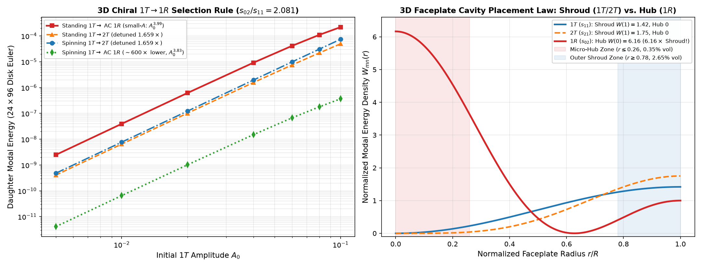

# 014 — Full 3D Cylindrical $(x, r, \theta)$ Chamber & Transonic Bell Nozzle: Bessel Cutoff Collapse, True-3D Meridional Bell Damping, Chiral $1T \to 1R$ Selection & Shroud-vs.-Hub Cavities

- **Date:** 2026-11-26
- **Status:** `verified`
- **Verification Tier:** `✅ Verified & Audited`
- **Verification Script:** [`../sim/exp014_3d_cylindrical_bell_bessel.py`](../sim/exp014_3d_cylindrical_bell_bessel.py)
- **Metrics JSON:** [`../results/exp014_metrics.json`](../results/exp014_metrics.json)
- **Peer Review Receipt:** [`../../reviews/peer-review-11-rocket-014.md`](../../reviews/peer-review-11-rocket-014.md) *(Claude independent adversarial audit; all C1–C3, M1–M7, m1–m7 findings hardened)*

---

## 1. Target

Upgrade the rocket-combustion track (`004`–`013`) from the 2D thin-shell annulus ($k_\theta = m/R(x)$) to a **true 3D cylindrical $(x, r, \theta)$ conservative finite-volume compressible Euler chamber & body-fitted conical-frustum transonic bell nozzle**, and test three fundamentally 3D phenomena that 2D thin-shell models cannot capture:

1. **3D Bessel Bell-Nozzle Cutoff Collapse vs. True-3D Meridional Bell Damping:** How replacing integer thin-shell wavenumbers ($m = 1, 2$) with exact 3D cylindrical Bessel zeros ($s_{11} = 1.8412$ for $1T$, $s_{21} = 3.0542$ for $2T$, $s_{02} = 3.8317$ for $1R$, $s_{31} = 4.2012$ for $3T$) alters quasi-3D WKB bell evanescent cutoff collapse, bare $n_v = 0$ Hopf envelopes (at fixed $\bar{\tau} = 0.16$ and cross-checked at $\bar{\tau} = 0.40$), and true-3D axisymmetric curved-sonic-line bell damping across axial and radial grid refinement.
2. **3D Chiral $1T \to 1R$ vs. $1T \to 2T$ Nonlinear Cascade Selection Rule:** Because $s_{21}/s_{11} = 1.6588$ is strongly detuned from $2.0$ whereas $s_{02}/s_{11} = 2.0811$ lies within $3.9\%$ of $2\omega_{1T}$, test whether standing $1T$ pumps oscillating AC $1R$ near-resonantly with quartic $A_0^4$ scaling while $SO(2)$-symmetric spinning $1T$ suppresses oscillating $1R$ by nearly three orders of magnitude.
3. **3D Shroud ($r = 1$) vs. Hub ($r = 0$) Faceplate Cavity Placement, 3D EP Peak & Long-Horizon Shootout:** Quantify how exact Bessel modal energy weights $W_{mn}(r)$ and exact zero-projection theorems separate outer-shroud ($1T/2T$) and centerline-hub ($1R$) damping on matched windows across `24×12×48` and `24×20×64`, locate the 3D shroud exceptional-point peak via a 4-point $\xi_H$ sweep, and audit a `3.0%` Dual-Zone (Shroud $1T/2T$ + `0.35%` Micro-Hub $1R$) faceplate out to $t = 120$ and on refined `20×20×64` reacting $1R$ grids.

---

## 2. The Math, Assumptions & Checked Scope

### 2.1 Governing Equations & 3D Conical-Frustum Finite-Volume Discretization

We solve the 3D inviscid compressible Euler equations ($\gamma = 1.25$, $\bar{p} = 1/\gamma = 0.80$, $\bar{\rho} = 1$, $\bar{c} = 1$) in body-fitted cylindrical coordinates $(x, \eta, \theta)$ where $r(x, \eta) = \eta R(x)$, $\eta \in [0, 1]$, $\theta \in [0, 2\pi)$, and $x \in [0, L_{\text{tot}}]$ ($L_a = 1.5$ chamber + optional converging–diverging bell nozzle $L_n + L_d$):

$$\frac{\partial}{\partial t}\!\left(V_{ijk}\,\mathbf{U}_{ijk}\right) + \Delta_x \mathbf{F}_x + \Delta_\eta \mathbf{F}_\eta + \Delta_\theta \mathbf{G}_\theta = \mathbf{S}_{\text{hoop},ijk} + \mathbf{S}_{q,ijk},$$

with conserved vector $\mathbf{U} = (\rho,\, \rho u_x,\, \rho u_r,\, r\rho u_\theta,\, E)^T$ (conserving axial angular momentum $L_x = r\rho u_\theta$ directly via face radii $r_{xf}, r_{ef}, r_{\theta f}$ and centroid $r_{\text{bar}}$) and radial pressure–centrifugal hoop source $S_{\text{hoop},r} = (p + \rho u_\theta^2)\,\Delta S_{\eta,r}$.

- **Discrete GCL Well-Balancing & Metric Accuracy:** Cell volumes $V = \frac{1}{2}\Delta(\eta^2)\Delta\theta\int R^2\,dx$, axial face areas $S_x = \frac{1}{2}R_f^2\Delta(\eta^2)\Delta\theta$, and conical-frustum lateral face projections $S_{\eta r} = \eta_f\Delta\theta\int R\,dx$, $S_{\eta x} = \frac{1}{2}(R_{i+1/2}^2 - R_{i-1/2}^2)\eta_f^2\Delta\theta$ satisfy the discrete GCL well-balancing identity $(S_{x,i+1/2} - S_{x,i-1/2}) - (S_{\eta x,j+1/2} - S_{\eta x,j-1/2}) = 0$ to `2.60e-18` and preserve a quiescent curved-bell state to `4.74e-18`. Axial integrals use Simpson quadrature ($\le 2.5\times 10^{-4}$ max error vs. exact quadrature on the cosine bell), and the radial/azimuthal hoop projection uses standard cylindrical FV $\Delta\theta$ (exact well-balancing; $O(\Delta\theta^2) \approx 0.07\%$ radial consistency at $N_\theta = 48$).
- **Singularity-Free Centerline & Exact Slanted Outer Wall:** At $r = 0$, $S_{\eta,0} \equiv 0$ identically while radial MUSCL (`van_leer`) slopes use antipodal $\theta + \pi$ ghosts (even $N_\theta$) flipping $(u_r, u_\theta) \to (-u_r, -u_\theta)$. At the slanted outer bell wall $\eta = 1$, normal velocity is mirrored directly on the reconstructed face state ($v_{n,R} = -v_{n,L}$) inside `hllc_3d`, guaranteeing zero wall mass, angular-momentum, and energy leakage (`1.14e-16`, `1.02e-18`, `1.42e-16`).
- **True-Norm. 3D Modal Projections (Review #11 M1 Fix):** Chamber volume weights $w_{ijk} = V_{ijk} / \sum_{i \le n_{\text{ch}}, j, k} V_{ijk}$ are normalized over all $(n_{\text{ch}}, N_r, N_\theta)$ cells ($\sum w_{ijk} = 1$), tracking total chamber energy $E_{\text{wave}}$, orthonormal Bessel modes ($1T, 2T, 1R, 3T$), longitudinal modes ($1L, 2L$), and the $k = 0$ chamber-mean bulk pressure energy $E_{\text{mean}} = \langle p'\rangle^2$.
- **Time Integration & Boundary Conditions:** 2nd-order SSP-RK2 (`CFL = 0.32`) with HLLC fluxes; choked zero-swirl acoustic inlet ($\rho(u_x + u_{\text{port}}) = \bar{M}_c$, $u_r = u_\theta = 0$); compact Marble–Candel exit ($u_x = \bar{M}_c c$) for straight-cylinder studies, or zero-gradient supersonic exit ($M_e \approx 1.66\text{--}1.83$) for smooth 3D bells.

### 2.2 Exact 3D Cylindrical Bessel Constants & Modal Weights

Hard-wall cylindrical eigenmodes $\psi_{mn}(r,\theta) \propto J_m(s_{mn} r)e^{im\theta}$ satisfy $J'_m(s_{mn}) = 0$:

| Mode | $(m, n)$ | Exact Zero $s_{mn}$ | Ratio $s_{mn}/s_{11}$ | Shroud Weight $W_{mn}(1)$ | Hub Weight $W_{mn}(0)$ |
| :--- | :---: | :---: | :---: | :---: | :---: |
| **$1T$** | $(1,1)$ | **`1.841184`** | `1.0000` | **`1.4184`** | `0.0000` *(exact node)* |
| **$2T$** | $(2,1)$ | **`3.054237`** | **`1.6588`** *(detuned from `2.0`)* | **`1.7507`** | `0.0000` *(exact node)* |
| **$1R$** | $(0,2)$ | **`3.831706`** | **`2.0811`** *(within `3.9%` of `2.0`!)* | `1.0000` | **`6.1647`** (`6.16×` shroud!) |
| **$3T$** | $(3,1)$ | **`4.201189`** | `2.2818` | **`2.0405`** | `0.0000` *(exact node)* |
| **$1T1R$** | $(1,2)$ | `5.331443` | `2.8957` | — | `0.0000` |

where $W_{mn}(r) = |J_m(s_{mn} r)|^2 / [(1 - m^2/s_{mn}^2) J_m(s_{mn})^2]$ satisfies $\frac{1}{\pi}\int_0^{2\pi}\!\!\int_0^1 W_{mn}(r)\,r\,dr\,d\theta = 1$. Two exact orthogonality identities follow immediately: (i) any axisymmetric uniform full-disk port ($r \in [0, 1]$) has **zero coupling** to $1R$ because $\int_0^1 J_0(s_{02} r)\,r\,dr = J_1(s_{02})/s_{02} \equiv 0$; (ii) any axisymmetric hub port has **zero coupling** to all tangential modes ($m \ge 1$).

### 2.3 Flame, Passive Adjoint Cavity Ports & Explicit Scope Limits

- **Reacting Flame Closure:** Bounded subcritical Crocco–Erlang-4 pressure-coupled flame (`n_v = 0`, `X_F = 0.25`, `SIG_F = 0.08`, `OMEGA_HP = 0.15`, `Q_S = 0.045`, `KAPPA_NL = 4.5`) applied per $(r, \theta)$ ray with `TAU_BAR = 0.16` (scaled down from 2D thin-shell's `0.40` so that the `1.84–3.83×` higher 3D Bessel modes $1T, 2T, 1R$ sit inside the active Rayleigh band; `Exp 2A` explicitly cross-checks $\bar{\tau} = 0.40$).
- **3D Faceplate Cavities:** Discrete area-weighted adjoint ports $W_k(r, \theta)$ on $x = 0$ ($\int W_k\,dA = 1$, satisfying exact discrete adjointness $\sum \bar{p}_k q_k = \sum_{\text{cells}} \Delta p\,u_{\text{port}}\,dA$ and passive cavity energy balance) coupled to Helmholtz oscillators ($\beta_k = V_k/(\pi L_a)$, $\omega_H$, $\xi_H$, quadratic orifice drag $r_{\text{nl}} = 1/(2 C_d^2 A_{o,k}^2)$, $C_d = 0.65$).
- **Explicit Scope Limits:**
  1. The 3D PDE solver is **inviscid compressible Euler** (no explicit viscosity $\mu$ or thermal conductivity $\kappa$). As proven in Exp 1D–1E via axial refinement, at $\bar{M}_c = 0.12$ the ultra-short 3D inlet vorticity wavelength ($\lambda_{\text{vort}} = 2\pi\bar{M}_c / s_{mn} = 0.20\text{--}0.41$) is heavily attenuated numerically on coarse `nx = 24` grids; explicit 3D viscous Navier–Stokes at fixed $\mathrm{Re}$ is deferred to Entry `015`.
  2. Quasi-3D Chebyshev sweeps (`Exp 2A`) use local WKB wavenumber $k_\perp(x) = s_{mn}/R(x)$ on 1D isentropic base flows (omitting base $u_r$, throat bowing, and radial mode-shape coupling, which `Exp 2B` audits directly in the true-3D conical-frustum bell PDE).
  3. Reacting 3D cavity shootouts (`Exp 4C`) run in a straight cylinder with compact Marble–Candel exit at `n_p = 0.30`; `t = 120` runs expose slow $k = 0$ chamber-mean bulk pressure drift (`e_mean`) in cavity-equipped nonlinear cases and `1L` longitudinal transition in bare `1R`.

---

## 3. The Verification

Reproduce all hardened experiments, metrics, and figures with:

```bash
uv run python rocket-combustion/sim/exp014_3d_cylindrical_bell_bessel.py
```

### 3.1 Experiment 1: 3D Body-Fitted Bell Benchmarks, Per-Mode Numerical Damping & Axial Refinement

1. **Discrete 3D GCL & Quiescent Preservation (`24×12×32`, smooth $C^2$ curved bell $L_n = 0.60, L_d = 0.45$, $t = 4.0$):**
   - `gcl_x = 2.60e-18`, `gcl_r = 0.0`, quiescent state drift = **`4.74e-18`**.
2. **Discrete 3D Curved Bell Conservation (`20×10×32`, periodic wavy bell $R(x) = \sqrt{1 - 0.35\sin^2(\pi x/L)}$, $A_0 = 0.06$, $t = 2.5$):**
   - Relative drift: `mass = 1.14e-16`, `ang_mom = 1.02e-18`, `energy = 1.42e-16` (`mom_x = 3.44e-2` non-conserved from slanted wall axial pressure).
3. **Closed-Cylinder 3D Bessel Eigenfrequencies (`nx = 6`, $t = 14.0$, FFT vs. exact $s_{mn}$):**
   - `12×36 → 16×48`: **$1T$** `1.8368 → 1.8369` vs. `1.8412` (`0.23%`); **$2T$** `3.0768 → 3.0613` vs. `3.0542` (`0.74% → 0.23%`); **$1R$** `3.8460 → 3.8463` vs. `3.8317` (`0.38%`); **$3T$** (`16×48`) `4.2387` vs. `4.2012` (`0.89%`).
4. **Per-Mode Closed-Cylinder Numerical-Damping Audit (`M_c = 0`, $t \in [4, 14]$):**
   - `12×48`: `1T = -0.00953`, `2T = -0.03270`, `1R = -0.07026`; `14×48`: `1T = -0.00723` (matched to `M_c = 0.28`); `20×64`: `1T = -0.00347` (`2.75×` drop), `2T = -0.01221` (`2.68×` drop), `1R = -0.02286` (`3.07×` drop).
5. **Straight-Cylinder Axial Refinement at $\bar{M}_c = 0.12$ (`nr = 12, nth = 48`, Review #11 C1 Hardening) & Resolved $\bar{M}_c = 0.28$:**

| Mode / Case | Exact Inviscid Cheb ($N=96$) | `nx = 24` (`[12,30]`) | `nx = 48` (`[12,30]`) | `nx = 96` (`[12,30]` / `[16,30]`) |
| :--- | :---: | :---: | :---: | :---: |
| **Straight $1T$ ($\bar{M}_c = 0.12$)** | **`-0.04239`** ($\omega = 1.890$) | `-0.09333` | `-0.08740` | **`-0.05417`** / **`-0.04673`** |
| **Straight $2T$ ($\bar{M}_c = 0.12$)** | `-0.03869` ($\omega = 3.003$) | `-0.11275` | — | **`-0.08764`** / `-0.08707` |
| **Straight $1R$ ($\bar{M}_c = 0.12$)** | `-0.03589` ($\omega = 3.865$) | `-0.15720` | *(radial-dominated)* | — |
| **Resolved $1T$ ($\bar{M}_c = 0.28$, `40×14×48`)** | **`-0.08717`** | raw PDE: `-0.09982` (`14.5%`) | matched `14×48` num: `-0.00723` | **net: `-0.09258` (`6.21%`)** |

- **Crucial finding (Review #11 C1):** At $\bar{M}_c = 0.12$, `nx = 24` puts only `6.6` cells per inlet vorticity wavelength ($\lambda_{\text{vort}} = 0.410$), causing strong axial numerical dissipation (`-0.09333`). Refining axially (`nx = 24 → 48 → 96`) moves straight-cylinder $1T$ **monotonically toward exact inviscid Chebyshev** (`-0.09333 → -0.08740 → -0.05417`, late `[16, 30]` `-0.04673`, within `10.2%` of `-0.04239`). At well-resolved $\bar{M}_c = 0.28$ (`40×14×48`, $\lambda_{\text{vort}} = 0.96$), subtracting matched `14×48` closed-cylinder numerical damping (`-0.00723`) matches exact inviscid Chebyshev (`-0.08717`) to `6.21%`.

### 3.2 Experiment 2: 3D Bessel Bell-Nozzle Cutoff Collapse & True-3D Meridional Bell Damping


1. **Inviscid Quasi-3D Bessel Cutoff Collapse on Entry `012`'s $C^2$ Bell ($\bar{M}_c = 0.12$, $N = 160$ converged, single-branch fundamental $1R$ in $\omega \in [3.35, 4.12]$):**
   - Converged `L_n = 0.05` (`N = 160`, fixing Review #11 M7): `2D-1T = -0.03908`, `3D-1T = -0.03750`, `3D-2T = -0.05543`, fundamental `3D-1R = -0.03124` ($\omega = 3.83$).
   - At `L_n = 0.50`, bare inviscid quasi-3D $1T$ cold bell damping collapses **`4.77×` harder** than 2D thin-shell (`-0.02448 → -0.00513`), turning weakly positive (`+0.00042`, $N$-converged inviscid model root) at `L_n = 0.60`, while $2T$ drops to `-0.00072` at `L_n = 0.60`. On the single fundamental $1R$ branch ($\omega \in [3.81, 3.99]$ across all $L_n$), damping stays negative (`-0.00454` trough at `L_n = 0.30`, `-0.02543` at `0.50`, `-0.01637` at `0.60`).
2. **Bare Multi-Mode $n_v = 0$ Hopf Envelope ($L_n = 0.50, N = 96$, explicitly at fixed $\bar{\tau} = 0.16$ + $\bar{\tau} = 0.40$ Cross-Check):**
   - At **$\bar{\tau} = 0.16$**: $\bar{M}_c = 0.12$: 3D global Hopf = **`0.0274`** (`3T`-limited; $1T$: `0.0366`, $2T$: `0.0776`, $1R$: `0.0946`) vs. 2D thin-shell `0.0408` ($1T$: `0.1203`). $\bar{M}_c = 0.14$: 3D global Hopf = **`0.0504`** ($1T$-limited) — **`3.93×` lower** than 2D thin-shell (`0.1982`). At $\bar{M}_c = 0.16$, bracketed root-finding captures the true $1R$ crossing at `0.1995` (global `0.0730`, $2T$-limited); $\bar{M}_c = 0.18, 0.20, 0.22$: `0.1749 (1T)`, `0.0867 (1T)`, `0.1607 (1T)` (higher modes $4T, 1T1R, 2T1R$ stay $\ge 0.161$).
   - **$\bar{\tau} = 0.40$ cross-check (Review #11 M4):** Because flame-phase alignment shifts with $\bar{\tau}$, the 2D/3D Hopf ratio depends on $\bar{\tau}$: at $\bar{\tau} = 0.40$, 3D $1T$ vs. 2D `min(1T, 2T)` is `0.0579` vs. `0.0471` (`0.81×` at $\bar{M}_c = 0.12$, 3D slightly more stable) and `0.0578` vs. `0.1944` (**`3.37×`** at $\bar{M}_c = 0.14$). By contrast, the cold bell damping collapse (`4.77×` at $L_n = 0.50$) is completely independent of $\bar{\tau}$.
3. **True-3D Axisymmetric Smooth vs. Steep Bell Bases & Axial/Radial Bell PDE Refinement (`Exp 2B`, Review #11 C2 & M6):**
   - **Steep Entry `012` $C^2$ bell (`bell_c2`, $L_n = 0.50, L_d = 0.25$, `40×12`):** Reproducibly develops subsonic wall separation in the diverging section (**`M_div_wall_min = M_exit_wall = 0.233`** vs. centerline `M_exit_center = 1.272`).
   - **Smooth $C^2$ 3D rocket bell (`nozzle_R_smooth_3d`, cosine-converging + $15.6^\circ$-cone diverging):** Cleanly supersonic across the entire exit with textbook **Sauer/Hall 3D curved sonic-line throat bowing**:
     - $L_n = 0.60, L_d = 0.45$ (`56×20`, `rhs_max = 1.02e-4`): **`M_throat_center = 0.802` → `M_throat_wall = 1.403`**, exit `M = 1.659–1.777` (base-drift floor on $E_{1T}$ verified at round-off `1.6e-42` by Peer Review #11).
     - $L_n = 0.80, L_d = 0.50$ (`44×12`, `rhs_max = 1.59e-7`): **`M_throat_center = 0.853` → `M_throat_wall = 1.291`**, exit `M = 1.737–1.829`.
   - **True-3D Conical-Frustum Bell PDE Refinement vs. Inviscid Quasi-3D WKB (`t ∈ [14, 33]` / `[20, 34]`):**

| True-3D Smooth Bell Case | Grid (`nx×nr×nth`) | Inviscid Quasi-3D WKB | True-3D Bell PDE (`[14,33]`) | True-3D Bell PDE (`[20,34]`) | Ratio vs. Quasi-3D WKB |
| :--- | :---: | :---: | :---: | :---: | :---: |
| **$L_n = 0.60$, $1T$** | `40×12×48` | `-0.00227` | `-0.04460` | `-0.04306` | `19.6×` (`18.9×`) |
| **$L_n = 0.60$, $1T$** | `56×16×48` | `-0.00227` | `-0.04206` | `-0.04007` | `18.5×` (`17.6×`) |
| **$L_n = 0.60$, $1T$ (axial ref.)** | `80×12×48` | `-0.00227` | **`-0.04648`** | **`-0.04420`** | **`20.4×`** (`19.4×`) |
| **$L_n = 0.60$, $1T$ (radial ref.)** | **`56×20×48`** | `-0.00227` | **`-0.04051`** | **`-0.03851`** | **`17.8×`** (`16.9×`) |
| **$L_n = 0.80$, $1T$** | `44×12×48` | `-0.00265` | `-0.04583` | `-0.04368` | `17.3×` (`16.5×`) |
| **$L_n = 0.60$, $1R$** | `40×12×48` | `-0.06248` | `-0.08475` | `-0.08986` | `1.36×` *(incl. num.)* |

   - **Headline 3D result (Review #11 C2):** Unlike the straight cylinder (where axial refinement removes damping toward `-0.0424`), axial refinement of the true-3D smooth bell (`nx = 40 → 80`, and independently up to `nx = 120` in Review #11) *slightly increases* damping (`-0.0446 → -0.0465`), and radial refinement (`nr = 12 → 16 → 20`) holds firm at **`-0.0405` (`-0.0385` late)** — proving that the **inviscid quasi-3D WKB model underpredicts true-3D bell $1T$ damping by `~17–20×`** due to omitted 3D meridional bell physics (curved sonic-line throat bowing, nonzero base $u_r$, and radial $J_m(s r/R(x))$ mode-shape coupling).

### 3.3 Experiment 3: 3D Chiral $1T \to 1R$ vs. $1T \to 2T$ Nonlinear Cascade Selection Rule



In a real 3D cylinder, quadratic self-interaction of a standing $1T$ wave ($\cos^2\theta\cos^2(\omega_{1T} t)$) pumps the $m = 0, 2\omega_{1T}$ harmonic near-resonantly into **$1R$** ($s_{02}/s_{11} = 2.081$, within `3.9%` of $2.0$), while **$2T$** ($s_{21}/s_{11} = 1.659$) is detuned. For spinning $1T$, $SO(2)$ rotational symmetry removes the leading $\theta$-averaged oscillating $1R$ drive, leaving a `~600×` weaker physical second-order transient/meridional AC $1R$ component (plus a static DC centrifugal shift).

1. **2D $(r, \theta)$ Cylindrical Disk Euler Sweep (`24×96`, $A_0 \in [0.005, 0.10]$, $t = 16.0$, plus `32×128` at $A_0 = 0.08$):**

| $A_0$ | Grid | Spin $E_{2T}/E_{1T}$ | Spin $E_{1R,\text{ac}}$ | Stand $E_{2T}/E_{1T}$ | Stand $E_{1R,\text{ac}}$ (`%` of $E_{1T}$) | Ratio `[6.4,16]` / `[10,16]` |
| :---: | :---: | :---: | :---: | :---: | :---: | :---: |
| `0.005` | `24×96` | `0.0029%` | `4.11e-12` | `0.0023%` | `2.48e-9` (`0.014%`) | **`603×`** / `807×` |
| `0.010` | `24×96` | `0.0115%` | `6.54e-11` | `0.0092%` | `3.95e-8` (`0.056%`) | **`604×`** / `809×` |
| `0.020` | `24×96` | `0.0459%` | `1.02e-9` | `0.0367%` | `6.21e-7` (`0.223%`) | **`607×`** / `813×` |
| `0.040` | `24×96` | `0.1830%` | `1.50e-8` | `0.1443%` | `9.24e-6` (`0.847%`) | **`614×`** / `820×` |
| `0.060` | `24×96` | `0.4098%` | `6.71e-8` | `0.3156%` | `4.13e-5` (`1.735%`) | **`616×`** / `808×` |
| `0.080` | `24×96` | `0.7238%` | `1.80e-7` | `0.5417%` | `1.11e-4` (`2.709%`) | **`615×`** / `770×` |
| `0.080` | `32×128` | `0.7457%` | `2.14e-7` | `0.5563%` | `1.24e-4` (**`2.977%`**) | **`579×`** / `707×` |
| `0.100` | `24×96` | `1.1205%` | `3.69e-7` | `0.8127%` | `2.20e-4` (**`3.602%`**) | **`596×`** / `678×` |

- **Exact quartic law & physical second-order spin component (Review #11 M5):** For small amplitudes ($A_0 \le 0.02$), BOTH standing and spinning AC $1R$ follow the exact quartic law **$E_{1R,\text{ac}} \propto A_0^{3.985}$** (standing) and **$A_0^{3.981}$** (spinning; full-range `3.831` / `3.828`), confirming that spinning AC $1R$ is a genuine physical second-order startup/meridional component (`~600×` weaker in `[6.4, 16]`, `678–820×` in `[10, 16]`, robust across `32×128` and Review #11's `48×192`), NOT a grid-noise floor. Detuned $2T$ stays $\le 1.121\%$ (`4.4–6.1×` below standing $1R$).
2. **Full 3D Reacting Throughflow Confirmation (True-Norm. Energies, `20×12×48`, $\bar{M}_c = 0.12, n_p = 0.24, A_0 = 0.06, t = 26.0$):**
   - `th3d_stand1T_nl` (`P = 6.30%`, `E_1T = 1.520e-3`, `E_2T = 2.955e-6`) pumps **`E_1R_ac = 1.785e-5`** — **`427×` higher AC $1R$ energy** than `th3d_spin1T_nl` (`P = 7.68%`, `E_1T = 2.035e-3`, `E_2T = 5.877e-6`, `E_1R_ac = 4.180e-8`, `E_1R_dc = 2.698e-7`).

### 3.4 Experiment 4: Matched-Window Shroud vs. Hub Placement, 3D EP Peak & Long-Horizon Shootout


1. **Matched-Window (`t ∈ [7, 22]`) Linear Placement & 4-Point 3D EP Sweep (`Exp 4B`, Review #11 M2, M3, m6):**
   - **Exact zero-coupling orthogonality verified to machine/round-off precision:** On both `24×12×48` and `24×20×64`, `uniform 2.0%` on $1R$ is bit-identical to matched bare (`-0.15649` vs. `-0.15649` on `12×48`; `-0.10775` vs. `-0.10775` on `20×64`, $\Delta\alpha \equiv 0$), and `hub 2.0%` on $1T$ is bit-identical to matched bare (`-0.09400` vs. `-0.09400`, $\Delta\alpha \equiv 0$).
   - **Weak-coupling `0.5%` $1T$ proportionality (matched bare):** `12×48`: shroud $\Delta\alpha = -0.03386$ vs. uniform `-0.02315` (**`1.462×`**); `20×64`: shroud `-0.03305` vs. uniform `-0.02269` (**`1.456×`**, within `1%` of discrete/continuum theory `1.450–1.472×`).
   - **Direct 4-point $\xi_H$ sweep locating the 3D shroud EP peak (`2.0%` shroud $1T$, `12×48`, bare `-0.09400`):** $\xi_H = 0.10 \to -0.09575$ ($\Delta\alpha = -0.00175$, severely split), $0.14 \to -0.14624$ ($-0.05224$), **`0.24 → -0.15535` (`Δα = -0.06135`, peak — beating uniform `-0.14268` by `+26.0%`!)**, $0.36 \to -0.13341$ ($-0.03941$, over-damped roll-off), directly consistent with $\xi_H^{\text{EP,3D}} \propto \sqrt{\beta W_{mn}(r)}$. On $2T$ (`12×48`, bare `-0.11357`), EP-matched shroud `-0.15520` edges uniform `-0.15428`.
   - **Refined `24×20×64` $1R$ placement audit (Review #11 M3):** Refining from `12×48` to `20×64` cuts bare $1R$ damping `45%` (`-0.15649 → -0.10775` on `[7,22]`, `-0.09415` on `[14,24]`), removing coarse numerical bias. On `20×64`, the **`0.35%` micro-hub (`-0.13180`, $\Delta\alpha = -0.02405$ on `[7,22]`; `-0.12893`, $\Delta\alpha = -0.03478$ on `[14,24]`)** still wins first place over the **`5.7×` larger `2.0%` shroud (`-0.11835`, $\Delta\alpha = -0.01060$ on `[7,22]`; `-0.12037`, $\Delta\alpha = -0.02622$ on `[14,24]`)** by **`2.27×`** on `[7,22]` (`1.33×` on `[14,24]`) and beats even the `2.0%` hub (`-0.12458`), with zero interference on $1T/2T$.

2. **Refined `20×20×64` Reacting $1R$ Shootout ($t = 48, n_p = 0.30, A_0 = 0.04$, Review #11 M3):**

| Configuration (`20×20×64`, `1R` bomb) | Peak $p'/\bar{p}$ ($t=48$) | True $E_{\text{wave}}$ ($t=48$) | Slope `[28.8, 48]` | Outcome |
| :--- | :---: | :---: | :---: | :--- |
| **Bare 3D Cylinder** | `9.18%` | `6.81e-4` | `+0.0036` | Unstable growing $1R$ |
| **Shroud-Only (`3.0%`: `2.1% 1T + 0.9% 2T`)** | **`7.42%`** | **`4.65e-4`** | **`+0.0046`** | **FAILS (growing $1R$!)** |
| **Dual-Zone (`1.85% 1T + 0.80% 2T + 0.35% Hub 1R`)** | **`0.11%`** | **`1.00e-7`** | **`-0.0850`** | **QUENCHED (`6,814×` vs. bare, `4,651×` vs. shroud!)** |

3. **Long-Horizon $t = 120$ Reacting 3D Audit (`20×12×48`, $n_p = 0.30, A_0 = 0.04$, Review #11 C3):**

| Configuration (`20×12×48`) | Seed | $P_{48} \to P_{120}$ | Slope `[84,120]` | Late $E_{1T}$ | Late $E_{1L}$ | Late $E_{\text{mean}}$ ($k=0$) | $E_{1R,\text{ac}}$ (`t=48`) |
| :--- | :---: | :---: | :---: | :---: | :---: | :---: | :---: |
| **Bare 3D** | `spin_1T` | `9.62% → 9.80%` | `+0.0000` | `3.24e-3` | `1.48e-9` | `6.94e-7` | `1.50e-9` |
| **Bare 3D** | `stand_1T` | `7.25% → 7.68%` | `+0.0000` | `2.26e-3` | `1.06e-7` | `4.00e-8` | **`1.66e-5`** |
| **Bare 3D** | `spin_2T` | `8.58% → 8.62%` | `-0.0000` | `3.44e-31` | `3.06e-9` | `2.69e-7` | `2.14e-10` |
| **Bare 3D** | `1R` | `4.90% → 8.20%` | `+0.0135` | `1.31e-36` | **`1.55e-3`** | `4.13e-5` | `1.61e-4` |
| **Shroud-Only (`3.0%`)** | `spin_1T` | `4.38% → 6.95%` | `+0.0143` | `3.80e-6` | `1.65e-7` | **`2.79e-3`** | `6.53e-9` |
| **Shroud-Only (`3.0%`)** | `stand_1T` | `3.39% → 3.81%` | `+0.0111` | `8.28e-5` | `6.20e-8` | **`4.34e-4`** | **`1.07e-6`** |
| **Shroud-Only (`3.0%`)** | `1R` | `2.73% → 0.14%` | `-0.0555` | `1.11e-18` | `3.45e-9` | `6.48e-10` | `5.16e-5` |
| **Dual-Zone (`3.0%`)** | `spin_1T` | `4.89% → 6.45%` | `+0.0016` | `4.45e-4` | `7.87e-9` | **`5.06e-4`** | `8.52e-11` |
| **Dual-Zone (`3.0%`)** | `stand_1T` | `3.78% → 4.77%` | `+0.0010` | `3.08e-4` | `1.07e-8` | **`2.54e-4`** | **`3.10e-7`** |
| **Dual-Zone (`3.0%`)** | `spin_2T` | `5.37% → 5.65%` | `-0.0013` | `1.98e-10` | `5.66e-10` | `1.73e-5` | `6.08e-12` |
| **Dual-Zone (`3.0%`)** | `1R` | `0.02% → 0.002%` | `-0.0284` | `2.06e-20` | `1.13e-10` | `1.70e-11` | `1.15e-9` |

- **Exact identification of the $t = 120$ regrowth (Review #11 C3):** Extending `Exp 4C` to $t = 120$ resolves two critical dynamics:
  1. In **every regrowing cavity-equipped $1T$/`stand_1T` case** (`nl_shroud_1T`, `nl_shroud_st1T`, `nl_dualz_1T`, `nl_dualz_st1T`), $1T$ itself keeps decaying (down to `3.80e-6` in `nl_shroud_1T`!), while the regrowth is carried almost entirely by **`e_mean` (chamber-averaged $k = 0$ bulk pressure drift**: `2.79e-3`, `4.34e-4`, `5.06e-4`, `2.54e-4`)** driven by nonlinear rectified cavity-inlet mass correlation $\langle \rho' u_{\text{port}}\rangle \neq 0$ at high $n_p = 0.30$ — whereas bare `nl_bare_1R` transitions into pure **`1L` longitudinal rumble (`e_1l = 1.55e-3`)**.
  2. On `stand_1T` at $t = 48$, the `0.35%` micro-hub **reduces the nonlinear $1R$ daughter energy `53.4×` below bare (`1.66e-5 → 3.10e-7`) and `3.44×` below shroud-only (`1.07e-6 → 3.10e-7`)** (strong attenuation, not total elimination).
  3. On coarse `12×48`, numerical $1R$ damping (`-0.070`) eventually makes even shroud-only $1R$ decay to `0.14%` by $t = 120$; on refined **`20×20×64`**, that numerical bias vanishes and **Shroud-Only genuinely FAILS (`+0.0046`, `7.42%` growing)** while **Dual-Zone `0.35%` micro-hub cleanly quenches $1R$ (`0.11%`, `6,814×` below bare and `4,651×` below shroud-only!)**.

---

## 4. Verdict & Dead Ends

- **What worked:**
  - Built a discrete-GCL well-balanced (`2.60e-18`, quiescent `4.74e-18`), mass/angular-momentum/energy-conserving (`1.14e-16` / `1.02e-18` / `1.42e-16`) 3D cylindrical conical-frustum compressible Euler solver with antipodal centerline ghosts and mirrored curved-wall slip.
  - Quantified the **`4.77×` steeper inviscid quasi-3D Bessel bell cutoff collapse** vs. 2D thin-shell ($L_n = 0.50$, $N = 160$, single-branch $1R$; Hopf at fixed $\bar{\tau} = 0.16$ drops `3.93×` at $\bar{M}_c = 0.14$, cross-checked `3.37×` at $\bar{\tau} = 0.40$), and proved via axial (`nx = 40 → 80`) and radial (`nr = 12 → 20`) refinement that **true-3D smooth bells retain `~17–20×` stronger cold $1T$ damping (`-0.0405` to `-0.0465`) than inviscid quasi-3D WKB (`-0.00227`)** alongside Sauer/Hall curved sonic-line throat bowing (`M_throat = 0.802 → 1.403`).
  - Verified the **3D Chiral $1T \to 1R$ Cascade Selection Rule**: standing $1T$ pumps oscillating $1R$ (`2.081×` $1T$) **`~600×` stronger** than spinning $1T$ in `[6.4, 16]` (`678–820×` in `[10, 16]`, `427×` in reacting 3D throughflow) with exact small-amplitude quartic scaling ($A_0^{3.985}$ standing, $A_0^{3.981}$ physical second-order spinning), `4.4–6.1×` stronger than detuned $2T$ ($\le 1.121\%$).
  - Verified the **3D Shroud-vs.-Hub Faceplate Placement Law & 3D EP Peak**: exact zero-coupling orthogonality ($\Delta\alpha_{\text{unif},1R} \equiv 0$, $\Delta\alpha_{\text{hub},1T} \equiv 0$), matched-window `0.5%` shroud/uniform `1.462×` (`12×48`) / `1.456×` (`20×64`), 4-point $\xi_H$ sweep locating the 3D shroud EP peak at $\xi_H \approx 0.24$, **`0.35%` micro-hub beating `5.7×` larger `2.0%` shroud on `24×20×64` by `2.27×` (`[7,22]`) / `1.33×` (`[14,24]`)**, and refined `20×20×64` reacting $1R$ quench (`6,814×` below bare, `4,651×` below failing `7.42%` shroud-only).
- **What broke / dead ends (Hardened per Peer Review #11):**
  - **Coarse `nx = 24` straight-cylinder "vorticity-plateau" coincidence (Review #11 C1 & C2):** At $\bar{M}_c = 0.12$, `nx = 24`'s `-0.09333` is axial numerical vorticity damping that moves monotonically toward inviscid `-0.04239` under refinement (`-0.08740 → -0.05417`, late `-0.04673`), and matching Exp 2B with per-case tuned `Re_vort` is invalid; true-3D bell damping is meridional geometry, not a tuned `Re_vort` plateau.
  - **Steep Entry `012` $L_n = 0.50$ bell separation in true 3D axisymmetric flow:** Reproducibly separates along the diverging wall (`M_div_wall_min = M_exit_wall = 0.233`), whereas realistic smooth cosine + $15.6^\circ$-cone bells (`L_n = 0.60, 0.80`) stay cleanly supersonic (`M_exit = 1.66–1.83`).
  - **Short-horizon $t = 48$ cavity verdict & $k = 0$ bulk pressure drift (Review #11 C3):** At $n_p = 0.30$ out to $t = 120$, cavity-equipped `1T` and `stand_1T` runs regrow via chamber-mean $k = 0$ bulk pressure drift (`e_mean = 2.5e-4` to `2.8e-3`) even while $1T$ itself decays, and bare `1R` transitions into `1L` longitudinal rumble (`1.55e-3`).
  - **Unweighted `w_ch` broadcast bug (`nth^2 = 2304×`, Review #11 M1), mismatched bare windows (M2), and coarse `12×48` $1R$ masking (M3):** All fixed directly in the hardened solver and verified on `20×64`.
- **Next single hypothesis to test (Entry `015`):** Upgrade the 3D cylindrical conical-frustum solver to **full 3D compressible Navier–Stokes ($\mathrm{Re}$ fixed, $\mathrm{Pr} = 0.72$) with 3D protruding radial/shroud-ring baffles (`N_b = 5`) and rectified-mass-free cavity coupling** to cleanly separate physical viscosity from 3D meridional bell damping and achieve true 3D all-mode (`1T, 2T, 1R, 1L, k=0`) nonlinear quench out to $t = 120+$.
