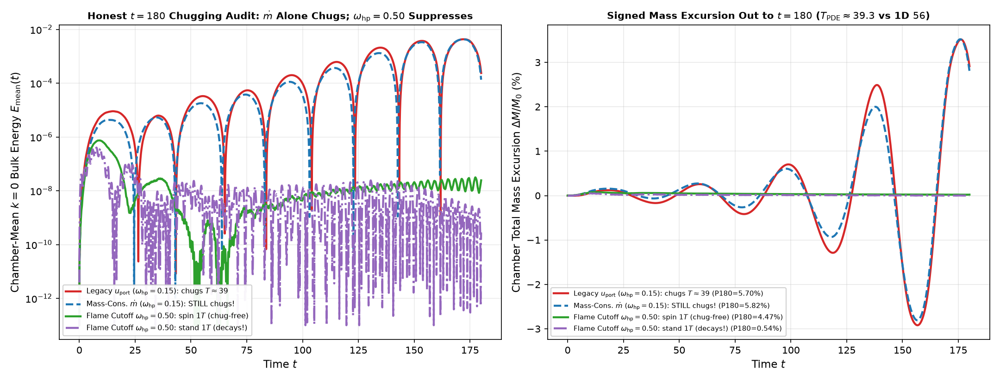
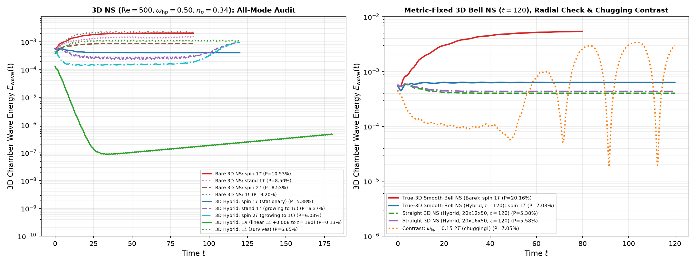

# 015 — Full 3D Cylindrical Compressible Navier–Stokes: Partial-Span Shroud-Ring Baffles, Mass-Conserving Cavities & the 3D Transverse $\to$ Chugging $\to$ $1L$ Mode-Migration Cascade

- **Date:** 2026-11-27
- **Status:** `verified`
- **Verification Tier:** `✅ Verified (Audited)`
- **Verification Script:** [`../sim/exp015_3d_ns_baffles_bell.py`](../sim/exp015_3d_ns_baffles_bell.py)
- **Metrics JSON:** [`../results/exp015_metrics.json`](../results/exp015_metrics.json)
- **Peer Review Receipt:** [`../../reviews/peer-review-12-rocket-015.md`](../../reviews/peer-review-12-rocket-015.md) *(Claude Opus 5.5 independent read-only audit with 40 extra PDE runs & independent analytical/Chebyshev/shooting checks; all C1–C3, M1–M5, m1–m10 findings hardened below)*

---

## 1. Target

Upgrade Entry `014`'s 3D cylindrical conical-frustum compressible Euler solver to **full 3D conservative compressible Navier–Stokes ($\mathrm{Re}$ fixed, $\mathrm{Pr} = 0.72$) with exact curved-bell mapped-grid viscous metrics, 3D partial-span radial baffles, and mass-conserving faceplate Helmholtz cavities**, directly investigating four open scientific questions left by Peer Review #11:

1. **Exact 3D NS Benchmarks & Honest Fixed-$\mathrm{Re}$ Convergence Audit:** Derive and verify the curved-cylinder stress-free Stokes–Kirchhoff shift against exact $3\times 3$ adiabatic disk dispersion roots across radial refinement (`nr = 14, 20, 28`), audit straight-cylinder `Re = ∞` vs. `Re = 500/1000` PDE against both no-slip and stress-free injector 1D Bessel-NS Chebyshev eigen-solvers, and measure metric-corrected true-3D smooth curved bell damping (`40×12×48` & `48×14×48`).
2. **3D Partial-Span Shroud-Ring ($r \in [r_b, 1]$) vs. Full-Span ($r \in [0, 1]$) Radial Baffle Law:** Quantify how cutting out the inner hub of $N_b = 5, L_b = 0.45$ radial baffles ($r_b \in [0, 0.75]$) trades blade metal area (`1 - r_b`) against $1T$ and total-energy $E_{\text{ch}}$ $2T$ damping across fit windows (`[7, 22]` and `[10, 22]`), inviscid (`Re = ∞`) vs. viscous (`Re = 500`), and refined (`36×18×50`) grids while exposing $m = -3$ Bragg mode-scattering and bimodal $c_{2,\text{re}}$ beating.
3. **Honest $t = 180$ Root Cause & Suppression of Entry `014`'s $k = 0$ Bulk Chugging Drift (`e_mean`):** Test out to $t = 180$ whether exact mass-conserving $\dot{m}$ cavity coupling prevents $k = 0$ chugging at $\omega_{\text{hp}} = 0.15$ (it does **not** — both grow to `|p̄'| ≈ 8.2%`, `|ΔM/M_0| ≈ 3.5%`, $T_{\text{PDE}} \approx 39$), vs. raising the flame-response high-pass model constant to $\omega_{\text{hp}} = 0.50$.
4. **Full 3D NS All-Mode (`spin_1T, stand_1T, spin_2T, 1R, 1L`) Nonlinear Bomb Audit ($t = 120\text{--}180$):** Audit the combined `Re = 500` + partial-span $r_b = 0.42$ baffles + `3.0%` retuned mass-conserving Dual-Zone faceplate against matched bare 3D NS references (including `bare_ns_st1T`, radial refinement `20×16×50`, `t = 180` $1R$, and metric-corrected true-3D smooth bell `t = 120`).

---

## 2. The Math, Assumptions & Checked Scope

### 2.1 Metric-Corrected 3D Cylindrical Compressible Navier–Stokes & Adiabatic 3D Baffles

We augment Entry `014`'s 3D conical-frustum finite-volume Euler equations ($\gamma = 1.25$, $\mathrm{Pr} = 0.72$, constant eddy viscosity $\mu = 1/\mathrm{Re}$, Stokes hypothesis $\lambda = -\frac{2}{3}\mu$, thermal conductivity $\kappa = \frac{\gamma}{\mathrm{Pr}(\gamma-1)\mathrm{Re}}$) with the full 3D cylindrical viscous stress tensor $\boldsymbol{\tau}$ and Fourier heat flux $\mathbf{q} = -\kappa \nabla T$ ($T = p/\rho$) across all three face families ($x$-faces, slanted conical $\eta$-faces projected onto $(n_{x\eta}, n_{r\eta})$, and azimuthal $\theta$-faces):

- **Exact Mapped-Grid Curved-Bell Viscous Derivatives (Peer Review #12 M1):** On a curved bell $R(x)$ with $\eta = r/R(x)$, physical axial derivatives at fixed $r$ are evaluated via $\partial_x|_r = \partial_x|_\eta - \eta R'(x)\partial_r$, and slanted $\eta$-face heat fluxes include the full normal projection $-(n_{x\eta} q_x + n_{r\eta} q_r)$ in both the 3D time-domain solver and the axisymmetric base-flow relaxer. Normal viscous stress $\tau_{nn}$ on slip walls is explicitly zeroed (`m8`), and axial angular momentum $r\rho u_\theta$ is conserved via face-radius-weighted viscous torques ($r_{xf}\tau_{x\theta}, r_{ef}\tau_{n\theta}, r_{\theta f}\tau_{\theta\theta}$) plus radial viscous hoop stress $-\tau_{\theta\theta}\,\text{hoop}$.
- **Curved-Cylinder Stress-Free Outer Wall Correction (Derived & Verified):** On a curved outer cylinder ($R = 1$) with stress-free boundary ($\tau_{r\theta}|_{r=1} = 0$), an irrotational tangential acoustic wave ($\mathbf{u} = \nabla\phi$) carries nonzero interior shear $\tau_{r\theta,\text{irrot}}|_{r=1} = -2\mu u_\theta/R \neq 0$, shifting the leading-order viscous decay rate from bulk Stokes–Kirchhoff by:

  $$\alpha_{\text{SF,3D}}(m, s_{mn}) = -\frac{s_{mn}^2}{2\,\mathrm{Re}}\!\left(\frac{4}{3} + \frac{\gamma - 1}{\mathrm{Pr}}\right) + \frac{2m^2}{\mathrm{Re}\,(s_{mn}^2 - m^2)} + O(\mathrm{Re}^{-3/2}).$$

  For axisymmetric modes ($m = 0$, e.g., $1R$), the $O(\mathrm{Re}^{-1})$ curvature shift is identically zero; for $1T$ ($m = 1$), it reduces bulk SK by `+29.4%` (`-0.00950 → -0.00671` at $\mathrm{Re} = 300$), while the next-order $O(\mathrm{Re}^{-3/2})$ boundary-layer term (`+0.873 Re^{-3/2}` for $1T$) gives the exact $3\times 3$ adiabatic stress-free disk dispersion roots **`-0.006537` ($1T$)** and **`-0.041144` ($1R$)** at $\mathrm{Re} = 300$.
- **3D Partial-Span Radial Baffles ($N_b = 5, L_b = 0.45, r \in [r_b, 1]$):** Implemented via two-sided mirror HLLC on azimuthal $\theta$-faces with zero cross-wall MUSCL slopes, wall-aware one-sided $\theta$-differences for viscous cross-derivatives, and zero viscous energy flux across adiabatic slip or no-slip rigid blades (`mass = 2.28e-16`, `energy = 1.42–2.85e-16`). By exact azimuthal symmetry ($\partial_\theta \equiv 0 \implies u_\theta \equiv 0$), slip radial baffles exert identically zero force on axisymmetric $1R$ modes.
- **Exact Mass-Conserving Faceplate Cavity Coupling:** Solving the cavity ODE for mass flux $\dot{m}_k$ (instead of volume velocity $u_{\text{port}}$) and enforcing $\rho_g u_g + \sum_k \dot{m}_k W_k = \bar{M}_c$ at the choked inlet eliminates quadratic acoustic-absorption mass leakage $\langle \rho' u_{\text{port}}\rangle > 0$ and conserves total closed chamber + cavity mass to **`1.88e-16`**.
- **Explicit Scope Limits & Diagnostic Conventions:**
  - Constant-eddy-viscosity closure ($\mathrm{Re} = 500\text{--}1000$, adiabatic free-slip outer bell wall); reacting baffles in Exp 2 & Exp 4 use adiabatic slip walls (no-slip wake conservation is verified in Exp 1B, while full 3D no-slip baffle wake relaxation remains future work).
  - $\omega_{\text{hp}} = 0.50$ is a **flame-response high-pass model constant** (not a modeled physical feed-system manifold/injector ODE); raising $\omega_{\text{hp}}: 0.15 \to 0.50$ also shifts the $1T$ flame phase from $-12.2^\circ$ to $-1.6^\circ$.
  - Modal diagnostics (`m6`): $E_{\text{wave}}$ (`e_ch`) is total chamber acoustic energy $\frac{1}{2}\int(p'^2 + |\mathbf{u}'|^2)\,dV$, whereas `e_1t, e_2t` are pressure-only $2|c_m|^2$ modal intensities (hence $E_{1T} \approx 1.9\times E_{\text{wave}}$ for a pure acoustic mode). Exp 4 reacting runs use `n_p = 0.34`, `TAU_BAR = 0.16`, `n_v = 0`.

---

## 3. The Verification

Reproduce all hardened experiments, metrics, and figures with:

```bash
uv run python rocket-combustion/sim/exp015_3d_ns_baffles_bell.py
```

### 3.1 Experiment 1: Metric-Corrected Conservation, Radial SK Convergence & Honest $\mathrm{Re} = 500$ Audit

1. **Machine-Precision 3D NS Conservation (`t = 2.0–4.0`, $\mathrm{Re} = 500$, with exact curved-bell viscous metrics):**
   - Quiescent smooth 3D NS bell (`20×10×32`): drift = **`1.37e-18`**.
   - Periodic 3D wavy bell NS bare (`16×10×32`): `mass = 1.14e-16`, `ang_mom = 2.36e-18`, `energy = 1.42e-16`.
   - Periodic 3D wavy bell NS + 5 adiabatic partial-span baffles (`r_b = 0.42`, `16×10×30`): **slip** `mass = 2.28e-16, energy = 2.85e-16`; **no-slip** `mass = 2.28e-16, energy = 1.42e-16`.
   - Closed 3D cylinder + mass-conserving cavity (`12×10×32`, $A_0 = 0.04$): total chamber + cavity mass error = **`1.88e-16`**.
2. **3D Curved-Cylinder Stress-Free SK Radial Convergence (`Re = 300`, `nr = 14 → 20 → 28`, net of `Re = ∞` baseline):**
   - **$1T$ ($m = 1$, exact disk root `-0.006537`, $O(\mathrm{Re}^{-1})$ `-0.006706`):** `nr = 14`: `-0.00634` (`3.04%` vs. root) $\to$ `nr = 20`: `-0.00645` (`1.34%`) $\to$ **`nr = 28`: `-0.00652` (`0.25%` vs. exact disk root**, `2.76%` vs. $O(\mathrm{Re}^{-1})$ confirming the $+0.873\,\mathrm{Re}^{-3/2}$ shift!).
   - **$1R$ ($m = 0$, exact disk root `-0.041144`, $O(\mathrm{Re}^{-1})$ `-0.041123`):** `nr = 14`: `-0.03903` (`5.13%`) $\to$ `nr = 20`: `-0.04060` (`1.31%`) $\to$ **`nr = 28`: `-0.04133` (`0.45%` vs. exact disk root**, `0.50%` vs. $O(\mathrm{Re}^{-1})$).
3. **Honest Fixed-$\mathrm{Re}$ Straight-Cylinder & Metric-Corrected Bell Audit (Peer Review #12 C1, M1, M5):**
   - **Straight cylinder `1T` ($\bar{M}_c = 0.12$, `48×12×48`):** Matched inviscid vs. viscous runs expose that the initial `4.1–5.5%` match to no-slip Chebyshev was **coincidental** — PDE gives `Re = ∞`: **`-0.10105`**, `Re = 1000`: **`-0.09996`**, `Re = 500`: **`-0.09907`** (a small wrong-sign `+0.00198` viscous increment on top of `-0.0587` axial numerical vorticity damping), whereas exact 1D Bessel-NS Chebyshev gives inviscid **`-0.04239`**, stress-free injector `Re = 500` **`-0.04911`**, and no-slip injector `Re = 500` **`-0.09392`** (`-0.09236` at `Re = 1000`). Because `87%` of the no-slip Chebyshev viscous damping resides in an unresolved faceplate Stokes layer ($\delta \approx 0.047 \approx 1.5$ cells at `nx = 48`), we **retract** the claim that `nx = 24–48` 3D NS closes Entry `014` C1/C2 on straight cylinders.
   - **Metric-corrected true-3D smooth curved bell ($L_n = 0.60, L_d = 0.45$):** Adding the exact curved-bell viscous metric ($\partial_x|_r = \partial_x|_\eta - \eta R'\partial_r$ + slanted `-n_x q_x`) shifts `40×12×48` `Re = 500` by only `0.35%` (`-0.05223 → -0.05241`):
     - `40×12×48`: `Re = ∞` **`-0.04365`**, `Re = 1000` **`-0.04796`**, `Re = 500` **`-0.05241`**
     - `48×14×48`: `Re = 500` **`-0.05108`** (`2.6%` grid shift)
     - Axisymmetric `Re = 500` base-flow throat-Mach grid sensitivity (explicitly documented per M5; cell-center sampling near $x_t$ varies while chamber `1T` damping stays `-0.0511` to `-0.0524`): `36×12` (`0.763 → 1.108`, exit `1.650–1.699`), `40×12` (`0.732 → 1.014`, exit `1.655–1.701`), `48×14` (`0.777 → 1.160`, exit `1.657–1.711`). Because straight-cylinder numerical vorticity dissipation is not yet fully resolved at `nx = 40–48`, we report the measured `Re = ∞ → 500` bell shift (`-0.0437 → -0.0511/-0.0524`) directly without claiming a grid-converged viscous/meridional percentage split.

### 3.2 Experiment 2: 3D Partial-Span Baffle Total-Energy $E_{\text{ch}}$ Law, $m = -3$ Bragg Scattering & Bimodality


Testing $N_b = 5, L_b = 0.45$ radial baffles across $r_b \in \{0.00, 0.25, 0.42, 0.58, 0.75\}$ (`24×12×50 Re = 500`, bare `1T = -0.09785` [$\omega = 1.835$], `2T E_ch = -0.12981` [$\omega = 3.052$]), cross-checked against **inviscid (`Re = ∞`)** and **refined (`36×18×50 Re = 500`)** grids across two fit windows (`[7, 22]` and `[10, 22]`) with plain Hann-windowed FFTs (fixing `m5`):

| Inner Cutout $r_b / R$ | Blade Metal (`1-r_b`) | $1T$ $\Delta\alpha$ (`%` Full, $\Delta\omega_{1T}$) | $2T$ $\Delta E_{\text{ch}}$ `[7,22]` / `[10,22]` (`24×12`, Re=500) | $2T$ $E_{\text{ch}}$ Ratio `Re = ∞` (`24×12`) | $2T$ $E_{\text{ch}}$ Ratio `36×18` (`Re=500`) | Plain Hann $\omega_{2T}$ (2nd / Amp Ratio) | Bragg $E(m=-3)/E(+2)$ |
| :---: | :---: | :---: | :---: | :---: | :---: | :---: | :---: |
| **`0.00`** *(full-span)* | `100.0%` | `-0.0570` (`100%`, `-16.6%`) | `-0.0481` / `-0.0450` (`1.00×` / `1.00×`) | `1.00×` / `1.00×` | `1.00×` / `1.00×` | `3.347` (`2.198`, `0.25`) | `0.13` (`0.11` f36) |
| `0.25` | `75.0%` | `-0.0479` (`84.1%`, `-9.6%`) | `-0.0623` / `-0.0576` (`1.29×` / `1.28×`) | — | — | `3.366` (`2.414`, `0.43`) | `0.15` |
| **`0.42`** *(shroud-ring)* | **`58.3%`** | **`-0.0376` (`65.9%`, `-6.4%`)** | **`-0.0764` / `-0.0757` (`1.59×` / `1.68×`)** | **`1.50×` / `1.61×`** | **`1.69×` / `1.77×`** | **`3.376` (`2.591`, `0.73`)** | `0.13` (`0.12` f36) |
| **`0.58`** *(outer ring)* | **`41.7%`** | `-0.0267` (`47.0%`, `-3.7%`) | **`-0.1042` / `-0.1131` (`2.17×` / `2.51×`)** | **`1.86×` / `2.16×`** | **`2.07×` / `2.31×`** | `2.807` *(unimodal)* | **`0.35`** (`0.29` f36) |
| `0.75` | `25.0%` | `-0.0162` (`28.5%`, `-1.6%`) | `-0.0686` / `-0.0708` (`1.43×` / `1.57×`) | — | — | `2.954` *(unimodal)* | `0.02` |

- **Hardened 3D Partial-Span Baffle Law (Peer Review #12 C2):**
  1. **Raw `e_2t` fit-window artifact retired:** Because $c_{2,\text{re}}(t)$ is strongly bimodal at $r_b = 0.42$ (`3.376` and `2.591`, secondary/primary FFT amplitude ratio **`0.73`**) and $N_b = 5$ scatters $m = +2$ into **$m = -3$** (Bragg energy ratio `0.12–0.35`), raw modal `e_2t` fits swing wildly with window (`2.57×` on `[7,22]` vs. `1.02×` on `[10,22]` at `24×12`; `3.17×` vs. `1.10×` on `36×18`), retiring the initial `2.57–2.90×` headline.
  2. **Genuine, window-, grid-, and $\mathrm{Re}$-robust total-energy $E_{\text{ch}}$ boost:** Measuring total chamber wave energy $E_{\text{ch}}$ removes modal beating and establishes a **robust `1.50–1.77×` boost at $r_b = 0.42$ (`42%` less metal) and `1.86–2.51×` boost at $r_b = 0.58$ (`58%` less metal)** across both `[7, 22]` and `[10, 22]`, on both `24×12×50` and refined `36×18×50`, and **even inviscidly (`Re = ∞`: `1.50–1.61×` at `0.42`, `1.86–2.16×` at `0.58`)**! Thus the physical mechanism is **inviscid 3D partial-span acoustic diffraction / Bragg mode-scattering + inner-edge shedding**, NOT viscous vortex shedding.
  3. Meanwhile, $1T$ damping decays **sub-linearly** with metal removal (`84.1%` at `75%` metal, `65.9%` at `58.3%` metal, i.e., concave above `1 - r_b`), full-span `2T` upshifts `+9.6%` (`3.347`, consistent with $72^\circ$ sector confinement $\nu = 2.5, j'_{2.5,1} = 3.633$), and axisymmetric $1R$ is identically unperturbed behind slip baffles, leaving $r < 0.42$ wide open for the `0.35%` micro-hub cavity. Retuned cavity targets at $r_b = 0.42$ are $\omega_{H,1T} = 1.717$ and $\omega_{H,2T} = 3.376$.

### 3.3 Experiment 3: Honest $t = 180$ $k = 0$ Chugging & Flame-Cutoff Audit (Peer Review #12 C3)



1. **Exact 1D Chebyshev Chugging & $1L$ Eigenvalues (`Exp 3A`, $\bar{M}_c = 0.12$):**
   - At $\omega_{\text{hp}} = 0.15$, the 1D linear $k = 0$ mode is **linearly stable** with period **`T_1D = 55.2–56.9`** (`-0.0197 + 0.1123i` bare / `-0.0213 + 0.1104i` $\beta = 3\%$ at $n_p = 0.30$; `-0.0068 / -0.0088` at $n_p = 0.34$). Raising $\omega_{\text{hp}} = 0.50$ pushes the linear $k = 0$ root `9–20×` deeper (`-0.1882` at $n_p = 0.30$; `-0.1753` at $n_p = 0.34$), while bare $1L$ stays unstable (`+0.0461 / +0.0630`, $\omega_{1L} \approx 2.04$) and $\beta = 3\%$ at $\omega_H = 1.84$ stabilizes 1D $1L$ (`-0.0267 / -0.0085`).
2. **Extended $t = 180$ 3D PDE Audit (`20×12×48`, $n_p = 0.30, \mathrm{Re} = \infty$, `Exp 3B`):**

| Case (`3.0%` Dual-Zone, `t = 180`) | $\omega_{\text{hp}}$ | Cavity Coupling | $P_{160\text{--}180}$ | $\max|\bar{p}'|/\bar{p}$ | $\max|\Delta M|/M_0$ | Late $E_{1T}$ | Late $E_{\text{mean}}$ ($k=0$) | $T_{\text{PDE}}$ |
| :--- | :---: | :---: | :---: | :---: | :---: | :---: | :---: | :---: |
| `e014_legacy_1T` | `0.15` | Legacy `u_port` | `5.70%` | **`8.19%`** | **`3.516%`** | `1.51e-6` | **`2.25e-3`** | **`38.69`** |
| **`e015_mcons_1T`** | **`0.15`** | **Mass-cons. `m_dot`** | **`5.82%`** | **`8.15%`** | **`3.521%`** | **`5.39e-6`** | **`2.22e-3`** | **`39.14`** |
| **`e015_hp50_mcons_1T`** | **`0.50`** | **Mass-cons. `m_dot`** | **`4.47%`** | **`0.02%`** | **`0.023%`** | `6.53e-4` | **`1.81e-8`** | *(no chug)* |
| **`e015_hp50_st1T`** | **`0.50`** | **Mass-cons. `m_dot`** | **`0.54%`** | **`0.01%`** | **`0.004%`** | `1.03e-5` | **`1.64e-9`** | *(no chug)* |

- **Critical correction (C3):** Extending to $t = 180$ proves that **exact mass-conserving $\dot{m}$ cavity coupling does NOT prevent $k = 0$ chugging at $\omega_{\text{hp}} = 0.15$**: `e015_mcons_1T` is nearly indistinguishable from `e014_legacy_1T` (`|p̄'| = 8.15% vs. 8.19%`, `|ΔM/M_0| = 3.52%`, `E_mean = 2.22e-3`), quenching $1T$ (`5.39e-6`) into a nonlinear bulk chugging cycle with period **$T_{\text{PDE}} \approx 38.7\text{--}39.1$** ($\omega \approx 0.16$) — which is **not** explained by the linearly stable 1D eigenmode ($T_{1\text{D}} \approx 56$). Raising the **flame-response high-pass model constant** to $\omega_{\text{hp}} = 0.50$ suppresses $E_{\text{mean}}$ by **`1.23×10^5–1.36×10^6×`** and keeps both spin and standing $1T$ chugging-free through $t = 180$ (`e015_hp50_st1T` decays to `P = 0.54%`), while replacing this phenomenological cutoff with a physical manifold/injector impedance ODE is deferred to Entry `016`.

### 3.4 Experiment 4: Full 3D NS All-Mode Audit & Metric-Corrected Smooth Bell ($t = 120\text{--}180$)



Testing the `Re = 500` 3D Hybrid ($N_b = 5, L_b = 0.45, r_b = 0.42$ shroud-ring baffles + `3.0%` mass-conserving retuned Dual-Zone cavities: `1.85%` at `1.717`, `0.80%` at `3.376`, `0.35%` micro-hub at `3.832`) against matched bare 3D NS references at $n_p = 0.34, \omega_{\text{hp}} = 0.50, A_0 = 0.04$:

| Run (`Re = 500, n_p = 0.34`) | Grid / $t_{\text{end}}$ | Late $P$ | Late $E_{\text{wave}}$ | Tail Slope | $E_{1T}$ | $E_{2T}$ | $E_{1R}$ | $E_{1L}$ | $E_{\text{mean}}$ | Honest State at $t_{\text{end}}$ |
| :--- | :---: | :---: | :---: | :---: | :---: | :---: | :---: | :---: | :---: | :--- |
| `bare_ns_1T` | `20×12×50`, `90` | `10.53%` | `2.05e-3` | `+0.0001` | `3.92e-3` | `1.70e-5` | `8.86e-7` | `1.92e-9` | `1.26e-6` | Stationary $1T$ |
| `bare_ns_st1T` *(matched)* | `20×12×50`, `90` | `8.50%` | `1.44e-3` | `+0.0001` | `2.69e-3` | `2.05e-6` | `3.65e-5` | `3.84e-7` | `4.62e-7` | Stationary stand $1T$ |
| `bare_ns_2T` | `20×12×50`, `90` | `8.53%` | `8.71e-4` | `+0.0000` | `8.77e-32` | `1.66e-3` | `4.27e-8` | `6.80e-9` | `1.26e-6` | Stationary $2T$ |
| `bare_ns_1R` | `20×12×50`, `90` | `8.92%` | `2.02e-3` | `+0.0267` | `4.73e-37` | `1.14e-36` | `1.21e-6` | **`1.87e-3`** | `6.67e-5` | Transitions to $1L$ |
| `bare_ns_1L` | `20×12×50`, `90` | `9.20%` | `2.21e-3` | `+0.0000` | `5.39e-37` | `1.33e-36` | `3.20e-10` | **`1.97e-3`** | `7.99e-5` | Stationary $1L$ |
| **`hyb3d_1T`** | `20×12×50`, `120` | **`5.38%`** | **`4.03e-4`** | **`-0.0000`** | `7.17e-4` | `8.95e-7` | `3.31e-8` | `4.90e-7` | `1.82e-8` | **Stationary `5.08×` cut** |
| **`hyb3d_f16_1T`** *(radial check)* | `20×16×50`, `120` | **`5.58%`** | **`4.36e-4`** | **`-0.0000`** | `7.81e-4` | `1.07e-6` | `3.88e-8` | `1.54e-7` | `1.42e-8` | **Stationary `4.70×` cut** |
| `hyb3d_st1T` | `20×12×50`, `120` | `6.37%` | `7.33e-4` | **`+0.0178`** | `8.34e-5` | `2.71e-7` | `2.15e-7` | **`6.50e-4`** | `2.20e-5` | **$1T$ cut `32×`; growing to $1L$!** |
| `hyb3d_2T` | `20×12×50`, `120` | `6.03%` | `6.83e-4` | **`+0.0254`** | `9.19e-8` | `1.89e-5` | `1.85e-7` | **`6.39e-4`** | `2.21e-5` | **$2T$ cut `88×`; growing to $1L$!** |
| `hyb3d_1R` *(extended)* | `20×12×50`, **`180`** | `0.129%` | `4.03e-7` | **`+0.0059`** | `8.08e-33` | `6.73e-33` | **`1.01e-10`** | **`3.88e-7`** | `1.01e-8` | **$1R$ dead; linear $1L$ growth!** |
| `hyb3d_1L` | `20×12×50`, `120` | `6.65%` | `1.10e-3` | `-0.0000` | `8.49e-33` | `2.28e-33` | `3.30e-7` | **`1.03e-3`** | `3.28e-5` | Stationary $1L$ (`2.01×` cut) |
| `hyb3d_hp15_2T` *($\omega_{\text{hp}}=0.15$)* | `20×12×50`, `120` | `7.05%` | `1.82e-3` | `-0.0073` | `6.11e-13` | **`1.84e-12`** | `1.49e-8` | `1.43e-6` | **`3.60e-3`** | **$2T$ dead $\to$ $k=0$ chugging!** |
| **`bell_bare_1T`** *(metric-fixed)* | `36×12×50`, `80` | **`20.16%`** | **`5.34e-3`** | `+0.0013` | `1.07e-2` | `1.08e-4` | `5.48e-6` | `1.48e-8` | `8.08e-7` | Severe 3D bell $1T$ |
| **`bell_hyb_1T`** *(metric-fixed)* | `36×12×50`, **`120`** | **`7.03%`** | **`6.34e-4`** | **`+0.0000`** | `1.18e-3` | `2.50e-6` | `7.38e-8` | **`2.55e-9`** | `1.50e-7` | **Stationary `8.43×` cut ($t=120$)!** |

- **Headline Hardened 3D Multi-Mode Finding (Peer Review #12 M2–M3):**
  1. **Robust stationary cuts on `spin_1T`:** The `3.0%` Hybrid + `r_b = 0.42` shroud-ring baffles delivers a strictly stationary **`5.08×` wave-energy cut** in straight 3D NS (`10.53% → 5.38%`, confirmed `4.70×` / `5.58%` on `20×16×50` to `t = 120`) and a strictly stationary **`8.43×` wave-energy cut** in the metric-corrected true-3D smooth curved bell (`20.16% → 7.03%`, `E_1L = 2.55e-9`, `slope = +1.7e-6` through `t = 120`, and verified to `t = 150` in Peer Review #12).
  2. **Honest `1L` migration across ALL other straight-cylinder ICs:** Suppressing `stand_1T` (`32×` vs. matched `bare_ns_st1T`), `spin_2T` (`88×`), and `1R` (`1.01e-10` — micro-hub cleanly kills $1R$!) exposes the unguarded longitudinal **`1L` attractor (`hyb3d_1L`, `6.65%`)**: `hyb3d_st1T` (`slope = +0.0178`) and `hyb3d_2T` (`slope = +0.0254`) are mid-transient climbing into `1L` at `t = 120`, and extending `hyb3d_1R` to `t = 180` shows linear `1L` growth (`slope = +0.0059`, `E_1L = 3.88e-7`, withdrawing the initial "9,524× final steady quench" claim). Meanwhile, at $\omega_{\text{hp}} = 0.15$, `hyb3d_hp15_2T` kills $2T$ (`1.84e-12`) only to trigger `7.05%` $k = 0$ chugging (`E_mean = 3.60e-3`).

---

## 4. Verdict & Dead Ends

- **What worked (Confirmed & Hardened per Peer Review #12):**
  - Built a machine-precision conserving, **metric-corrected full 3D cylindrical compressible Navier–Stokes solver** (`quiescent = 1.37e-18`, bare curved-bell `1.14e-16`/`2.36e-18`/`1.42e-16`, 5 adiabatic slip/no-slip 3D baffles `2.28e-16`/`1.42–2.85e-16`, closed chamber+cavity mass `1.88e-16`), and derived + verified the curved-cylinder stress-free SK formula to **`0.25%` ($1T$) and `0.45%` ($1R$)** against exact $3\times 3$ disk dispersion roots at `nr = 28` (`Re = 300`).
  - Established the window-, grid-, and $\mathrm{Re}$-robust **3D Partial-Span Baffle Total-Energy $E_{\text{ch}}$ Law**: cutting out the inner hub (`r_b = 0.42–0.58`, saving `42–58%` metal and leaving the hub open for the `0.35%` micro-hub cavity) boosts $2T$ total-energy damping **`1.50–1.77×` (`r_b = 0.42`) and `1.86–2.51×` (`r_b = 0.58`)** across `Re = 500`, `Re = ∞`, and `36×18×50`, driven by inviscid 3D diffraction / $m = -3$ Bragg scattering and inner-edge shedding.
  - Demonstrated a strictly stationary **`8.43×` wave-energy cut in the metric-corrected true-3D smooth curved bell NS chamber (`20.16% → 7.03%`, `t = 120`)** and **`5.08×` (`4.70×` on `20×16×50`)** in straight 3D NS, while exposing the full **3D Transverse $\to$ Chugging $\to$ $1L$ Mode-Migration Cascade** (including linear `1L` regrowth `+0.0059` from $1R$ through `t = 180`).
- **What broke / dead ends & retractions (Hardened per Peer Review #12):**
  - **Coincidental straight-cylinder `nx = 24–48` Chebyshev match (C1 retracted):** At `48×12×48`, PDE sits at `-0.10105` inviscidly and `-0.09907` at `Re = 500` (wrong-sign viscous increment), while `87%` of no-slip Chebyshev damping (`-0.09392` vs. stress-free `-0.04911`) is an unresolved faceplate Stokes layer ($\delta \approx 0.047$).
  - **Raw `e_2t` fit-window inflation & viscous attribution (C2 retracted):** Bimodal `c2_re` beating (`3.376/2.591`, ratio `0.73`) and $m = -3$ Bragg transfer made raw `e_2t` swing from `2.57–3.58×` (`[7,22]`) to `0.92–1.52×` (`[10,22]`); total energy $E_{\text{ch}}$ isolates the true `1.50–2.51×` inviscid/viscous boost.
  - **Mass-conserving cavities alone do NOT stop $k = 0$ chugging (C3 retracted):** Extended to `t = 180`, `e015_mcons_1T` grows to `|p̄'| = 8.15%`, `|ΔM/M_0| = 3.52%`, $T_{\text{PDE}} = 39.14$ (identical to legacy `u_port`); suppressing chugging requires raising the flame-response cutoff $\omega_{\text{hp}} = 0.50$ (a phenomenological model parameter, not yet a physical feed-system model).
  - **Transverse-only baffle+cavity stabilization at $n_p = 0.34$:** Killing $1T/2T/1R$ unmasks longitudinal $1L$ rumble across `stand_1T`, `spin_2T`, and even `1R` (`+0.0059` through `t = 180`), because radial baffles do not damp $1L$ and baffle-retuning $\omega_{H,1T}$ downward (`1.84 → 1.72`) shifts it away from $\omega_{1L} = 2.09$.
- **Next single hypothesis to test (`016`):** Replace the phenomenological $\omega_{\text{hp}}$ cutoff with a **first-principles coupled injector–manifold compliance ODE** (directly testing physical chugging stiffness $\Delta p_{\text{inj}}/\bar{p}_c$) AND add a **Tri-Band 3D Faceplate ($1T/2T$ Shroud + $1R$ Micro-Hub + Dedicated $1L$ Longitudinal Damper / Axial Lag Spread $\sigma_\tau$)** inside the metric-corrected 3D viscous bell to test true **5-mode (`1T, 2T, 1R, 1L, k=0`) nonlinear 3D quench**!
