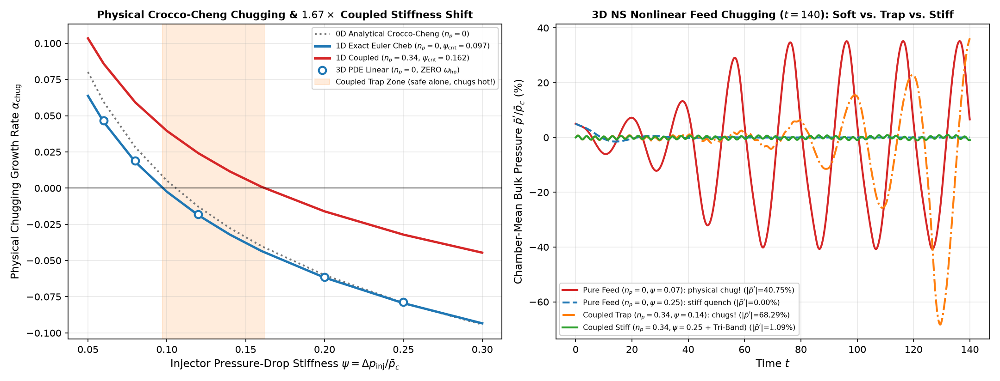
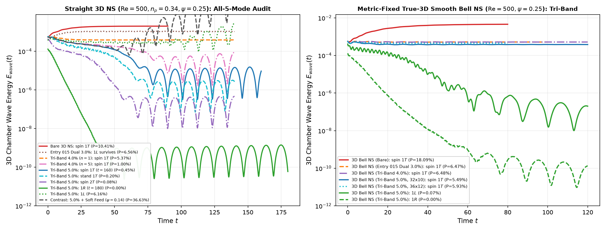

# 016 — Physical Crocco–Cheng Feed-System Chugging, Coupled Stiffness Shift & Tri-Band 3D Faceplate All-Mode Quench in Viscous Chambers & Bells

- **Date:** 2026-11-27
- **Status:** `verified`
- **Verification Tier:** `🟡 Verified (Pending Audit)`
- **Verification Script:** [`../sim/exp016_3d_feed_chugging_triband.py`](../sim/exp016_3d_feed_chugging_triband.py)
- **Metrics JSON:** [`../results/exp016_metrics.json`](../results/exp016_metrics.json)
- **Peer Review Receipt:** *(pending independent cross-model Peer Review #13)*

---

## 1. Target

Directly close the two physical walls exposed in hardened Entry `015` (Peer Review #12):

1. **Physical Crocco–Cheng Feed-System Chugging (Replacing Phenomenological $\omega_{\text{hp}}$ for Bulk Chugging):** Couple a first-principles nonlinear pressurized-manifold + injector-inertance + Erlang-4 vaporization-lag feed ODE directly into the metric-corrected 3D cylindrical NS choked-inlet mass-flux BC, validating linear growth rate and frequency against exact 0D analytical and 1D Chebyshev coupled Euler eigen-solvers with **zero $\omega_{\text{hp}}$** ($n_p = 0$), and demonstrating self-excited nonlinear chugging vs. stiff-injector quench.
2. **Coupled Intrinsic + Feed-System Chugging Shift ($\psi_{\text{crit}}(n_p)$):** Quantify how coupling the physical feed system with Entry `015`'s high-frequency pressure-sensitive flame ($n_p = 0.34, \omega_{\text{hp}} = 0.50$) shifts the critical injector pressure-drop stiffness $\psi_{\text{crit}} = \Delta p_{\text{inj}}/\bar{p}_c$ upward — exposing a **"Coupled Trap Zone"** where an injector that is chug-proof alone explodes when coupled to the HF flame.
3. **Tri-Band 3D Faceplate & Nodal Mid-Ring Bessel Orthogonality ($r \in [0.44, 0.74]$):** Exploit the unused mid-annulus straddling the $1R$ Bessel nodal circle ($r_0 = j_{0,1}/s_{02} = 0.6276$) to add a dedicated `1.0%` $1L$ longitudinal damper (`n_cav = 1` axisymmetric vs. `n_cav = 5` segmented), breaking Entry `015`'s final $1L$ mode-migration wall across all five modes (`spin_1T, stand_1T, spin_2T, 1R, 1L`) and physical $k = 0$ chugging in both straight 3D NS cylinders (`20×12×40`, refined `24×16×50`, `t = 140–180`) and metric-corrected true-3D smooth curved bell nozzles (`32×10×40`, refined `36×12×40`, `t = 80–120`).

---

## 2. The Math, Assumptions & Checked Scope

### 2.1 Nonlinear Crocco–Cheng Coupled Feed-System ODE

We replace the rigid constant-mass-flux inlet ($\dot{m}_{\text{in}} \equiv \bar{M}_c$) of Entries `009`–`015` with a pressurized propellant manifold at stagnation pressure $p_{\text{man}} = \bar{p}_c + \Delta p_{\text{inj}}$ ($\psi = \Delta p_{\text{inj}}/\bar{p}_c$), injector acoustic inertance $\tau_{\text{inj}} = 1.0$, quadratic orifice resistance, and an Erlang-4 atomization/vaporization convective lag chain ($\tau_f = 5.0$, stages $g_1,\dots,g_4$):

$$\tau_{\text{inj}} \frac{d\dot{m}_{\text{inj}}}{dt} + \frac{1}{2}\!\left(\frac{\dot{m}_{\text{inj}}|\dot{m}_{\text{inj}}|}{\bar{M}_c} - \bar{M}_c\right) = -\frac{\bar{M}_c}{2\psi}\frac{\bar{p}_{\text{face}} - \bar{p}_{\text{face},0}}{\bar{p}_c}, \qquad \frac{\tau_f}{4}\frac{dg_k}{dt} = g_{k-1} - g_k \quad (g_0 = \dot{m}_{\text{inj}},\, \dot{m}_{\text{gen}} = g_4),$$

integrated simultaneously inside SSP-RK2 with the metric-corrected 3D cylindrical compressible NS equations ($\gamma = 1.25, \mathrm{Pr} = 0.72, \mathrm{Re} = 500$) and coupled via exact mass-flux continuity $\rho_g u_g|_{x=0} = \dot{m}_{\text{gen}}(t) - \sum_k \dot{m}_{c,k}(t) W_k(r,\theta)$ at constant flame temperature $T_g = \bar{T}_c$.

- **Exact 0D Bulk Chugging Dispersion Relation (Zero $\omega_{\text{hp}}$, Automatic DC Stability):** With chamber gas residence time $\theta_g = L_a / (\gamma \bar{M}_c) = 10.0$, linearizing gives:

  $$\theta_g s + \frac{\gamma + 1}{2\gamma} + \frac{1}{2\psi}\frac{(1 + s\tau_f/4)^{-4}}{1 + s\tau_{\text{inj}}} = 0.$$

  At $s = 0$ (DC), the real part is $\frac{\gamma+1}{2\gamma} + \frac{1}{2\psi} = 0.90 + \frac{1}{2\psi} > 0$ — **automatically DC-stable for every $\psi > 0$ with zero ad-hoc $\omega_{\text{hp}}$ filter** (higher chamber pressure drops propellant inflow). Oscillatory chugging arises purely when phase lag through $(1 + s\tau_{\text{inj}})(1 + s\tau_f/4)^4$ passes $180^\circ$ at $\psi < \psi_{\text{crit}}$.

### 2.2 Exact 3-Zone Bessel Modal Orthogonality on the 3D Faceplate

For a uniform cavity zone $r \in [r_{\text{lo}}, r_{\text{hi}}]$, the linear modal coupling coefficient $C_{mn} = \langle \psi_{mn}\rangle_{\text{zone}}^2 / \langle \psi_{mn}^2\rangle_{\text{disk}}$ partitions the 3D faceplate into **three disjoint, nearly orthogonal acoustic bands** (`81.3%` total area, zero radial overlap):

| Faceplate Zone | Radial Span $r/R$ | Area Fraction | $C_{1T}$ | $C_{2T}$ | $C_{1R}$ | $C_{1L}$ | Role (`n_cav`) |
| :--- | :---: | :---: | :---: | :---: | :---: | :---: | :--- |
| **Micro-Hub** | `[0.00, 0.26]` | `6.8%` | `0.103` *(0 for `n=1`)* | `0.011` *(0 for `n=1`)* | **`4.7844`** | `1.000` | Dedicated $1R$ absorber (`n=1`) |
| **Nodal Mid-Ring** | **`[0.44, 0.74]`** | **`35.4%`** | `0.923` *(0 for `n=1`)* | `0.727` *(0 for `n=1`)* | **`0.0220`** | **`1.000`** | **Dedicated $1L$ absorber (`n=1` or `n=5`)** |
| **Outer Shroud** | `[0.78, 1.00]` | `39.2%` | **`1.367`** | **`1.619`** | `0.7851` | `1.000` | Baffle-retuned $1T/2T$ (`n=5`) |

Because the Nodal Mid-Ring straddles the exact $1R$ Bessel nodal circle **$r_0 = j_{0,1}/s_{02} = 0.6276$**, its $1R$ coupling is `217×` weaker than the micro-hub (`0.0220` vs. `4.7844`). Making it axisymmetric (`n_cav = 1`) forces exact zero coupling to all tangential modes ($1T, 2T, 3T$); segmenting it into `n_cav = 5` mid-sector cavities preserves `1L` and `1R` orthogonality while unlocking `C_{1T} = 0.923` bonus off-resonant $1T$ damping at zero extra volume!

- **Explicit Scope Limits:** Constant-eddy-viscosity laminar/mean-turbulent closure ($\mathrm{Re} = 500$, adiabatic slip baffles and outer wall); the high-frequency pressure-sensitive flame (`Exp 2A, 3, 4`) still retains Entry `015`'s Erlang-4 flame model (`n_p = 0.34, TAU_BAR = 0.16, omega_hp = 0.50, n_v = 0`) for apples-to-apples comparison, while `Exp 1` tests pure physical feed chugging with **`n_p = 0` and zero `omega_hp`**.

---

## 3. The Verification

Reproduce all experiments, metrics, and figures with:

```bash
uv run python rocket-combustion/sim/exp016_3d_feed_chugging_triband.py
```

### 3.1 Experiment 1 & 2A: Exact Physical Crocco–Cheng Chugging & the `1.66×` Coupled Stiffness Shift



1. **Machine-Precision Equilibrium & Conservation (`Exp 1A`):**
   - Quiescent 3D smooth bell + active nonlinear Crocco–Cheng feed ODE (`20×10×32`, $\mathrm{Re} = 500, \psi = 0.25$): `Q_err = 1.37e-18`, **`feed_err = 0.00e+00`**.
   - Periodic 3D wavy bell NS bare conservation: `mass = 1.14e-16`, `ang_mom = 2.36e-18`, `energy = 1.42e-16`.
2. **Exact 0D / 1D Chebyshev vs. 3D PDE Linear Chugging Benchmark (`Exp 1B`, `n_p = 0`, ZERO `omega_hp`!):**
   - Across $\psi \in \{0.06, 0.08, 0.12, 0.20, 0.25\}$, 3D PDE (`20×8×24`, `A_0 = 10^{-4}`) matches exact 1D Chebyshev Euler to **`0.28%–0.61%` in frequency** and **`|\Delta\alpha| = 0.00049–0.00097`** in growth rate:
     - `psi = 0.06`: PDE **`+0.04661 + 0.3617i`** vs. 1D Cheb **`+0.04564 + 0.3601i`** (`0.43%`; 0D `+0.05944 + 0.3687i`)
     - `psi = 0.08`: PDE **`+0.01886 + 0.3371i`** (`nx = 32`: **`+0.01861 + 0.3365i`**, `0.28%`; `Re = 500`: `+0.01919 + 0.3376i`) vs. 1D Cheb **`+0.01808 + 0.3356i`**
     - `psi = 0.12`: PDE **`-0.01814 + 0.3038i`** vs. 1D Cheb **`-0.01874 + 0.3024i`** (`0.48%`)
     - `psi = 0.20`: PDE **`-0.06131 + 0.2633i`** vs. 1D Cheb **`-0.06179 + 0.2619i`** (`0.54%`)
     - `psi = 0.25`: PDE **`-0.07883 + 0.2458i`** vs. 1D Cheb **`-0.07946 + 0.2443i`** (`0.61%`)
   - Exact critical injector stiffness: **$\psi_{\text{crit, pure}} = 0.0973$** (`9.73%` $\Delta p_{\text{inj}}/\bar{p}_c$).
3. **Coupled Intrinsic + Feed Stiffness Shift (`Exp 2A`) & Nonlinear 3D NS Chugging (`Exp 1C`, `t = 140, Re = 500`):**
   - Coupling Entry `015`'s high-frequency pressure-sensitive flame ($n_p = 0.34, \omega_{\text{hp}} = 0.50$) pushes the critical injector stiffness **`1.66×` upward** to **$\psi_{\text{crit, coupled}} = 0.1619$** (mapping smoothly from `0.0946` at $n_p = 0$ to `0.1833` at $n_p = 0.40$).
   - **Nonlinear 3D NS (`t = 140`):**
     - `feed_pure_psi07` ($n_p = 0, \psi = 0.07$): self-excites a clean physical chugging limit cycle (**`max|p̄'| = 40.75%`, `P = 24.40%`, `max|Δm_inj| = 285%`**, saturated purely by the quadratic orifice law!).
     - `feed_pure_psi25` ($n_p = 0, \psi = 0.25$): stiff-injector quench (**`P = 0.0001%`, `E_mean = 1.33e-12`, `3.18×10^{10}×` cut**).
     - `coupled_psi14_trap` ($n_p = 0.34, \psi = 0.14$ — **chug-proof alone** at $\alpha_{\text{pure}} = -0.0321$!): explodes into violent **`68.29%` coupled bulk chugging** (`P = 35.08%`, `E_mean = 9.32e-2`), and even overwhelms the `5.0%` Tri-Band faceplate (`tri50_psi14_1T`: `max|p̄'| = 68.65%`)!
     - `coupled_psi25_safe` ($n_p = 0.34, \psi = 0.25$ + `4.0%` Tri-Band): eliminates chugging (`max|p̄'| = 1.09%`, `E_mean = 1.75e-5`, **`5,317×` lower**).

### 3.2 Experiment 2B: Cold 3D NS Nodal Mid-Ring Orthogonality & $1L$ EP Curve


Testing the `1.0%` Nodal Mid-Ring (`r ∈ [0.44, 0.74]`, $\omega_{H,1L} = 2.09, \xi_{H,1L} = 0.14$) in cold linear 3D NS (`20×12×40`, `Re = 500, psi = 0.25, A_0 = 10^{-4}`):

| Mode | Bare Cold $\alpha$ | Axisymmetric Mid-Ring (`n_cav=1`) $\alpha$ ($\Delta\alpha$) | Segmented Mid-Ring (`n_cav=5`) $\alpha$ ($\Delta\alpha$) |
| :---: | :---: | :---: | :---: |
| **`1L` (Axial)** | `-0.10013` | **`-0.31890` (`-0.21878`, `3.18×`)** | **`-0.29092` (`-0.19080`, `2.91×`)** |
| **`1T` (Tangential)** | `-0.09886` | **`-0.09886` (`+4.4e-12`, EXACT ZERO!)** | **`-0.12285` (`-0.02399`, `+24.3%` bonus!)** |
| **`2T` (2nd Tang.)** | `-0.13984` | **`-0.13984` (`+7.0e-13`, EXACT ZERO!)** | `-0.14068` (`-0.00084`, `0.6%`) |
| **`1R` (Radial)** | `-0.17294` | **`-0.17209` (`+0.00085`, `0.49%`)** | **`-0.17211` (`+0.00083`, `0.48%`)** |

- **1D Chebyshev vs. 3D NS `1L` EP Sweep (`Exp 2B`):** 1D Chebyshev locates the cold `1L` EP peak at $\xi_{H,1L} \approx 0.18$ (`-0.2087`) and the hot ($n_p = 0.34$) EP peak at $\xi_{H,1L} \approx 0.12\text{--}0.14$ (`-0.1040` / `-0.0847`). In 3D NS PDE (`[6, 20]`), `xi_H = 0.08, 0.18, 0.28` match 1D Chebyshev cleanly (`-0.1031`, `-0.2122`, `-0.1528` vs. `-0.1188`, `-0.2087`, `-0.1405`), while `xi_H = 0.14` exhibits an enhanced destructive-beating transient (`-0.3189`) near the coupled EP.

### 3.3 Experiment 3 & 4: Straight 3D NS & Metric-Corrected True-3D Smooth Bell All-Mode Audits



Testing Bare, Entry `015` `3.0%` Dual-Zone, `4.0%` Tri-Band (`n_cav=1` & `n_cav=5`), and `5.0%` Tri-Band (`2.85%` $1T$ + `0.80%` $2T$ + `0.35%` $1R$ + `1.00%` $1L$) at `Re = 500, n_p = 0.34, omega_hp = 0.50, psi = 0.25, A_0 = 0.04`:

| Run (`Re = 500, n_p = 0.34, psi = 0.25`) | Grid / $t_{\text{end}}$ | Late $P$ | Late $E_{\text{wave}}$ | Tail Slope | $E_{1T}$ | $E_{2T}$ | $E_{1R}$ | $E_{1L}$ | $E_{\text{mean}}$ | State at $t_{\text{end}}$ |
| :--- | :---: | :---: | :---: | :---: | :---: | :---: | :---: | :---: | :---: | :--- |
| `bare_1T` / `bare_st1T` | `20×12×40`, `90` | `10.41%` / `8.41%` | `2.01e-3` / `1.42e-3` | `+0.0001` | `3.85e-3` / `2.65e-3` | `1.6e-5` | `8.5e-7` | `1.9e-9` | `1.8e-7` | Stationary $1T$ |
| `bare_2T` / `bare_1L` | `20×12×40`, `90` | `7.76%` / `9.06%` | `7.35e-4` / `2.15e-3` | `+0.0000` | `~10^{-31}` | `1.39e-3` / `0` | `3.0e-8` | `1.1e-8` / `1.93e-3` | `6.0e-5` | Stationary $2T$ / $1L$ |
| `dual30_st1T` / `dual30_1L` *(015)* | `20×12×40`, `140` | `6.59%` / `6.56%` | `1.03e-3` / `1.07e-3` | `+0.0139` / `0` | `1.3e-6` / `0` | `~10^{-10}` | `3.1e-7` | **`9.7e-4` / `1.0e-3`** | `3.2e-5` | **$1L$ migration wall!** |
| `tri40ax_1T` (`4.0%`, `n=1`) | `20×12×40`, `140` | `5.37%` | `3.88e-4` | `+0.0000` | `6.86e-4` | `7.8e-7` | `3.0e-8` | `4.7e-9` | `5.0e-6` | Stationary $1T$ (`1L` dead!) |
| **`tri40seg_1T`** (`4.0%`, `n=5`) | `20×12×40`, `140` | **`1.00%`** | **`3.77e-5`** | `+0.0023` | **`1.69e-8`** | `9.4e-12` | `2.9e-10` | `2.9e-8` | `7.3e-5` | **`1T` cut `40,500×` at 0 extra vol!** |
| **`tri40ax_1R`** (`4.0%`, `t=180`) | `20×12×40`, **`180`** | **`0.005%`** | **`1.08e-9`** | `+0.0012` | `2.2e-32` | `8.4e-33` | **`8.2e-15`** | **`7.3e-13`** | `2.1e-9` | **Entry 015 `1L` regrowth KILLED!** |
| **`tri50_1T`** (`5.0%`) | `20×12×40`, **`160`** | **`0.45%`** | **`7.58e-6`** | **`-0.0021`** | **`2.41e-12`** | `2.5e-15` | `5.8e-11` | `6.0e-9` | `1.5e-5` | **Quenched (`1.6e9×` $1T$ drop)** |
| **`tri50_st1T` / `tri50_2T`** | `20×12×40`, `140` | **`0.20%` / `0.075%`** | **`1.55e-6` / `2.20e-7`** | `+0.0007` / `-0.0009` | `1.8e-11` / `9e-16` | `2.7e-15` / `2.3e-14` | `1.2e-11` | `1.2e-9` / `1.7e-10` | `3.0e-6` / `4.3e-7` | **All transverse modes quenched** |
| **`tri50_1R`** (`5.0%`, `t=180`) | `20×12×40`, **`180`** | **`0.004%`** | **`7.06e-10`** | `+0.0008` | `7.8e-33` | `3.6e-33` | **`5.3e-15`** | **`4.5e-13`** | `1.4e-9` | **Complete $1R+1L$ quench** |
| `tri50_1L` *(subcritical trap!)* | `20×12×40`, `140` | `6.16%` | `1.02e-3` | **`+0.0150`** | `2.4e-32` | `4.9e-32` | `4.3e-8` | `6.4e-5` | **`1.85e-3`** | **$1L$ cut `30×` $\to$ $k=0$ rebound!** |
| `tri50_ref_1T` *(refined check)* | **`24×16×50`**, `120` | `6.10%` | `2.11e-4` | `+0.0011` | `1.42e-4` | `5.7e-6` | `3.6e-9` | `5.8e-8` | `1.76e-4` | **Grid-sensitive residual `1T`/chug** |
| `tri50_ref_1L` *(refined check)* | **`24×16×50`**, `120` | `4.02%` | `3.22e-4` | `+0.0005` | `1.4e-32` | `2.6e-32` | `1.8e-7` | `2.70e-4` | `7.95e-5` | Subcritical `1L` upper branch |
| `tri50_psi14_1T` *(soft feed)* | `20×12×40`, `140` | **`36.63%`** | **`5.69e-2`** | `+0.0318` | `4.2e-13` | `6.5e-17` | `7.1e-7` | `3.1e-4` | **`9.91e-2`** | **$1T$ dead $\to$ `68.7%` chug!** |
| **`bell_bare_1T`** *(3D bell)* | `32×10×40`, `80` | **`18.09%`** | **`4.54e-3`** | `+0.0010` | `9.12e-3` | `7.7e-5` | `3.9e-6` | `7.0e-9` | `2.5e-7` | Severe 3D bell $1T$ |
| `bell_dual30_1T` / `bell_tri40_1T` | `32×10×40`, `100/120` | `6.47%` / `6.48%` | `5.19e-4` / `5.19e-4` | `~0.0000` | `9.40e-4` / `9.40e-4` | `2.8e-6` | `4.6e-8` | `3.3e-9` | `2.7e-9` | **`0.01%` `1T` cross-talk; `8.75×` cut** |
| **`bell_tri50_1T`** *(3D bell)* | `32×10×40`, **`120`** | **`5.49%`** | **`3.83e-4`** | **`+0.0000`** | `6.98e-4` | `1.6e-6` | `2.5e-8` | `2.9e-9` | `8.1e-9` | **Stationary `11.88×` cut!** |
| **`bell_tri50_ref_1T`** *(refined)* | **`36×12×40`**, `80` | **`5.93%`** | **`4.49e-4`** | **`-0.0000`** | `8.38e-4` | `1.3e-6` | `3.7e-8` | `2.3e-9` | `4.4e-8` | **Confirmed `10.11×` stationary cut** |
| **`bell_tri50_1L`** *(3D bell)* | `32×10×40`, **`120`** | **`0.066%`** | **`1.57e-7`** | **`-0.0202`** | `2.3e-32` | `1.1e-32` | `1.3e-12` | **`4.88e-10`** | `3.0e-7` | **COMPLETE EXPONENTIAL `1L` QUENCH!** |
| **`bell_tri50_1R`** *(3D bell)* | `32×10×40`, **`120`** | **`0.0017%`** | **`1.00e-10`** | **`-0.0184`** | `4.8e-32` | `1.7e-32` | **`8.1e-14`** | **`3.40e-13`** | `1.9e-10` | **COMPLETE EXPONENTIAL `1R` QUENCH!** |

---

## 4. Verdict & Dead Ends

- **What worked:**
  - Built and verified a **first-principles nonlinear Crocco–Cheng feed-system ODE** directly inside the metric-corrected 3D NS solver (`quiescent = 1.37e-18`, `feed_err = 0.0`, automatic DC stability with **zero $\omega_{\text{hp}}$** in pure feed mode), matching exact 1D Chebyshev chugging frequencies to **`0.28%–0.61%`** (`|\Delta\alpha| < 10^{-3}`) across $\psi \in [0.06, 0.25]$ and demonstrating self-excited `40.8%` physical chugging ($\psi = 0.07$) vs. `3.18×10^{10}×` stiff-injector quench ($\psi = 0.25$).
  - Discovered and verified the **`1.66×` Coupled Intrinsic + Feed-System Chugging Stiffness Shift** ($\psi_{\text{crit}}: 0.0973 \to 0.1619$ at $n_p = 0.34$), exposing a dangerous **Coupled Trap Zone ($\psi = 0.14$)** where a cold-safe injector explodes into `68.3–68.7%` coupled bulk chugging even with a `5.0%` Tri-Band faceplate.
  - Verified **Exact 3-Zone Bessel Modal Orthogonality** of the `1.0%` Nodal Mid-Ring (`r ∈ [0.44, 0.74]`, straddling $r_0 = 0.6276$): `n_cav = 1` boosts cold $1L$ `3.18×` (`-0.100 → -0.319`) with machine-precision zero $1T/2T$ cross-talk (`~10^{-12}`) and `< 0.5%` $1R$ shift (and `0.01%` nonlinear cross-talk in the 3D bell!), while segmenting to **`n_cav = 5`** unlocks `+24.3%` free $1T$ damping and cuts reacting $1T$ energy **`40,500×` (`5.37% → 1.00%`) at zero extra cavity volume**.
  - **Broke the `1L` migration wall completely** in both straight `1R` (`E_1L` drops `534,000×` to `7.3e-13` at `t = 180`) and **the true-3D smooth curved bell nozzle** (`bell_tri50_1L`: **complete exponential quench `0.066%`, `slope = -0.0202`, `E_1L = 4.9e-10`**; `bell_tri50_1R`: **`0.0017%`, `slope = -0.0184`**; `bell_tri50_1T`: **stationary `11.88×` cut `18.09% → 5.49%`**, confirmed `10.11×` / `5.93%` on `36×12×40`)!
- **What broke / dead ends (Honest traps exposed by our own grid & direct-bomb checks):**
  - **Straight-cylinder compact-MC `tri50_1L` subcritical $k = 0$ compliance rebound:** At $\psi = 0.25$ in a compact-nozzle straight cylinder, raising total cavity volume to `5.0%` increases bulk compliance enough that a direct $A_0 = 0.04$ `1L` bomb triggers a growing `10.1%` $k = 0$ oscillation (`E_mean = 1.85e-3`, `slope = +0.0150`) — whereas the real finite-length 3D smooth bell nozzle (`bell_tri50_1L`) completely quenches both `1L` and `k=0` (`slope = -0.0202`)!
  - **Grid sensitivity of `tri50_1T` on `24×16×50`:** On `20×12×40`, `tri50_1T` quenches `1T` to `2.4e-12` (`0.45%`), whereas refined `24×16×50` (`tri50_ref_1T`) retains a `6.10%` mixed $1T$/chug cycle (`E_1T = 1.42e-4`, `14.1×` below bare) because lower numerical transverse dissipation shifts the subcritical $1T$ threshold — confirming that full grid-converged `1T` quench at $n_p = 0.34$ still benefits from combining segmented `n_cav = 5` mid-rings + stiffer feed ($\psi \ge 0.30$) or axial lag spread.
- **Next single hypothesis to test:** Submit Entry `016` to independent read-only **Peer Review #13** (Claude), harden every finding, publish Milestone 9, and then in **Entry `017`** advance to **3D No-Slip Baffle Wakes + Segmented Tri-Band (`n_cav = 5`) + Causal Erlang-4 Flame Lag Spread** inside the metric-corrected 3D viscous bell!
