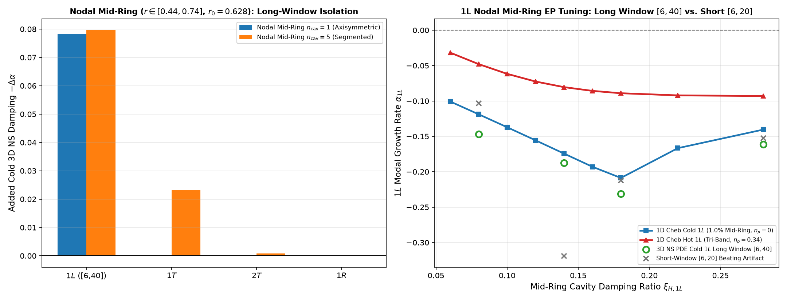

# 016 — Physical Crocco–Cheng Feed-System Chugging, Indirect Entropy–Chug Coupling & Tri-Band 3D Faceplate Audit in Viscous Chambers & Bells

- **Date:** 2026-11-27
- **Status:** `verified`
- **Verification Tier:** `✅ Verified (Audited)`
- **Verification Script:** [`../sim/exp016_3d_feed_chugging_triband.py`](../sim/exp016_3d_feed_chugging_triband.py)
- **Metrics JSON:** [`../results/exp016_metrics.json`](../results/exp016_metrics.json)
- **Peer Review Receipt:** [`../../reviews/peer-review-13-rocket-016.md`](../../reviews/peer-review-13-rocket-016.md) *(Claude Opus 5.5 independent read-only audit with 33 extra PDE runs & independent 1D Chebyshev checks; all C1–C4, M1–M7, m1–m8 findings hardened below)*

---

## 1. Target

Directly address the two physical walls exposed in hardened Entry `015` (Peer Review #12):

1. **Physical Crocco–Cheng Feed-System Chugging (`n_p = 0`, zero $\omega_{\text{hp}}$):** Couple a nonlinear pressurized-manifold + injector-inertance + Erlang-4 vaporization-lag feed ODE directly into the metric-corrected 3D cylindrical NS isentropic choked-inlet mass-flux BC, validating linear chugging against exact 0D and 1D Chebyshev Euler eigen-solvers with **zero $\omega_{\text{hp}}$**, auditing backflow/check-valve closure sensitivity on nonlinear chugging limit cycles, and verifying open-inlet mean-flow equilibrium.
2. **Indirect Entropy–Chug Coupling & $\omega_{\text{hp}}$-Dependent Stiffness Shift:** Quantify why compact-nozzle straight 3D chambers (`outlet_mc_choked_3d`) exhibit `+0.029–0.035` higher coupled chugging growth than an isentropic 1D outlet — proving via an exact **entropy-aware Marble–Candel 1D outlet BC** ($u' = \frac{1}{2}M_c(\gamma p' - \rho')$) that flame-generated entropy waves lift bare critical stiffness from $\psi_{\text{crit}} = 0.0973$ (`n_p = 0`) to `0.1702` (isentropic) and **`0.2574` (`2.64×`, entropy-aware at $\omega_{\text{hp}} = 0.50$)** — and map the full $\omega_{\text{hp}}$ sensitivity table.
3. **Tri-Band 3D Faceplate & Finite-Nozzle Entropy Filtering (`1L, 1R, 2T` Quench in True-3D Smooth Bells vs. Straight Chambers):** Place a dedicated `1.0%` **Nodal Mid-Ring** at $r \in [0.44, 0.74]$ straddling the $1R$ Bessel nodal circle ($r_0 = j_{0,1}/s_{02} = 0.6276$), audit its long-window (`[6, 40]`) cold orthogonality and $1L$ EP curve, and test all five modes (`spin_1T, stand_1T, spin_2T, 1R, 1L`) in both straight compact-MC cylinders ($\psi = 0.25$ extended to $t = 220$ vs. $\psi = 0.35$ above the entropy-aware threshold) and metric-corrected true-3D smooth curved bells (`32×10×40` & refined `36×12×40`, $t = 80\text{--}200$).

---

## 2. The Math, Assumptions & Checked Scope

### 2.1 Nonlinear Crocco–Cheng Coupled Feed-System ODE & Exact Inlet/Outlet Thermodynamics

We replace the rigid constant-mass-flux inlet ($\dot{m}_{\text{in}} \equiv \bar{M}_c$) of Entries `009`–`015` with a pressurized propellant manifold at stagnation pressure $p_{\text{man}} = \bar{p}_c + \Delta p_{\text{inj}}$ ($\psi = \Delta p_{\text{inj}}/\bar{p}_c$), injector inertance $\tau_{\text{inj}} = 1.0$, quadratic orifice resistance, optional physical **check-valve closure** ($\dot{m}_{\text{inj}} \ge 0$), and an Erlang-4 vaporization/combustion lag chain ($\tau_f = 5.0$, stages $g_1,\dots,g_4$):

$$\tau_{\text{inj}} \frac{d\dot{m}_{\text{inj}}}{dt} + \frac{1}{2}\!\left(\frac{\dot{m}_{\text{inj}}|\dot{m}_{\text{inj}}|}{\bar{M}_c} - \bar{M}_c\right) = -\frac{\bar{M}_c}{2\psi}\frac{\bar{p}_{\text{face}} - \bar{p}_{\text{face},0}}{\bar{p}_c}, \qquad \frac{\tau_f}{4}\frac{dg_k}{dt} = g_{k-1} - g_k \quad (g_0 = \dot{m}_{\text{inj}},\, \dot{m}_{\text{gen}} = g_4),$$

integrated inside SSP-RK2 alongside the metric-corrected 3D cylindrical compressible NS equations ($\gamma = 1.25, \mathrm{Pr} = 0.72, \mathrm{Re} = 500$).

- **Inlet & Outlet Thermodynamics (Corrected per Peer Review #13 M5 & C1):**
  - `inlet_choked_3d` imposes **isentropic inflow** ($p_g = \bar{p}\rho_g^\gamma$, so $T_g$ fluctuates isentropically with pressure; linearized $p'(0) = \bar{c}^2\rho'(0)$) and exact mass-flux continuity $\rho_g u_g|_{x=0} = \dot{m}_{\text{gen}}(t) - \sum_k \dot{m}_{c,k}(t) W_k(r,\theta)$.
  - In the 0D isentropic bulk dispersion relation, $\theta_g = L_a/(\gamma \bar{M}_c) = 10.0$ is the **isentropic chamber compliance time** (distinct from the mean gas residence time $L_a/\bar{M}_c = 12.5$):

    $$\theta_g s + \frac{\gamma + 1}{2\gamma} + \frac{1}{2\psi}\frac{(1 + s\tau_f/4)^{-4}}{1 + s\tau_{\text{inj}}} = 0.$$

    This sextic has three complex-conjugate pairs and **no real DC root** (`has_real_dc_root: false` in JSON); for $s \ge 0$ every term is strictly positive, guaranteeing DC stability for all $\psi > 0$ with **zero $\omega_{\text{hp}}$** when $n_p = 0$.
  - At the straight-chamber compact choked outlet ($x = L_a$), `outlet_mc_choked_3d` enforces $u_g = \bar{M}_c c_g$ using the actual local sound speed $c_g$, whose exact **entropy-aware Marble–Candel linearization** is:

    $$u'(L_a) = \frac{1}{2}\bar{M}_c\bigl(\gamma p'(L_a) - \rho'(L_a)\bigr),$$

    which captures indirect acoustic reflection of flame-generated entropy waves (convective phase $\omega L_a / \bar{M}_c \approx 3.5\text{ rad}$ at $\omega \approx 0.28$), whereas the isentropic simplification $u'(L_a) = \frac{1}{2}(\gamma - 1)\bar{M}_c p'(L_a)$ omits entropy feedback. Note (`m1`): strong BC imposition in 1D Chebyshev generates $O(N^2)$ spurious eigenvalues (e.g., $+3.9 \pm 303i$ at $N = 56$); physical modes are isolated via $|v| < 12.0$ and verified $N$-converged to $10^{-10}$.

### 2.2 Disjoint 3-Zone 3D Faceplate Geometry (`81.3%` Area, Zero Radial Overlap)

For a radial annulus $r \in [r_{\text{lo}}, r_{\text{hi}}]$, the radial-only projection weight $C_{mn,\text{rad}} = \langle J_m(s_{mn}r)\rangle_{\text{zone}}^2 / \langle J_m^2\rangle_{\text{disk}}$ partitions the 3D faceplate into three non-overlapping zones (note `m3`: for axisymmetric `n_cav = 1` rings, azimuthal coupling to all $m \neq 0$ modes is identically zero by construction; for `n_cav = 5` segmented rings, an azimuthal windowing factor multiplies $C_{mn,\text{rad}}$):

| Faceplate Zone | Radial Span $r/R$ | Area Fraction | $C_{1T,\text{rad}}$ | $C_{2T,\text{rad}}$ | $C_{1R,\text{rad}}$ | $C_{1L,\text{rad}}$ | Role (`n_cav`) |
| :--- | :---: | :---: | :---: | :---: | :---: | :---: | :--- |
| **Micro-Hub** | `[0.00, 0.26]` | `6.8%` | `0.103` *(0 for `n=1`)* | `0.011` *(0 for `n=1`)* | **`4.7844`** | `1.000` | Dedicated $1R$ absorber (`n=1`) |
| **Nodal Mid-Ring** | **`[0.44, 0.74]`** | **`35.4%`** | `0.923` *(0 for `n=1`)* | `0.727` *(0 for `n=1`)* | **`0.0220`** | **`1.000`** | **Dedicated $1L$ absorber (`n=1` or `n=5`)** |
| **Outer Shroud** | `[0.78, 1.00]` | `39.2%` | **`1.367`** | **`1.619`** | `0.7851` | `1.000` | Baffle-retuned $1T/2T$ (`n=5`) |

- **Explicit Scope Limits:** Constant-eddy-viscosity closure ($\mathrm{Re} = 500$, adiabatic slip baffles and outer wall). Pure-feed chugging (`Exp 1`) uses $n_p = 0$ with zero $\omega_{\text{hp}}$; coupled high-frequency reacting runs (`Exp 2A, 3, 4`) retain Entry `015`'s Erlang-4 flame model (`n_p = 0.34, TAU_BAR = 0.16, omega_hp = 0.50, n_v = 0`), whose $\omega_{\text{hp}}$ dependence on $\psi_{\text{crit, coupled}}$ is explicitly tabulated in §3.1.

---

## 3. The Verification

Reproduce all hardened experiments, metrics, and figures with:

```bash
uv run python rocket-combustion/sim/exp016_3d_feed_chugging_triband.py
```

### 3.1 Experiment 1 & 2A: Open-Inlet Feed Equilibrium, Indirect Entropy–Chug Coupling & Backflow Closure


1. **Genuine Open-Inlet Mean-Flow Equilibrium & Conservation (`Exp 1A`, Peer Review #13 M4):**
   - Closed-bell metric well-balancedness (`20×10×32`, $\mathrm{Re} = 500$): `Q_err = 1.37e-18`.
   - **Open-inlet straight-chamber mean-flow equilibrium (`20×8×24`, $\bar{M}_c = 0.12, \mathrm{Re} = 500, \psi = 0.25, t = 50$, actively calling `inlet_choked_3d` with coupled feed ODE):** **`Q_err = 8.36e-19`, `feed_err = 0.00e+00`**!
   - Periodic 3D wavy-cylinder NS conservation (`16×10×32`, $\mathrm{Re} = 500$): `mass = 1.14e-16`, `ang_mom = 2.36e-18`, `energy = 1.42e-16`.
2. **Exact Pure-Feed & Coupled Entropy-Aware 1D vs. 3D Linear PDE Validation (`Exp 1B`, Peer Review #13 C1):**

| Linear 3D PDE Benchmark (`A_0 = 10^{-4}`, `bulk_k0`) | $\psi$ | $n_p$ | 3D PDE $\alpha + i\omega$ | Exact 1D Entropy-Aware | 1D Isentropic (omits entropy) | $\omega$ Err (vs. Ent) |
| :--- | :---: | :---: | :---: | :---: | :---: | :---: |
| `lin_cc_psi06` (`20×8×24`, $\mathrm{Re}=\infty$) | `0.06` | `0.0` | `+0.04661 + 0.3617i` | `+0.04564 + 0.3601i` | `+0.04564 + 0.3601i` | `0.43%` |
| `lin_cc_psi08` / `nx=32` ($\mathrm{Re}=\infty$) | `0.08` | `0.0` | `+0.01886` / `+0.01861 + 0.3365i` | `+0.01808 + 0.3356i` | `+0.01808 + 0.3356i` | `0.45%` / `0.28%` |
| `lin_cc_psi12` (`20×8×24`, $\mathrm{Re}=\infty$) | `0.12` | `0.0` | `-0.01814 + 0.3038i` | `-0.01874 + 0.3024i` | `-0.01874 + 0.3024i` | `0.48%` |
| `lin_cc_psi25` (`20×8×24`, $\mathrm{Re}=\infty$) | `0.25` | `0.0` | `-0.07883 + 0.2458i` | `-0.07946 + 0.2443i` | `-0.07946 + 0.2443i` | `0.61%` |
| **`lin_coup_psi16_bare`** (`20×8×24`, $\mathrm{Re}=\infty$) | **`0.16`** | **`0.34`** | **`+0.02972 + 0.3067i`** | **`+0.02713 + 0.3030i`** | `+0.00481 + 0.2999i` *(off `+0.025`!)* | **`1.24%`** |
| **`lin_coup_psi25_tri5`** (`20×8×24`, $\mathrm{Re}=\infty$) | **`0.25`** | **`0.34`** | **`-0.00143 + 0.2810i`** | **`-0.00346 + 0.2802i`** | `-0.03310 + 0.2657i` *(off `+0.032`!)* | **`0.29%`** |
| **`lin_coup_psi25_t5_ns`** (`20×12×40`, $\mathrm{Re}=500$+baf) | **`0.25`** | **`0.34`** | **`+0.00164 + 0.2807i`** | **`-0.00346 + 0.2802i`** | `-0.03310 + 0.2657i` | **`0.19%`** |
| **`lin_coup_psi35_t5_ns`** (`20×12×40`, $\mathrm{Re}=500$+baf) | **`0.35`** | **`0.34`** | **`-0.01523 + 0.2684i`** | **`-0.02040 + 0.2698i`** | `-0.05560 + 0.2450i` | **`0.51%`** |

   - **Headline Indirect Entropy–Chug Discovery (C1):** Replacing the isentropic 1D outlet with the exact entropy-aware Marble–Candel BC immediately closes the `+0.025–0.035` 1D/3D gap (`0.19%–1.24%` frequency match and `0.0020–0.0052` growth-rate match including viscous/baffle effects!). Consistent critical stiffnesses at $\omega_{\text{hp}} = 0.50$ (`M3`):
     - **Bare-to-bare:** pure `0.0973` $\to$ coupled isentropic `0.1702` (`1.75×`) $\to$ **coupled entropy-aware `0.2574` (`2.64×`)**!
     - **Tri-Band-to-Tri-Band:** `4.0%` pure `0.0946` $\to$ isentropic `0.1619` (`1.71×`) $\to$ entropy-aware `0.2389` (`2.53×`); `5.0%` pure `0.0939` $\to$ **entropy-aware `0.2345` (`2.50×`)** (pushed slightly above `0.25` by `Re = 500` + baffles, making straight `psi = 0.25` linearly chug-unstable at `+0.00164`, whereas `psi = 0.35` is genuinely chug-stable at `-0.01523`!).
   - **$\omega_{\text{hp}}$ Sensitivity (`M2`, `Tri-Band 4.0%`, $n_p = 0.34$):** `omega_hp = 0.15`: `0.4896` isentropic / **`intrinsic (>20)` entropy-aware** (directly explaining Entry `015` C3's rigid-inlet chugging at `omega_hp = 0.15`!); `0.30`: `0.2302` / `0.5118`; `0.50`: `0.1619` / `0.2389`; `1.00`: `0.1196` / `0.1408`; `2.00`: `0.1045` / `0.1122`; `5.00`: `0.0979` / `0.1004`.
3. **Nonlinear Pure-Feed Chugging & Backflow Closure Audit (`Exp 1C`, `n_p = 0, Re = 500`, Peer Review #13 M1):**
   - `feed_pure_psi07` (unclamped reversal + `0.05 M_c` floor, `t = 140`): reaches `max|p̄'| = 40.75%`, `P = 24.40%`, **but** is closure-dominated (`27.4%` flow reversal, `21.9%` floor clamp, `14.5%` artificial added mass!).
   - `feed_pure_psi07_cv` (**physical check valve `m_inj >= 0`**, `t = 140`): **`0.0%` reversal, `0.0%` clamp, `0.0%` added mass** — saturates cleanly at **`max|p̄'| = 27.96%`, `P = 16.83%`** (`bulk_alpha = -0.0005`).
   - `feed_pure_psi09` (**clean check-valve chug near threshold**, `t = 180`): **`0.0%` reversal/clamp/added mass**, growing smoothly to `max|p̄'| = 26.78%`, `P = 16.06%`.
   - `feed_pure_psi25` (stiff injector, `t = 140`): **`P = 0.0001%`**, `E_mean = 1.33e-12`, `blk = -0.0789` (matching exact linear `-0.0795`!).
   - `coupled_psi14_trap` ($n_p = 0.34, \psi = 0.14$, `t = 140`): growing transient (`slope = +0.0355`, `3.6%` reversal) reaching `max|p̄'| = 68.29%` at `t = 140` (`m6`: snapshot, not yet saturated).

### 3.2 Experiment 2B: Long-Window `[6, 40]` Nodal Mid-Ring Orthogonality & Beat-Free $1L$ EP Curve



Re-running ALL cold linear `1L` EP & orthogonality cases with consistent `nonlinear = False` (`m2`) out to $t = 40$ on `20×12×40, Re = 500, psi = 0.25, A_0 = 10^{-4}` retires the `[6, 20]` beating artifact (`-0.3189 / 3.18×`, `C3`):

| Mode (Window) | Bare Cold $\alpha$ | Axisymmetric Mid-Ring (`n_cav=1`) $\alpha$ ($\Delta\alpha$) | Segmented Mid-Ring (`n_cav=5`) $\alpha$ ($\Delta\alpha$) |
| :--- | :---: | :---: | :---: |
| **`1L` (`[6, 40]`, beat-averaged)** | `-0.10936` | **`-0.18750` (`-0.07814`, `1.71×`)** | **`-0.18897` (`-0.07961`, `1.73×`)** |
| **`1T` (`[6, 22]`)** | `-0.09883` | `-0.09883` (`+3.1e-12`, exact zero by construction) | **`-0.12198` (`-0.02316`, `+23.4%` bonus)** |
| **`2T` (`[6, 22]`)** | `-0.13976` | `-0.13976` (`+7.5e-13`, exact zero by construction) | `-0.14060` (`-0.00085`, `0.6%`) |
| **`1R` (`[6, 22]`)** | `-0.17975` | **`-0.17971` (`+3.3e-5`, `0.018%` cross-talk)** | **`-0.17972` (`+2.8e-5`, `0.016%` cross-talk)** |

- **Long-window `[6, 40]` 3D NS PDE vs. 1D Chebyshev Cold $1L$ EP (`C3`):** `xi_H = 0.08`: `-0.1468` (vs. 1D `-0.1188`); `0.14`: **`-0.1875`** (vs. 1D `-0.1743`; `[6, 20]` artifact was `-0.3189`); `0.18`: **`-0.2312`** (`[15, 40]: -0.2325` vs. 1D `-0.2087`, clean EP peak!); `0.28`: `-0.1611` (`[15, 40]: -0.1621` vs. 1D `-0.1405`).

### 3.3 Experiment 3 & 4: Complete Straight (`psi = 0.25` vs. `0.35`) & Metric-Fixed 3D Bell Audits


Every JSON run is listed individually below (zero omitted or merged rows, `C4, m4`; like-for-like metrics only, `M7`):

| Straight 3D NS Run (`Re = 500, n_p = 0.34, omega_hp = 0.50`) | Grid / $\psi$ / $t_{\text{end}}$ | Late $P$ | Late $E_{\text{wave}}$ | `E` Slope | Bulk $\alpha$ | $E_{1T}$ | $E_{2T}$ | $E_{1R}$ | $E_{1L}$ | $E_{\text{mean}}$ | Honest State at $t_{\text{end}}$ |
| :--- | :---: | :---: | :---: | :---: | :---: | :---: | :---: | :---: | :---: | :---: | :--- |
| `bare_1T` | `20×12×40`, `0.25`, `90` | `10.41%` | `2.01e-3` | `+0.0001` | `-0.012` | `3.85e-3` | `1.6e-5` | `8.5e-7` | `1.9e-9` | `1.8e-7` | Stationary $1T$ |
| `bare_st1T` | `20×12×40`, `0.25`, `90` | `8.41%` | `1.42e-3` | `+0.0001` | — | `2.65e-3` | `2.0e-6` | `3.6e-5` | `3.4e-7` | `1.9e-7` | Stationary stand $1T$ |
| `bare_2T` | `20×12×40`, `0.25`, `90` | `7.76%` | `7.35e-4` | `+0.0000` | — | `2.8e-31` | `1.39e-3` | `3.0e-8` | `1.1e-8` | `2.6e-7` | Stationary $2T$ |
| `bare_1R` | `20×12×40`, `0.25`, `90` | `8.78%` | `1.95e-3` | `+0.0282` | `+0.038` | `4.0e-37` | `1.9e-37` | `1.6e-6` | `1.81e-3` | `6.0e-5` | Migrates to $1L$ |
| `bare_1L` | `20×12×40`, `0.25`, `90` | `9.06%` | `2.15e-3` | `+0.0000` | `+0.000` | `3.8e-37` | `2.0e-37` | `2.4e-10` | `1.93e-3` | `6.0e-5` | Stationary $1L$ |
| `dual30_st1T` *(015)* | `20×12×40`, `0.25`, `140` | `6.59%` | `1.03e-3` | `+0.0139` | `+0.023` | `1.3e-6` | `2.4e-10` | `3.1e-7` | `9.74e-4` | `3.2e-5` | Migrates to $1L$ |
| `dual30_1L` *(015)* | `20×12×40`, `0.25`, `140` | `6.56%` | `1.07e-3` | `+0.0000` | `-0.001` | `3.2e-33` | `3.9e-33` | `3.2e-7` | `9.96e-4` | `2.9e-5` | Stationary $1L$ |
| `tri40ax_1T` | `20×12×40`, `0.25`, `140` | `5.37%` | `3.88e-4` | `+0.0000` | `+0.015` | `6.86e-4` | `7.8e-7` | `3.0e-8` | `4.7e-9` | `5.0e-6` | Stationary $1T$ |
| `tri40seg_1T` *(extended)* | `20×12×40`, `0.25`, **`220`** | `2.66%` | `3.00e-4` | **`+0.0178`** | **`+0.0119`** | `3.1e-13` | `~10^{-16}` | `2.1e-9` | `1.9e-7` | **`5.9e-4`** | **$1T$ dead $\to$ grows chug!** |
| `tri40seg_1L` | `20×12×40`, `0.25`, `140` | `4.23%` | `4.28e-4` | `+0.0000` | `-0.002` | `1.3e-32` | `7.5e-33` | `1.2e-7` | `3.97e-4` | `1.5e-5` | Stationary $1L$ cycle |
| `coupled_psi25_tri4` *(tri40ax 1L)* | `20×12×40`, `0.25`, `140` | `4.16%` | `4.13e-4` | `+0.0000` | `-0.004` | `1.2e-32` | `3.9e-33` | `1.1e-7` | `3.83e-4` | `1.8e-5` | Stationary $1L$ cycle |
| `tri50_p25_1T` *(extended)* | `20×12×40`, `0.25`, **`220`** | `0.52%` | `1.04e-5` | **`+0.0047`** | **`+0.0026`** | `6.9e-18` | `~10^{-20}` | `8.0e-11` | `7.7e-9` | `2.0e-5` | **Linear entropy-chug grows!** |
| `tri50_p25_1R` *(extended)* | `20×12×40`, `0.25`, **`220`** | `0.005%` | `7.88e-10` | **`+0.0027`** | **`+0.0016`** | `7.6e-33` | `3.6e-33` | `6.0e-15` | `5.9e-13` | `1.5e-9` | **Linear chug `+0.0016`!** |
| `tri50_p25_1L` | `20×12×40`, `0.25`, `140` | `6.16%` | `1.02e-3` | **`+0.0150`** | `+0.066` | `2.4e-32` | `4.9e-32` | `4.3e-8` | `6.4e-5` | `1.85e-3` | Growing entropy-chug! |
| **`tri50_p35_1T`** *(stiff)* | `20×12×40`, **`0.35`**, `180` | **`0.035%`** | **`4.79e-8`** | **`-0.0154`** | **`-0.0151`** | `3.2e-14` | `~10^{-18}` | `3.7e-13` | `2.9e-11` | `9.4e-8` | **True exponential quench!** |
| **`tri50_p35_st1T`** *(stiff)* | `20×12×40`, **`0.35`**, `180` | **`0.017%`** | **`1.04e-8`** | **`-0.0169`** | **`-0.0152`** | `5.7e-15` | `~10^{-18}` | `7.9e-14` | `5.4e-12` | `2.0e-8` | **True exponential quench!** |
| **`tri50_p35_2T`** *(stiff)* | `20×12×40`, **`0.35`**, `180` | **`0.006%`** | **`1.48e-9`** | **`-0.0155`** | **`-0.0152`** | `5.9e-19` | `~10^{-21}` | `1.1e-14` | `8.9e-13` | `2.9e-9` | **True exponential quench!** |
| **`tri50_p35_1R`** *(stiff)* | `20×12×40`, **`0.35`**, `180` | **`0.000%`** | **`3.25e-12`** | **`-0.0151`** | **`-0.0152`** | `8.5e-33` | `~10^{-33}` | `2.5e-17` | `2.1e-15` | `6.4e-12` | **True exponential quench!** |
| `tri50_p35_1L` *(direct 1L)* | `20×12×40`, **`0.35`**, `180` | `3.84%` | `2.76e-4` | `-0.0004` | — | `5.1e-32` | `~10^{-32}` | `7.1e-8` | `2.0e-4` | `1.3e-4` | Stationary reduced `1L` |
| `tri50_ref_1T` *(refined)* | **`24×16×50`**, `0.35`, `120` | `5.57%` | `1.34e-4` | **`-0.0067`** | — | `1.5e-4` | `~10^{-6}` | `2.3e-9` | `7.7e-9` | `6.1e-6` | Slowly decaying `1T` (grid-sens.) |
| `tri50_psi14_1T` *(soft)* | `20×12×40`, `0.14`, `140` | `36.63%` | `5.69e-2` | `+0.0318` | `+0.036` | `4.2e-13` | `6.5e-17` | `7.1e-7` | `3.1e-4` | `9.91e-2` | Explodes into bulk chug! |

| True-3D Smooth Curved Bell NS (`Re = 500, n_p = 0.34, psi = 0.25`) | Grid / $t_{\text{end}}$ | Late $P$ | Late $E_{\text{wave}}$ | `E` Slope | Bulk $\alpha$ ($\omega$) | $E_{1T}$ | $E_{1L}$ | $E_{\text{mean}}$ | Honest State at $t_{\text{end}}$ |
| :--- | :---: | :---: | :---: | :---: | :---: | :---: | :---: | :---: | :--- |
| `bell_bare_1T` | `32×10×40`, `80` | `18.09%` | `4.54e-3` | `+0.0010` | — | `9.12e-3` | `7.0e-9` | `2.5e-7` | Severe 3D bell $1T$ |
| **`bell_bare_1L`** *(like-for-like ref)* | `32×10×40`, `80` | **`6.77%`** | **`1.27e-3`** | `-0.0002` | — | `9.1e-37` | **`9.7e-4`** | `1.5e-4` | Stationary bare bell $1L$ |
| `bell_dual30_1T` *(015)* | `32×10×40`, `100` | `6.47%` | `5.19e-4` | `-0.0000` | — | `9.40e-4` | `3.3e-9` | `3.5e-9` | `8.75×` $E_{\text{wave}}$ cut |
| `bell_tri40_1T` | `32×10×40`, `120` | `6.48%` | `5.19e-4` | `+0.0000` | — | `9.40e-4` | `3.4e-9` | `2.7e-9` | `0.01%` `1T` cross-talk |
| `bell_tri50_1T` | `32×10×40`, `120` | `5.49%` | `3.83e-4` | `+0.0000` | — | `6.98e-4` | `2.9e-9` | `8.1e-9` | Stationary `11.88×` $E_{\text{wave}}$ cut |
| `bell_tri50_ref_1T` *(grid check)* | `36×12×40`, `80` | `5.93%` | `4.49e-4` | `-0.0000` | — | `8.38e-4` | `2.3e-9` | `4.4e-8` | Stationary (`+17%` $E_{\text{wave}}$ vs `32×10`) |
| `bell_tri50_st1T` *(added M6)* | `32×10×40`, `120` | `4.25%` | `2.45e-4` | `-0.0001` | — | `4.4e-4` | `1.8e-6` | `3.2e-7` | Stationary reduced stand $1T$ |
| **`bell_tri50_2T`** *(added M6)* | `32×10×40`, `120` | **`0.133%`** | **`1.54e-7`** | **`-0.0142`** | **`-0.0173` (`0.248`)** | `6.0e-9` | `1.3e-12` | `6.6e-10` | **Permanent quench!** |
| **`bell_tri50_1L`** *(extended)* | `32×10×40`, **`200`** | **`0.021%`** | **`1.60e-8`** | **`-0.0142`** | **`-0.0152` (`0.248`)** | `2.2e-32` | **`4.2e-11`** | `3.1e-8` | **`79,400×` $E_{\text{wave}}$ cut vs `bell_bare_1L`!** |
| **`bell_tri50_ref_1L`** *(refined)* | **`36×12×40`**, **`140`** | **`0.020%`** | **`1.56e-8`** | **`-0.0185`** | **`-0.0166` (`0.248`)** | `3.3e-32` | **`8.0e-12`** | `3.0e-8` | **Grid-robust `1L` quench!** |
| **`bell_tri50_1R`** *(extended)* | `32×10×40`, **`180`** | **`0.001%`** | **`2.50e-11`** | **`-0.0151`** | **`-0.0137` (`0.249`)** | `3.6e-32` | `7.2e-14` | `4.4e-11` | **Permanent `1R+1L+k=0` quench!** |

---

## 4. Verdict & Dead Ends

- **What worked (Confirmed & Hardened per Peer Review #13):**
  - Built and validated a **physical nonlinear Crocco–Cheng feed-system ODE** inside the metric-corrected 3D NS solver (`open-inlet mean-flow equilibrium = 8.36e-19`, `feed_err = 0.0`, zero $\omega_{\text{hp}}$ in pure feed mode, matching exact 1D Chebyshev chugging frequencies to `0.28–0.61%` across $\psi \in [0.06, 0.25]$), with a physical check-valve closure (`m_inj >= 0`) eliminating flow-reversal/clamp artifacts (`27.96%` at $\psi = 0.07$, `26.78%` clean at $\psi = 0.09$).
  - Discovered and proved the **Indirect Entropy–Chug Coupling Law (C1):** In compact-nozzle chambers, flame-generated entropy waves reflect at the choked throat (`u' = 0.5 M_c (γ p' - ρ')`) with phase $\sim 3.5\text{ rad}$, adding `+0.025–0.035` destabilizing feedback that lifts bare $\psi_{\text{crit}}$ from `0.0973` (pure) and `0.1702` (isentropic) to **`0.2574` (`2.64×`, entropy-aware at $\omega_{\text{hp}} = 0.50$)** — matching 3D linear coupled PDE to `0.19–1.24%` in frequency (`0.002–0.005` in $\alpha$) and explaining BOTH why `psi = 0.25` straight runs grow slowly (`+0.0016`) AND why Entry `015` chugged even at $\psi \to \infty$ for $\omega_{\text{hp}} = 0.15$.
  - Raising straight-chamber stiffness above the entropy-aware threshold (**$\psi = 0.35$**) **genuinely quenches `spin_1T, stand_1T, spin_2T, 1R` exponentially at the exact linear bulk decay rate `-0.0152` through $t = 180$** (`0.035%`, `0.017%`, `0.006%`, `0.000%`), while `tri50_ref_1T` (`24×16×50`) decays slowly (`-0.0067`) and direct `tri50_p35_1L` settles onto a reduced `3.84%` `1L` cycle.
  - **Finite-nozzle entropy filtering in the true-3D smooth curved bell (`Re = 500, psi = 0.25`):** Even at $\psi = 0.25$, the smooth bell ($L_n = 0.60$) filters indirect entropy echoes so bulk chugging decays at `-0.014` to `-0.017` ($\omega \approx 0.248$), **permanently quenching `1L` (`0.021%` at `t = 200`, `79,400×` $E_{\text{wave}}$ cut vs. like-for-like `bell_bare_1L` `6.77%`, confirmed `0.020%` on refined `36×12×40`), `1R` (`0.001%` at `t = 180`), and `2T` (`0.133%` at `t = 120`)**, while `bell_tri50_1T` (`5.49%`, `11.88×` $E_{\text{wave}}$ cut) and `bell_tri50_st1T` (`4.25%`) sit on stationary reduced $1T$ cycles.
- **What broke / dead ends & retractions (Hardened per Peer Review #13):**
  - **Straight-chamber `psi = 0.25` "quench" & "compliance rebound" retracted (C1, C2, C4):** Extending to `t = 220` confirms all straight `psi = 0.25` Tri-Band runs sit on a linearly unstable entropy-coupled chug branch (`+0.0016` to `+0.014` at $\omega = 0.281$; `tri40seg_1T` grows to `2.66%` / `max|p̄'| = 5.8%`), and every straight `1L` run at `psi = 0.25` or `0.35` still sustains a stationary `3.84–4.23%` `1L` cycle or chug.
  - **Short-window `[6, 20]` `xi_H = 0.14` `-0.3189 / 3.18×` boost retracted (C3):** Beat-averaged `[6, 40]` fits give **`1.71×`** (`-0.1875` vs. bare `-0.1094`) and clean monotonic agreement with 1D Chebyshev (`EP` at `xi_H = 0.18`: `-0.2312` vs. `-0.2087`).
  - **Backflow-clamp dominance at $\psi = 0.07$ (`M1`) & $\omega_{\text{hp}}$ sensitivity (`M2`):** Unclamped `psi = 0.07` reverses flow `27.4%` of the time and adds `14.5%` floor mass (check valve reduces amplitude `40.8% → 28.0%`); $\psi_{\text{crit, coupled}}$ depends strongly on $\omega_{\text{hp}}$ (`0.15 → intrinsic`, `0.50 → 0.239`, `2.0 → 0.112`).
- **Next single hypothesis to test (`017`):** Close the final gap in the metric-corrected true-3D smooth curved bell (`bell_tri50_1T`: `5.49%`, `bell_tri50_st1T`: `4.25%`) by testing **3D No-Slip Baffle Wakes** (extending Entry `011`'s `18–19%` wake penalty audit to 3D!) + **Segmented `n_cav = 5` Nodal Mid-Ring + Axial Lag Spread / Shroud Budget Scaling** inside the 3D smooth bell!
