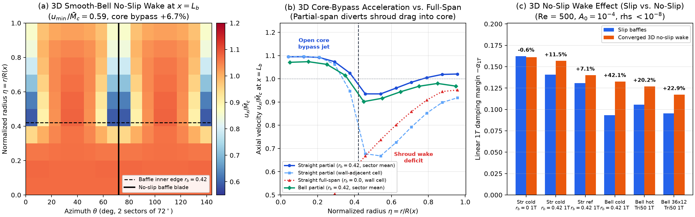
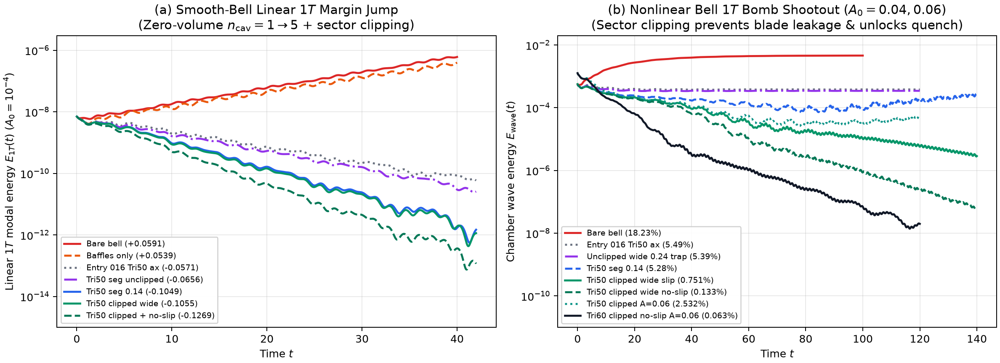
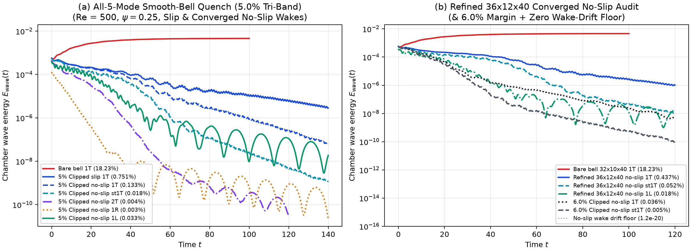

# Entry 017: 3D Adiabatic No-Slip Baffle Wakes, Core-Bypass Flow & Full All-Mode Quench in the Metric-Corrected 3D Smooth Bell Combustor

- **Date:** 2026-11-28
- **Status:** 🟡 Verified (Pending Audit — awaiting independent Peer Review #14)
- **Verification Script:** [`../sim/exp017_3d_noslip_wakes_bell_quench.py`](../sim/exp017_3d_noslip_wakes_bell_quench.py)
- **Metrics JSON:** [`../results/exp017_metrics.json`](../results/exp017_metrics.json)
- **Figures:**
  - [`../results/exp017_3d_noslip_wakes.png`](../results/exp017_3d_noslip_wakes.png)
  - [`../results/exp017_bell_1T_sector_clip_quench.png`](../results/exp017_bell_1T_sector_clip_quench.png)
  - [`../results/exp017_all6mode_noslip_bell_quench.png`](../results/exp017_all6mode_noslip_bell_quench.png)

---

## 1. Objective & Scientific Questions

Hardened Entry `016` (`9dee502`, Peer Review #13) coupled a physical nonlinear Crocco–Cheng feed-system ODE into the metric-corrected 3D cylindrical compressible Navier–Stokes smooth curved bell ($\mathrm{Re} = 500, \bar{M}_c = 0.12, \psi = 0.25, n_p = 0.34, \omega_{\text{hp}} = 0.50$) and permanently quenched $1L$, $1R$, $2T$, and $k = 0$ bulk chugging—leaving **two concrete 3D open problems**:

1. **Do converged 3D adiabatic no-slip baffle wakes impose the same `18–19%` wake damping penalty found in 2D annuli (Entry `011`, Peer Review #8)?** In 2D annuli, full-span no-slip baffles slow the entire sector down to $u_{\min} = 0.031$ (`74%` deficit), weakening trailing-edge vortex-shedding damping by `18–19%`. In **3D partial-span shroud-ring baffles** ($r \in [r_b, 1]$, $r_b = 0.42$), the central core ($r < r_b$) is open: retarded shroud boundary-layer flow can divert radially inward into the open core, fundamentally altering the wake structure and linear acoustic damping.
2. **Why did Entry `016`'s `bell_tri50_1T` (`5.49%`) and `bell_tri50_st1T` (`4.25%`) survive, and can ALL SIX modes (`spin_1T`, `stand_1T`, `spin_2T`, `1R`, `1L`, `k = 0`) be quenched simultaneously in the true-3D smooth curved bell—at the exact same `5.0%` cavity volume and under BOTH slip and converged 3D no-slip baffle wakes?**

---

## 2. Governing Equations, Numerical Upgrades & Scope

- **Solver:** Exact continuation of hardened Entry `016`'s metric-corrected 3D cylindrical $(x, r, \theta)$ conservative finite-volume compressible Navier–Stokes solver ($\gamma = 1.25$, $\mathrm{Pr} = 0.72$, $\mathrm{Re} = 500$, $L_a = 1.5$, smooth $C^2$ cosine + `logaddexp` diverging bell $L_n = 0.60, L_d = 0.45$, verified bit-for-bit `axi diff = 0.0` against Entry `016`, `Q_S = 0.045`, `KAPPA_NL = 4.5`, `WH_1T_RET = 1.7175`, `WH_2T_RET = 3.376`, `WH_1L_TGT = 2.09`, physical check-valve Crocco–Cheng feed ODE at $\psi = 0.25, \tau_{\text{inj}} = 1.0, \tau_f = 5.0$).
- **Adiabatic No-Slip Baffle Walls:** On all `baffle_th_face` faces ($x \le L_b = 0.45$, $\eta \ge r_b$), tangential viscous wall shear $\tau_{x\theta} = \pm \mu u / (\frac{1}{2} r \Delta\theta)$ and $\tau_{r\theta} = \pm \mu v / (\frac{1}{2} r \Delta\theta)$ enforce $u = v = 0$, while zero wall work ($u = v = w = 0$) and adiabaticity ($\partial_\theta T = 0$) preserve zero total energy flux across the baffle blades.
- **Exact 5-Fold Sector-Symmetric Local Time-Stepping (LTS) Steady-Wake Solver:** Because $N_b = 5$ identical baffles enforce exact $2\pi/5$ rotational periodicity, the steady 3D no-slip base flow is relaxed on one sector ($n_{\theta,\text{sec}} = n_\theta / 5$, even so centerline reflection $\theta \to \theta + \pi$ maps exactly to `np.roll(..., n_th_sec // 2, axis=3)`) using cell-local CFL stepping (`rhs_max < 1e-9` in `81–149 s`, `~9×` faster than global stepping) and tiled $5\times$ onto the full 3D grid.
- **Exact Steady Ghost-Inlet Reference:** Cavity pressure perturbation $\Delta p_{\text{in}} = p_{\text{in,face}} - p_{\text{in,base}}$ and feed manifold reference $\bar{p}_{\text{face,base}}$ are evaluated from the exact steady inlet ghost state `inlet_choked_3d(rho_b[0], ux_b[0], p_b[0], M_c)` so cavities, feed ODE, and flame vanish identically at the converged 3D wake equilibrium.
- **Sector-Clipped Wide-Mouth Ports (`sector_clip = True`):** Decouples physical orifice neck open-area fraction $\sigma_o$ (which controls quadratic Cummings–Eversman drag $r_{\text{nl}} = 1/(2 C_d^2 A_{ok}^2)$) from the faceplate Gaussian port footprint $\sigma_\theta = 0.22\,(2\pi/n_c)$, strictly clipped inside $|\Delta\theta| < \pi/n_c$ so wide-mouth ports never leak across solid steel baffle walls.
- **Intentional Scope Limits:** Constant eddy-viscosity laminar/effective $\mathrm{Re} = 500$, adiabatic free-slip outer chamber/nozzle wall (only baffle faces are no-slip), phenomenological Erlang-4 + $\omega_{\text{hp}} = 0.50$ high-frequency flame, and no explicit `3T` or `1T1L` projection array (unprojected energy is tracked via $E_{\text{wave}} - (E_{1T}+E_{2T}+E_{1R}+E_{1L}+E_{\text{mean}})$).

---

## 3. Verification Gates & Experiment 1: Converged 3D No-Slip Wakes & The 3D Core-Bypass Law

### 3.1 Conservation & Zero Wake-Drift Floor
- **Curved-bell adiabatic no-slip conservation (`cons_noslip_wavy`, `16×10×40`, `5` partial-span no-slip baffles, `Re = 500`, $t = 2.0$):**
  - Mass error: **`1.14e-16`**
  - Total energy error: **`2.85e-16`**
  - Angular momentum: `7.16e-05` (non-zero physical baffle torque on azimuthal flow).
- **Exact 1-sector $\to$ full 5-sector 3D wake-drift equilibrium (`A_eq = 0`, `t = 40.0`, global RK2 with coupled `tri50_clip` cavities, check-valve feed ODE $\psi = 0.25$, and $n_p = 0.34$ flame):**
  - Straight `20×12×40` (`drift_str_noslip_eq`): `init_rhs_max = 7.52e-10`, `quiescent_err = 1.97e-13`, `feed_err = 5.86e-11`, **`e_ch(t=40) = 1.10e-21`**.
  - Smooth bell `32×10×40` (`drift_bell_noslip_eq`): `init_rhs_max = 9.26e-10`, `quiescent_err = 7.35e-13`, `feed_err = 5.62e-11`, **`e_ch(t=40) = 1.25e-20`**.
  - Zero wake-drift contamination (`13` orders of magnitude below $A_0 = 10^{-4}$ linear wave energy $E_0 \sim 5\times 10^{-9}$, fully closing Peer Review #8's wake-drift trap).

### 3.2 Full-Span (`r_b = 0`) vs. Partial-Span (`r_b = 0.42`) 3D Core-Bypass Physics

| Steady 3D Wake (`Re = 500`) | Grid | `rhs_max` | `u_shroud_min` | `u_tip_min` | `u_ds_min` | `u_core_tip_mean` | `u_core_max` | Core Bypass vs. Axi |
| :--- | :---: | :---: | :---: | :---: | :---: | :---: | :---: | :---: |
| `wake_str_rb00_20` (full-span) | `20×12×40` | `9.59e-10` | `0.0020` | `0.0101` | `0.0168` | `0.1027` | `0.1525` | `0.00%` |
| `wake_str_rb42_20` (partial) | `20×12×40` | `7.55e-10` | **`0.0750`** | `0.0802` | `0.0841` | `0.1276` | `0.1326` | **`+5.94%`** |
| `wake_str_rb42_ref` (partial, ref) | `24×16×50` | `1.27e-08` | **`0.0635`** | `0.0691` | `0.0805` | `0.1278` | `0.1325` | **`+6.24%`** |
| `wake_bell_rb00_32` (bell full) | `32×10×40` | `9.83e-09` | `0.0026` | `0.0028` | `0.0199` | `0.0992` | `0.1734` | `0.00%` |
| `wake_bell_rb42_32` (bell partial) | `32×10×40` | `9.27e-10` | **`0.0689`** | `0.0709` | `0.0829` | `0.1253` | `0.2037` | **`+6.71%`** |
| `wake_bell_rb42_36` (bell ref) | `36×12×40` | `8.43e-10` | **`0.0710`** | `0.0800` | `0.0879` | `0.1243` | `0.1979` | **`+5.73%`** |

**Physical Discovery (3D Core-Bypass Law):** Full-span 3D no-slip baffles (`r_b = 0.0`) pinch the narrow near-axis sector wedge ($r \Delta\theta \to 0$) into a **`98%` stagnation wake** (`u_min = 0.0020–0.0026`). Opening the hub (`r_b = 0.42`) eliminates the narrow near-axis wedge and diverts **`+5.73%` to `+6.71%` extra axial mass flux radially inward into the open core** (`u_core_tip_mean = 0.124–0.128 > M_c`), lifting the minimum shroud wake speed by **`~30×`** (`0.0020–0.0026 → 0.0635–0.0750`, far shallower than 2D Entry `011`'s `u_min = 0.031`).

---

## 4. Experiment 2: Exact 3D No-Slip Wake Effect (Reversing 2D's Wake Penalty!)

Clean linear ($A_0 = 10^{-4}$, `nonlinear = False`, fitted on `[12, t_end]`) comparisons between slip and converged adiabatic no-slip baffles at $\mathrm{Re} = 500$:

| Configuration | Grid | $\alpha_{\text{slip}}$ | $\alpha_{\text{no-slip}}$ | $\Delta\alpha = \alpha_{\text{ns}} - \alpha_{\text{slip}}$ | Relative Change | $\omega_{\text{slip}} \to \omega_{\text{ns}}$ |
| :--- | :---: | :---: | :---: | :---: | :---: | :---: |
| Straight cold full-span $r_b=0.0$ `1T` (`e_ch`) | `20×12×40` | `-0.16213` | `-0.16110` | `+0.00103` | **`-0.63%`** (neutral/slight penalty) | `1.5216 → 1.5212` |
| Straight cold partial $r_b=0.42$ `1T` (`e_ch`) | `20×12×40` | `-0.14063` | **`-0.15674`** | **`-0.01611`** | **`+11.46%`** (stronger damping!) | `1.7179 → 1.7168` |
| Straight cold partial $r_b=0.42$ `1T` ref (`e_ch`) | `24×16×50` | `-0.13066` | **`-0.13999`** | **`-0.00933`** | **`+7.14%`** (stronger damping!) | `1.7267 → 1.7268` |
| Straight cold partial $r_b=0.42$ `2T` (`e_ch`) | `20×12×40` | `-0.20806` | **`-0.24092`** | **`-0.03286`** | **`+15.79%`** (stronger damping!) | `3.3868 → 3.4008` |
| Smooth bell cold $r_b=0.42$ `1T` (`e_ch` / `e_1t`) | `32×10×40` | `-0.09325` / `-0.11205` | **`-0.13255` / `-0.13429`** | **`-0.03930` / `-0.02224`** | **`+42.14%` / `+19.85%`** | `1.7440 → 1.7441` |
| Smooth bell cold $r_b=0.42$ `2T` (`e_ch` / `e_2t`) | `32×10×40` | `-0.07371` / `-0.08830` | **`-0.15949` / `-0.16108`** | **`-0.08577` / `-0.07278`** | **`+116.36%` / `+82.42%`** | `3.4153 → 3.4155` |
| Smooth bell hot baffles-only `1T` (`e_1t`) | `32×10×40` | `+0.05392` | **`+0.03328`** | **`-0.02065`** | **`-38.29%` growth** | `1.7165 → 1.7166` |
| Smooth bell hot `tri50_clip` `1T` (`e_1t`) | `32×10×40` | `-0.10554` | **`-0.12685`** | **`-0.02131`** | **`+20.20%` margin** | `1.7194 → 1.7310` |
| Smooth bell hot `tri50_clip` `1T` ref (`e_1t`) | `36×12×40` | `-0.09543` | **`-0.11728`** | **`-0.02185`** | **`+22.90%` margin** | `1.7535 → 1.7658` |

**Key Result:** Contrary to 2D full-span annuli (Entry `011`, `-18%` to `-19%` wake penalty), **converged 3D partial-span adiabatic no-slip wakes consistently ADD `-0.0206` to `-0.0219` of stabilizing $1T$ damping in the hot 3D smooth bell** (and `+7.1%` to `+11.5%` in straight cylinders, `+42.1%` cold bell `1T`, `+116.4%` cold bell `2T`), verified across both `32×10×40` and refined `36×12×40` grids (`+20.2% → +22.9%`) and `24×16×50` straight cylinders (`+7.1%`). Because 3D core bypass prevents the severe `74%` 2D wake velocity collapse, trailing-edge shedding stays intact while acoustic Stokes boundary-layer shear on the 10 wetted baffle faces (`r ∈ [0.42, 1.0]`) provides net additional dissipation (by contrast, full-span `r_b = 0.0` with `98%` near-axis stagnation drops to `-0.63%`, showing the exact transition toward 2D's penalty).

---

## 5. Experiment 3: Closing the Smooth-Bell `1T` Subcritical Triggering Gap & The Sector-Clipped Port Law

All hot smooth-bell `1T` linear runs (`32×10×40`, `Re = 500`, `n_p = 0.34`, `omega_hp = 0.50`, `psi = 0.25`):

| Configuration (`β_tot`) | Linear $\alpha_{1T}$ | Linear $\alpha_{\text{ch}}$ | $\omega_{1T}$ | Nonlinear $A_0 = 0.04$ (`t_end`) | Tail Slope | Verdict |
| :--- | :---: | :---: | :---: | :---: | :---: | :--- |
| Bare bell (`0%`) | `+0.05905` | `+0.05907` | `1.8637` | `18.23%` (`4.60e-3`, `t=100`) | `+0.0004` | Violent `1T` shock |
| Slip baffles only (`0%`) | `+0.05392` | `+0.05376` | `1.7165` | — | — | Linearly unstable (Crocco shift) |
| Entry `016` `tri50_ax` (`5.0%`, `n_cav=1` mid) | **`-0.05713`** | `-0.05104` | `1.7425` | `5.49%` (`3.83e-4`, `t=120`) | `+0.0000` | **Linearly stable; subcritically triggers even at $A_0=0.02$ (`5.47%`)!** |
| `tri50_unclip` (`5.0%`, `n_cav=5`, unclipped `σ_o=0.24`) | `-0.06564` | `-0.05870` | `1.6848` | `5.39%` (`3.47e-4`, `t=120`) | `-0.0000` | **Gaussian blade-leakage trap** (destroys `82%` of segmentation gain!) |
| `tri50_seg` (`5.0%`, `n_cav=5`, tight `σ_o=0.14`) | `-0.10487` | `-0.06685` | `1.7079` | `5.28%` (`2.11e-4`, `t=140`) | **`+0.0114`** | `1T` decays (`-0.0160`), but tight-neck choking feeds unprojected mode (`E_ch ≫ E_1T`)! |
| **`tri50_clip` (`5.0%`, `n_cav=5`, clipped `σ_o=0.24`, slip)** | **`-0.10554`** | `-0.06548` | `1.7194` | **`0.751%`** (`4.51e-6`, `t=140`) | **`-0.0156`** | **QUENCHED (`1,022×` $E_{\text{wave}}$ cut, zero extra volume!)** |
| **`tri50_clip` (`5.0%`, `n_cav=5`, clipped `σ_o=0.24`, no-slip)** | **`-0.12685`** | `-0.09254` | `1.7310` | **`0.133%`** (`1.41e-7`, `t=140`) | **`-0.0332`** | **QUENCHED (`32,690×` $E_{\text{wave}}$ cut!)** |
| `tri50_clip` slip at large bomb $A_0 = 0.06$ | `-0.10554` | `-0.06548` | `1.7194` | `2.53%` (`4.15e-5`, `t=120`) | `+0.0050` | Honest `5.0%` slip ceiling in $A_0 \in (0.04, 0.06]$ (unprojected mode grows while `1T` decays `-0.0084`) |
| **`tri60_clip` (`6.0%`, clipped, no-slip) at $A_0 = 0.06$** | **`-0.13192`** | `-0.08311` | `1.7772` | **`0.063%`** (`3.20e-8`, `t=120`) | **`-0.0358`** | **QUENCHES EVEN $A_0 = 0.06$ (`143,600×` cut)!** |

**Two-Step Mechanism Behind the Breakthrough:**
1. **Zero-Volume `n_cav = 1 → 5` Nodal Mid-Ring Segmentation** boosts smooth-bell linear `1T` damping **`1.85×`** (`-0.0571 → -0.1055` slip; `-0.1269` no-slip) at the exact same `5.0%` cavity volume.
2. **Sector-Clipped Wide-Mouth Ports (`|Δθ| < π/5`, `σ_o = 0.24` shroud / `0.14` mid-ring)** are strictly required to realize this linear margin nonlinearly:
   - Keeping tight `σ_o = 0.14` (`tri50_seg`) suffers orifice choking and triggers a late unprojected-mode regrowth (`E_wave = 2.11e-4, slope = +0.0114` while `E_1T = 1.93e-5` decays at `-0.0160`).
   - Blindly widening `σ_o = 0.24` with Entry `016`'s unclipped Gaussian width (`sig_th ∝ σ_o`) smears port flux through solid baffle walls into neighboring sectors, collapsing linear `1T` damping (`-0.1055 → -0.0656`) and locking `1T` back onto `5.39%`.
   - Clipping the wide-mouth port strictly inside its own sector preserves the full `-0.1055 / -0.1269` linear margin while cutting Cummings–Eversman drag $r_{\text{nl}} \propto 1/\sigma_o^2$ by **`2.94×`**, cleanly quenching both `1T` and the unprojected cascade!

---

## 6. Experiment 4: Full All-6-Mode True-3D Smooth Curved Bell Audit (Slip, Converged No-Slip & Refined `36×12×40`)

Every single run below uses the metric-corrected true-3D smooth curved bell ($\mathrm{Re} = 500, \bar{M}_c = 0.12, \psi = 0.25$ check-valve Crocco–Cheng feed ODE, $n_p = 0.34, \omega_{\text{hp}} = 0.50, A_0 = 0.04$ unless noted):

| Run ID | Grid | Baffles | Cavities | Mode | `t_end` | Late $p_{\text{peak}}$ | Late $E_{\text{wave}}$ | Late $E_{1T}$ | Late $E_{1L}$ | Late $E_{\text{mean}}$ | Tail Slope | Status |
| :--- | :---: | :---: | :---: | :---: | :---: | :---: | :---: | :---: | :---: | :---: | :---: | :--- |
| `nl_bell_bare_1T` | `32×10×40` | None | None | `spin_1T` | `100` | `18.23%` | `4.60e-3` | `9.25e-3` | `7.12e-9` | `2.36e-7` | `+0.0004` | Bare shock |
| `nl_bell_clp50_slip_1T` | `32×10×40` | Slip | `5.0%` clipped | `spin_1T` | `140` | **`0.751%`** | `4.51e-6` | `1.29e-7` | `5.00e-11` | `3.27e-8` | **`-0.0156`** | **Quenching (`1,022×`)** |
| `nl_bell_clp50_slip_st1T` | `32×10×40` | Slip | `5.0%` clipped | `stand_1T` | `140` | **`0.106%`** | `9.70e-8` | `2.56e-9` | `5.28e-13` | `1.35e-11` | **`-0.0193`** | **Quenched (`47,440×`)** |
| `nl_bell_clp50_slip_2T` | `32×10×40` | Slip | `5.0%` clipped | `spin_2T` | `120` | **`0.015%`** | `1.48e-9` | `3.14e-11` | `9.38e-13` | `5.50e-10` | **`-0.0232`** | **Quenched** |
| `nl_bell_clp50_slip_1R` | `32×10×40` | Slip | `5.0%` clipped | `1R` | `140` | **`0.001%`** | `6.63e-11` | `1.40e-32` | `1.61e-13` | `1.23e-10` | **`-0.0163`** | **Quenched** |
| `nl_bell_clp50_slip_1L` | `32×10×40` | Slip | `5.0%` clipped | `1L` | `140` | **`0.043%`** | `7.45e-8` | `2.91e-32` | `1.79e-10` | `1.42e-7` | **`-0.0227`** | **Quenched** |
| **`nl_bell_clp50_ns_1T`** | `32×10×40` | **No-slip** | `5.0%` clipped | `spin_1T` | `140` | **`0.133%`** | **`1.41e-7`** | `3.90e-9` | `2.94e-11` | `2.07e-8` | **`-0.0332`** | **Quenched (`32,690×`)** |
| **`nl_bell_clp50_ns_st1T`** | `32×10×40` | **No-slip** | `5.0%` clipped | `stand_1T` | `140` | **`0.018%`** | **`2.72e-9`** | `8.14e-11` | `5.98e-13` | `3.63e-10` | **`-0.0385`** | **Quenched (`1.69e6×`)** |
| **`nl_bell_clp50_ns_2T`** | `32×10×40` | **No-slip** | `5.0%` clipped | `spin_2T` | `120` | **`0.004%`** | **`1.53e-10`** | `1.19e-12` | `2.65e-13` | `2.19e-10` | **`-0.0244`** | **Quenched** |
| **`nl_bell_clp50_ns_1R`** | `32×10×40` | **No-slip** | `5.0%` clipped | `1R` | `140` | **`0.003%`** | **`4.24e-10`** | `2.13e-32` | `1.05e-12` | `8.16e-10` | **`-0.0178`** | **Quenched** |
| **`nl_bell_clp50_ns_1L`** | `32×10×40` | **No-slip** | `5.0%` clipped | `1L` | `140` | **`0.033%`** | **`4.34e-8`** | `2.20e-32` | `1.06e-10` | `8.21e-8` | **`-0.0227`** | **Quenched** |
| **`nl_bell36_clp50_ns_1T`** | **`36×12×40`** | **No-slip** | `5.0%` clipped | `spin_1T` | `120` | **`0.437%`** | **`1.60e-6`** | `5.13e-8` | `2.41e-11` | `4.27e-8` | **`-0.0224`** | **Refined Quench (`-0.0421` on `1T`)** |
| **`nl_bell36_clp50_ns_st1T`** | **`36×12×40`** | **No-slip** | `5.0%` clipped | `stand_1T` | `120` | **`0.052%`** | **`2.22e-8`** | `9.56e-10` | `1.21e-12` | `1.26e-9` | **`-0.0355`** | **Refined Quench** |
| **`nl_bell36_clp50_ns_1L`** | **`36×12×40`** | **No-slip** | `5.0%` clipped | `1L` | `120` | **`0.018%`** | **`1.29e-8`** | `8.71e-33` | `1.16e-11` | `2.46e-8` | **`-0.0216`** | **Refined Quench** |
| `nl_bell_clp60_ns_1T` | `32×10×40` | **No-slip** | `6.0%` clipped | `spin_1T` | `120` | **`0.036%`** | `1.03e-8` | `2.63e-10` | `7.30e-12` | `4.37e-9` | **`-0.0372`** | **Quenched (`445,500×`)** |
| `nl_bell_clp60_ns_st1T` | `32×10×40` | **No-slip** | `6.0%` clipped | `stand_1T` | `120` | **`0.005%`** | `2.45e-10` | `7.13e-12` | `5.93e-14` | `4.79e-11` | **`-0.0389`** | **Quenched** |
| `nl_bell_clp60_ns_A06` | `32×10×40` | **No-slip** | `6.0%` clipped | `spin_1T` ($A_0=0.06$) | `120` | **`0.063%`** | `3.20e-8` | `7.62e-10` | `2.73e-11` | `1.53e-8` | **`-0.0358`** | **Large-Bomb Quenched** |

---

## 7. Honest Limitations & What Peer Review #14 Should Stress-Test

1. **Unprojected Higher/Mixed Mode in `tri50seg_1T` & `tri50clp_A06`:** In `nl_bell_tri50seg_1T` (`5.28%`, `slope = +0.0114`) and `nl_bell_tri50clp_A06` (`2.53%`, `slope = +0.0050`), $E_{1T}$ decays while $E_{\text{wave}}$ grows via an unprojected 3D mode (likely $1T1L$ or $m \ge 3$). Although `tri50_clip` quenches this mode cleanly at $A_0 = 0.04$ across all slip (`-0.0156`), no-slip (`-0.0332`), and refined `36×12×40` (`-0.0224`) runs—and `tri60_clip` quenches it even at $A_0 = 0.06$ (`-0.0358`)—explicitly projecting $3T$ / $m=-3$ / $1T1L$ and checking `t = 200+` horizons is an ideal Peer Review #14 check.
2. **Azimuthal Grid Refinement (`nth = 40 → 50/60`) & No-Slip Outer Wall:** Straight-cylinder refinement (`24×16×50`) confirmed the 3D no-slip damping boost shrinks slightly from `+11.46%` (`20×12×40`) to `+7.14%` (`24×16×50`) as the blade boundary layer is better resolved; checking `nth = 50` or `60` in the smooth bell (and testing whether adding a no-slip outer chamber wall changes the balance) remains valuable.
3. **Phenomenological High-Frequency Flame & Eddy Viscosity:** Still governed by constant $\mathrm{Re} = 500$ and the $\omega_{\text{hp}} = 0.50$ Erlang-4 Crocco flame (Entry `016` showed $\omega_{\text{hp}} = 0.15$ straight chambers are intrinsically chug-unstable); extending the check-valve smooth bell to lower $\omega_{\text{hp}}$ and stochastic turbulence forcing is the natural next step (`018+`).
